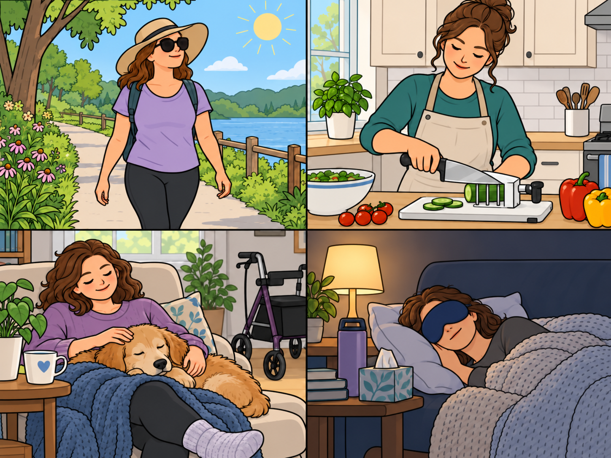

<!-- NAV-BREADCRUMB:START -->
[Home](../../README.md) › [Course](../README.md) › Part One: Understanding FND › [Module 1: What FND Is](README.md) › **Remission, Recovery, and What Improvement Can Mean**
<!-- NAV-BREADCRUMB:END -->

# Remission, Recovery, and What Improvement Can Mean

> **Working draft:** This page contains human authored and AI-assisted material and is looking for [contributors and reviewers](https://fndeducationproject.org/contact/).

This lesson explains remission, recovery and meaningful improvement in FND, including why getting better does not always mean that every symptom disappears.

One of the big questions after an FND diagnosis, perhaps once the initial shock has faded, is:

**"Can this go away?"**

It's an important question, and the answer is not always simple.

You may hear words such as *cure*, *remission*, *recovery* and *improvement*. Sometimes people use these words to mean the same thing, but they can describe very different experiences.

We'll explore treatments, [rehabilitation](../../glossary/README.md#rehabilitation) and long-term management in greater detail later.

> **A principle throughout this course:** FND symptoms may return or worsen regardless of what a person knows, tries or has achieved. The severity of someone's symptoms must never be used to judge their effort, acceptance of the diagnosis or personal progress.

---

[For the Person With FND](#for-the-person-with-fnd) 
[For Family, Friends, and Other Supporters](#for-family-friends-and-other-supporters) 
[For Clinicians and the Care Team](#for-clinicians-and-the-care-team) 
[Research and Sources](#research-and-sources)

---

## For the Person With FND
{: #for-the-person-with-fnd .shareable }

### Is there a cure for FND?

**There is no cure for FND.** By *cure*, we mean a treatment known to permanently remove the disorder so that it cannot return.

However, many people do improve. Some experience months or years without symptoms, while others continue to have symptoms or need substantial support.

Researchers are still learning why outcomes differ so much between individuals. (*citations* [1](#citation-1), [5](#citation-5), [6](#citation-6))

### What is remission?

In this course, **remission** means that symptoms become much milder or go away for a while.

We may hear two forms described:

- **Complete remission:** The symptoms being discussed are no longer present.
- **Partial remission:** The symptoms have improved considerably but remain present, or some symptoms have disappeared while others remain.

Some people experience remission lasting months or years. Others have shorter periods of improvement. Some have not experienced remission.

Remission can feel like being cured, but symptoms can return.

Studies describe outcomes across groups of people, using different definitions and follow-up periods. They cannot tell one person whether, or for how long, their symptoms will remit. (*citations* [1](#citation-1), [5](#citation-5), [6](#citation-6))

### What does recovery mean?

Recovery does not mean the same thing for everyone. It can mean having fewer symptoms, being able to do more or finding safer and more comfortable ways to live with symptoms.

Consider someone who still experiences functional seizures but now has better support at home, feels safer participating in activities and can spend more time with family.

Their seizures may not have disappeared, but important parts of their life have improved. Research on patient priorities supports looking beyond symptom counts when assessing improvement. (*citation* [3](#citation-3))

**Recovery does not have to mean that every symptom has disappeared.**

<figure class="image-60center" markdown="1">

<figcaption>Illustration: Meaningful improvement can include taking part in activities, using practical supports, enjoying company and resting comfortably.</figcaption>

</figure>

### Recovery can also mean something smaller

There's another way we use the word *recovery* in everyday life.

For instance, I might say:

> "After a functional seizure, I need a few days to recover."

— *Lived experience*

Here, recovery means getting back to your usual level after an episode. It does not mean that the FND itself has gone away.

This personal example does not set a recovery timetable for anyone else. The time and support someone needs after an episode can differ.

In this context, recovery means becoming more stable again, rather than permanently overcoming the disorder.

Recognizing this difference is important because **returning to your usual level after a difficult episode is not the same thing as entering remission.**

### What happens if symptoms return?

FND doesn't follow one predictable path.

Some people improve over time. Some feel better for a while and then have symptoms again. Others have symptoms that change from one day to the next or continue to affect daily life in serious ways.

Symptoms can come back even when you have worked hard and made progress. A flare does not erase what you have learned or mean that you have failed.

For example, someone who has become more independent may still experience a severe flare. The knowledge, support, equipment and adaptations they've developed can remain valuable.

A return of symptoms does not necessarily mean FND is progressing or that future improvement is impossible.

It also cannot tell us whether the person has accepted the diagnosis, worked hard enough or followed their treatment plan. (*citations* [1](#citation-1), [2](#citation-2), [5](#citation-5))

**Symptoms can change independently of the effort someone has made.**

### What if my symptoms don't improve?

Living with symptoms that do not improve can be discouraging.

It may also mean that everyday life needs to be organized differently from what you once expected.

You may need help, a mobility aid, changes at home, a different way to communicate or changes to your usual activities. These supports can make daily life safer and more comfortable. Using them does not mean that you have given up.

Some people find that their most important improvements concern independence, relationships, participation or quality of life rather than symptom reduction.

The goal is not to convince yourself that difficult symptoms don't matter.

It's to recognize that **your wellbeing matters even when those symptoms remain.**

### Questions to reflect on

If one part of your health or everyday life could improve, which change would mean the most to you?

What would recovery mean to you if some of your symptoms remained?

### One small step

Choose one sign of improvement that would make a meaningful difference to your life.

It might be something related directly to your symptoms, such as shorter episodes or less pain.

Or it could be something else:

- Feeling safer during an everyday activity.
- Preparing part of a meal.
- Spending more time with someone you care about.
- Becoming more comfortable asking for help.
- Returning to your usual level more easily after an episode.

If you wish, write down one sentence describing that improvement.

You don't need to track it every day. It's simply a way to recognize something that matters to you.

### Optional learning activity

<a href="{{ '/puzzles/' | relative_url }}?collection=crosswords&amp;puzzle=lesson-3">Browse crosswords for this lesson</a> · <a href="{{ '/puzzles/' | relative_url }}?collection=colouring&amp;puzzle=lesson-3">Browse colouring pages for this lesson</a>

Choose a crossword edition below, or select the preview to browse the collection. These activities are optional.

<a class="puzzle-card" href="{{ '/puzzles/' | relative_url }}?collection=crosswords&amp;puzzle=lesson-3" aria-label="Browse the crossword for Lesson 3">
  
  Lesson 3 crossword
</a>

<a href="{{ '/assets/puzzles/crosswords/Module-1-Lesson-3/remission-and-recovery-m1-3-easy.pdf' | relative_url }}" target="_blank" rel="noopener" aria-label="Easy crossword PDF for Lesson 3 (opens in a new tab)">Easy</a>
<a href="{{ '/assets/puzzles/crosswords/Module-1-Lesson-3/remission-and-recovery-m1-3-normal.pdf' | relative_url }}" target="_blank" rel="noopener" aria-label="Normal crossword PDF for Lesson 3 (opens in a new tab)">Normal</a>
<a href="{{ '/assets/puzzles/crosswords/Module-1-Lesson-3/remission-and-recovery-m1-3-answer-key.pdf' | relative_url }}" target="_blank" rel="noopener" aria-label="Answer key crossword PDF for Lesson 3 (opens in a new tab)">Answer key</a>

PDFs open in a new tab. Easy includes a word bank.

#### Colouring page

<a class="puzzle-card" target="_blank" rel="noopener" title="Opens PDF in a new tab or window" href="{{ '/assets/puzzles/colouring/lesson-3-coloring-book.pdf' | relative_url }}">
  
  Recovery — Colouring page <small>PDF</small>
</a>

---

[For the Person With FND](#for-the-person-with-fnd) 
[For Family, Friends, and Other Supporters](#for-family-friends-and-other-supporters) 
[For Clinicians and the Care Team](#for-clinicians-and-the-care-team) 
[Research and Sources](#research-and-sources)

---

## For Family, Friends, and Other Supporters
{: #for-family-friends-and-other-supporters .shareable }

Thank you for supporting someone through their experience with FND.

It's natural to hope that the person you care about will get better. You may also wonder what you can do to help.

One of the most useful things you can do is **ask what recovery means to them.**

Their priorities might be different from yours.

### Recovery is personal

For someone experiencing several functional symptoms, recovery might initially mean getting through the day safely.

For another person, it could mean returning to work, walking independently or spending time with friends.

Someone who has recently received a diagnosis may first need time to understand what's happening and adjust to the changes in their life.

The person's priorities may change over time, too.

Try to build goals together rather than deciding what their recovery should look like.

### Support and independence

Many people living with FND place considerable value on independence, comfort, safety and relationships.

Helping someone maintain these aspects of life can make a meaningful difference.

This might involve making the home more accessible, helping with transportation, arranging assistance or finding suitable mobility equipment.

Expert guidance for physiotherapy and occupational therapy cautions that aids can sometimes interfere with movement rehabilitation or cause secondary problems. Both sets of guidance also recognize a role for equipment when disability persists.

The occupational therapy guidance recommends assessing each situation individually. Equipment may be needed for safety, and aids or adaptations can support independence and community access when disability continues after rehabilitation. Decisions should consider the person's needs, goals and safe use of the equipment. (*citations* [2](#citation-2), [4](#citation-4))

**Making life safer and more accessible is worthwhile whether or not symptoms improve.**

Someone should not have to demonstrate that an accommodation will reduce their FND symptoms before receiving help with a genuine need.

### When symptoms return

If the person experiences a flare or [relapse](../../glossary/README.md#relapse--setback), it can be disappointing for everyone involved.

You may wonder whether something went wrong or whether the progress you saw has been lost.

However, symptoms returning does not mean that previous improvements were meaningless.

The person may still have gained knowledge, skills, confidence or useful support.

When symptoms return, focus first on what the person needs now.

Perhaps they need more rest, assistance, a quieter environment or medical advice about a new symptom.

Try not to turn recovery into an expectation that every setback must be prevented.

### Supporting hope without pressure

Hope can be encouraging, but it can also become a source of pressure when someone feels expected to recover.

Statements such as "You were doing so well!" may be intended kindly, yet someone experiencing a relapse might hear them as disappointment.

You can acknowledge the difficulties of the present without assuming the future will always be the same.

And you can recognize meaningful improvements without expecting those improvements to continue uninterrupted.

**Supporting someone means caring about their wellbeing now, not only about who they might become if their symptoms improve.**

For further reading, our [Recovery Pressure, Self-Blame, and Feeling Like You Are Failing](../../reference/biopsychosocial-experiences/06-recovery-pressure-self-blame-and-feeling-like-you-are-failing.md) page explores the emotional effects of recovery expectations.

---

[For the Person With FND](#for-the-person-with-fnd) 
[For Family, Friends, and Other Supporters](#for-family-friends-and-other-supporters) 
[For Clinicians and the Care Team](#for-clinicians-and-the-care-team) 
[Research and Sources](#research-and-sources)

---

## For Clinicians and the Care Team
{: #for-clinicians-and-the-care-team .shareable }

### What does recovery mean for this patient?

Clinicians play an important role in shaping how patients understand their prognosis and what improvement might look like.

A useful starting point is to distinguish several outcomes that are related but not interchangeable. The table describes how this course uses the terms; studies may define or measure them differently.

| Outcome | Meaning |
|---|---|
| **Symptom remission** | Some or all of the symptoms being considered become absent or substantially less active for a period. |
| **Symptom improvement** | Symptoms become less frequent, less severe or shorter in duration. |
| **Functional improvement** | The patient can do more, participate more or become more independent, whether or not symptoms remain. |
| **Personal recovery** | Improvement in aspects of life that matter to the patient, such as confidence, safety, relationships, identity, independence or quality of life. |
| **Recovery after an episode** | Returning toward the patient's usual level after a functional seizure, flare or other temporary deterioration. |

These outcomes overlap, but progress in one area does not guarantee progress in another.

For example, a patient may experience fewer functional seizures without a meaningful improvement in community participation. (*citation* [5](#citation-5))

Another patient may continue to experience frequent symptoms while gaining substantial independence through equipment, rehabilitation or practical support.

Research into FND outcome measurement emphasizes including patients' own experiences alongside clinical observations and symptom measures. (*citation* [3](#citation-3))

### Communicating prognosis

Prognosis is an important part of the clinical conversation, but it needs to be handled carefully.

Studies of functional motor symptoms have reported widely differing outcomes. More recent systematic reviews have also explored factors associated with prognosis and treatment response, including symptom duration. (*citations* [1](#citation-1), [5](#citation-5), [6](#citation-6))

Group-level associations, however, cannot predict an individual's future with certainty.

Longer symptom duration was associated with smaller average gains in some motor and physical quality-of-life outcomes in the treatment review, but meaningful improvement remained possible. Duration alone should not be used to rule out treatment. (*citation* [6](#citation-6))

A patient may have experienced substantial disability for many years and still benefit from treatment, rehabilitation, accommodations or other support. (*citations* [2](#citation-2), [6](#citation-6))

A useful explanation might be:

> Improvement is possible, but we cannot predict exactly how much, how quickly or how permanently you will improve. Some people experience long periods of remission. Others improve partly, have recurring symptoms or continue to need substantial support. We can discuss what improvement would mean for you and what options are available.

This avoids two problematic extremes:

- "You will recover if you accept the diagnosis and work hard enough."
- "You have had FND for too long, so nothing can help."

Neither statement is an appropriate individual prediction.

### The effect of prognosis language

How clinicians communicate prognosis can have lasting consequences for patients.

For example, a psychologist reviewing my case on behalf of an insurer wrote:

> "The longer conversion symptoms are present, the worse the prognosis."

A later neuropsychiatric assessment also linked concerns about my prognosis to the duration of symptoms and a history of trauma.

— *Lived experience*

These experiences illustrate why careful language matters. The existence of a possible prognostic association does not justify treating an individual outcome as predetermined.

Clinicians can discuss evidence about poorer average outcomes in some groups without turning statistical associations into fixed expectations for a particular patient.

### Setting meaningful goals

Clinical goals should reflect what matters to the patient, not only what is easiest to measure.

This may include improvements in movement, seizure frequency, speech, pain or fatigue.

But it can also include returning to valued activities, gaining independence, improving accessibility or reducing the disruption caused by an episode.

Consider asking:

**"What is the most important thing you would like to be able to do more comfortably, safely or independently?"**

A small number of patient-chosen goals can help guide treatment and make progress easier to recognize.

These goals may need to change as symptoms, life circumstances, health or access to care change.

### Supporting recovery when improvement is limited

Some patients will not experience substantial symptom improvement, despite receiving appropriate care.

This does not establish that they have failed to participate, misunderstood their diagnosis or lacked motivation.

Continued care may still address symptom relief, safety, accessibility, communication, participation, mental health, quality of life and caregiver needs.

Clinicians should also remain attentive to new or substantially changed symptoms rather than assuming they are necessarily another manifestation of FND. (*citation* [7](#citation-7))

The [Recovery Techniques collection](../../reference/recovery-techniques/README.md) organizes approaches by symptom, including supporting evidence and important limitations.

These resources can help identify possible options for discussion. They cannot determine which treatment will be most appropriate for an individual patient.

**Recovery is not a single yes-or-no outcome.**

A clinician's role includes helping patients understand their options, defining meaningful goals together, communicating uncertainty and continuing to provide appropriate care when symptoms remain.

---

[For the Person With FND](#for-the-person-with-fnd) 
[For Family, Friends, and Other Supporters](#for-family-friends-and-other-supporters) 
[For Clinicians and the Care Team](#for-clinicians-and-the-care-team) 
[Research and Sources](#research-and-sources)

---

<!-- NAV-CONTEXT:START -->
**Continue:** [Next page: Available Capacity, Spoons, and Early Action](04-available-capacity-spoons-and-early-action.md)

**Navigate:** [Home](../../README.md) · [Course](../README.md) · [Reference Library](../../reference/README.md) · [Site Map](../../SITEMAP.md)
<!-- NAV-CONTEXT:END -->

## Research and Sources
{: #research-and-sources .shareable }

This lesson introduces current understandings of prognosis, remission, functional outcomes and patient-centred recovery.

Studies of different FND symptom groups may report different outcomes. Research findings should therefore be interpreted with attention to the people studied, the outcomes measured and the limits of individual prediction.

### Three focused research quotations

Gelauff and colleagues reviewed outcomes in functional motor symptoms. The studies differed in their populations, follow-up and methods; this is not a prediction for an individual or every FND presentation.

> "Reported symptom outcome was highly variable."

*Figure 1.* Gelauff et al., 2014, abstract, Results. [1](#citation-1)

Nicholson and colleagues discuss flexible goal setting in occupational therapy. This is consensus guidance about a possible course of symptoms, not a measured rate or duration of remission.

> "recovery often follows a pattern of symptom remission and exacerbation."

*Figure 2.* Nicholson et al., 2020, supplementary long version, p. 3, goal-setting discussion. [2](#citation-2)

Rutten and colleagues interviewed patients, caregivers and healthcare professionals about outcome measurement. Here, "all" refers to the participants in that qualitative study, not everyone with FND.

> "all believed that the patient's subjective experience should be central."

*Figure 3.* Rutten et al., 2025, abstract, Results. [3](#citation-3)

### Citation table

| Citation | Source | Figure | Supports / limits |
|---|---|---|---|
| **[1]** | Gelauff J, Stone J, Edwards M, Carson A. The prognosis of functional (psychogenic) motor symptoms: a systematic review. *Journal of Neurology, Neurosurgery & Psychiatry*. 2014;85(2):220–226. [FND-CIT-0007](../../research/citation-index.md#fnd-cit-0007). [DOI](https://doi.org/10.1136/jnnp-2013-305321). | Figure 1 | Systematic review of motor-symptom prognosis; variable group outcomes, not individual predictions. |
| **[2]** | Nicholson C, Edwards MJ, Carson AJ, et al. Occupational therapy consensus recommendations for functional neurological disorder. *Journal of Neurology, Neurosurgery & Psychiatry*. 2020;91(10):1037–1045. [FND-CIT-0011](../../research/citation-index.md#fnd-cit-0011). [DOI](https://doi.org/10.1136/jnnp-2019-322281). | Figure 2 | Occupational therapy consensus: flexible goals, equipment and continuing support. Quote from the [supplementary long version](https://neurosymptoms.org/wp-content/uploads/2020/12/jnnp-2019-322281-inline-supplementary-material-1.pdf), p. 3; equipment discussion p. 5. |
| **[3]** | Rutten S, Bradley-Westguard A, Nicholson TR, Pick S. Outcome measurement in functional neurological disorder: a qualitative study on the views of patients, caregivers and healthcare professionals. *Journal of Neurology*. 2025;272:189. [FND-CIT-0012](../../research/citation-index.md#fnd-cit-0012). [DOI](https://doi.org/10.1007/s00415-025-12912-9). | Figure 3 | Qualitative stakeholder views on meaningful outcomes; not treatment efficacy. |
| **[4]** | Nielsen G, Stone J, Matthews A, et al. Physiotherapy for functional motor disorders: a consensus recommendation. *Journal of Neurology, Neurosurgery & Psychiatry*. 2015;86(10):1113–1119. [FND-CIT-0028](../../research/citation-index.md#fnd-cit-0028). [DOI](https://doi.org/10.1136/jnnp-2014-309255). | — | Physiotherapy consensus on movement rehabilitation and individualized equipment decisions. |
| **[5]** | Sekine ER, Kanaan RA, McMillan J, Oxford S, Iles RA. Biopsychosocial prognostic indicators in Functional Neurological Disorder: a systematic review. *Journal of Psychosomatic Research*. 2025;195:112201. [FND-CIT-0017](../../research/citation-index.md#fnd-cit-0017). [DOI](https://doi.org/10.1016/j.jpsychores.2025.112201). | — | Systematic review of prognostic associations; seizure-frequency change and participation are distinct outcomes. |
| **[6]** | Thomas ST, Thomas ET, Schembri E, Lehn AC, Palmer DDG. Treatment outcomes in functional neurological disorder: a systematic review and meta-analysis exploring the influence of symptom chronicity. *BMJ Neurology Open*. 2025;7(2):e001150. [FND-CIT-0051](../../research/citation-index.md#fnd-cit-0051). [DOI](https://doi.org/10.1136/bmjno-2025-001150). | — | Treatment review and meta-analysis: chronicity and average treatment outcomes; not a personal prognosis. |
| **[7]** | Dworetzky BA, Baslet G. Functional neurological disorder: Practical management. *Neurotherapeutics*. 2025;22(4):e00612. [FND-CIT-0013](../../research/citation-index.md#fnd-cit-0013). [DOI](https://doi.org/10.1016/j.neurot.2025.e00612). | — | Practical clinical review: coexisting conditions and reassessment of new symptoms. |

*First-pass editorial and source review: 13 October 2026. Working draft; further clinical and community review is welcome.*
