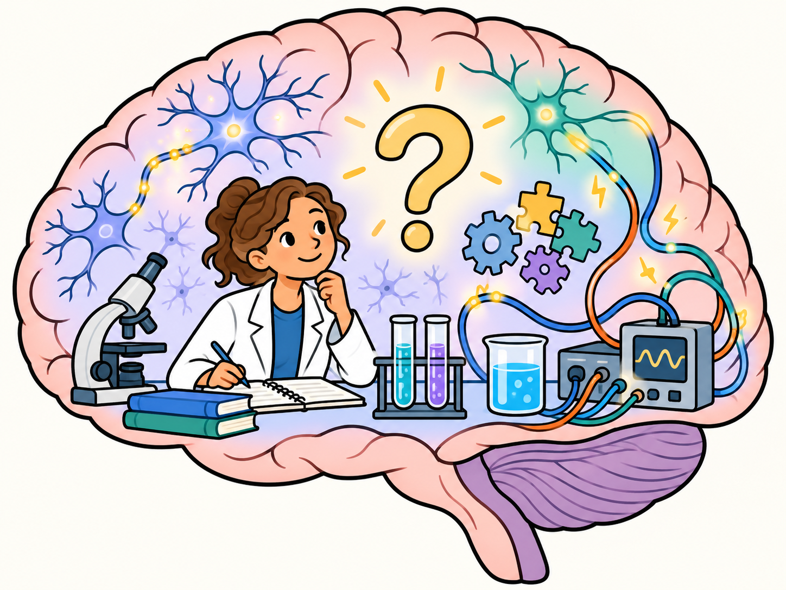

<!-- NAV-BREADCRUMB:START -->
[Home](../../README.md) › [Course](../README.md) › Part One: Understanding FND › [Module 3: Causes, Mechanisms, and Honest Uncertainty](README.md) › **Causes, Risk Factors, Triggers, and Maintaining Factors**
<!-- NAV-BREADCRUMB:END -->

# Causes, Risk Factors, Triggers, and Maintaining Factors

> **Working draft:** Human authored revision; editorial and evidence audits completed. Clinical review pending. [Contributors and reviewers](https://fndeducationproject.org/contact/) are welcome.

This lesson explores why FND may begin, how symptoms may happen, and what can affect them today. Learn how causes, risk factors, triggers and current influences differ.

---
[For the Person With FND](#for-the-person-with-fnd) 
[For Family, Friends, and Other Supporters](#for-family-friends-and-other-supporters) 
[For Clinicians and the Care Team](#for-clinicians-and-the-care-team) 
[Research and Sources](#research-and-sources)
---

## For the Person With FND
{: #for-the-person-with-fnd .shareable }

### Why did my FND begin?

You may have questions such as:

Could an illness have played a part? What may explain movement difficulties when my muscles can still work? How are functional seizures related to, or different from, panic attacks?

These questions matter. Research has taught us a lot about FND, and researchers are still building a fuller explanation of each person’s experience.

This lesson separates two big questions:

- What may have played a part when my FND began?

- What may be affecting my symptoms now?

Keeping these questions separate can make FND easier to understand. [Lesson 8](02-brain-networks-prediction-attention-and-agency.md) will look more closely at the different ways the nervous system may be involved.

### What is a cause?

A cause is something that helps bring about an outcome. To identify a cause, researchers look at what happened first and seek evidence that it contributed.

Imagine a person who first develops one or more FND symptoms while they have an infection.

The infection came before the symptoms. It may have been a trigger—an event linked closely to the start of symptoms.

The timing gives us a clue. Evidence that the infection contributed would be needed to identify it as a cause.

**Key idea:** What happened first is an important clue. Evidence helps us decide what role it may have played.

### What is a mechanism?

A mechanism is a process that produces a symptom. Different symptoms may involve different mechanisms. The term answers the question: How might this symptom happen?

Researchers are studying whether changes in the way brain networks work together may help explain some FND symptoms. This research may teach us about mechanisms. Understanding the cause of one person’s FND also requires evidence from that person’s experience and assessment. (*citations* [1](#citation-1), [2](#citation-2))

A trigger and a mechanism answer different questions. A trigger is connected with when one or more symptoms began. A mechanism describes how a particular symptom may happen.

<figure class="image-60center" markdown="1">

<figcaption>Researchers are investigating how FND symptoms happen. This imaginative scene represents scientific questions, rather than a proven explanation of one person's FND.</figcaption>

</figure>

### What is a risk factor?

A risk factor is something linked with a greater chance of developing a condition in a group of people.

A risk factor describes a pattern across a group. Each person can have a different mix of risk factors, symptoms and experiences, so individual evidence is needed to understand its possible role. (*citations* [1](#citation-1), [2](#citation-2))

**Main question:** What do we know about how my FND began, and what are we still learning?

### Can FND begin in different ways?

Yes. Some people first notice one or more symptoms during an illness, after an injury, or near a stressful time. Other people remember an ordinary period with no clear change around the start. (*citations* [1](#citation-1), [2](#citation-2), [4](#citation-4))

One community member described a new symptom this way:

> “This tremor just came out of nowhere.”

— *Lived experience (excerpt):* the writer described a new tremor after earlier symptoms had improved. [Read the public source](https://www.reddit.com/r/FND/comments/1dde4p6/my_journey_with_functional_neurological_disorder/).

Stress and trauma can matter for some people. People can develop FND with or without a history of stress or trauma. Each person’s history can be different. (*citations* [1](#citation-1), [2](#citation-2))

Your symptoms and experiences are real while understanding of how they began continues to develop.

### What may be affecting my symptoms now?

Return to the person who noticed one or more symptoms during an infection.

Months later, the infection has cleared. The person notices that better sleep helps with some symptoms or daily activities.

Sleep may be affecting their experience now. The cause of their FND remains a separate question.

A [maintaining factor](../../glossary/README.md#predisposing-precipitating-perpetuating-and-protective-factors) is something that may help a symptom or difficulty continue after it has begun.

Pain may be a maintaining factor for one person. Migraine may matter for another. These may also be separate health concerns that deserve care of their own. (*citations* [5](#citation-5), [6](#citation-6))

Some people describe [sensory overload](../../reference/biopsychosocial-experiences/05-unpredictability-overload-and-trusting-your-body.md) affecting certain symptoms or daily activities. Each person can have a different pattern.

Another community member wrote:

> “My FND symptoms, especially risk of seizures, get worse around sensory overload.”

— *Lived experience (excerpt):* the writer described their own pattern. Other people may experience different symptoms, triggers or responses. [Read the public source](https://www.reddit.com/r/FND/comments/1bpx5du/comment/kwymlh2/).

Some people notice clear patterns in one or more symptoms. Other people experience symptoms that change in less predictable ways. Both experiences deserve care.

**Main question:** What could make my symptoms or daily life easier today?

<figure class="image-60center" markdown="1">

<figcaption>A timeline can show when something happened. Timing offers one clue, and further evidence helps explain its role.</figcaption>

</figure>

### Can treatment help while the cause is still being understood?

Yes. Care can focus on the symptoms and activities that matter to you now while understanding of the original cause continues to develop.

For example, treating [migraine](../../reference/co-occurring-conditions/01-migraine.md) may make daily life easier for a person who has both migraine and FND. Improvement is useful evidence about what helps that person now, while the original cause remains a separate question. (*citation* [6](#citation-6))

Researchers are studying how brain activity, signalling and chemistry may be involved in different functional symptoms. [Lesson 8 explores this research, including brain chemistry](02-brain-networks-prediction-attention-and-agency.md#could-the-chemicals-in-my-brain-have-changed), and what its findings may mean.

**Key idea:** Useful care can begin now, while your personal explanation continues to develop.

### Pause and think

Start with one question:

What do I remember about the time my FND began?

Your answer might be an illness, an injury, a stressful time, nothing unusual or “I do not know yet.” Each answer is useful information.

Then consider a second question:

What affects my symptoms or daily activities now?

Different symptoms may have different patterns, and your answers can change over time.

If you feel comfortable, you might also ask:

How does it feel to have some answers and some uncertainty?

You can skip this question or return to it another day.

### One small step

Choose one question to ask your clinician:

> “What do we understand about how my symptoms began, and what are we still learning?”

One question is enough to begin. New or very different symptoms are also important to have medically assessed.

### Optional learning activity

You can try the Lesson 7 crossword to revisit causes, risk factors, triggers and what researchers are still learning. The easy version includes a word bank.

<a href="{{ '/puzzles/' | relative_url }}?collection=crosswords&amp;puzzle=lesson-7">Browse this crossword in the puzzles collection</a>.

<a class="puzzle-card" href="{{ '/puzzles/' | relative_url }}?collection=crosswords&amp;puzzle=lesson-7" aria-label="Browse the Lesson 7 crossword">
  
  Lesson 7 crossword
</a>

<a href="{{ '/assets/puzzles/crosswords/Module-3-Lesson-7/causes-risk-factors-and-triggers-m3-7-easy.pdf' | relative_url }}" target="_blank" rel="noopener" aria-label="Easy crossword PDF for Lesson 7 (opens in a new tab)">Easy</a>
<a href="{{ '/assets/puzzles/crosswords/Module-3-Lesson-7/causes-risk-factors-and-triggers-m3-7-normal.pdf' | relative_url }}" target="_blank" rel="noopener" aria-label="Normal crossword PDF for Lesson 7 (opens in a new tab)">Normal</a>
<a href="{{ '/assets/puzzles/crosswords/Module-3-Lesson-7/causes-risk-factors-and-triggers-m3-7-answer-key.pdf' | relative_url }}" target="_blank" rel="noopener" aria-label="Answer key PDF for Lesson 7 (opens in a new tab)">Answer key</a>

PDFs open in a new tab. Easy includes a word bank.

### Optional colouring activity

Choose the preview to open the printable PDF in a new tab or window. Select landscape orientation and fit to page when printing. You can also browse the <a href="{{ '/puzzles/' | relative_url }}?collection=colouring&amp;puzzle=lesson-7">colouring-page collection</a>.

<a class="puzzle-card" target="_blank" rel="noopener" title="Opens PDF in a new tab or window" href="{{ '/assets/puzzles/colouring/lesson-7-coloring-book.pdf' | relative_url }}">
  
  Lesson 7: Exploring questions about FND — Colouring page <small>PDF</small>
</a>

---
[For the Person With FND](#for-the-person-with-fnd) 
[For Family, Friends, and Other Supporters](#for-family-friends-and-other-supporters) 
[For Clinicians and the Care Team](#for-clinicians-and-the-care-team) 
[Research and Sources](#research-and-sources)
---

## For Family, Friends, and Other Supporters
{: #for-family-friends-and-other-supporters .shareable }

### Why the question matters

A person with FND may be trying to understand what happened to their body. A clear explanation can help them feel believed and more prepared to take part in their care.

Sometimes there is no complete answer yet. In that space, family members or friends may form explanations based on an illness, an injury, stress or a past experience.

These ideas may come from care and concern. It is still helpful to separate what is known from what is possible.

In the earlier example, the person first noticed symptoms during an infection. The timing is known; the infection’s possible role is still being understood.

This distinction can protect the person from feeling blamed or pressured to accept an explanation that has not been established. It can also help supporters share accurate information with the care team.

A useful starting point is curiosity:

- “What have you been told so far?”

- “Which parts make sense, and which parts are still unclear?”

Curious questions give the person room to describe their own understanding and decide what support would be useful.

### Understanding the beginning and the present

Two separate questions can guide supportive conversations.

#### What happened near the beginning?

In the continuing example, dates of the infection, the first symptoms and medical appointments may help the clinician understand the timeline.

A supporter may remember details that the person missed or found difficult to record. Sharing those details—with the person’s permission—can strengthen the history available to the care team.

#### What affects the person now?

Later, the infection has cleared. The person notices that better sleep helps with some symptoms or daily activities.

This present-day pattern can guide practical support. For example, a calmer evening routine may make rest easier if that is something the person wants to try.

Another person may find that migraine care, quieter surroundings or planned breaks are more relevant. FND symptoms and helpful supports vary from person to person.

Understanding what helps now can improve comfort, access and participation. It also keeps current care separate from theories about how FND began.

### Why changes in symptoms matter

Symptoms can vary across people and can also change over time.

A change may offer useful information about sleep, pain, sensory demands, activity or another health concern. It reflects the person’s current experience rather than their effort or willpower. (*citations* [1](#citation-1), [6](#citation-6))

Noticing patterns together may help the person explain their experience at appointments. It may also help the care team choose which concerns to assess or address first.

### Supporting clearer conversations with clinicians

Some people find appointments tiring or cognitively demanding. A trusted supporter can make information easier to follow when the person welcomes that help.

Questions such as these can organize the conversation:

- “What do we understand about how these symptoms may happen?”

- “Which parts of the explanation are well supported, and which are still being studied?”

- “What could help with the symptoms or activities that matter most right now?”

These questions separate current knowledge, developing research and practical care. That separation can make the plan easier to understand and remember.

Listening first keeps the person’s goals at the centre. With permission, a supporter may help take notes, check understanding or remember the next step.

New or substantially different symptoms are important to have medically assessed. This allows the care team to consider FND alongside any other health concern that may need attention.

---
[For the Person With FND](#for-the-person-with-fnd) 
[For Family, Friends, and Other Supporters](#for-family-friends-and-other-supporters) 
[For Clinicians and the Care Team](#for-clinicians-and-the-care-team) 
[Research and Sources](#research-and-sources)
---

## For Clinicians and the Care Team
{: #for-clinicians-and-the-care-team .shareable }

### Three questions, three kinds of evidence

When a patient asks, “Why did I develop FND?”, the question may contain several parts.

- One part concerns onset: what was happening when one or more symptoms began?

- Another concerns mechanism: which processes may help explain how a particular symptom happens?

- A third concerns current influences: what may be shaping symptoms, function or participation now?

Naming these questions separately can make the explanation easier to follow.

The continuing example helps show the distinction.

The patient first noticed functional symptoms during an infection. This timing is an observation supported by the history.

The infection may have played a role in onset. That possibility is a causal hypothesis, which can be considered alongside evidence from the individual assessment.

Changes in motor control, attention, awareness or other neural processes are candidate mechanisms. Different symptoms may involve different combinations of processes.

Later, the infection has cleared. Sleep, pain or migraine may now influence some symptoms or daily activities. They may also be separate diagnoses with care needs of their own.

The patient can therefore have evidence about timing, possible onset factors, mechanisms and current influences at the same time. Each type of evidence answers a different question. (*citations* [1](#citation-1), [2](#citation-2), [5](#citation-5), [6](#citation-6))

This structure gives the patient a clear account of what has been observed, what research may explain and what remains under investigation.

### What the research establishes

Hallett and colleagues’ 2022 clinical review describes multiple FND presentations and developing accounts of shared neurological processes. (*citation* [2](#citation-2))

The review supports understanding symptoms as involuntary changes in function. It also describes variation across symptoms and patients.

This evidence provides a foundation for discussing possible mechanisms while keeping the explanation specific to the individual.

Pick and colleagues’ 2019 review places emotional processing within a biopsychosocial research model. It describes testable relationships between emotional and neurological processes. (*citation* [3](#citation-3))

The model provides possible pathways for research and formulation. The person’s history and assessment help clinicians consider whether the model is relevant to their care. Establishing a specific mechanism in that person requires further evidence.

A 2021 international survey gathered experiences and perceived causes from 1,048 respondents with FND. It shows the range of influences that participants associated with their symptoms. (*citation* [4](#citation-4))

Participants were recruited online through social media and patient groups. This method makes the findings useful for understanding reported experiences. Population frequency requires evidence from representative studies.

The 2024 systematic review of pain and FND, the 2025 migraine review and the 2022 autonomic, endocrine and inflammation synthesis examine clinically relevant overlap and physiology. (*citations* [5](#citation-5), [6](#citation-6), [7](#citation-7))

The pain and migraine reviews support assessing accompanying conditions and considering their care needs. The autonomic synthesis describes varied physiological findings and questions for further research; it does not establish a treatment pathway. (*citations* [5](#citation-5), [6](#citation-6), [7](#citation-7))

For an individual patient, the history, examination and response over time can clarify how each concern relates to symptoms and function.

### Explaining the continuing example

The available evidence may be organized into a short explanation:

> “Your symptoms began while you were ill. That gives us clear information about timing. Your examination and symptom history provide positive evidence for the FND diagnosis. Research describes several processes that may help explain your symptoms. We can also address the concerns affecting you now while your individual explanation continues to develop.”

- The positive diagnostic findings provide evidence for the diagnosis.

- The timeline provides evidence about onset.

- Research offers possible mechanisms.

- The patient’s current pattern identifies concerns that may benefit from treatment, rehabilitation, safety planning or support.

Keeping these forms of evidence separate matches the level of certainty to the available information. It gives the patient a clinical account grounded in their findings and informed by research, while keeping proposed mechanisms distinct from diagnostic evidence. (*citations* [1](#citation-1), [2](#citation-2))

### Why present-day care remains useful

In the continuing example, the infection at onset, migraine during flares, sleep quality and accessibility needs are separate clinical questions.

Each question can contribute useful information to the care plan.

For example, improved daily function during migraine treatment shows that the treatment may be helping a current concern. The original cause remains a separate area of inquiry.

Likewise, a response to movement rehabilitation or psychological therapy provides evidence about what supports function now. Different therapies can be useful across different symptoms and goals. (*citations* [1](#citation-1), [6](#citation-6))

The patient can leave with three clear messages:

- What the clinical evidence supports.

- What research is still investigating.

- What care can address now.

[Lesson 8](02-brain-networks-prediction-attention-and-agency.md) develops the neurological mechanisms and the evidence for them.

---
[For the Person With FND](#for-the-person-with-fnd) 
[For Family, Friends, and Other Supporters](#for-family-friends-and-other-supporters) 
[For Clinicians and the Care Team](#for-clinicians-and-the-care-team) 
[Research and Sources](#research-and-sources)
---

<!-- NAV-CONTEXT:START -->
**Continue:** [Next page: Brain Networks, Prediction, Attention, and Agency](02-brain-networks-prediction-attention-and-agency.md)

**Navigate:** [Home](../../README.md) · [Course](../README.md) · [Reference Library](../../reference/README.md) · [Site Map](../../SITEMAP.md)
<!-- NAV-CONTEXT:END -->

---

## Research and Sources
{: #research-and-sources .shareable }

### What this evidence can and cannot establish

The diagnostic and broad clinical reviews support a positive diagnosis of FND and investigate varied possible mechanisms. The emotional-processing review studies psychosocial experiences as potential contributors in some groups. These sources inform possible explanations while leaving an individual’s original cause uncertain. (*citations* [1](#citation-1), [2](#citation-2), [3](#citation-3))

The online survey records respondents’ own views and symptom reports. Recruitment through social media and patient groups means its percentages should not be treated as population prevalence. (*citation* [4](#citation-4))

The pain and migraine reviews support attention to overlap and accompanying conditions. The autonomic review examines physiological findings, with varied results across studies. These sources support different clinical and research questions rather than one causal explanation for every person. (*citations* [5](#citation-5), [6](#citation-6), [7](#citation-7))

### Citation table

| Citation | Full citation |
|---|---|
| **[1]** | Espay AJ, Aybek S, Carson A, et al. Current concepts in diagnosis and treatment of functional neurological disorders. *JAMA Neurology*. 2018;75(9):1132–1141. [FND-CIT-0002](../../research/citation-index.md#fnd-cit-0002). [https://doi.org/10.1001/jamaneurol.2018.1264](https://doi.org/10.1001/jamaneurol.2018.1264) |
| **[2]** | Hallett M, Aybek S, Dworetzky BA, McWhirter L, Staab JP, Stone J. Functional neurological disorder: new subtypes and shared mechanisms. *The Lancet Neurology*. 2022;21(6):537–550. [FND-CIT-0003](../../research/citation-index.md#fnd-cit-0003). [https://doi.org/10.1016/S1474-4422(21)00422-1](https://doi.org/10.1016/S1474-4422(21)00422-1) |
| **[3]** | Pick S, Goldstein LH, Perez DL, Nicholson TR. Emotional processing in functional neurological disorder: a review, biopsychosocial model and research agenda. *Journal of Neurology, Neurosurgery & Psychiatry*. 2019;90(6):704–711. [FND-CIT-0005](../../research/citation-index.md#fnd-cit-0005). [https://doi.org/10.1136/jnnp-2018-319201](https://doi.org/10.1136/jnnp-2018-319201) |
| **[4]** | Butler M, Shipston-Sharman O, Seynaeve M, et al. International online survey of 1048 individuals with functional neurological disorder. *European Journal of Neurology*. 2021;28(11):3591–3602. [FND-CIT-0014](../../research/citation-index.md#fnd-cit-0014). [https://doi.org/10.1111/ene.15018](https://doi.org/10.1111/ene.15018) |
| **[5]** | Steinruecke M, Mason I, Keen M, McWhirter L, Carson AJ, Stone J, Hoeritzauer I. Pain and functional neurological disorder: a systematic review and meta-analysis. *Journal of Neurology, Neurosurgery & Psychiatry*. 2024;95(9):874–885. [FND-CIT-0015](../../research/citation-index.md#fnd-cit-0015). [https://doi.org/10.1136/jnnp-2023-332810](https://doi.org/10.1136/jnnp-2023-332810) |
| **[6]** | Stone J, Coebergh J, Khoja L, Butler M, Nicholson TR, Dodick DW. Migraine and functional neurological disorder (FND)—a review of comorbidity and potential overlap. *Brain Communications*. 2025;7(4):fcaf288. [FND-CIT-0049](../../research/citation-index.md#fnd-cit-0049). [https://doi.org/10.1093/braincomms/fcaf288](https://doi.org/10.1093/braincomms/fcaf288) |
| **[7]** | Paredes-Echeverri S, Maggio J, Bègue I, Pick S, Nicholson TR, Perez DL. Autonomic, endocrine, and inflammation profiles in functional neurological disorder: a systematic review and meta-analysis. *Journal of Neuropsychiatry and Clinical Neurosciences*. 2022;34(1):30–43. [FND-CIT-0064](../../research/citation-index.md#fnd-cit-0064). [https://doi.org/10.1176/appi.neuropsych.21010025](https://doi.org/10.1176/appi.neuropsych.21010025) |

*Human-authored revision: October 19, 2026 · Evidence and editorial audits completed: October 20, 2026 · Clinical review pending*
