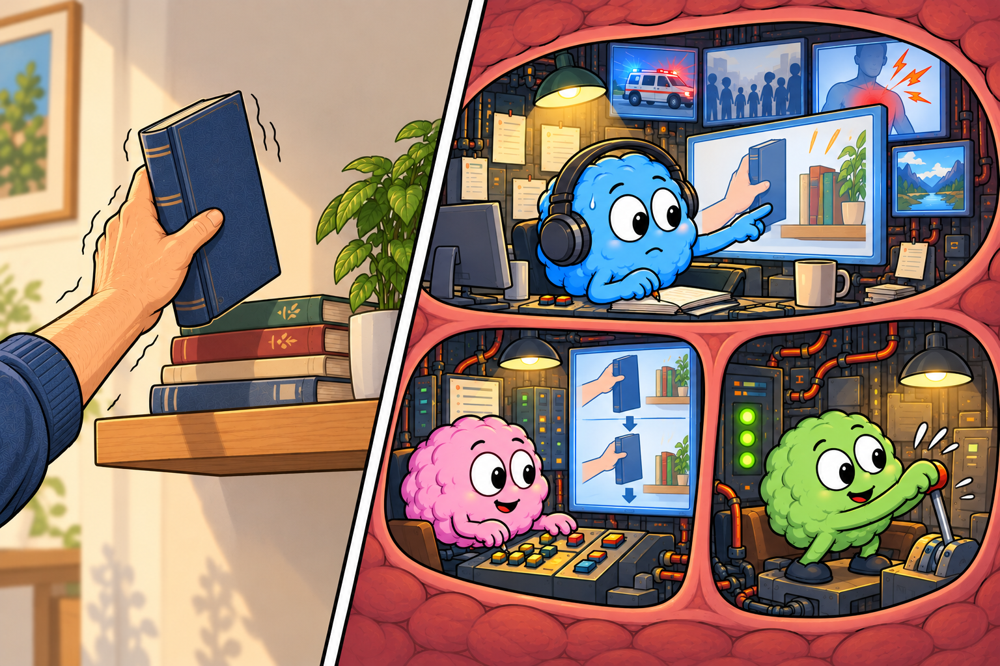

# Distraction, External Focus, and Context

> **Working draft:** Human authored with AI assistance; the Person, Supporter and Clinician sections have been reviewed and approved by the project lead. Audit 1 completed October 28, 2026; accepted corrections and editorial Audit 2 completed October 29, 2026. Illustrations and captions approved by the project lead; independent clinical review remains pending.

Lesson 17 explores distraction, external focus, and context through everyday examples, collaborative adaptations and clinical reasoning.

*Last reviewed: October 29, 2026*

***
[For the Person With FND](#for-the-person-with-fnd) 
[For Family, Friends, and Other Supporters](#for-family-friends-and-other-supporters) 
[For Clinicians and the Care Team](#for-clinicians-and-the-care-team) 
[Research and Sources](#research-and-sources)

***

## For the Person With FND

### A good moment is a starting point

Imagine someone with functional tremor sitting with an occupational therapist.

They want to put a few photographs into a folder. Their hand shakes as they hold the first one.

The therapist places the folder nearby and asks them to slide a photograph toward the open pocket of the folder.

The person looks at the pocket instead of concentrating on the movement of their fingers. This time, getting the photograph into place feels a little easier. And it feels encouraging.

Then they get home. They want to put a novel away between two books on a shelf.

But the novel is heavier than a photograph. Their hand needs a different grip, and the shelf may be harder to reach. Putting the book away feels difficult.

"My hand was doing better at therapy. Why is this so hard?"

The person has a new task, in a different setting. That gives them and their therapist something useful to explore.

**An easier movement in therapy is a starting point. The next step is finding out how it might help in everyday life.**

This is what we'll explore in our final lesson on attention and automatic control.

### The setting is part of the task

Putting a photograph into a folder and sliding a novel between books sound like similar jobs. You're putting something away.

But the nervous system has a lot of work to do for each one.

It's constantly using information from your eyes, skin, muscles and joints. It judges distances, helps you balance, adjusts how firmly you grip something and coordinates the movement.

A thin photograph lying on a table calls for different movements from a heavier book going onto a shelf.

And your body is doing its ordinary work throughout the day. Posture, effort, energy, pain and fatigue can all affect how manageable a task feels.

That's part of **context**: everything involved in doing an activity, including the demands of the task itself, your surroundings and the support available.

A functional symptom can change even when you can't identify anything that set it off. **There doesn't have to be a noticeable trigger.** Sometimes the reason one moment feels different from another isn't clear.

For some people with FND, adjusting the task or the setting can make participation easier. For others, the difference may be small or absent. The idea is to explore what is useful rather than assume one cause. (*citations* [1](#citation-1), [3](#citation-3))

<figure class="image-60center" markdown="1">

<figcaption>A clear destination and a suitable setup may make an activity more manageable while symptoms remain. This control-room metaphor illustrates an idea to explore, not a guaranteed response or a literal brain mechanism.</figcaption>

</figure>

### A cue can give movement somewhere to go

Think about that photograph and its open pocket.

The pocket gives the person a destination. It's a **cue**: a piece of information that helps guide what happens next.

When someone pays attention to the result of an action, rather than every movement needed to get there, that's called **[external focus](../../glossary/README.md#external-focus)**.

The person is still paying attention. They're giving their attention a useful destination.

A bookshelf can offer a destination, too. But a novel is heavier, and reaching the shelf makes different demands on the arm and body. Focusing on the destination may help with one part of the job while the person still needs a different setup or support.

A physiotherapist or occupational therapist may use external focus when it fits someone's functional movement symptoms. The therapist can change the target, the task and the support available. (*citations* [1](#citation-1), [3](#citation-3))

Sometimes a cue is a **rhythm**, such as a steady beat that helps guide the timing of a movement. It's one possible tool, rather than something everyone needs to follow.

### Isn't that just distraction?

Not quite.

**Distraction** means attention has shifted toward something else. It might happen naturally when something catches your interest, or it might be deliberately encouraged during an activity.

Imagine someone sorting photographs while talking about a happy memory. They become caught up in the conversation, and their shaking changes.

The conversation has drawn some attention away from monitoring the hand.

With **external focus**, attention stays on the goal of the action: getting the photograph into the folder.

So the difference isn't whether the shift happens on purpose. **It's where attention goes.**

One community member described a similar experience:

> “The tremor stops when I think about my answer and speak it.”

*Figure 1. Community experience.* One person's description of a change in tremor during conversation. [Original public source](https://www.reddit.com/r/FND/comments/1nzuyuz/comment/ni918wf/). (*citations* [5](#citation-5))

Researchers have studied how attention relates to some functional tremors. Clinicians may also observe changes with distraction during an examination. These observations can help them understand a movement pattern, alongside the rest of a proper assessment. (*citations* [1](#citation-1), [2](#citation-2))

**A movement changing with attention is still an involuntary experience.**

For rehabilitation, focusing on a meaningful goal may be more useful than simply adding an unrelated distraction. The therapist can explore what helps the person complete an activity they actually want to do.

### Would doing two things at once help?

Sometimes, yes. Other times, it makes things harder.

You might have heard about walking to a beat or talking while moving. Those are different approaches.

A beat can provide a cue for timing. Talking while walking is a **[dual task](../../glossary/README.md#dual-tasking--dual-task-practice)**: doing two activities at once.

Imagine someone working on walking with a physiotherapist. In a carefully supported session, a simple conversation might help their steps flow more naturally because they're paying less attention to each separate movement.

For another person, talking while walking may make balance and concentration harder. They may do better with one clear destination and no conversation at all.

Both experiences are useful information.

A **dual task can sometimes help**, but it also asks the nervous system to manage two activities. It isn't automatically a better exercise, especially when symptoms involve balance, dizziness, sensory overload or thinking difficulties.

The therapist chooses whether an added task is worthwhile, checks that it's safe, and changes the plan when needed. (*citations* [1](#citation-1), [3](#citation-3))

### Bringing an easier moment into everyday life

Let's return to the person who put a photograph into a folder at therapy and struggled to put a novel onto a shelf at home.

At their next appointment, they tell the occupational therapist what happened.

Together, they look at the new task. A book has more weight, needs a different grip and may have to be lifted higher. They explore whether the clear destination that helped with the photograph is still useful, and what other support the book needs.

Perhaps a lower shelf, a lighter book or a safer position makes the job more manageable. The therapist helps decide what fits the person's abilities and safety needs.

They're exploring whether a helpful idea from one task can support a different one that matters at home.

Rehabilitation professionals call this **carryover**: when a skill or useful approach practised in one setting becomes helpful in everyday life.

Carryover can take time. A movement that works in a quiet therapy room might still be difficult at home, or on a day when pain and fatigue are stronger.

That doesn't erase what happened in therapy. The person and therapist now know a little more about what the everyday task requires.

**The aim is to build something you can use, rather than collect moments when a symptom happens to look better.** (*citations* [1](#citation-1), [3](#citation-3))

### Sometimes the useful change is around you

Think of someone who loses words during an appointment.

When several people speak at once, they struggle to finish a thought. With one listener, more time, and a question they can refer back to, the conversation might become easier.

This is a change in context, too.

Perhaps those conditions would help at another appointment. The person could ask for **one person to speak at a time** or a short written reminder.

Their speech or thinking symptoms might remain. The conversation can still become more manageable.

An adaptation that makes participation easier is valuable in its own right. Rehabilitation and everyday supports can work alongside each other. (*citations* [3](#citation-3))

### What does a changing symptom tell us?

Sometimes a specialist uses a change with distraction or a different movement task as one part of a **positive FND examination**.

That is a clinical observation, interpreted with the person's history and other findings. It's different from testing yourself or asking a family member to surprise you with distractions.

A response to one task tells us what happened *in that situation*. It may offer an opportunity for treatment. It doesn't guarantee the same movement will happen on request tomorrow.

And if a strategy makes things harder, that's useful information as well. A different approach, more support, or a break may be a better fit.

### Putting our three lessons together

Lesson 15 introduced attention: what your brain notices.

Lesson 16 introduced automatic control: how familiar actions can run without step-by-step direction.

Now we've added something new: **the conditions around an action can change how it goes, and rehabilitation may help carry useful conditions into everyday activities.**

That gives us a practical question:

**"When something is a little easier, what helped make it possible—and can any of that help me elsewhere?"**

We're still learning about other ways the nervous system works. The next module will introduce some of those ideas.

### Something to think about

Does the same activity sometimes feel easier or harder depending on where you are, who's with you, or how instructions are given?

### How might that feel?

How would it feel to ask for the conditions that help you, and have that request taken seriously?

### One small step

Choose one familiar, safe activity and **one small change** to the setting or support around it.

Maybe you'd like more time to answer during a conversation. Perhaps a clear place to put things would help with a task, or you'd prefer one agreed reminder instead of several instructions at once.

See whether the activity feels easier or more comfortable. Your symptoms might change, or they might stay the same.

Keep the supports and safety measures you already need. If exploring a movement could involve falling or injury, you can bring the idea to your rehabilitation clinician instead.

### Further reading in the Reference Library

For more detail, choose the topic that fits your question. Each page includes information for the person, supporters and clinicians.

- [External focus and meaningful tasks](../../reference/recovery-techniques/functional_tremor/03-external-focus-and-meaningful-task-practice.md)
- [External focus and purposeful dual-task walking](../../reference/recovery-techniques/functional_gait_disorder/07-external-focus-and-purposeful-dual-task-walking.md)

### Optional crossword

Revisit the lesson with a crossword. The easy edition includes a word bank.

<a class="puzzle-card" href="{{ '/puzzles/' | relative_url }}?collection=crosswords&amp;puzzle=lesson-17" aria-label="Browse Distraction, External Focus, and Context">Distraction, External Focus, and Context</a>

<a href="{{ '/assets/puzzles/crosswords/Module-6-Lesson-17/distraction-external-focus-and-context-m6-17-easy.pdf' | relative_url }}" target="_blank" rel="noopener" aria-label="Easy PDF for Distraction, External Focus, and Context (opens in a new tab)">Easy</a>
<a href="{{ '/assets/puzzles/crosswords/Module-6-Lesson-17/distraction-external-focus-and-context-m6-17-normal.pdf' | relative_url }}" target="_blank" rel="noopener" aria-label="Normal PDF for Distraction, External Focus, and Context (opens in a new tab)">Normal</a>
<a href="{{ '/assets/puzzles/crosswords/Module-6-Lesson-17/distraction-external-focus-and-context-m6-17-answer-key.pdf' | relative_url }}" target="_blank" rel="noopener" aria-label="Answer key PDF for Distraction, External Focus, and Context (opens in a new tab)">Answer key</a>

PDFs open in a new tab.

### Optional colouring activity

<a href="{{ '/assets/puzzles/colouring/lesson-17-coloring-book.pdf' | relative_url }}" target="_blank" rel="noopener">Open the Lesson 17 colouring PDF (new tab)</a>, or <a href="{{ '/puzzles/' | relative_url }}?collection=colouring&amp;puzzle=lesson-17">browse the colouring collection</a>.

***
[For the Person With FND](#for-the-person-with-fnd) 
[For Family, Friends, and Other Supporters](#for-family-friends-and-other-supporters) 
[For Clinicians and the Care Team](#for-clinicians-and-the-care-team) 
[Research and Sources](#research-and-sources)

***

## For Family, Friends, and Other Supporters

### The idea that helped in therapy isn't helping at home

Imagine someone coming home from occupational therapy feeling encouraged.

Their hand has been shaking during everyday activities. But at the appointment, they managed to slide several photographs into a folder. Looking toward the pocket where each photograph belonged seemed to make the task easier.

Later, they're trying to put a novel back onto a bookshelf. The shaking makes it difficult to grip and position the book.

Their partner remembers the therapy appointment.

“Maybe look at the space on the shelf instead of your hand?”

The person tries. The book still won't go where they want it.

Now the partner wonders whether they've given the wrong cue. The person feels disappointed that something helpful earlier isn't helping now.

**What if neither of them has done anything wrong? What if these two activities are asking for different things?**

That's the new idea in this lesson. The setting, the task and the support available can all affect how manageable an activity is. Knowing this can help supporters offer thoughtful assistance without feeling responsible for making a symptom change.

### A photograph and a novel aren't the same job

Think about the two objects.

A photograph is light. It can slide along a table, and the folder provides a clear destination.

A novel is heavier. It needs a secure grip and may need to be lifted against gravity. The person might have to reach higher, turn their wrist or hold their balance while fitting it into a narrow space.

Those are real differences in the work the body has to do.

And perhaps the therapy room was quiet, with a supportive chair and someone nearby to help. At home, the person may be tired after travelling or surrounded by ordinary household noise.

All of this is part of **context**: not just where an activity happens, but what it requires, when it happens and what help is available.

For some people with FND, changing a task or its surroundings can make participation easier. Occupational-therapy guidance considers the activity, environment and person's own goals together. (*citations* [3](#citation-3))

**An easier movement doesn't tell us that the room, the person's thoughts or any single factor caused the symptom.** And a harder movement doesn't mean they failed to use a technique correctly.

Sometimes symptoms change for reasons nobody can identify. There's no requirement to find a trigger before offering practical help.

### Distraction and external focus aren't quite the same

This is where a little FND knowledge can change how you offer help.

You may have heard that some functional movements change when a person is distracted. It might be tempting to start a lively conversation, turn on music or suggest counting backwards.

But there are a few different ideas here.

**Distraction** means attention moves toward something else. A conversation about the weekend might draw attention away from watching a shaking hand.

**External focus** means attention stays with the activity, but goes toward its purpose or result. For the photograph, that might mean looking at the pocket where it belongs instead of concentrating on each finger movement.

A **second task** adds another job. Talking while putting away a book means following a conversation *and* managing the book. That can help some people in some situations, but it can also make things more difficult.

Research involving selected people with functional action tremor suggests that attentional focus can affect performance in certain tasks. It doesn't mean everyone with FND benefits from distraction, or that more stimulation is always better. (*citations* [2](#citation-2))

**Sometimes a useful cue gives the person one clear goal. Sometimes the most helpful change is fewer demands.**

If the person wants to use a cue learned in therapy, it's reasonable to ask what they find helpful. It isn't necessary to improvise new exercises or add distractions in the hope of producing a particular movement.

### When helping becomes one more thing to manage

Return to the bookshelf.

The partner wants to help, so they offer another idea.

“Maybe try the other hand. What about humming? Should I count for you?”

Each suggestion is well meant. Together, though, they've become another conversation to follow while the person is struggling with the book.

Imagine how different it could feel to hear: “Would you like me to move a few books so there's more room, or would you rather leave it for now?”

The person might welcome the help. They might prefer a lower shelf, a break or simply to finish without conversation.

That answer tells the supporter which kind of assistance is wanted. It doesn't require the person to explain the mechanism of their symptoms.

It's worth remembering that **being helpful isn't always the same as doing more**.

Sometimes you can make the surroundings easier to use. Sometimes you can leave space for the person to work in their own way. And sometimes the activity can wait.

### Finding what fits can take energy

Finding a helpful adjustment takes energy from both people. There can be room for a useful idea and room to leave it for another day.

Working out what helps can take time, attention and patience from both people. It's possible to learn something useful along the way without making every activity a trial.

A change that suits one person may not suit another. The same person may prefer something different on another day.

And there are occasions when the answer is simply, “Not today.”

That is an acceptable outcome, not a setback anyone has to explain away.

### Can a helpful idea travel from therapy into ordinary life?

The photograph went into the folder. The novel didn't go onto the shelf.

The therapist may call the next challenge **carryover**: finding out whether a useful approach from one activity or setting can help somewhere else.

The supporter doesn't have to design that process, but they may have information worth sharing if the person wants their involvement.

For example, they might mention that the photograph was light and supported by the table, while the book needed lifting and a firmer grip.

An occupational therapist could use those details to explore an easier shelf, a lighter object, a different position or a suitable aid. A physiotherapist might contribute if safe reaching, standing, walking or movement control is part of the difficulty. These are examples of individualized professional care, rather than a set of instructions to try at home. (*citations* [1](#citation-1), [3](#citation-3))

At home, an ordinary, low-risk change might be to keep frequently used books on a shelf the person can reach more comfortably. That could help them enjoy reading without needing the tremor to improve first.

**Making an activity more accessible is a worthwhile result, even when the symptom remains.**

The person may also wish to practise a particular movement through their rehabilitation programme. They and their therapist can decide how that fits alongside everyday aids and assistance.

### Your role may change the kind of help you offer

Suppose you're a **spouse or partner**. You may know which activities are difficult at home, but you might also be tired of every shared activity turning into a discussion of symptoms. It can be good for the relationship to have evenings when the books simply stay where they are.

A **parent** might notice that a child manages a task at home but struggles with it in a noisy classroom. That observation could help the child and school discuss practical changes, while suitable professionals guide any specialized rehabilitation.

A **friend** may only see the person during visits. Asking whether a quieter place or an easier setup would help can be more useful than trying to recreate a technique they've heard about.

And someone **without a supporter** can still work with an OT, physiotherapist or another appropriate professional to make activities more accessible. They shouldn't need a second person to perform constant tests or reminders.

No one role has to include everything.

It's also worth noticing when helping has become demanding for you. If you've spent the afternoon offering suggestions and moving things around, you may need a break too.

**A practical arrangement works best when the person with FND has a meaningful say and the supporter can offer help sustainably.**

### When a cue belongs in a professional plan

Some changes are ordinary decisions: moving a book to a lower shelf, allowing more time or asking whether quiet would be preferred.

Others need professional judgment.

An FND-informed **physiotherapist** may select task-focused movement or rhythm strategies for an appropriate motor presentation. An **occupational therapist** can analyse meaningful activities and equipment needs. A **speech-language therapist** can guide communication or swallowing approaches when those symptoms are involved. The [Professional Roles in FND Care](../../reference/professional-roles-in-fnd-care.md) explains how these responsibilities may fit together.

If a person has falls risk, painful or fixed posturing, unsafe grip or new major changes in function, it's especially important not to experiment with movement or remove support to see what happens. New or concerning medical symptoms deserve their own assessment.

A supporter may be invited to offer an agreed cue as part of a clinician-guided plan. That's different from making up a test to see whether the symptom can be interrupted.

You don't have to be the therapist to be a helpful part of the person's life.

### What these three lessons give a supporter

Lesson 15 helped us understand **attention**: why interruptions and competing demands can make some experiences harder.

Lesson 16 explored **automatic movement**: why familiar actions don't always happen in the same way when they're deliberately attempted.

Now we've added **context**: the task, surroundings, timing, cues and support can all influence what an activity asks of a person.

Together, these ideas offer a more useful way of responding than assuming that one successful movement should be easy to repeat, or that distraction is always the answer.

Return to the bookshelf one last time.

Instead of trying to make the hand stop shaking, the two people might decide that the novel belongs somewhere easier to reach.

That adaptation can make life easier today while other rehabilitation goals continue.

**The question to carry forward is: “What about this activity could we make more manageable together?”**

**Something to discuss together:** “When something is difficult, would you prefer a suggestion, practical help, a quieter space—or for me to ask later?”

**One small thing:** Think of one familiar, already safe activity where a small change to the surroundings might help. Agree on whether that change would be welcome. You don't have to test symptoms to make everyday life easier.

***
[For the Person With FND](#for-the-person-with-fnd) 
[For Family, Friends, and Other Supporters](#for-family-friends-and-other-supporters) 
[For Clinicians and the Care Team](#for-clinicians-and-the-care-team) 
[Research and Sources](#research-and-sources)

***

## For Clinicians and the Care Team

### The photograph worked. Why didn't the book?

Consider a different patient from the one we followed in Lessons 15 and 16.

This person has an established diagnosis of functional tremor. During occupational therapy, they find it easier to slide a photograph into a folder when the therapist directs their attention toward the open pocket.

At home, they try putting a novel between other books on a shelf. Their hand shakes, their grip feels unreliable, and the book is difficult to position.

At the next appointment they ask, “Why did the technique work here but not at home?”

It's tempting to conclude either that external focus helped the tremor only briefly, or that the patient needs more practice with the same instruction.

**But what exactly changed between the two tasks?**

The clinician has an opportunity to distinguish an effect of attention from the other demands of an activity—and then decide which part of the easier experience is worth taking into daily life.

*This is a fictional clinical teaching case, not a published patient outcome.*

### The important variable may be the task itself

The photograph rests on a table. It is thin, light and easy to slide. The folder provides a visible destination.

A novel requires a different grip, enough force to support its weight, and often a reach against gravity. Fitting it between books involves positioning the wrist and adjusting the book's orientation. If the shelf is high, posture and balance also contribute.

The nervous system must combine information about the object's properties, the intended destination, the person's position and what happens during the action.

These are **task constraints**: the physical and informational demands that shape how a movement is produced.

The patient's symptoms may change between the two activities. So may the level of effort, the available support and the likelihood of completing the action—even if the symptom itself does not change.

**A clinical question:** Was the useful ingredient the destination cue, the easier physical task, the therapist's support, or some combination?

One successful attempt cannot separate them. Rather than assuming the reason, the team can explore what makes participation possible.

This is why **context** means more than a search for triggers. It includes ordinary task demands, surroundings and available assistance. No identifiable trigger is required for a functional symptom to vary.

### From examination findings to therapeutic choices

During a specialist assessment of functional tremor, the examiner may observe that tremor changes while the person performs another task. That is **distractibility**: a task-related alteration in symptom expression that may contribute to a positive examination when interpreted with the whole clinical picture.

The examiner may also evaluate **entrainment**. In its specific diagnostic sense, this describes tremor frequency changing to match the rhythm of a voluntary movement made elsewhere in the body. A tremor merely pausing or becoming smaller is not entrainment.

The [functional tremor assessment](../../reference/diagnostic-signs/02-functional-tremor.md), [distractibility reference](../../reference/diagnostic-signs/functional_tremor/01-distractibility.md) and [entrainment reference](../../reference/diagnostic-signs/functional_tremor/02-entrainment.md) describe appropriate clinical interpretation.

What makes these findings useful is the pattern of involuntary movement during specifically chosen tasks. Their diagnostic meaning comes from specialist assessment.

But the examination question—*“Does this symptom change under these conditions?”*—differs from the rehabilitation question: **“Can a chosen strategy help this person perform an activity that matters?”**

A distractible tremor does not mean someone should be kept distracted all day. A positive sign is not a prescription, nor proof that a particular cue will succeed at home.

### Distraction, external focus and rhythm answer different questions

Return to the photograph.

The therapist could ask the patient about a favourite novel while they move the photograph. Their attention might shift toward the conversation. That is **distraction** in the ordinary sense, whether the shift happens naturally or is deliberately encouraged.

Alternatively, the therapist could ask them to aim the photograph toward the pocket in the folder. Attention remains on the action, but its destination rather than the fingers becomes the focus. That is **external focus**.

Or a therapist could introduce a steady beat to guide *when* a movement occurs. Here **rhythm** provides timing information. Using a beat as a therapeutic cue differs from observing diagnostic entrainment during examination.

These approaches have different demands and intended effects. They are not interchangeable versions of “stop concentrating on your symptom.”

Huys and colleagues compared functional action tremor, other action tremors and healthy controls (17–28 participants per group), measuring reaching paths and duration. Several task effects occurred across groups. The functional group particularly attended to visual movement feedback; only this group improved during an apparently unimportant preparatory movement. These laboratory results leave everyday treatment benefit and wider applicability open. (*citations* [2](#citation-2))

For the photograph task, external focus provides a purposeful destination. The clinician can ask whether that instruction makes the activity easier to coordinate, even if some tremor continues.

The distinction matters because **the therapeutic goal is a usable action, not a temporarily quieter symptom**.

### Find out what helped before making the task harder

Suppose the therapist and patient want to explore the destination cue.

They could begin with the same photograph, folder, seat and level of arm support, changing only the instruction. One attempt emphasizes where the photograph should go; another may use the patient's ordinary approach.

They observe whether the photograph reaches its pocket, what assistance was needed, and how the person describes effort or discomfort.

This is a **collaborative clinical comparison**, not a controlled research experiment or an FND diagnostic test. Even when one factor is changed deliberately, practice effects and symptom variability can influence the result.

What matters is the reasoning: changing several things at once makes it difficult to know which alteration was useful.

Next, the therapist and patient can alter the activity to resemble home life, taking care with weight, reach and safety. A lighter book on a lower shelf may provide an intermediate version. Perhaps the arm needs support, the shelf position needs adjustment, or another method is more appropriate.

Occupational-therapy consensus recommends analysing the actual activity and building collaborative, meaningful goals. Physiotherapy consensus supports selected task-oriented and externally directed motor-retraining approaches. Both provide clinical frameworks, not guarantees of a specific response. (*citations* [1](#citation-1), [3](#citation-3))

The task can succeed while tremor remains present. A book placed safely with an adaptation is a meaningful outcome.

### Why adding a second task can give the opposite result

A clinician might remember that some functional movements improve when attention is occupied elsewhere and suggest talking to the patient throughout the next attempt.

But that suggestion adds another demand: the person must process conversation while managing the object.

This is **dual-tasking**, and its effects depend on the person and the tasks.

Consider the patient with functional gait symptoms and cognitive complaints from the previous lessons. A conversation during walking might sometimes coincide with more fluid steps. It might instead make it harder to interpret instructions, maintain balance, navigate hazards or initiate a movement.

The key difference is that an **external target can clarify a single task**, while a second simultaneous activity requires attention to be shared.

A therapist can compare external focus alone with an added task only where appropriate, with consent and suitable safety measures. Improvement in one component does not outweigh a new balance, pain, cognitive or sensory cost.

For some patients the most helpful intervention is **less competing input**, such as one instruction at a time. For others, a carefully selected additional activity may be useful. Their observed response guides the decision.

[Purposeful dual-task walking](../../reference/recovery-techniques/functional_gait_disorder/07-external-focus-and-purposeful-dual-task-walking.md) and [external-focus practice for functional tremor](../../reference/recovery-techniques/functional_tremor/03-external-focus-and-meaningful-task-practice.md) provide more detailed clinical procedures and safety considerations.

### Turning a clinic success into useful carryover

The photograph task can help the therapist find a promising approach. The novel challenges whether it transfers.

This is **carryover**: making a useful skill or strategy available in circumstances beyond the one in which it was practised.

A person may perform well in a predictable clinic task but have difficulty when the object, surface, movement direction, fatigue or level of support changes. These differences can be meaningful even when the instruction sounds identical.

The rehabilitation task is to find a progression that respects those differences.

For our patient, the therapist might begin with the photograph, then explore a lightweight booklet at table height, then a different object or destination. If the goal remains shelving a novel, they can assess its weight and location and consider a safe way to achieve it with appropriate assistance.

That progression is an *illustration of clinical reasoning*, rather than a validated sequence of exercises.

**The test of usefulness is whether the patient can participate more reliably in the activity they value—not whether they can reproduce a clinic effect on command.**

The occupational therapist can identify the actual home demands. A physiotherapist may be involved when safe movement, postural control or walking are central. A psychologist may help when fear, anticipation or distress is part of the individual's difficulty with participation. Each contribution follows an identified need, as described in [Professional Roles in FND Care](../../reference/professional-roles-in-fnd-care.md).

### Match the strategy to the presentation

An external-focus cue might help a selected functional tremor but be less relevant to a painful fixed posture that requires protection of joints and careful positioning.

For a patient with sudden functional jerks and no usable warning, an instruction to redirect attention before each jerk may offer little practical opportunity. Reducing injury risk could be more important.

For someone with functional tic-like symptoms, assessment of the phenomenology and appropriate treatment planning are needed before borrowing strategies from other movement disorders. Malaty and colleagues review clinical distinctions in functional tic-like presentations. (*citations* [4](#citation-4))

These examples illustrate a more general principle: **a treatment principle is selected for a person's presentation, abilities and goals, not applied because the diagnosis contains the word “functional.”**

The [jerks](../../reference/diagnostic-signs/03-functional-jerks-and-myoclonus.md), [dystonia](../../reference/diagnostic-signs/04-functional-dystonia.md) and [functional tic-like symptoms](../../reference/diagnostic-signs/17-functional-tics-and-tic-like-symptoms.md) references provide the phenotype-specific assessment routes.

### The final clinical question in this module

Lessons 15 and 16 introduced two connected ideas.

**Attention** shapes what information receives priority.

**Automatic motor control** helps organize familiar actions without conscious direction of every component.

This lesson adds a third: **what surrounds an activity—including its goal, physical demands, cues, environment and support—can change how the action is carried out and whether it is usable in everyday life.**

These principles can inform diagnosis and rehabilitation, but each observation still needs interpretation within its own evidence. Functional-tremor attention research applies to selected presentations; specialist motor and occupational-therapy consensus guides individual practice. The sources do not establish one explanation or one cue for every FND symptom. (*citations* [1](#citation-1), [2](#citation-2), [3](#citation-3))

Our patient came to therapy with a practical concern: “Why could I manage a photograph here but not a book at home?”

A useful answer is more than reassurance or a request to try harder. The clinician can identify the differences between the tasks, work out which adaptations matter, and develop a plan that remains useful beyond the clinic.

**The most important next question is: “What did this particular task show us—and how can we turn that knowledge into better participation in the person's actual life?”**

***
[For the Person With FND](#for-the-person-with-fnd) 
[For Family, Friends, and Other Supporters](#for-family-friends-and-other-supporters) 
[For Clinicians and the Care Team](#for-clinicians-and-the-care-team) 
[Research and Sources](#research-and-sources)

***

## Research and Sources

This lesson draws on a selected functional-tremor experiment, a review of functional tic-like symptoms, professional rehabilitation consensus and individual community experience. Practical scenes and suggested conversations are illustrative; they are not tested treatment protocols. Community excerpts are individual accounts and do not establish diagnoses, typical outcomes or treatment effects.

| Citation | Figure | Full citation |
|---|---|---|
| **[1]** | — | Nielsen G, Stone J, Matthews A, et al. **Physiotherapy for functional motor disorders: a consensus recommendation.** JNNP. 2015;86:1113–1119. doi:10.1136/jnnp-2014-309255. [Original](https://pmc.ncbi.nlm.nih.gov/articles/PMC4602268/) · [PubMed](https://pubmed.ncbi.nlm.nih.gov/25433033/). [FND-CIT-0028](../../research/citation-index.md#fnd-cit-0028). |
| **[2]** | — | Huys ACML, Haggard P, Bhatia KP, Edwards MJ. **Misdirected attentional focus in functional tremor.** Brain. 2021;144:3436–3450. doi:10.1093/brain/awab230. [PubMed](https://pubmed.ncbi.nlm.nih.gov/34145898/) · [Original](https://academic.oup.com/brain/article/144/11/3436/6305827). [FND-CIT-0220](../../research/citation-index.md#fnd-cit-0220). |
| **[3]** | — | Nicholson C, Edwards MJ, Carson AJ, et al. **Occupational therapy consensus recommendations for functional neurological disorder.** JNNP. 2020;91:1037–1045. doi:10.1136/jnnp-2019-322281. [Original](https://jnnp.bmj.com/content/91/10/1037) · [PubMed](https://pubmed.ncbi.nlm.nih.gov/32732388/). [FND-CIT-0011](../../research/citation-index.md#fnd-cit-0011). |
| **[4]** | — | Malaty IA, Anderson S, Bennett SM, et al. Diagnosis and management of functional tic-like phenomena. *Journal of Clinical Medicine*. 2022;11(21):6470. [Source](https://doi.org/10.3390/jcm11216470). [FND-CIT-0110](../../research/citation-index.md#fnd-cit-0110). |
| **[5]** | Figure 1 | Public Reddit contribution, r/FND. [Original](https://www.reddit.com/r/FND/comments/1nzuyuz/comment/ni918wf/). Wording and relevant context checked October 26, 2026. Individual experience. [FND-CIT-0310](../../research/citation-index.md#fnd-cit-0310). |

*Publication-readiness audit: October 26, 2026. Person and Clinician sections were human-edited and approved on October 27, 2026; Supporter section was human-edited and approved on October 28, 2026. Audit 1 completed October 28, 2026; accepted corrections and editorial Audit 2 completed October 29, 2026. Illustrations and captions approved by the project lead; independent clinical review remains pending.*
