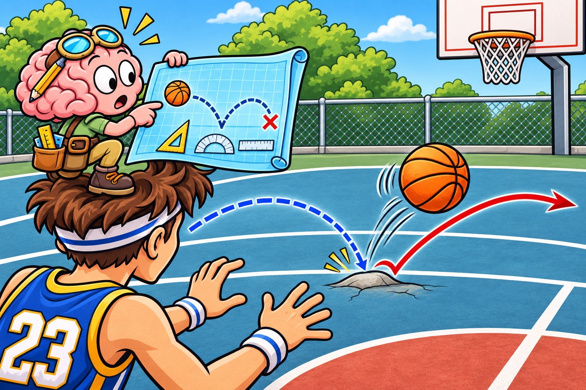

# The Predictive Brain

> **Working draft:** Human authored and project-lead approved. Audit 1 corrections applied November 4, 2026; Audit 2 and independent clinical review remain pending.

Lesson 18 explores the Predictive Brain through everyday examples, collaborative adaptations and clinical reasoning.

*Last reviewed: November 4, 2026*

*The Person section was human-authored and approved October 29, 2026; the Clinician section was previously approved, and the Supporter section was human-edited and approved November 3, 2026. Audit 1 corrections were accepted and applied November 4, 2026.*

***
[For the Person With FND](#for-the-person-with-fnd) 
[For Family, Friends, and Other Supporters](#for-family-friends-and-other-supporters) 
[For Clinicians and the Care Team](#for-clinicians-and-the-care-team) 
[Research and Sources](#research-and-sources)

***

## For the Person With FND

### The last step that wasn't there

You're walking up a familiar staircase. Your foot lifts for one more step—and finds empty air because you're already at the top.

Perhaps you stumbled or grabbed the handrail.

What happened?

Your brain had prepared your next movement using what usually happens when you climb stairs. But this time, there wasn't another step.

You hadn't consciously decided that another step existed. Your nervous system had already prepared for one.

Scientists have a name for this kind of preparation.

> **Prediction:** The brain's best guess about what is likely to happen next, using previous experience and information from the present. Much of this happens automatically.

Your brain uses predictions all day, often without you noticing.

### Your brain is always looking ahead

Imagine someone bouncing a ball toward you across a driveway.

You've watched it bounce a few times. Your brain uses its direction, speed and earlier bounces to prepare your hands for where it will probably arrive.

But the driveway isn't perfectly smooth.

The ball hits a small stone and bounces sideways!

You quickly move your hands toward its new path.

You didn't stop to calculate the physics. Your nervous system was already making adjustments.

Three things happened:

1. **Predicting:** Your brain prepared for where the ball was likely to go.
2. **Checking:** Your eyes provided information about where it actually went.
3. **Updating:** Your brain used that new information to help adjust your movement.

The ball didn't go where expected. Scientists have a name for that difference.

> **Prediction error:** A difference between what the brain expected and what it actually detected. It provides information that can help the brain adjust its predictions.

Despite the word *error*, you didn't do anything wrong.

And once you've adjusted your hands, your brain is already preparing for the next bounce.

### Prediction is about more than movement

Think about reaching for a familiar mug.

Before you pick it up, your brain has already prepared for approximately how much it weighs. If someone replaced it with an identical-looking but much heavier mug, you'd probably be surprised.

Now imagine walking into your kitchen.

You already have a general idea of where the counter, cupboards and furniture are. Your eyes provide fresh information, but your brain also uses what it remembers about the room.

Or think about listening to someone say a familiar phrase. You may know how the sentence is going to end before they've finished speaking.

Your brain uses what it has learned to help you understand what you're hearing.

Prediction also plays a part in how the brain interprets sensations from your body. But how you sense your heartbeat, where your foot is, or whether you're hungry involves different kinds of information. We'll explore those in our next lesson.

For now, notice something these examples share:

**Your brain doesn't simply wait to discover what happened. It uses what it knows to help prepare for and understand what's happening.**

### Which should the brain trust?

Let's return to the bouncing ball.

On a smooth driveway, the earlier bounces provide a useful guide. Your brain can make a fairly good guess about where the ball will go next.

But imagine the driveway is covered with small stones.

Now the ball can bounce in unexpected directions. Its earlier path becomes less helpful, so your brain needs to rely more on what your eyes are telling it right now.

That raises an interesting question.

How does the brain decide how much importance to give what it expects, compared with what its senses are telling it?

Researchers study this using a family of scientific explanations.

> **[Predictive processing](../../glossary/README.md#predictive-processing):** A way of explaining how the brain combines what it expects with information arriving from the senses, helping us understand the world and respond to it.

One part of these explanations concerns how much confidence the brain gives to different information.

> **Precision weighting:** How strongly the brain relies on an expectation or an incoming signal when combining information. This happens largely outside conscious awareness.

Think of it as having two advisers.

One says, "I've seen this ball bounce several times. I know where it's going."

The other says, "Look! It just hit a stone and changed direction!"

Both have useful information. But when the unexpected bounce happens, the second adviser has something especially important to contribute.

Your brain needs to work out how much to rely on each. (*citations* [1](#citation-1), [2](#citation-2))

And this brings us to something FND researchers find particularly interesting.

<figure class="image-60center" markdown="1">

<figcaption>The brain had a plan. The ball had other ideas!</figcaption>

</figure>

### What might prediction have to do with FND?

Researchers know that some functional neurological symptoms can change with attention, surroundings and the demands of an activity.

For example, a person may find a movement difficult when concentrating on every part of it, yet perform it differently during another activity.

Scientists are investigating why this happens.

One possibility involves how the brain balances expectations with information from the senses.

Remember our two advisers?

Some FND theories propose that the brain may sometimes give unusually strong importance to certain expectations, or too little importance to information that would normally help it make an adjustment.

Imagine preparing to move your arm.

Your brain has expectations about the movement and the sensations it should produce. At the same time, information from your eyes, muscles and joints helps guide what actually happens.

If the brain gives these different sources of information an unusual amount of importance, researchers propose that movement—or how the movement feels—could be affected.

This might help explain some experiences in which a person intends to move but the movement doesn't happen as expected, or happens without the usual feeling of control.

**Prediction gives researchers a useful model to investigate.** How it applies to a particular person remains an individual clinical question. (*citations* [1](#citation-1), [2](#citation-2))

The exciting part is that this gives scientists questions they can investigate about real neurological symptoms.

And prediction isn't involved only in movement.

### Did the television just move?

Imagine staying in an unfamiliar holiday rental.

After a few days, you've become used to the living room. You know where the furniture is and can usually move around it without much thought.

You're walking past the television when something strange happens.

Its edge suddenly seems to be farther out into your path than you expected!

You stop just short of walking into it.

For a moment, it almost feels as though the television jumped toward you. But as you get closer, it seems to return to the position you originally expected.

What just happened?

Your brain normally combines what your eyes see with what it knows about the space around you.

It also helps you judge your own position as you move.

If those sources of information don't agree, your experience of where an object is may become confusing.

Could prediction be involved? Possibly.

But a changing impression of an object's location can have several explanations. Vision, spatial awareness, attention and conditions such as migraine may all be relevant.

The example helps us see something important: **the brain's expectations can contribute to what we see and experience, not just how we move.**

### When the ground doesn't meet your foot

Now imagine walking across an unfamiliar patch of uneven ground.

You're watching where you're going, but there are bumps, dips and stones everywhere.

You take a step.

The ground is lower than you expected. Your foot lands later than your body prepared for, and you feel an uncomfortable jolt through your hip.

A few steps later, the opposite happens.

The ground is higher than expected, and your foot meets it sooner.

Now you're paying close attention to every step.

On smooth, familiar ground, walking can happen with relatively little conscious attention. On uneven ground, your nervous system has more adjusting to do.

That's normal for everyone.

But what if you're also experiencing functional gait difficulties, changes in sensation or trouble judging where your foot is?

The task may become considerably harder.

Prediction could be one part of what's happening. Your brain also needs useful information about your body's position, your surroundings and the movement itself.

We'll learn more about those different sources of information in the next lesson.

For now, we can see why a seemingly simple activity might demand far more attention and effort than it once did.

### Could prediction affect other FND symptoms?

We've explored movement and vision. But FND can affect much more than those abilities.

Consider a few other examples.

**Sensory symptoms**

Your brain helps you make sense of information from your skin and body.

Some people with FND experience numbness, tingling or unusual sensations. Researchers are interested in whether differences in how the brain combines expectations and incoming information might contribute to certain sensory symptoms. (*citations* [2](#citation-2))

We'll explore body sensing more fully in Lesson 19.

**Cognitive difficulties**

When you're listening to a conversation, your brain uses earlier words and the subject being discussed to help understand what comes next.

But sometimes keeping track of a conversation, remembering information or finding a word becomes difficult.

Prediction contributes to normal language understanding, but researchers haven't established that an incorrect prediction explains a person's functional cognitive difficulties.

Attention and other abilities are involved too.

**Speech difficulties**

Speaking involves preparing movements and using feedback from what we hear and feel as we talk.

These abilities normally work together so quickly that we barely notice them.

Researchers are exploring how movement preparation, attention and feedback relate to functional speech symptoms. The exact explanation may differ between people. (*citations* [3](#citation-3))

These examples show why prediction interests researchers working with different FND symptoms. They don't mean that every symptom has the same cause.

### What about predicting a seizure?

There's another use of the word *prediction* that's worth understanding.

Imagine deciding whether to attend a family gathering tomorrow.

You've experienced functional seizures during outings before. You wonder how demanding the gathering might be and whether you'd have somewhere safe to rest.

You think, *I might have a seizure there.*

That's a conscious judgement about a possible future event.

You're using memories, experience and what you know about the situation to help make a decision.

It's different from the rapid, automatic preparation involved in catching a bouncing ball.

You can make a reasonable safety plan without knowing whether a seizure will happen.

In other words, **expecting that something might happen isn't the same as the automatic predictions researchers are investigating in FND.**

### What have we learned?

Your brain does much more than react to what happens around you.

It prepares for what might happen next, compares that expectation with new information and makes adjustments.

These abilities help us move, understand our surroundings, recognize sensations and communicate.

Researchers are investigating whether differences in these abilities help explain certain FND symptoms.

We don't yet have all the answers, but we now have a better understanding of what scientists mean when they discuss prediction and FND.

### Something to think about

Think about a time when your body didn't do what you expected. Perhaps a familiar step suddenly felt difficult, your words wouldn't come, or a sound seemed much louder than you expected. What did you expect to happen, and what happened instead?

### How might that feel?

When something familiar becomes unpredictable, what bothers you most? Is it the surprise, not knowing what will happen next, or missing out on something you wanted to do? What might make the situation feel more manageable?

### One small step

Remember the ways you've already made places safer or easier to use? The same thinking can help with an activity you enjoy. Keeping things where you expect to find them, or choosing a route you know well, may make that activity more comfortable. A familiar arrangement that's already helping is worth keeping.

In our next lesson, we'll meet the different kinds of information your brain receives from your body and surroundings. That will help us understand what predictions are being compared *with*.

### Optional colouring activity

<a href="{{ '/assets/puzzles/colouring/lesson-18-coloring-book.pdf' | relative_url }}" target="_blank" rel="noopener">Open the Lesson 18 colouring PDF (new tab)</a>, or <a href="{{ '/puzzles/' | relative_url }}?collection=colouring&amp;puzzle=lesson-18">browse the colouring collection</a>.

***
[For the Person With FND](#for-the-person-with-fnd) 
[For Family, Friends, and Other Supporters](#for-family-friends-and-other-supporters) 
[For Clinicians and the Care Team](#for-clinicians-and-the-care-team) 
[Research and Sources](#research-and-sources)

***

## For Family, Friends, and Other Supporters

### When something familiar becomes difficult

Imagine visiting relatives for lunch.

At home, your partner moves around the kitchen quite comfortably. They know where the furniture is, where the cupboards open and how much room they have to move.

But when you arrive at your relatives' house, something changes.

Your partner slows down near the entrance. They look carefully at the floor, hesitate before entering the hallway and ask where the bathroom is.

You remember seeing them walk comfortably around the house that morning.

Naturally, you might wonder why walking has suddenly become so difficult.

Your partner may be wondering exactly the same thing.

### Why unfamiliar places can feel different

Our brains use past experiences to help prepare for what comes next. This is called *prediction*, and much of it happens automatically.

Think about walking through your home at night. Even in dim light, you probably know where the furniture is. Your brain has learned the layout, so moving around doesn't require quite as much attention.

Now imagine walking through someone else's home in that same dim light. You'd probably slow down and look more carefully.

For someone with functional movement difficulties, changes in sensation or problems judging their surroundings, those extra demands may make an unfamiliar place considerably harder to manage.

The hesitation you see might reflect far more effort than you realize.

**An ability that works comfortably in familiar surroundings may become difficult when the situation changes.**

### What does this have to do with FND?

Here's where the research becomes particularly interesting.

Scientists have proposed that **differences in predictive processing may contribute to functional neurological symptoms in some people with FND**. The idea is that the brain's expectations and the information arriving from the senses may not always be combined in the usual way. This could influence movement, sensation or how someone experiences an action. Researchers have been developing these explanations for more than a decade. (*citations* [1](#citation-1), [2](#citation-2))

It's a promising explanation for understanding certain functional symptoms, although researchers are still investigating exactly when and how it applies.

Think back to your partner hesitating in the unfamiliar hallway.

We can't know from that moment whether predictive processing is responsible. But the research helps us appreciate why changing the surroundings might make an activity unexpectedly difficult, even when the person knows what they want to do.

And perhaps that changes how we understand what we're seeing.

Instead of wondering why they aren't walking as comfortably as they did at home, we can begin to appreciate that the two situations might be asking different things of their nervous system.

### When there doesn't seem to be a pattern

Of course, not every symptom follows a pattern that either person can recognize.

One parent described watching their son's FND:

> “He’s only shown symptoms for 4 months and they come on from nothing, with no real pattern that we can see. It’s quite frightening to witness, accept and deal with.”

*Figure 1. Community experience — parent of someone with FND. [Original public discussion](https://www.reddit.com/r/FND/comments/1n8gljg/teenage_son_diagnosed_any_helpful_advicesupport/).* (*citations* [4](#citation-4))

It's easy to understand why that parent would want answers. Watching something happen unexpectedly, especially to someone you love, can be frightening.

Sometimes supporters notice that certain activities or environments seem to make things harder. Other times, symptoms appear without any obvious explanation.

There's also an important difference between the automatic predictions scientists are studying and someone consciously thinking that a symptom might happen.

A person can worry about having a functional seizure during an outing, for example, without that worry being the cause of the seizure.

And they may experience symptoms when they weren't expecting anything unusual at all.

Not knowing what will happen next can be difficult for both people.

### Sometimes a little familiarity helps

Let's return to the family visit.

Perhaps your partner mentions that unfamiliar entrances have become difficult.

You could ask whether they'd like to know more about the house before visiting. Maybe a photograph of the entrance would help, or knowing whether there are steps between the living room and bathroom.

They might appreciate arriving a little early, before the house fills with people.

Or perhaps they'd rather not make any special preparations.

Either way, you've learned something about what they're experiencing, and they've had a say in what might help.

The same idea applies beyond walking. Someone who struggles with unfamiliar surroundings might appreciate knowing where they'll be sitting, how noisy a gathering is likely to be or what to expect at a medical appointment.

Sometimes it's the small, ordinary things that make an outing easier.

### Making room for a different experience

Perhaps your partner feels more comfortable during the visit because they know their way around.

Perhaps they still struggle.

They might even find that another part of the visit is more difficult than either of you expected.

Living with unpredictable symptoms can involve quite a lot of adjusting along the way.

What matters is that you've begun to understand something about their experience that wasn't obvious from watching them.

You don't need to know precisely what their brain is doing to appreciate why an unfamiliar situation might be difficult.

And you don't need to predict every problem to make someone feel supported.

**Sometimes understanding begins with recognizing that what looks like the same activity to us may feel very different to the person doing it.**

***
[For the Person With FND](#for-the-person-with-fnd) 
[For Family, Friends, and Other Supporters](#for-family-friends-and-other-supporters) 
[For Clinicians and the Care Team](#for-clinicians-and-the-care-team) 
[Research and Sources](#research-and-sources)

***

## For Clinicians and the Care Team

### From attention to prediction

In Module 6, we examined how attention influences movement, why familiar actions can occur with relatively little conscious control, and how changing the task or context may change functional performance. Those observations raise another question: **How does the nervous system prepare for what comes next, and what happens when incoming information differs from what it expects?**

Module 7 explores that question from several perspectives. Lesson 18 introduces predictive processing. Lesson 19 examines sensory information from inside the body, its position and the external environment. Lesson 20 considers salience, arousal and feedback loops. Lesson 21 addresses cognitive difficulties, followed by emotional regulation in Lesson 22. Lesson 23 brings these ideas together through agency, learning and personal adaptations.

We begin with **predictive processing**, a theoretical framework for understanding how the nervous system combines prior expectations with incoming sensory information to guide perception and action.

### Predictive processing: Preparing, checking and updating

Consider a person climbing a familiar staircase. Their foot rises for another step, but they've already reached the top.

For a moment, the movement continues as though another step exists. The nervous system prepared the action from the familiar pattern, but incoming information reveals a mismatch.

Predictive-processing models describe this interaction through three related concepts:

- **Priors:** Expectations informed by previous experience, often operating outside conscious awareness.
- **Prediction errors:** Differences between expected and incoming information that can contribute to updating perception or action.
- **Precision weighting:** The estimated reliability assigned to expectations and incoming sensory evidence, influencing how strongly each contributes.

The missing step is an ordinary example of anticipation and correction. It illustrates the concepts without demonstrating that the nervous system literally computes them in one particular way.

Now consider uneven ground. When the surface is unpredictable, earlier steps provide a less reliable guide to the next one. The nervous system must continually integrate fresh visual and body-position information to adjust movement.

Prediction is involved in perception as well as action. Previous experience helps the brain interpret sights, sounds and bodily sensations, while incoming information helps refine those interpretations.

**What might change if the relative weighting of expectations and incoming information differs?**

This question lies at the centre of predictive-processing theories of FND.

### What does FND research suggest?

Edwards and colleagues (2012) proposed a Bayesian account in which altered weighting of prior expectations and sensory information could contribute to certain functional motor and sensory symptoms. (*citations* [1](#citation-1))

In this model, a sufficiently influential prior could affect how movement or sensation is experienced, even when incoming information might otherwise support an adjustment.

Importantly, the prior is a computational construct. It is not necessarily a consciously held belief that the person will fail to move.

Drane and colleagues (2021) placed predictive-processing ideas within a broader framework of interacting mechanisms, including attention, emotion, agency and neural network function. (*citations* [2](#citation-2))

These publications provide plausible theoretical explanations, but neither establishes a universal FND mechanism or a validated measure of abnormal precision weighting in an individual patient. Their clinical value is in directing attention toward questions that can be investigated:

**What does the patient anticipate during an activity? What information must the nervous system use to complete it? Does changing the task or sensory context alter functional performance?**

The answers may help shape rehabilitation, even when the precise computational mechanism remains unknown.

### Clinical case: Walking into the community centre

*Elena is a fictional patient whose functional gait disorder has been diagnosed through an appropriate neurological examination with positive clinical findings.*

She wants to return to a weekly community activity.

Walking along a quiet, familiar corridor is sometimes manageable using her usual mobility aid. Entering the community centre is much harder.

People move across her path. Chairs are arranged differently each week. She must decide where to walk while adjusting to changing visual information.

Elena often stops at the entrance.

"I know where I want to go, but I can't seem to get my feet started."

She also experiences migraine and sensitivity to bright lighting.

**Why might predictive processing be relevant?**

In the familiar corridor, previous experience provides useful information about the expected route. At the community centre, the environment changes continually, requiring the nervous system to update movement preparation using incoming visual and body-position information.

Predictive-processing theory raises the possibility that the integration or weighting of that information contributes to Elena's difficulty.

However, her hesitation could also involve attentional demands, motor initiation, sensory discomfort, fatigue, vestibular difficulties or other clinical factors. Her history and examination must guide which possibilities warrant investigation.

The theory gives the clinician a question to explore, rather than an answer to assume.

### Using the observation to guide rehabilitation

Elena's physiotherapist begins with her goal: reaching a chair and joining the weekly group.

The assessment identifies where the activity becomes difficult. Does hesitation occur when the route changes? During movement initiation? When people cross her path? Does she become uncomfortable under the bright lighting?

Elena reports that she manages better when she can see a clear destination and knows the route.

This creates an opportunity for a collaborative, clinically supervised comparison.

The physiotherapist might begin with a short, predictable route to a visible destination, retaining Elena's usual mobility aid and appropriate safety measures. The therapist can then assess how she initiates movement, maintains walking and manages transitions.

If the task becomes easier, the clinician has identified a potentially useful condition for rehabilitation.

**Why might that help?**

A stable destination and a predictable route can simplify some of the demands involved in planning and adjusting movement. In predictive-processing terms, the task may place different demands on anticipation and incoming sensory information.

That interpretation remains hypothetical. The improvement could involve attention, task clarity, motor control or several factors together.

The practical rehabilitation rationale is stronger: **Elena has demonstrated a more accessible way to perform an activity that matters to her.**

Functional motor rehabilitation consensus recommendations support individualized, meaningful, task-oriented practice. Occupational therapy consensus also emphasizes collaborative goals, activity analysis and adaptations that support participation. (*citations* [5](#citation-5), [6](#citation-6))

These clinical principles can guide treatment without requiring confirmation of altered precision weighting.

### Evaluating whether the intervention works

Suppose Elena reaches her chair more easily during therapy.

The therapist records what changed: movement initiation, assistance required, task completion, comfort and any adverse effects. Elena's own assessment of effort and usefulness is equally important.

The next question is whether the improvement helps her outside the treatment session.

Perhaps she manages the route when the hall is quiet but still struggles when people move around her. This suggests that the intervention helps under certain conditions, while additional demands remain difficult.

The clinician can then decide whether to modify the task, develop another rehabilitation strategy or maintain an accommodation that supports attendance.

A meaningful improvement does not need to occur under every condition to be valuable. Nor does a successful response establish that a predictive-processing abnormality has been corrected. The outcome that matters is whether Elena can participate more safely, comfortably and independently according to her goals.

### When another clinical perspective is needed

Elena's physiotherapist may lead the movement rehabilitation, while an occupational therapist could help assess the community setting and identify practical environmental adaptations.

Her migraine and visual discomfort may warrant assessment or management by her treating medical clinician. A new visual disturbance, progressive deficit or other clinically significant change requires assessment on its own merits.

Additional professionals become involved according to the findings and the patient's needs, rather than as a routine consequence of the FND diagnosis.

The same reasoning can apply to other functional presentations.

For example, a speech-language therapist may compare communication across spontaneous, rehearsed and purposeful speaking tasks. The Baker and colleagues consensus provides recommendations for individualized assessment and management of functional communication symptoms. (*citations* [3](#citation-3))

Task-dependent differences may identify therapeutic opportunities. They do not establish that the patient's speech difficulty results from an abnormal prior or that fluent speech can be produced on demand.

**Predictive-processing theory can inform clinical questions across presentations, while the assessment and rehabilitation approach remain specific to the symptom and the individual.**

### What should clinicians take into practice?

Predictive processing provides a framework for examining how the nervous system uses previous experience and incoming sensory information to prepare actions and interpret sensations.

In FND, altered weighting of that information is a proposed mechanism, not an established explanation for every symptom.

The clinical application is to examine how task demands, sensory information and environmental context affect the individual's function. From there, clinicians can select appropriate rehabilitation strategies, preserve necessary supports and evaluate meaningful outcomes.

When treatment helps, the functional benefit stands on its own. Establishing the underlying computational mechanism remains a separate scientific question.

**Clinical takeaway:** Predictive processing helps explain why expectations and incoming information are relevant to perception and movement. Use the framework to generate clinical questions, while allowing positive examination findings, individualized rehabilitation and real-world outcomes to guide care.

***
[For the Person With FND](#for-the-person-with-fnd) 
[For Family, Friends, and Other Supporters](#for-family-friends-and-other-supporters) 
[For Clinicians and the Care Team](#for-clinicians-and-the-care-team) 
[Research and Sources](#research-and-sources)

***

## Further reading in the Reference Library

For more detail, explore [functional sensory assessment](../../reference/diagnostic-signs/07-functional-sensory-symptoms.md) and [recovery through meaningful activity](../../reference/recovery-techniques/functional_sensory_symptoms/04-sensation-with-meaningful-movement.md).

## Research and Sources

This lesson draws on a proposed predictive-processing model, an FND research framework and rehabilitation consensus guidance. Everyday scenes illustrate the ideas; the community account describes one family’s experience.

| Citation | Figure | Full citation |
|---|---|---|
| **[1]** | — | Edwards MJ, Adams RA, Brown H, Pareés I, Friston KJ. **A Bayesian account of “hysteria”.** Brain. 2012;135:3495–3512. doi:10.1093/brain/aws129. FND-CIT-0242. |
| **[2]** | — | Drane DL, Fani N, Hallett M, Khalsa SS, Perez DL, Roberts NA. **A framework for understanding the pathophysiology of functional neurological disorder.** CNS Spectr. 2021;26:555–561. doi:10.1017/S1092852920001789. [Original](https://pmc.ncbi.nlm.nih.gov/articles/PMC7930164/) · [PubMed](https://pubmed.ncbi.nlm.nih.gov/32883381/). [FND-CIT-0006](../../research/citation-index.md#fnd-cit-0006). |
| **[3]** | — | Baker J, Barnett C, Cavalli L, et al. **Management of functional communication, swallowing, cough and related disorders: consensus recommendations for speech and language therapy.** JNNP. 2021;92:1112–1125. doi:10.1136/jnnp-2021-326767. [Original](https://jnnp.bmj.com/content/92/10/1112) · [PubMed](https://pubmed.ncbi.nlm.nih.gov/34210802/). [FND-CIT-0025](../../research/citation-index.md#fnd-cit-0025). |
| **[4]** | Figure 1 | Public Reddit contribution, r/FND. [Original](https://www.reddit.com/r/FND/comments/1n8gljg/teenage_son_diagnosed_any_helpful_advicesupport/). Wording and relevant context checked October 26, 2026. Individual experience. [FND-CIT-0299](../../research/citation-index.md#fnd-cit-0299). |
| **[5]** | — | Nielsen G, Stone J, Matthews A, et al. **Physiotherapy for functional motor disorders: a consensus recommendation.** JNNP. 2015;86:1113–1119. doi:10.1136/jnnp-2014-309255. [Original](https://pmc.ncbi.nlm.nih.gov/articles/PMC4602268/) · [PubMed](https://pubmed.ncbi.nlm.nih.gov/25433033/). [FND-CIT-0028](../../research/citation-index.md#fnd-cit-0028). |
| **[6]** | — | Nicholson C, Edwards MJ, Carson AJ, et al. **Occupational therapy consensus recommendations for functional neurological disorder.** JNNP. 2020;91:1037–1045. doi:10.1136/jnnp-2019-322281. [Original](https://jnnp.bmj.com/content/91/10/1037) · [PubMed](https://pubmed.ncbi.nlm.nih.gov/32732388/). [FND-CIT-0011](../../research/citation-index.md#fnd-cit-0011). |
