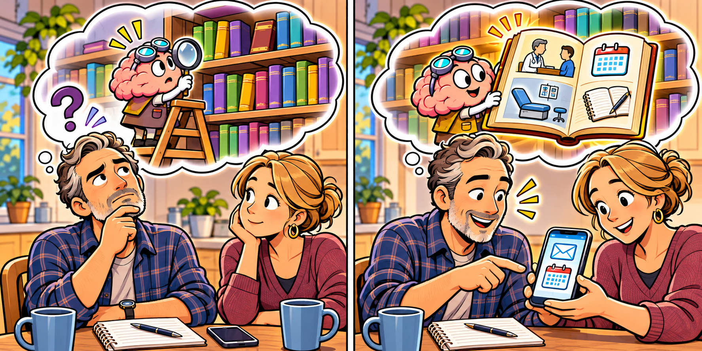

# Cognitive Difficulties in FND

> **Working draft:** Human authored and project-lead approved. Audit 1 corrections and editorial Audit 2 completed November 4, 2026; independent clinical review remains pending.

Lesson 21 introduces everyday thinking and memory difficulties, explains why they can appear alongside different FND symptoms without a separate Functional Cognitive Disorder diagnosis, and distinguishes them from dissociation.

*Last reviewed: November 4, 2026*

***

[For the Person With FND](#for-the-person-with-fnd) 
[For Family, Friends, and Other Supporters](#for-family-friends-and-other-supporters) 
[For Clinicians and the Care Team](#for-clinicians-and-the-care-team) 
[Research and Sources](#research-and-sources)

***

## For the Person With FND

### Where was I?

You're making dinner.

You've set a saucepan on the stove, opened a cupboard and taken out the ingredients.

Someone walks into the kitchen and asks a question.

You answer them.

Then you turn back toward the counter.

What were you going to do next?

For a moment, you're stuck.

Perhaps you remember when you see the open cupboard. Perhaps you need to look at the recipe again. Or the next step doesn't come back at all.

Most people have experienced a moment like that.

But imagine it happening often, even during tasks that used to feel easy. You lose the thread of a conversation, forget a familiar fact or need much more effort to follow instructions.

Thinking difficulties can affect more than schoolwork or memory tests. They can change how you cook, talk with someone, travel or manage your day.

Let's give these abilities a shared name.

> **Cognition:** The brain's abilities for taking in information, remembering, understanding, using knowledge, planning and getting things done. Memory is one part of cognition.

Cognitive difficulties are real experiences. The useful question isn't simply "Is my memory bad?" It's *which part of thinking has become difficult?*

### It's not all one kind of memory

Return to the kitchen.

You were about to add an ingredient when someone interrupted you.

You forgot the next step.

That could involve the small amount of information you were keeping ready to use.

> **Working memory:** Holding and using information for a short time, such as remembering a question while preparing an answer.

Think of it as a little workbench. You can keep a few things within reach, but it's harder to work when more things keep arriving.

Now imagine something different.

Yesterday, you had a telephone conversation about an appointment.

Today, someone asks what you agreed to. You can't remember the conversation—or you remember talking but not what was decided.

That involves remembering an experience from your life.

> **Episodic memory:** Remembering events you experienced, including what happened and, sometimes, where or when it happened.

There's another possibility.

You recognize a familiar kitchen tool and know exactly what it does, but its name won't come to mind.

Or you can't bring back a fact you have known for years.

> **Semantic memory:** The knowledge we have about facts, words, people and what things mean.

Losing access to a word doesn't always mean you've lost the knowledge behind it. You may still know what the object does.

These differences matter because two people who both say "I keep forgetting things" may be experiencing quite different difficulties.

### Sometimes the information never gets a good start

Imagine reading a short message.

Your phone buzzes. You glance up. Someone asks a question.

You reach the bottom of the message and realize you couldn't explain what you just read.

Did you forget information you'd learned?

Maybe not. You might never have taken it in clearly enough to remember it later.

> **Encoding:** Taking in information in a way that makes it available to remember.

And when you've learned something but cannot bring it back when you need it, the difficulty may involve another step.

> **Retrieval:** Bringing information you've learned back into awareness when you need it.

You can see why "memory loss" is such a broad description.

The problem might involve noticing the information, taking it in, keeping it available or finding it again.

More than one of these can be difficult at once.

<figure class="image-60center" markdown="1">

<figcaption>Sometimes a small clue helps us find a memory that seemed out of reach.</figcaption>

</figure>

### What about thinking, planning and switching tasks?

Imagine following a recipe you've made many times.

You know the ingredients. You know the method.

But today, organizing the steps feels unusually hard.

You begin chopping vegetables, remember that the oven needs heating, then forget what you had started.

You haven't necessarily forgotten how to cook.

You may be having difficulty organizing and shifting between parts of the task.

> **Executive functions:** Abilities that help us start, organize, plan, change course and complete activities.

Another person knows what they want to say but needs much longer to answer.

Or they follow a conversation until a second person starts speaking. Then the thread disappears.

These difficulties can involve thinking speed, attention, language access and memory. They often overlap.

The names help us describe what has changed. They don't tell us the cause by themselves.

### When you keep going with only part of the picture

Suppose you're discussing tomorrow's plans.

You remember agreeing to go shopping.

But what you don't remember is that the other person had offered to change the time because of your appointment.

The conversation continues.

You don't realize your memory is limiting you because, at the moment, thinking feels as it usually does; you're using what you remember.

You reach a conclusion that feels sensible:

"They never considered my appointment."

The other person remembers making the offer and doesn't understand your response.

Have you experienced that? What does it feel like when someone else's memory of events is different from yours?

Something important has become unavailable, even though you can still think and talk.

**A conclusion can feel convincing when it fits the information you can access right now—even if something important is missing.**

This can happen to anyone.

And remembering something differently doesn't automatically prove which person's account is correct.

We'll return to the emotional side of that experience in our next lesson.

### Does having these difficulties mean I have Functional Cognitive Disorder?

Imagine two people with FND.

The first has difficulty walking and also lives with migraine.

During a particularly difficult migraine, reading becomes exhausting. They lose their place repeatedly and struggle to remember instructions.

The second person experiences functional seizures.

They can explain a familiar activity quite easily while chatting with a friend.

But when asked to describe the same activity step by step, the information suddenly becomes much harder to reach.

Both people are having trouble with cognition.

But notice the difference.

For the first person, migraine may be affecting their ability to think clearly.

For the second, an ability that works during one activity seems much harder to use during another.

Neither example tells us the cause on its own.

But the second raises a question that can be particularly interesting when investigating Functional Cognitive Disorder.

> **Functional Cognitive Disorder (FCD):** A condition in which thinking or memory becomes difficult to use reliably. An important clue is that the same ability can work much better in one situation than another, in a way that ordinary tiredness or differences between tasks don't fully explain. A clinician looks for a clear pattern before making the diagnosis.

Imagine knowing how to do something but being unable to rely on that knowledge whenever you need it.

The ability hasn't necessarily disappeared.

Yet reaching or using it can become unexpectedly difficult.

That helps us understand why someone with FCD may complete a task successfully one day—or in one situation—and struggle greatly with a similar task elsewhere.

This difference isn't a choice.

And it doesn't mean the person's abilities are always intact underneath every difficulty.

It means that **how thinking works can be less reliable than expected**.

Now return to our two people.

The person with migraine needs their migraine and cognitive difficulties understood together.

The person who struggles to access familiar information in different situations may need a closer examination of how their thinking works.

They could have different explanations, overlapping explanations or other conditions that need investigation.

**Having cognitive difficulties doesn't automatically mean having FCD.**

This is important because cognitive difficulties can accompany other FND symptoms without a separate FCD diagnosis. (*citations* [1](#citation-1), [2](#citation-2), [5](#citation-5))

### What are scientists learning?

Imagine two people playing a simple game on a computer.

At first, the rule is easy.

Press the left button when a blue shape appears. Press the right button when a yellow shape appears.

Both people learn the rule and start getting the answers right.

Then the rule changes!

Now blue means right, and yellow means left.

The first person has functional movement symptoms.

They completed the earlier rounds successfully, but now they slow down and make a few mistakes while adjusting.

The second person has functional seizures.

They also learned the first rule. But after it changes, they keep using the old rule for several attempts before getting back on track.

Both finish the task, but changing rules requires extra effort.

These are imagined examples of what a thinking task might reveal.

Scientists use tasks like these to study attention and the ability to switch between activities.

Some studies have found that, on average, groups of people with functional movement symptoms or functional seizures have greater difficulty with certain attention and switching tasks than comparison groups. (*citations* [5](#citation-5))

That doesn't mean every person with FND struggles with these tasks.

But it does tell us something valuable.

**Cognitive difficulties deserve attention even when movement problems or seizures are the person's main FND symptoms.**

### When you feel disconnected

Now imagine something different.

You're sitting in your living room.

You know exactly where you are.

You can see the furniture and hear someone talking nearby.

But the room suddenly feels strange.

Everything seems distant, almost as though you're watching it through a window.

You know the room is real, yet it doesn't quite feel real.

Or you feel disconnected from yourself, as though you're not fully present.

Scientists have a name for experiences like these.

> **[Dissociation](../../glossary/README.md#dissociation):** A change in how connected or aware someone feels toward themselves, their surroundings, memories or experiences.

Dissociation can take several forms.

A person may feel detached from their surroundings.

Another feels disconnected from their own body.

Someone else experiences a gap in awareness or memory.

Now return to our earlier telephone conversation.

A person can forget a telephone call without experiencing dissociation.

Someone can feel disconnected during a conversation but remember it afterward.

And another person may experience both difficulties together.

**Dissociation and memory difficulties can overlap, but they aren't the same thing.** (*citations* [8](#citation-8))

Some people with FND experience dissociation; others don't.

And missing time doesn't automatically tell us whether dissociation, a seizure or another condition was involved.

Learning the difference gives us better words for describing what happened.

### How can a clinician tell what's happening?

Imagine sitting with a clinician.

You explain:

"My memory isn't working properly."

They ask you to tell them more.

You describe forgetting the next step while cooking.

You explain that you can't always remember conversations from the day before.

And you describe knowing a familiar fact but being unable to bring it to mind.

The clinician notices that you're describing three different difficulties.

So they ask different questions.

Did the information disappear while you were using it?

Do you remember the conversation but lose its details?

Can a familiar word or fact return when something reminds you of it?

These questions help the clinician decide what to examine.

They may ask you to complete thinking or memory tasks and compare how you manage different activities.

They'll also consider migraine, sleep, pain, medications and other health conditions that can affect thinking.

Several professionals can help.

A neurologist investigates the symptoms and possible causes.

A neuropsychologist can examine different thinking abilities in more detail.

An occupational therapist looks at how cognitive difficulties affect activities such as cooking, managing appointments or organizing a day.

A speech-language therapist can help assess difficulties understanding or finding words.

But there's something important to remember.

**A short appointment doesn't necessarily show what your thinking is like throughout an entire day.**

Perhaps you complete a task successfully during an examination but struggle later when you're exhausted.

Or you complete it because you've learned to use helpful reminders.

These details matter.

The aim is to understand your abilities and difficulties well enough to guide useful care. (*citations* [1](#citation-1), [2](#citation-2), [4](#citation-4))

A new, sudden or substantially worsening change in thinking, memory, speech or awareness still needs appropriate medical assessment.

### Can understanding cognition help with recovery?

Let's go back to our kitchen.

You're following a recipe, but interruptions keep making you lose your place.

Now imagine placing the recipe on the counter and checking off each step as you finish it.

Someone asks you a question.

You answer.

Then you turn back to the recipe.

This time, you know where to continue.

Your working memory didn't have to keep the next step available throughout the interruption.

The written recipe helped do that job.

Here's another example.

Someone often forgets what was decided during telephone conversations.

After an important call, they make a short note of the agreement.

Later, they can return to the note instead of depending entirely on their memory.

Or consider someone who knows how to complete a familiar activity but struggles to organize the steps.

A checklist helps them begin and continue without having to work everything out again.

All three examples have something in common.

**Understanding the difficulty helps us choose support that fits the task.**

But support isn't the only possibility.

An occupational therapist or another professional may help a person practise meaningful activities, develop skills or make changes that improve independence.

Rehabilitation can involve learning, practice and adaptations. (*citations* [4](#citation-4))

And a helpful adaptation doesn't automatically have to disappear as someone improves.

**Being able to do something with useful support still counts as doing it.**

Successfully using support also doesn't prove why the difficulty happened.

For a deeper exploration, our Reference Library includes [Understanding Functional Cognitive Disorder](../../reference/functional-cognitive-disorder.md), [Cognitive Diagnostic Signs](../../reference/diagnostic-signs/12-functional-cognitive-disorder.md) and [Cognitive Recovery Techniques](../../reference/recovery-techniques/functional_cognitive_disorder/README.md).

### What have we learned?

We began in the kitchen, forgetting what we were about to do.

But we've discovered that thinking involves several abilities.

**Working memory** helps us keep information available while using it.

**Episodic memory** helps us remember experiences.

**Semantic memory** involves the things we know.

Attention, learning, finding information again and organizing activities matter too.

We've learned that cognitive difficulties can accompany FND without necessarily meaning someone has a separate FCD diagnosis.

We've also met dissociation—a different experience that can involve feeling disconnected or changes in awareness.

And we've seen how understanding the particular difficulty can help us explain it, seek assessment and choose useful support.

### Something to think about

Remember losing your place while cooking, forgetting what was agreed during a telephone call, or reaching for a word you know? Which comes closest to your experience? Did the information disappear while you were using it, or was it hard to bring back later?

### How might that feel?

When something important goes missing, what would you want the person beside you to understand? What kind of help would let you continue without feeling rushed or questioned?

### One small step

If an interruption makes it hard to finish something you enjoy, a simple place-marker may help: a tick beside the last recipe step or a short note about what was agreed on a call. A reminder that's already working is just as useful. The point is to make the activity easier, not test your memory.

In our next lesson, we'll explore what happens when thinking difficulties enter an emotional situation.

What if you want to explain something important, but the information you need suddenly isn't available?

And what if that difficulty itself becomes frightening or frustrating?

### Optional crossword

Revisit the lesson with a crossword. The easy edition includes a word bank.

<a class="puzzle-card" href="{{ '/puzzles/' | relative_url }}?collection=crosswords&amp;puzzle=lesson-21" aria-label="Browse Cognitive Difficulties in FND">Cognitive Difficulties in FND</a>

<a href="{{ '/assets/puzzles/crosswords/Module-7-Lesson-21/cognitive-difficulties-in-fnd-m7-21-easy.pdf' | relative_url }}" target="_blank" rel="noopener">Easy</a>
<a href="{{ '/assets/puzzles/crosswords/Module-7-Lesson-21/cognitive-difficulties-in-fnd-m7-21-normal.pdf' | relative_url }}" target="_blank" rel="noopener">Normal</a>
<a href="{{ '/assets/puzzles/crosswords/Module-7-Lesson-21/cognitive-difficulties-in-fnd-m7-21-answer-key.pdf' | relative_url }}" target="_blank" rel="noopener">Answer key</a>

PDFs open in a new tab.

### Optional colouring activity

<a href="{{ '/assets/puzzles/colouring/lesson-21-coloring-book.pdf' | relative_url }}" target="_blank" rel="noopener">Open the Lesson 21 colouring PDF (new tab)</a>, or <a href="{{ '/puzzles/' | relative_url }}?collection=colouring&amp;puzzle=lesson-21">browse the colouring collection</a>.

***

[For the Person With FND](#for-the-person-with-fnd) 
[For Family, Friends, and Other Supporters](#for-family-friends-and-other-supporters) 
[For Clinicians and the Care Team](#for-clinicians-and-the-care-team) 
[Research and Sources](#research-and-sources)

***

## For Family, Friends, and Other Supporters

### When one memory borrows from another

Imagine you're watching a detective series with your sister, who has FND.

A familiar-looking actor appears on screen.

"Wait, wasn't he the one who owned the hotel?" she asks.

You look at her.

"That was another programme!"

She thinks for a moment, then starts laughing.

"You're right. I've mixed up the two stories again."

You both find it funny, and the evening carries on.

But later, something similar happens while you're talking about a family gathering.

Your sister remembers your aunt arriving late and everyone laughing about a cake that collapsed.

You remember the cake too, but that happened at a different gathering several weeks earlier.

Your sister is surprised.

"No, I'm sure it was the same day."

She can describe the cake, the people around the table and what someone said.

Those details sound convincing because she remembers them clearly.

But you remember the two occasions separately.

How can someone remember so much about an experience and still mix up when it happened?

### Remembering something isn't always the same as remembering where it belongs

We tend to think of memories as recordings of things that happened.

But remembering involves bringing information back together. We may remember people, conversations, places and feelings without always remembering exactly when they occurred or which experience they belonged to. (*citations* [6](#citation-6))

Sometimes details from similar experiences become mixed together.

Finding where a memory belongs is part of remembering for everyone, with or without FND.

When someone describes cognitive difficulties, asking which details are hard to retrieve or place can help us understand their experience.

Your sister may genuinely remember the collapsed cake, the people laughing and your aunt arriving late.

What she's having trouble with is remembering how those details fit together.

From her perspective, the story may feel complete.

And that's where misunderstandings can begin.

**A memory can feel clear and convincing even when some of its details belong to another experience.**

Imagine how confusing it might be to discover that something you remember clearly happened differently from how you recall it.

You might question your own memory. You might wonder whether the other person is mistaken.

And if this happens repeatedly, you could begin feeling embarrassed about telling stories at all.

### Sometimes a reminder brings back more

Now imagine your sister trying to remember what happened during an important appointment.

She remembers discussing her symptoms and receiving some information about her treatment.

But she can't remember the order of the conversation or everything that was decided.

A few days later, she finds an email confirming something discussed during the appointment.

"Oh! That's right. We talked about that before the doctor came in."

Suddenly, another part of the experience comes back to her.

You may have noticed this happening before.

Sometimes a familiar name, photograph, message or small reminder helps someone retrieve information that wasn't available earlier.

Scientists call this *retrieval*: bringing information back into awareness.

The information may not have been completely lost. The person simply couldn't access it when they needed it.

But here's something important.

**A reminder can help someone remember more without guaranteeing that every newly recalled detail is accurate.**

If the details matter, an original email or appointment record may help both people understand what happened. (*citations* [6](#citation-6))

And it can be quite a relief to have something reliable to refer to.

### When a changing memory has consequences

Imagine having to explain an important event to someone who wasn't there.

Perhaps it's a medical appointment, an injury or an official report.

You explain what you remember.

Then, days later, you discover a message that reminds you of something important you'd left out.

You provide the additional information.

A little later, another detail comes back.

Now your account has changed more than once.

From the outside, someone might wonder why your story keeps changing.

From your perspective, you may be doing your best to explain something that you cannot remember all at once.

That can be deeply upsetting, particularly when being believed matters.

It may also be difficult for a supporter who witnessed the event differently.

Having access to written records, dates and messages can help distinguish what someone remembers from what can be independently confirmed.

Sometimes a supporter can help locate that information or ask a gentle question that brings another detail to mind.

But the goal isn't to supply the missing parts of someone's memory for them.

It's to help make reliable information available while respecting what they do and don't remember.

### It's not always the past that's difficult

Memory difficulties can also affect what someone is trying to do right now.

Imagine asking your partner to collect a few things before you leave the house.

"Could you grab the keys, your jacket, the letter from the table and your phone?"

They go to collect the keys.

Then they stop.

"What was the other thing?"

You repeat the list.

By the time you've reached the fourth item, the first one has disappeared again.

That can seem strange when you know they remember all four objects perfectly well.

But remembering what a phone is, remembering where it belongs and keeping a list of things to collect in mind are different abilities.

The last involves **working memory**—holding information available while doing something with it.

And the difficulty may not disappear just because you write the list down.

Some people struggle to keep their place while reading. They might reread the same sentence several times, trying to understand and retain what it says. Even a written list can become overwhelming when there are too many items to follow.

You may find that your partner manages better when there's one clear next step.

Or perhaps a familiar object left somewhere visible reminds them what they intended to do.

Someone else might prefer a short written reminder.

The helpful approach depends on what is difficult for that person.

**An aid is only helpful if the person can comfortably use it.**

### When you remember the same event differently

Let's return to your sister and the family gathering.

You remember two separate occasions.

She remembers one.

Perhaps you can laugh about the cake and work out what happened.

But not every disagreement about memory feels funny.

Imagine discussing a promise that one person remembers making and the other doesn't recall.

Or discovering that someone has forgotten an important conversation.

Both people may feel hurt.

The person with cognitive difficulties might feel disbelieved or embarrassed.

The supporter might feel frustrated because something important to them seems to have disappeared from the other person's memory.

Understanding cognition won't automatically resolve those feelings.

But it may help explain why each person is so certain of their account.

You might say:

"I remember that happening differently. Would looking at the messages help us work it out?"

That leaves room for both people's experiences without assuming one person must be dishonest or deliberately difficult.

Sometimes the records will clarify things.

Sometimes the details will remain uncertain.

When someone has difficulty remembering events, they may become especially dependent on what others tell them happened.

Imagine how vulnerable that could feel. If another person sounds certain, it may be difficult to question their account, even when something doesn't seem quite right.

As a supporter, you can help by making room for uncertainty. Looking at messages, checking records or welcoming another trusted perspective can help when something important is at stake.

**Someone who struggles with memory still deserves the same opportunity to question information, express disagreement and make their own decisions.**

And sometimes the best outcome is simply understanding why the conversation became difficult.

### What about missing whole periods of time?

There's another experience worth distinguishing.

Someone may have no recollection of an entire conversation or period of time. They may also describe feeling detached or disconnected during an experience.

These difficulties aren't necessarily the same as mixing up details from different memories.

Dissociation, altered awareness, seizures and other conditions may be relevant, depending on the circumstances.

A supporter who witnessed an episode may have useful information that the person cannot provide from memory. Significant or unfamiliar changes in awareness deserve appropriate clinical assessment.

For everyday life, the important thing is recognizing that forgetting details, mixing memories and losing awareness of an experience are not necessarily the same difficulty.

### Finding room for understanding

Living alongside someone with cognitive difficulties can be confusing.

You may remember a conversation that seems to have disappeared from their memory.

You may hear a familiar story told with details from several different occasions.

Or you may discover that something they couldn't remember yesterday becomes available after a small reminder today.

Sometimes these moments are funny. You might recognize a television plot that's wandered into another story and laugh about it together.

Other times, the consequences are serious, and the uncertainty can be distressing.

Understanding these differences doesn't mean assuming the person with FND is always mistaken, or that the supporter must agree with every recollection.

It means recognizing that **remembering, retrieving and putting memories in the right order can be different challenges**.

And once you understand that, an ordinary conversation can become a little more considerate.

Instead of wondering why someone isn't remembering properly, you might begin wondering which part of the information is difficult for them to access.

Perhaps a familiar clue helps. Perhaps a message or photograph gives you both something to refer to.

And perhaps, on another day, you simply laugh together about the detective who somehow ended up in two different television programmes.

**Sometimes being supportive means understanding that someone may be trying very hard to remember something they genuinely believe they already remember correctly.**

***

[For the Person With FND](#for-the-person-with-fnd) 
[For Family, Friends, and Other Supporters](#for-family-friends-and-other-supporters) 
[For Clinicians and the Care Team](#for-clinicians-and-the-care-team) 
[Research and Sources](#research-and-sources)

***

## For Clinicians and the Care Team

### When thinking becomes difficult to rely on

Lesson 20 explored how competing demands can affect attention, effort and participation. Those interactions also matter for cognition, but cognitive difficulties involve more than attention alone. They may affect how information is learned, kept available, retrieved and used to make decisions.

Cognitive complaints occur in people with different FND presentations, including functional movement symptoms and functional seizures. They do not automatically indicate a separate diagnosis of **Functional Cognitive Disorder (FCD)**.

The clinically useful question is therefore more specific than whether someone has a memory problem: **Which cognitive ability is difficult to use, under what circumstances, and what would help the person participate more reliably in everyday life?**

### Clinical case: The book exchange

*Nadia is a fictional patient with an established diagnosis of functional limb weakness. She also experiences recurrent migraine.*

For several years, she has helped organize a neighbourhood book exchange. She enjoys meeting people, discussing books and making sure donations reach the right families.

Lately, the organizing has become difficult.

During a telephone conversation, Nadia agrees to change the collection time. The next day, she remembers speaking with the volunteer but cannot recall the new arrangement.

When preparing the tables, she sometimes loses track of what she was doing after someone interrupts her. At other times, a familiar volunteer's name takes several moments to come to mind.

Yet when someone asks about a favourite novel, Nadia can describe its characters and plot in considerable detail.

She tells her clinician:

"I still know these things. I just can't count on finding them when I need them."

**What does this combination of difficulties tell us?**

### Understanding what has become difficult

Nadia's complaints involve several cognitive abilities, and each raises a different question.

Forgetting the changed collection time could involve **encoding**, if she had difficulty taking in the information during the telephone call, or **episodic retrieval**, if the information was learned but could not later be recalled.

Losing her place after an interruption may involve **working memory** and executive functions, particularly keeping the current goal available while attention shifts elsewhere.

Difficulty recalling a volunteer's name could involve **semantic retrieval** or language access. Her ability to discuss a familiar book suggests that at least some related knowledge remains accessible under those conditions.

These distinctions matter because the same complaint—"My memory is unreliable"—can describe different difficulties.

They also show why a brief cognitive test and an everyday activity may provide complementary information. Nadia might remember several words successfully during an appointment yet struggle to keep track of a conversation while organizing a busy event.

Neither observation makes the other untrue.

The clinical reasoning concerns what each observation demonstrates, which demands differ between the situations, and whether another health condition contributes to the difficulty.

Migraine, poor sleep, pain, medication effects and other neurological or medical conditions may all be relevant to Nadia's presentation.

### Does this mean Nadia has FCD?

Not necessarily.

Cognitive symptoms can accompany other forms of FND without meeting criteria for a separate Functional Cognitive Disorder diagnosis.

FCD becomes a consideration when clinical assessment identifies a meaningful pattern of **internal inconsistency** in cognitive functioning: a discrepancy in how an ability is expressed that is not adequately explained by ordinary differences in task demands or other identified conditions.

For example, a person might demonstrate access to information in one part of an assessment yet experience marked difficulty accessing comparable information elsewhere. Understanding whether that difference represents clinically meaningful inconsistency requires careful examination of the tasks, context and wider presentation.

This is more specific than noticing that someone performs better on a good day or completes a quiet task more easily than a demanding one.

Ball and colleagues (2020) emphasized the importance of recognizing FCD through positive clinical features, while McWhirter and colleagues (2022) proposed a diagnostic risk model to help distinguish functional cognitive presentations from other causes of cognitive complaints. (*citations* [1](#citation-1), [2](#citation-2))

**Why does this matter for care?**

An established FND diagnosis does not explain every subsequent cognitive symptom. Equally, normal structural imaging or a satisfactory brief cognitive screen does not establish that someone has no meaningful cognitive difficulty.

A useful formulation brings together the reported experience, demonstrable abilities, clinically significant inconsistencies where present, and possible coexisting conditions.

For Nadia, the information available so far describes cognitive difficulties that deserve attention. It does not establish FCD.

### From understanding the difficulty to supporting the activity

Nadia's immediate concern is practical: she wants to continue organizing the book exchange without repeatedly losing important information.

Suppose the difficulty becomes particularly noticeable when arrangements change during telephone conversations.

One possible adaptation is to make the agreed information available outside memory. A short written confirmation of the collection time gives Nadia something reliable to consult when preparing for the event.

During setup, a simple task list might help her return to an unfinished activity after an interruption.

**Why might these approaches help?**

A written confirmation reduces reliance on retrieving the details of a particular conversation. A visible task list helps preserve information that would otherwise need to remain available in working memory.

The supports address different cognitive demands, even though both might be described casually as memory aids.

They also leave Nadia responsible for the decisions she wants to make. The information is easier to access without requiring another person to take over the activity.

Occupational therapy consensus recommendations support individualized activity analysis, collaborative goals and practical adaptations that improve participation in everyday life. (*citations* [4](#citation-4))

The rehabilitation rationale is therefore based on understanding the task and reducing unnecessary cognitive demands. Successful use of an external aid would not demonstrate that Nadia has FCD, nor would it establish why the original difficulty developed.

### What would improvement actually mean?

Imagine that Nadia begins confirming collection arrangements in writing and uses a short list during setup.

She still occasionally loses her train of thought, but fewer arrangements are missed. She spends less time reconstructing conversations and can concentrate more comfortably on the part of the exchange she enjoys: meeting people and discussing books.

These are meaningful improvements, even if cognitive symptoms remain.

The outcome also reveals something about the selected support. A reminder may help with forgotten arrangements but do little for word-finding difficulties. A lengthy checklist might become another source of effort rather than a useful aid.

Understanding those differences allows a rehabilitation approach to be evaluated according to its purpose.

The central question is whether the support improves Nadia's reliability, independence and participation without creating an unreasonable additional burden.

**Using an effective cognitive aid is a functional achievement, not evidence that the person should now manage without it.**

### What does cognitive research contribute?

Research into FCD has examined how reported cognitive difficulties relate to observed performance and confidence in one's abilities.

Ball and colleagues (2020) described the clinical importance of identifying positive features of FCD rather than treating it as a diagnosis reached only after excluding other conditions. McWhirter and colleagues (2022) explored how clinical patterns might help refine that diagnostic reasoning. (*citations* [1](#citation-1), [2](#citation-2))

These publications are valuable because they direct attention to the relationship between cognitive experience and demonstrable function. However, neither provides a universal cognitive profile or a single test that establishes FCD in every patient.

Bhome and colleagues studied 18 people with FCD. Their task-specific monitoring was relatively preserved compared with historical healthy samples, alongside lower global self-evaluation. This small study helps separate confidence about cognition in general from monitoring one particular task. (*citations* [3](#citation-3))

Pick and colleagues (2026) examined four groups of 50: people with functional seizures, functional motor symptoms, depression or anxiety, and healthy controls. Both FND groups reported more cognitive symptoms and showed differences on sustained-attention and set-shifting tests; performance validity was comparable across groups. These findings support assessing cognition across FND presentations, with each person's pattern guiding care. (*citations* [5](#citation-5))

For rehabilitation, recognizing the affected cognitive demands can be useful even before every question about their cause has been resolved.

Nadia's written confirmation is helpful because it supports a difficult task. Its usefulness does not depend on proving a specific cognitive mechanism.

### What about dissociation and missing time?

A related but different clinical question arises when someone reports a gap in awareness or memory.

**Dissociation** is used in psychology, psychiatry and neuropsychiatry to describe changes in the usual integration of awareness, memory, perception, identity or the experience of oneself.

These experiences vary considerably. Someone may feel detached from their surroundings, experience a sense of unreality or become unusually absorbed in an internal experience. Others report changes in awareness or gaps in memory. Some experiences are brief and occur outside a diagnosed disorder, while others form part of clinically significant dissociative conditions.

Dissociative Identity Disorder (DID) is a separate diagnosis involving identity disruption and recurrent memory gaps, among other features. Assessment considers the full pattern of symptoms and their effect on everyday life. (*citations* [8](#citation-8))

**How does this connect to FND?**

The connection has both a clinical and historical background.

Functional seizures were previously—and are still in some settings—called *dissociative seizures*. This terminology reflects longstanding recognition of altered awareness and dissociative experiences in some seizure-like presentations. In 2025, an International League Against Epilepsy task force proposed the combined term *functional/dissociative seizures*, acknowledging established terminology across different clinical traditions. See the [functional-seizure reference](../../reference/diagnostic-signs/06-functional-seizures.md) for more detail. (*citations* [7](#citation-7))

The terminology does not mean that every functional seizure involves a recognizable dissociative experience. Nor does it establish that an individual seizure was caused by psychological dissociation, trauma or another particular mechanism.

This matters when considering a patient who cannot recall part of a conversation or an event.

The difficulty might involve information that was never adequately encoded, information that cannot later be retrieved, an altered state of awareness, or a dissociative experience. Seizure-related events, medication effects, sleep disturbances and other neurological or medical explanations may also be relevant.

A person might describe returning from an episode as though emerging from an intense daydream. That description helps convey the experience but cannot establish what occurred neurologically or psychologically during the interval.

**Dissociative experiences may coexist with FND, but they are not required for an FCD diagnosis and do not establish the cause of functional seizures.**

The clinical value of recognizing these distinctions is that altered awareness, cognitive forgetting and dissociation may require different explanations and sometimes different professional expertise. A gap in time remains important clinical information without being sufficient to identify its cause.

### Where can different professionals contribute?

For Nadia, practical cognitive difficulties affecting daily activities may be an appropriate focus for occupational therapy. Activity analysis can help clarify which demands are causing difficulty and whether a particular support makes participation more reliable.

A neurologist or other treating medical clinician may contribute when the cognitive presentation raises questions about diagnosis, coexisting conditions or a new neurological change.

Neuropsychology can be particularly valuable when a more detailed understanding of cognitive abilities would help answer a specific diagnostic or rehabilitation question. Such assessment may clarify patterns of performance, but test results still need interpretation alongside the person's daily-life experience.

Speech-language therapy may offer another perspective when word retrieval, comprehension or communication is a significant part of the difficulty.

Psychological expertise can be relevant when dissociation, distress or other psychological concerns form part of the individual's presentation. Its involvement follows from those needs rather than from the assumption that all cognitive symptoms in FND have a psychological cause.

A useful handoff identifies the unresolved clinical question and the functional consequences, rather than simply requesting that another professional confirm the FND diagnosis.

### What should clinicians take from this lesson?

Cognition involves several interacting abilities. Difficulties with encoding, working memory, retrieval, word access and executive functions may produce similar complaints while affecting daily activities in different ways.

These symptoms can occur alongside FND without necessarily meeting the criteria for FCD. A separate FCD diagnosis depends on an appropriate positive clinical formulation, while other causes and contributing conditions remain relevant.

Nadia's case illustrates how distinguishing the demands of an activity can lead to useful rehabilitation. Written confirmations and task reminders address particular difficulties without requiring an explanation for every aspect of her cognitive presentation.

**Clinical takeaway:** Cognitive complaints deserve individualized understanding, whether or not FCD is diagnosed. Distinguishing the affected abilities and their real-world consequences can support meaningful rehabilitation, appropriate professional collaboration and continued attention to other medical explanations.

***

[For the Person With FND](#for-the-person-with-fnd) 
[For Family, Friends, and Other Supporters](#for-family-friends-and-other-supporters) 
[For Clinicians and the Care Team](#for-clinicians-and-the-care-team) 
[Research and Sources](#research-and-sources)

***

## Research and Sources

Clinical FCD papers, studies of cognition and metacognition, and a general memory review inform this lesson. Each study describes its own sample and measures. Fictional scenes illustrate everyday difficulties; clinical assessment brings these observations together for the individual.

| Citation | Figure | Full citation and purpose |
|---|---|---|
| **[1]** | — | Ball HA, McWhirter L, Ballard C, et al. **Functional cognitive disorder: dementia's blind spot.** *Brain*. 2020;143:2895–2903. [DOI](https://doi.org/10.1093/brain/awaa224) · [FND-CIT-0071](../../research/citation-index.md#fnd-cit-0071). Functional cognitive assessment and distinctions. |
| **[2]** | — | McWhirter L, Ritchie C, Stone J, Carson A. **Identifying functional cognitive disorder: a proposed diagnostic risk model.** *CNS Spectr*. 2022;27:754–763. [DOI](https://doi.org/10.1017/S1092852921000845) · [FND-CIT-0026](../../research/citation-index.md#fnd-cit-0026). Pattern-based assessment; a proposed model is not a stand-alone diagnostic test. |
| **[3]** | — | Bhome R, McWilliams A, Price G, Poole NA, Howard RJ, Fleming SM, Huntley JD. **Metacognition in functional cognitive disorder.** *Brain Communications*. 2022;4(2):fcac041. [DOI](https://doi.org/10.1093/braincomms/fcac041). [FND-CIT-0325](../../research/citation-index.md#fnd-cit-0325). Eighteen participants with FCD; task-specific monitoring and global self-evaluation were examined separately. |
| **[4]** | — | Nicholson C, Edwards MJ, Carson AJ, et al. **Occupational therapy consensus recommendations for functional neurological disorder.** *JNNP*. 2020;91:1037–1045. [DOI](https://doi.org/10.1136/jnnp-2019-322281) · [FND-CIT-0011](../../research/citation-index.md#fnd-cit-0011). Individually chosen daily-activity supports, not FCD-specific efficacy proof. |
| **[5]** | — | Pick S, Merritt Millman LS, Gun Gürsoy E, et al. **Cognition and metacognition in functional motor symptoms and functional seizures: a case-control study.** *Psychological Medicine*. 2026;56:e61. [DOI](https://doi.org/10.1017/S0033291726103420) · [PubMed](https://pubmed.ncbi.nlm.nih.gov/41773078/). [FND-CIT-0326](../../research/citation-index.md#fnd-cit-0326). Four groups of 50; group comparisons of cognitive symptoms, performance and confidence. |
| **[6]** | — | Johnson MK, Hashtroudi S, Lindsay DS. **Source monitoring.** *Psychological Bulletin*. 1993;114(1):3–28. [DOI](https://doi.org/10.1037/0033-2909.114.1.3) · [PubMed](https://pubmed.ncbi.nlm.nih.gov/8346328/). General memory framework, not an FND-specific study. [FND-CIT-0327](../../research/citation-index.md#fnd-cit-0327).  |
| **[7]** | — | Hingray C, Popkirov S, Kozlowska K, et al.; ILAE Functional/Dissociative Seizures Task Force. **Functional/dissociative seizures: Proposal for a new diagnostic label and definition by the ILAE task force.** *Epilepsia*. 2025;66(11):4162–4182. [DOI](https://doi.org/10.1111/epi.18574) · [FND-CIT-0009](../../research/citation-index.md#fnd-cit-0009). Terminology proposal. |
| **[8]** | — | American Psychiatric Association. **What are dissociative disorders?** [Patient and family guidance](https://www.psychiatry.org/patients-families/dissociative-disorders/what-are-dissociative-disorders/). Accessed November 4, 2026. Supports the distinction among dissociative experiences and specific disorders, including DID. [FND-CIT-0329](../../research/citation-index.md#fnd-cit-0329).  |
