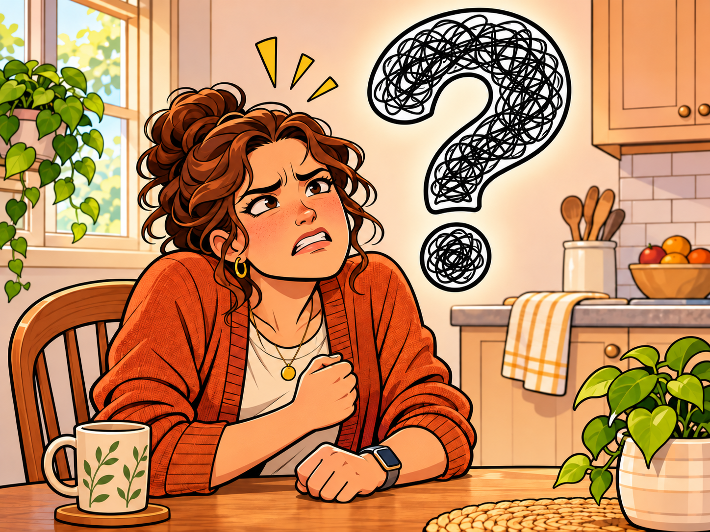

# Emotional Regulation and Involuntary Symptoms

> **Working draft:** Human authored and project-lead approved. Audit 1 corrections applied November 4, 2026; Audit 2 and independent clinical review remain pending.

Lesson 22 considers how emotions are processed and regulated, why conversations can become difficult when functional symptoms arise, and why timing does not establish intent.

*Last reviewed: November 4, 2026*

***

[For the Person With FND](#for-the-person-with-fnd) 
[For Family, Friends, and Other Supporters](#for-family-friends-and-other-supporters) 
[For Clinicians and the Care Team](#for-clinicians-and-the-care-team) 
[Research and Sources](#research-and-sources)

***

## For the Person With FND

### When a conversation suddenly becomes difficult

Jamie has missed the last two family gatherings.

His niece keeps asking when she'll see him again, and the family has finally arranged Sunday lunch.

He really wants to go.

His wife, Alex, wants to go too. But she remembers their last visit. The journey and crowded house left Jamie struggling for the rest of the evening.

"What if we just stay for lunch?" Jamie suggests.

"That could work," Alex replies. "But what if you need to leave early? Should we take separate cars? Could your brother drive you home?"

Jamie begins explaining that his brother is working.

Halfway through, he loses track of why he mentioned his brother.

Alex waits.

"Sorry. What was the question?"

She repeats the questions, trying to help.

Jamie remembers the first while she's asking the third. By the time she finishes, the first has disappeared again.

Frustration begins to rise.

"I do want to work this out," he says. "I just can't find where we were."

Alex has been trying to solve the transport problem.

Jamie has been trying to remain part of the conversation.

Neither wanted it to become difficult.

What happened?

Was Jamie frustrated because he couldn't follow the conversation? Did frustration make thinking harder? Or were several things happening together?

In Lesson 21, we learned how information can become difficult to remember or use.

Now we're going to explore **how emotions work, how we regulate them, and how they may interact with involuntary neurological symptoms.**

### What happens when we feel an emotion?

Leah receives a message from a relative.

"You seemed absolutely fine when I saw you yesterday. I think getting out more would do you good."

Yesterday, Leah managed an hour at a quiet café.

Today, she needed help getting dressed.

She begins typing.

"You saw ONE HOUR."

Then she adds another sentence. And another.

She wants her relative to understand how much effort that hour took.

Her shoulders tense. She's typing faster.

She's angry.

Emotions do more than give us feelings.

They can change what we notice, what we think about, how our bodies respond and what we feel ready to do.

Remember Lesson 20?

We learned about **salience**, which helps explain why some information becomes important, and **arousal**, which describes how ready our nervous system is to respond.

Emotions can influence both.

But emotions and arousal aren't the same thing.

Your heart can beat faster because you're running for a bus, excited about seeing a friend or frightened by something unexpected.

Your body becomes more alert in all three situations, even though the feelings are different.

### When a feeling arrives without an explanation

Chris and his wife, Maya, are having a pleasant morning.

They've been laughing over a crossword. Chris has made coffee, and there's nothing urgent to do.

"Shall I put this washing on?" Maya asks.

Suddenly, Chris feels intensely irritated.

"Yes. Fine."

Maya looks up.

Chris hears his own sharp tone and is surprised by it.

A moment ago, he was enjoying her company.

He still is.

"Sorry. That came out sharply."

"Are you upset about something?"

He searches for an answer.

"I feel upset. I don't know what I'm upset about."

Neither has an explanation.

We often expect emotions to follow thoughts we recognize.

*I'm angry because someone was unfair.*

*I'm worried because something bad might happen.*

But feelings don't always arrive with an explanation attached.

Our brains and bodies respond to information without everything passing through conscious thought first.

Pain, tiredness, physical changes and other influences may contribute.

And the reason may remain uncertain.

**Recognizing an emotion and understanding where it came from are different abilities.**

Chris doesn't have to invent an upsetting thought simply because he's feeling irritated.

### What does it mean to regulate an emotion?

Let's return to Leah and the message from her relative.

She has written several angry paragraphs.

She wants to press send.

But she also knows what could happen next.

Her relative might begin arguing about every detail.

Leah wants to be understood, not spend another evening defending her illness.

She puts the phone beside her.

Later, she writes:

"I enjoyed seeing you yesterday. Today is different. Please keep inviting me, but let me decide what I can manage."

She sends it.

She's still angry.

But she's found a response that better expresses what she wants.

This is an example of emotional regulation.

> **[Emotional regulation](../../glossary/README.md#emotional-regulation):** The ways our brains and bodies influence how emotions develop, how strongly we feel them, how long they last and what we do in response. Some regulation happens automatically, while some involves conscious choices.

Leah made a deliberate choice.

But regulation doesn't always require a conscious decision.

Imagine being startled by a loud crash.

Your body reacts.

Then you see that someone dropped a book.

The alarm begins to fade.

You didn't have to instruct yourself to calm down. Your nervous system adjusted as you understood what happened.

Both kinds of regulation matter.

But here's something especially important.

**Emotional regulation isn't a test of how calm, thoughtful or polite you can remain.**

An emotion can be strong enough that making a decision, finding words or controlling your reaction becomes genuinely difficult.

That doesn't mean you've failed.

Nor does being angry, crying or needing help automatically mean you have a problem with emotional regulation.

The useful question is whether your emotional responses are making something important harder for you—and whether support or different skills could help.

There is no requirement to become someone who never gets upset. (*citations* [1](#citation-1))

### Can you feel happy and resentful at the same time?

Priya receives a photograph from her friends.

They're gathered around a table, laughing.

One friend is wearing a tea towel as a chef's hat because the dessert they made has collapsed into a rather impressive mess.

Priya laughs too.

Then she notices the empty chair beside her closest friend.

That was supposed to be her place.

She had been dressed and ready to join them. Then her symptoms changed, and going out became impossible.

Priya sends a cheerful message about the dessert.

She means every word.

She's happy her friends are having a wonderful evening.

But after putting down her phone, she feels the disappointment of another missed occasion.

And something else.

She's tired of being the person who misses things.

That feeling has been building through months of cancelled plans and lost opportunities.

Yet Priya is generally happy with her life.

She enjoys her friends and looks forward to the future.

Are those feelings contradictory?

Not necessarily.

A person can be content with much of their life while feeling bitter about particular losses.

They can be optimistic about the future and still wish the past had been different.

**Having resentment doesn't automatically mean someone has a problem with emotional regulation.**

### Why can emotions become harder to manage?

Another evening, Jamie and Alex are at home.

Jamie has a headache.

The television is on. Alex is putting away dishes, and a phone keeps vibrating on the table.

Jamie has spent the afternoon dealing with an appointment that was booked incorrectly.

Alex asks about dinner.

"Pasta or something from the freezer?"

"Either."

"Which would you prefer?"

Jamie tries to remember what's in the freezer.

"Did you eat lunch?"

Now the dinner choices disappear.

"And do we need anything from the shop?"

"I don't know!"

Alex stops unloading the dishwasher.

"I only asked what you wanted for dinner."

Jamie hears how sharp his answer sounded.

"I know. I'm trying to answer you."

The dishwasher is still open. The television is still talking.

Jamie can't remember the two dinner choices.

Notice how many things are happening.

Pain, noise, questions and information that keeps slipping away.

Frustration has become part of the experience.

> **Overwhelm:** When the demands you're facing feel greater than what you can manage at that moment. Those demands can involve thinking, emotions, sensations, physical activity or several things together.

Overwhelm doesn't always look like anger.

One person becomes tearful. Another goes quiet. Someone else struggles to organize their thoughts.

Remember the feedback loops we learned about in Lesson 20?

A difficult task can require extra effort. That effort can increase tiredness, making the next part harder.

Emotions can become part of the experience.

But not every emotional difficulty comes from FND.

<figure class="image-60center" markdown="1">

<figcaption>A feeling can become intense and difficult to understand or manage. The scribbled question mark represents that experience, not a universal emotional pattern in FND.</figcaption>

</figure>

### What about medications?

Leah is at a medical appointment.

She's brought a list of things she wants to discuss.

One item near the bottom is crossed out.

*Crying.*

During a planned reduction in an antidepressant, she began crying during ordinary conversations.

Small frustrations felt enormous.

Afterward, she was surprised by how quickly her feelings had changed.

"I thought I should be able to handle it," she says.

The clinician asks when the changes began and how they relate to the medication reductions.

Leah opens the calendar on her phone.

She has the dates.

This matters because medications can affect emotional experiences.

Some antidepressants and pain medicines can influence mood or emotional responses.

Withdrawal from certain medicines can also cause irritability, agitation and changing emotions.

The timing and pattern of these changes can help the prescriber understand what is happening.

A prescribing clinician can help assess them and plan any medication changes together with the person. (*citations* [8](#citation-8))

Later changes in how someone feels deserve the same individual assessment, including their health, circumstances and medication history.

### What have studies actually found in FND?

Imagine a group of people answering questions about emotions.

Some have FND. Others are taking part as a comparison group.

They're asked about anger and how easy or difficult they find managing emotional responses.

In some studies, people with FND reported greater difficulty with certain parts of emotional regulation.

Other studies found less clear differences.

Now imagine another experiment.

People look at photographs of emotional faces.

The researchers ask about their feelings while measuring how their bodies or brains respond.

Some studies have found differences between groups with FND and comparison groups.

But here's something interesting.

**A difference in the body's or brain's response doesn't necessarily mean someone reports feeling a stronger emotion.**

Think back to what we learned about salience and arousal.

The brain receives information, gives some of it priority and prepares the body to respond.

Those activities don't always match what we consciously feel.

Research suggests that emotional information and bodily responses may work differently in some groups of people with FND.

But the findings vary, and many studies have important limitations.

So what can we learn?

**Some people with FND may have differences in how they experience, respond to or regulate emotions. But there isn't one emotional pattern that explains everyone's FND.** (*citations* [1](#citation-1), [2](#citation-2))

The research doesn't prove that emotional difficulties caused a particular person's symptoms.

And it doesn't mean everyone with FND needs emotional-regulation treatment.

### Does this mean I need to work harder at controlling my emotions?

Think about Chris.

His irritation arrived unexpectedly while he was enjoying a crossword with Maya.

He recognized that he'd answered sharply.

Does that mean he needs therapy to control his emotions?

Not necessarily.

Now think about Jamie.

His frustration increased while noise, pain and several questions competed for attention.

Would telling him to try harder at staying calm solve the problem?

It could simply add another demand to an already difficult situation.

Making the environment quieter or reducing the number of questions might be more useful.

And someone who regularly finds emotional responses difficult to manage may benefit from learning emotional-regulation skills with an appropriate professional.

These are different situations.

**Acceptance and rehabilitation aren't opposites.**

We can accept that an emotion is present without blaming ourselves for having it.

We can recognize that our nervous system sometimes responds in unexpected ways.

And we can still learn skills or make changes when an experience is making life difficult.

The goal isn't perfect emotional control.

It's finding ways to make life more manageable and meaningful.

### When cognitive difficulties create emotions

Chris mentions that he hasn't seen his daughter for weeks.

"We had lunch with her on Tuesday," Maya says.

Chris smiles, assuming she means another Tuesday.

"No, we were home. You made soup."

Maya remembers the café, finding somewhere to park and their daughter showing them photographs.

Chris remembers the soup.

At first, he's puzzled.

Then irritated.

He feels as though he's being corrected about a day he lived through.

"Are you sure you didn't go without me?"

"I'm sure you were there."

Chris looks at Maya.

He loves her. Normally, trusting her is as natural as breathing.

But now her certainty conflicts with a memory that feels equally convincing.

*Why do we remember Tuesday so differently?*

*Could she be mistaken?*

*Have I forgotten another part of my life?*

He feels confused, hurt and embarrassed.

For a moment, he even questions whether he can trust what he's being told.

Maya begins offering more details, hoping one will help.

"Please wait," Chris says. "I'm still trying to understand the first bit."

Notice what happened.

Chris began with a memory that felt clear.

The disagreement made him question what he knew.

Then came the emotions.

That is different from assuming an emotion caused the memory difficulty.

And fear isn't the only possible response.

Someone else might become angry, defensive or deeply discouraged.

The other person may feel hurt or confused too.

**Cognitive difficulties can create strong emotions, just as emotions can sometimes make thinking harder.**

Neither person's recollection automatically becomes correct because the other has memory difficulties.

We'll explore the relationship side of these situations in Module 14.

### When feeling strongly and losing an ability happen together

Remember Jamie and Alex planning the family visit?

Jamie wanted to explain why going mattered so much.

But several questions made it difficult to follow the conversation.

He became frustrated.

What came first?

The frustration?

Or the difficulty following the questions?

Perhaps the trouble thinking came first and frustration followed.

Or both were affecting each other.

Now imagine Jamie's speech becoming difficult as well.

He knows what he wants to say, but the words won't come.

Alex can see that he's struggling.

She doesn't know exactly which part is most difficult.

But Jamie still wants to participate.

**Feeling strongly, regulating an emotion and being able to communicate are different abilities.**

A person can be furious and still speak clearly.

Another can feel comfortable and suddenly lose access to words.

The emotional state doesn't tell us everything about someone's neurological abilities.

### What about other involuntary symptoms?

Earlier in the week, Jamie had been angry about a mistake with a benefits application.

He explained the problem, challenged the mistake and stayed on the telephone until he knew what would happen next.

Today, Alex is asking about a television programme.

"Was that the episode with the wedding?"

Jamie knows the scene.

But the words won't come.

Alex offers a character's name.

Jamie shakes his head.

Another suggestion follows.

Now he's lost the scene as well.

He was comfortable a moment ago.

The frustration begins when he realizes he cannot answer a simple question about something he enjoyed watching.

That's important.

**A neurological difficulty can create an emotional response even when no strong emotion came before it.**

Other functional symptoms may also interrupt activities.

Someone's movements may change. Another person experiences dissociation or a functional seizure.

Some people recognize a connection with emotional demands. Others don't.

These experiences need their own assessment.

And their timing alone doesn't establish why they happened.

### Why does the timing matter?

Let's return briefly to Jamie and Alex planning the family visit.

Imagine Jamie's speech becoming so difficult that he can no longer continue.

The conversation stops before they've agreed on transport.

From the outside, someone could wonder whether the interruption happened because Jamie wanted to avoid the discussion.

But that conclusion would go beyond what we know.

Jamie still wanted to participate.

**An involuntary symptom doesn't become a deliberate choice because it happens during a disagreement.**

And Alex's questions about the journey are still important.

We'll explore how people can manage unfinished conversations and shared concerns in Module 14.

For now, the lesson is about distinguishing **what someone intends from what they can do at that moment**.

### Can FND itself change how we feel?

Let's return to Priya.

She was genuinely happy to see her friends enjoying themselves.

But she also wanted to be there.

When another photograph arrives, showing everyone playing a board game together, the disappointment returns.

She had been looking forward to that ordinary evening.

Now she's missing it.

Her sadness doesn't need a complicated explanation.

Living with FND can involve lost opportunities, changed plans, pain, uncertainty and experiences of not being understood.

**An emotion can be a response to living with FND, rather than something that caused FND.**

And emotions and symptoms can sometimes influence one another.

Understanding someone's circumstances matters more than assuming every emotion has one neurological explanation.

### Can clinicians help us understand these experiences?

At an appointment, Jamie explains:

"I get frustrated during conversations."

The clinician asks what happens.

Jamie tries to explain, but he loses his place.

He asks Alex to show the note they prepared together.

It says:

*Jamie sometimes loses the question before becoming frustrated.*

"Yes," Jamie says. "That's what I was trying to explain."

Now the clinician can ask more useful questions.

Does Jamie have difficulty remembering several questions?

Does speech become harder even when he's comfortable?

Does the frustration come before or after the difficulty communicating?

Could pain, sleep, medication or another condition be contributing?

These questions matter because different difficulties need different kinds of help.

**You don't necessarily need a whole team of specialists.**

A clinician you already see can help work out what needs assessment and whether another professional would be useful.

For example, someone with difficulty communicating may benefit from speech-language therapy. Someone who wants help managing overwhelming emotions may benefit from psychological support.

Others may need help with everyday activities or an investigation of another medical condition.

The aim is to find support that fits the problem, taking into account what's available and realistic for the person.

There isn't one emotional-regulation test that diagnoses FND.

And new, sudden or substantially changed neurological symptoms, especially unfamiliar speech difficulty, weakness or changes in awareness, still need appropriate medical assessment.

### Can this understanding help with recovery?

Think about our four people.

Chris experienced unexpected irritation. He may find it helpful to recognize the feeling without immediately needing to explain it.

Leah chose how to respond to a message while still feeling angry. That was one kind of emotional regulation.

Jamie's frustration often appeared when thinking or communication became difficult. Making those activities more accessible may be more useful than expecting him to control every emotion.

Priya experienced sadness about missing time with friends. Her feeling was understandable, and she didn't necessarily need to change it.

These people have different needs.

And not all of them need a treatment.

When someone does want help, it may involve learning emotional-regulation skills, adapting an activity, treating another health problem or finding a better way to communicate.

**Helping someone regulate a feeling isn't necessarily the same as helping them regain access to speech, thinking or movement.**

Support should match the difficulty.

And it shouldn't make someone responsible for preventing every involuntary symptom. (*citations* [1](#citation-1), [3](#citation-3), [4](#citation-4), [6](#citation-6))

### What have we learned?

We began with Jamie and Alex trying to plan a family visit.

We saw how thinking and communication difficulties can interact with emotions.

Leah showed us that feeling angry and choosing how to respond are different things.

Chris reminded us that an emotion can arrive without an obvious explanation.

And Priya showed us how happiness, sadness and resentment can exist together.

We've also learned that studies have found differences in some emotional responses among groups of people with FND, without establishing one explanation for everyone.

**Emotional regulation isn't about achieving perfect calmness.**

Acceptance, useful adaptations and rehabilitation can work together when needed.

And when an involuntary neurological symptom interrupts an important conversation, its timing doesn't tell us what someone intended.

### Something to think about

Think about a conversation that became harder than you expected. Perhaps you lost the question halfway through, couldn't find a word, or had several questions coming at once. Did frustration arrive before the difficulty, or did it begin because you couldn't answer? It's fine if you can't tell which came first.

### How might that feel?

If you still wanted to take part in the conversation, what would you most want the other person to understand? Would more time, fewer questions or a different way to answer help you feel included?

### One small step

For a conversation that matters—perhaps planning a visit or explaining something at an appointment—make room for your answer. One question at a time, a quieter place, or a note you can point to may help. An arrangement that already makes another task easier could be useful here too. You don't have to control every feeling for the conversation to matter.

In our next lesson, we'll explore the difference between **intending an action**, **feeling in control of it**, and **what your body actually does**.

### Optional colouring activity

<a href="{{ '/assets/puzzles/colouring/lesson-22-coloring-book.pdf' | relative_url }}" target="_blank" rel="noopener">Open the Lesson 22 colouring PDF (new tab)</a>, or <a href="{{ '/puzzles/' | relative_url }}?collection=colouring&amp;puzzle=lesson-22">browse the colouring collection</a>.

***

[For the Person With FND](#for-the-person-with-fnd) 
[For Family, Friends, and Other Supporters](#for-family-friends-and-other-supporters) 
[For Clinicians and the Care Team](#for-clinicians-and-the-care-team) 
[Research and Sources](#research-and-sources)

***

## For Family, Friends, and Other Supporters

### When someone you know begins reacting differently

Helen has always thought of her daughter, Tessa, as someone with a good sense of humour. Tessa is in her twenties. She has FND, including functional seizures, and still enjoys joking with her mother and spending time with friends.

But Helen has noticed a change. Things that once seemed to bother Tessa only a little can now leave her intensely upset.

One afternoon, they're getting ready for a family birthday. Tessa is having difficulty fastening a bracelet. Helen offers to help.

"I can manage," Tessa replies.

A few moments later, Helen asks whether she'd rather leave the bracelet off. Tessa suddenly sounds angry.

"Why does everyone think I can't do anything for myself?"

Helen is surprised. She hadn't meant anything of the sort. She was just trying to help.

"I was only asking."

"I know! But you don't understand!"

Tessa's voice gets louder as she tries to explain. Helen feels herself becoming frustrated too. Just ten minutes earlier, they were laughing together. Now neither seems able to make the other understand.

What happened?

### When feelings become harder to manage

Later that evening, Helen and Tessa talk again.

"I'm sorry I shouted," Tessa says. "I knew you were trying to help."

Helen asks what made her so upset.

"I felt embarrassed. Then I felt like you didn't understand why. And the more I tried to explain, the angrier I got."

"Was it really about the bracelet?"

"Not exactly. I don't know how to explain it. It just felt enormous at the time."

Helen thinks about that. She has felt embarrassed plenty of times herself. But she usually understands why she feels that way and can decide what to do next. Tessa seems to have had a much harder time.

And perhaps that's the part Helen hadn't understood.

**Sometimes the difficulty isn't recognizing that you're upset. It's how intensely you feel it, how quickly it grows, and how difficult it becomes to decide what to do next.**

### What might emotional processing have to do with FND?

Researchers have been investigating differences in how people with FND experience and respond to emotions.

In a 2019 review, Pick and colleagues examined research involving emotional recognition, bodily and neurological responses to emotional information, and emotional regulation. Some studies found differences between groups of people with FND and comparison groups. (*citations* [1](#citation-1))

Later research frameworks have explored how emotional processing might interact with attention, bodily signals and networks involved in functional neurological symptoms. (*citations* [2](#citation-2))

This raises an interesting possibility: **for some people with FND, aspects of emotional processing or regulation may themselves be more difficult.** That doesn't mean everyone with FND experiences emotions differently, or that FND has been proven to cause these changes.

But it does mean that an unexpected change in someone's emotional experience deserves to be understood, rather than automatically dismissed as a personality problem.

Let's return to Tessa. Helen knows her daughter is usually cheerful and thoughtful. She's also noticed that certain feelings, particularly embarrassment and frustration, seem much harder for Tessa to manage than they once were.

Those observations don't tell Helen exactly what's happening neurologically. But they give her a different way to understand the experience. Perhaps Tessa isn't simply becoming angry over something small. Perhaps **the feeling itself has become much more difficult to manage than Helen realizes**.

### Feeling an emotion and knowing what to do with it

There's another distinction worth understanding. We all experience strong emotions. Anger, embarrassment, sadness and excitement are ordinary parts of life.

*Emotional regulation* involves how our brains and bodies influence those feelings and what we do in response. Some of this happens automatically. Other parts involve decisions we make consciously.

Imagine feeling embarrassed after making a mistake in front of friends. You might laugh, change the subject or remind yourself that everyone makes mistakes.

But what if the embarrassment keeps growing? You know nobody intended to hurt you. You even recognize that the situation wasn't particularly serious. Yet the feeling remains powerful.

Now someone asks why you're so upset. You try to explain, but you can't quite find the words. The harder you try, the more frustrated you become. You might even become louder because you desperately want the other person to understand.

That's a very different experience from deliberately deciding to argue. It can be confusing for both people. And it helps explain why telling someone they're overreacting may make an already difficult moment harder.

### Two people can experience the same moment differently

Think about Helen offering to help with the bracelet. From her perspective, it was an ordinary, kind gesture.

From Tessa's perspective, the offer arrived during a moment when she was already struggling with an activity she used to manage easily. Perhaps she felt embarrassed. Perhaps the difficulty reminded her of other things she'd lost. Or perhaps the feeling became intense before she could understand why.

Helen couldn't see all of that. And Tessa couldn't necessarily explain it while it was happening. Neither person had the whole picture.

That's something supporters may recognize from their own experiences. Sometimes the person with FND seems to interpret an event very differently from everyone else. Sometimes their emotional response appears much stronger than the situation would suggest. And sometimes they return to their usual cheerful self afterward, leaving everyone wondering what happened.

These differences are worth understanding without assuming that every emotional response is caused by FND. Pain, poor sleep, medications, other health conditions and ordinary life experiences can affect emotions too.

### When emotions and functional symptoms occur together

Now imagine that Tessa's speech becomes difficult while she's trying to explain herself. She still wants Helen to understand, but the words won't come as easily. Her frustration may increase because she can't finish what she was saying.

Or perhaps she experiences one of her familiar functional seizures during another emotionally demanding situation.

From the outside, the timing might seem connected. But there are several possibilities. An emotional demand might contribute to the difficulty. A neurological symptom might create frustration. Or several things might be happening together.

**A symptom appearing during an emotional moment doesn't tell us that the person intended it or that the emotion caused it.**

This matters because someone can want very much to continue a conversation while becoming unable to do so. It also helps us understand why emotional regulation isn't simply a matter of trying harder to remain calm.

### What might help them understand each other?

Let's return to Helen and Tessa after the birthday. They're discussing the bracelet again, but this time neither is upset. Helen has a question.

"When you said I didn't understand, what did you want me to know?"

Tessa thinks for a moment.

"That I was embarrassed. And when you offered to help again, I felt worse, even though I knew you meant well."

Helen hadn't realized that.

"Would it have been better if I'd just waited?"

"Maybe. Or asked if I wanted help and left it there."

That's something they can try another time. And perhaps Tessa has something she'd like to work on too.

She may want help recognizing when a feeling is becoming difficult to manage, or finding another way to explain what she's experiencing. A psychologist or another appropriate clinician can help when emotional regulation itself is becoming a significant difficulty. That support can be useful without assuming emotional problems caused the person's FND.

Helen doesn't need to become her daughter's therapist. She can remain her mother: someone who listens, learns and occasionally offers help.

### When safety matters

For familiar functional seizures, an agreed [safety plan](../module-05-medical-safety-and-new-symptoms/02-emergency-information-and-individual-safety-plans.md) helps everyone know how to respond and when a change calls for urgent medical assessment.

Understanding why an emotional response has become difficult doesn't mean anyone has to accept threats, intimidation or abuse. Both people deserve safety and respectful treatment.

Understanding the person's wider health needs matters too. In a study of people diagnosed with functional seizures in three specialist video-EEG services, overall mortality was higher than in the general population. Among patients in that group who died before age 50, approximately **20% of those deaths were attributed to suicide**. This is a proportion of deaths within that selected cohort; an individual's needs are best understood through a personal assessment. (*citations* [7](#citation-7))

This doesn't mean that irritability, emotional intensity or a functional seizure indicates suicidal thinking. But if someone talks about wanting to die, harming themselves or being unable to stay safe, it's important to take them seriously and seek appropriate professional support. Immediate danger calls for emergency help.

### Understanding someone who's still themselves

Helen knows her daughter. She knows the thoughtful, funny person who enjoys spending time with family. And she's beginning to understand another part of Tessa's experience.

Some feelings may now become much stronger than they once did. Tessa may struggle to understand them, respond to them or explain them while they're happening.

That doesn't erase the person Helen knows. Nor does it mean that every difficult emotion needs to be attributed to FND. It simply gives Helen something new to consider when a familiar situation suddenly becomes difficult.

The next time Tessa becomes unusually upset, Helen may remember their conversation about the bracelet. Perhaps she'll recognize that Tessa is struggling with the feeling itself, not just with what happened. And perhaps they'll find it easier to understand each other afterward.

**Sometimes what looks like an unusually strong reaction is also an experience the person themselves is struggling to understand.**

***

[For the Person With FND](#for-the-person-with-fnd) 
[For Family, Friends, and Other Supporters](#for-family-friends-and-other-supporters) 
[For Clinicians and the Care Team](#for-clinicians-and-the-care-team) 
[Research and Sources](#research-and-sources)

***

## For Clinicians and the Care Team

### When emotions and neurological symptoms occur together

Lesson 21 explored how cognitive difficulties can interrupt an activity or leave someone unable to access information they need. When that happens during an emotionally significant situation, another question arises: **How do we distinguish the emotion, the person's ability to regulate it, and an involuntary change in neurological function?**

Emotional regulation involves processes that influence how emotions develop, how intensely they are experienced, how long they last and how a person responds. Some processes occur automatically, while others involve deliberate choices.

Regulation is not synonymous with remaining calm. Someone may experience considerable anger yet choose an effective response. Another person may experience an unexpected emotion without understanding what prompted it. Neither situation necessarily indicates impaired emotional regulation.

Similarly, arousal, discussed in Lesson 20, describes a broader state of physiological and cognitive readiness. It is not a measure of emotional distress.

These distinctions become especially important when a functional symptom appears during a difficult conversation or another emotionally significant event.

### Clinical case: The discussion that never finishes

*Sofia is a fictional patient with an established diagnosis of functional seizures following appropriate neurological assessment.*

She and her partner, Malik, are discussing household responsibilities. Malik has been managing more of the household tasks than either expected, and he wants to find a more sustainable arrangement.

Sofia understands his concern. She wants to take on more responsibilities, but her symptoms are unpredictable, and she worries about promising something she cannot reliably manage.

As they discuss possible arrangements, Sofia struggles to keep track of several points. Malik asks whether she could take responsibility for a particular task each week.

She begins answering, loses her place and becomes frustrated.

Shortly afterward, she experiences one of her typical functional seizures. The conversation ends, and afterward she cannot recall everything they had been discussing.

Malik is concerned about her wellbeing, but he is also discouraged. Several important conversations have ended this way, leaving the practical problem unresolved.

From his perspective, the timing is difficult to understand.

Sofia tells her clinician, "I wanted to answer him. I was frustrated because I couldn't get my thoughts together."

**What can this sequence tell us about emotional regulation and involuntary symptoms?**

### Separating emotion, regulation and neurological capacity

Sofia's experience involves several possible changes, each deserving its own interpretation.

She was discussing something emotionally significant. She also experienced difficulty retaining and organizing information, became frustrated and subsequently had a functional seizure.

The order matters because it helps clarify her experience, but it does not establish a causal sequence.

Perhaps cognitive difficulty contributed to frustration. Perhaps emotional demands affected her ability to follow the discussion. Several factors may have interacted, or the seizure may have occurred independently of those changes.

The clinician also has an important distinction to make between **what Sofia intended and what she was capable of doing at that moment**.

She intended to participate. Her difficulty accessing information limited that participation. The seizure interrupted it further.

An episode occurring immediately after an unwelcome question might appear purposeful to an observer, particularly when similar interruptions have happened before. But apparent convenience is not evidence of intentional symptom production.

Functional seizures are involuntary events. Their diagnosis and assessment depend on appropriate clinical evidence rather than interpretations of a person's motivation. (*citations* [4](#citation-4), [5](#citation-5))

Malik's experience remains relevant too. His concern about household responsibilities has not been resolved by the event, and his difficulty understanding the timing is worth acknowledging.

**Recognizing an involuntary interruption and recognizing the other person's unresolved concern are compatible clinical positions.**

### What does emotional regulation actually contribute?

Emotion can influence attention, bodily responses, memory and behaviour. Some of these changes occur before a person recognizes what they are feeling; others involve conscious decisions about how to respond.

Consider two different situations.

One patient becomes angry during an appointment but remains able to explain the problem, consider alternatives and choose how to respond. The emotional response is intense, yet several aspects of regulation remain available.

Another patient is relatively comfortable when a functional speech difficulty begins. Frustration develops afterward because communicating has become difficult.

In the second situation, focusing primarily on emotional control could miss the more immediate neurological and functional problem.

Sofia's experience presents a third possibility: cognitive difficulty, emotional frustration and a functional seizure occur close together, without sufficient evidence to determine whether one caused another.

These differences matter for rehabilitation. Psychological support may be useful when emotional responses themselves are difficult to manage or cause significant distress. When the principal difficulty involves cognitive access, communication or an involuntary episode, another form of assessment or support may be more relevant.

The purpose is not to separate psychology from neurology as though they cannot interact. It is to identify **which part of the experience creates the difficulty that care might realistically address**.

### What has research found?

Pick and colleagues (2019) reviewed research examining emotional processing in FND, including emotional recognition, subjective experiences and physiological or neural responses. They identified differences in some group comparisons, alongside substantial variation in findings and methods. (*citations* [1](#citation-1))

Drane and colleagues (2021) described a broader framework in which emotional processing may interact with attention, salience, bodily information and neural networks involved in functional symptoms. (*citations* [2](#citation-2))

**Why do these findings matter?** They support investigation of relationships between emotional processing and neurological function. They also help explain why emotional experiences may be clinically relevant without being the cause of every functional symptom.

The findings do not establish that all people with FND have difficulty regulating emotions or that emotional regulation is the mechanism responsible for Sofia's seizures.

A useful clinical distinction follows: emotional processing can be relevant to a person's care even when its precise relationship to their neurological symptoms remains unknown.

### Finding a useful rehabilitation opportunity

Sofia's goal is not simply to remain calm during difficult conversations. She wants to participate in decisions that affect her and Malik's shared life.

The immediate difficulty is that important information becomes hard to use, and an involuntary episode may interrupt the discussion before Sofia has communicated her position.

One possible approach involves making the information needed for a decision available in a form that does not depend entirely on uninterrupted memory and speech.

For example, Sofia may find it easier to consider a short written outline of the options and indicate what she thinks about each one. The information remains available if she loses her place, and her contribution need not disappear when an episode interrupts the conversation.

This is a functional adaptation rather than a treatment intended to suppress an emotion.

**Why might it help?**

The outline reduces some of the demands on working memory and creates another way for Sofia to participate. It also preserves the substance of the discussion, making it possible to return to an unresolved issue without reconstructing everything from memory.

Neither person has to abandon their concerns because the conversation became difficult.

The accommodation cannot guarantee that Sofia will avoid another seizure. Its usefulness lies in improving access to a meaningful activity: participating in a shared decision.

The more detailed work of negotiating responsibilities, making concessions and maintaining sustainable boundaries belongs in Module 14.

### What would meaningful improvement look like?

Suppose Sofia and Malik can revisit an interrupted discussion with a clear record of what remains undecided.

Sofia is better able to express her preferences, and Malik can see that his concern has not been forgotten. They may still disagree, and Sofia may still experience functional symptoms.

Nevertheless, the discussion has become more accessible.

That distinction is important. A rehabilitation outcome might involve improved participation, reduced cognitive effort or fewer misunderstandings without a measurable change in seizure frequency.

The approach may also have limitations. Sofia might find written information useful during a quiet discussion but difficult to read when experiencing severe cognitive symptoms. A strategy that requires too much preparation could become another burden.

The relevant clinical question is whether the adaptation improves the activity that matters to the person, including whether it remains practical in everyday life.

**Successful rehabilitation does not require the person to suppress every emotion or prevent every involuntary symptom.**

### When is emotional-regulation support relevant?

Some people with FND experience persistent difficulties recognizing, tolerating or responding to strong emotions. Others experience understandable frustration, grief or distress related to the limitations imposed by their illness.

Those situations may have different implications.

For example, a patient who repeatedly finds emotional intensity difficult to manage and wants help may benefit from psychological work addressing emotional awareness, regulation or coping.

For another patient, an emotional response may reflect a practical difficulty that care has not yet addressed. Persistent pain, disrupted sleep, medication changes, withdrawal effects or the burden of disability may be particularly relevant.

Emotional distress may also follow an involuntary symptom rather than precede it.

Recognizing these possibilities helps avoid making emotional regulation a universal requirement for FND rehabilitation.

It also allows emotional wellbeing to receive appropriate attention when it is important to the patient, even if treating that concern does not directly alter the neurological symptom.

### How might different professionals contribute?

Sofia's functional seizures already require appropriate neurological diagnosis and an individualized approach to safety and ongoing care. Changes in event characteristics, new medical concerns or a possible coexisting seizure disorder remain separate clinical questions. The functional-seizure management guideline provides presentation-specific guidance. (*citations* [4](#citation-4))

Psychological expertise may be relevant if Sofia wants help with emotional regulation, distress or other difficulties for which psychological treatment is appropriate. That involvement need not imply that her seizures are caused by unresolved emotions.

If cognitive demands interfere with participation in everyday activities, occupational therapy may offer useful activity analysis and adaptations. Speech-language therapy may contribute where an assessed functional communication difficulty is an important part of the presentation. (*citations* [3](#citation-3), [6](#citation-6))

The professional contribution is strongest when it addresses an identified difficulty rather than an assumed cause.

For detailed background, see [Emotional Regulation, Irritability, and Overwhelm](../../reference/biopsychosocial-experiences/01-emotional-regulation-irritability-and-overwhelm.md) and the [Functional Seizures diagnostic reference](../../reference/diagnostic-signs/06-functional-seizures.md).

### What should clinicians take from this lesson?

Emotional experiences, emotional regulation, cognitive access and involuntary neurological symptoms are related but distinct aspects of a person's presentation.

Understanding their relationship can improve care, particularly when a symptom occurs during an emotionally significant situation and its timing invites assumptions about intention.

Sofia's case illustrates why the sequence of events deserves attention without becoming an explanation in itself. Her frustration, cognitive difficulty and functional seizure may interact, but each can also require a different clinical response.

The rehabilitation opportunity lies in understanding what has become difficult and what might improve meaningful participation, while preserving appropriate neurological care and the person's autonomy.

**Clinical takeaway:** Emotional significance does not establish emotional causation. Distinguishing feelings, regulation, neurological capacity and intention helps clinicians identify useful support without assigning responsibility for involuntary symptoms or overlooking the concerns of others involved.

***

[For the Person With FND](#for-the-person-with-fnd) 
[For Family, Friends, and Other Supporters](#for-family-friends-and-other-supporters) 
[For Clinicians and the Care Team](#for-clinicians-and-the-care-team) 
[Research and Sources](#research-and-sources)

***

## Further reading in the Reference Library

- [Emotional Regulation, Irritability, and Overwhelm](../../reference/biopsychosocial-experiences/01-emotional-regulation-irritability-and-overwhelm.md) — the broader explanation, boundaries and circumstances that may warrant assessment.
- [Functional Cognitive Disorder](../../reference/functional-cognitive-disorder.md) — different forms of cognitive difficulty and why one symptom doesn't settle a diagnosis.
- [Functional Speech and Voice Symptoms](../../reference/diagnostic-signs/09-functional-speech-and-voice-symptoms.md) — presentation-specific assessment and care.
- [Functional Seizures](../../reference/diagnostic-signs/06-functional-seizures.md) — diagnostic considerations, safety and uncertainty.
- [Professional Roles in FND Care](../../reference/professional-roles-in-fnd-care.md) — who can assess and support particular needs.

***

## Research and Sources

A review of emotional processing and an FND framework inform the explanatory material. Clinical and medication guidance support individualized care. The mortality study describes a selected specialist cohort. The everyday scenes are fictional teaching examples.

| Citation | Figure | Full citation and what it supports |
|---|---|---|
| **[1]** | — | Pick S, Goldstein LH, Perez DL, Nicholson TR. **Emotional processing in functional neurological disorder: a review, biopsychosocial model and research agenda.** JNNP. 2019;90:704–711. [DOI](https://doi.org/10.1136/jnnp-2018-319201) · [FND-CIT-0005](../../research/citation-index.md#fnd-cit-0005). Heterogeneous research and unresolved mechanisms, not universal emotion dysregulation. |
| **[2]** | — | Drane DL, Fani N, Hallett M, Khalsa SS, Perez DL, Roberts NA. **A framework for understanding the pathophysiology of functional neurological disorder.** CNS Spectr. 2021;26:555–561. [DOI](https://doi.org/10.1017/S1092852920001789) · [FND-CIT-0006](../../research/citation-index.md#fnd-cit-0006). Proposed mechanisms, not individual causal proof. |
| **[3]** | — | Baker J, Barnett C, Cavalli L, et al. **Management of functional communication, swallowing, cough and related disorders: consensus recommendations for speech and language therapy.** JNNP. 2021;92:1112–1125. [DOI](https://doi.org/10.1136/jnnp-2021-326767) · [FND-CIT-0025](../../research/citation-index.md#fnd-cit-0025). Consensus guidance for presentation-specific SLT involvement. |
| **[4]** | — | Tolchin B, Goldstein LH, Reuber M, et al. **Management of functional seizures practice guideline executive summary.** Neurology. 2026;106:e214466 (online December 2025). [DOI](https://doi.org/10.1212/WNL.0000000000214466) · [FND-CIT-0010](../../research/citation-index.md#fnd-cit-0010). Seizure assessment and care; not proof of emotional cause. |
| **[5]** | — | Bennett K, Diamond C, Hoeritzauer I, et al. **A practical review of functional neurological disorder for the general physician.** Clin Med. 2021;21:28–36. [DOI](https://doi.org/10.7861/clinmed.2020-0987) · [FND-CIT-0001](../../research/citation-index.md#fnd-cit-0001). Positive diagnosis and proportionate investigation. |
| **[6]** | — | Nicholson C, Edwards MJ, Carson AJ, et al. **Occupational therapy consensus recommendations for functional neurological disorder.** JNNP. 2020;91:1037–1045. [DOI](https://doi.org/10.1136/jnnp-2019-322281) · [FND-CIT-0011](../../research/citation-index.md#fnd-cit-0011). OT role and context-sensitive activity analysis. |
| **[7]** | — | Nightscales R, McCartney L, Auvrez C, et al. **Mortality in patients with psychogenic nonepileptic seizures.** Neurology. 2020;95:e643–e652. [DOI](https://doi.org/10.1212/WNL.0000000000009855) · [FND-CIT-0050](../../research/citation-index.md#fnd-cit-0050). Reported suicide accounted for about 20% of deaths among the patients who died before age 50 in this cohort; this is a **proportion of deaths**, not the risk that an individual with functional seizures will die by suicide, and it cannot predict an individual patient’s risk. |
| **[8]** | — | National Institute for Health and Care Excellence. **Medicines associated with dependence or withdrawal symptoms: safe prescribing and withdrawal management for adults.** NG215. 2022. [Recommendations](https://www.nice.org.uk/guidance/ng215/chapter/Recommendations), sections 1.5.6–1.5.10 and 1.5.17–1.5.20. Accessed November 4, 2026. [FND-CIT-0328](../../research/citation-index.md#fnd-cit-0328).  |
