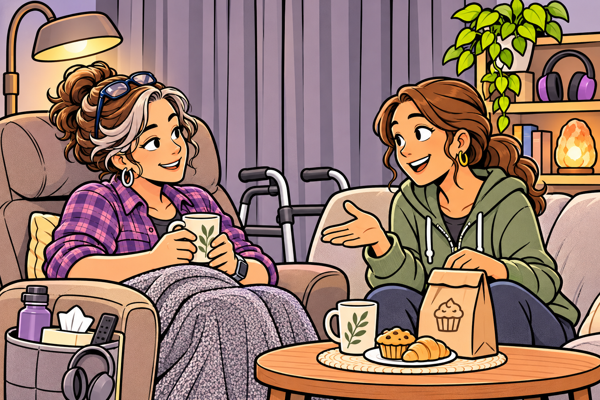

# When Better Doesn't Mean Symptom-Free

> **Working draft:** All three audience sections are human authored and approved. Editorial Audit 1 and owner-approved Work audit corrections applied November 7, 2026. Publication-readiness review completed November 8, 2026; independent clinical review and the project lead’s publication decision remain pending.

Lesson 24 explores how someone can make meaningful progress in participation and quality of life even when severe symptoms and support needs remain. All three audience sections are human-authored and approved.

*Editorial Audit 1 and Work evidence review: November 7, 2026 · Independent clinical review pending*

***
[For the Person With FND](#for-the-person-with-fnd) 
[For Family, Friends, and Other Supporters](#for-family-friends-and-other-supporters) 
[For Clinicians and the Care Team](#for-clinicians-and-the-care-team) 
[Research and Sources](#research-and-sources)

***

## For the Person With FND

### "You seem so much better!"

Natalie has been looking forward to Thursday.

Her friend Leah is coming over. They try to get together once or twice a week, and since Natalie lives alone, these visits are something she especially enjoys.

She has already drawn the curtains against the bright afternoon light. The living room is quiet, and everything she might need is within easy reach.

These arrangements aren't new. Over time, Natalie has worked out how to make her home more comfortable and how to prepare for activities that might otherwise be difficult.

Her FND is severe. Functional seizures regularly disrupt her life, and she lives with a continuous migraine. Light and sound sensitivity, unreliable movement, fatigue and cognitive difficulties make everyday activities challenging.

There's something else on her mind, too. A recent spell of dizziness felt different from the ones she's familiar with. She has an appointment coming up and wants to ask about it.

But today, she's ready for some company.

Leah arrives with a small bag from the bakery. She explains that she'd tried making her own bread over the weekend, with rather disappointing results.

"I could have used it as a doorstop," she says.

Natalie laughs.

They settle into their usual conversation. Leah tells her about the week's events, and Natalie shares a little of what she's been doing.

Sometimes Natalie loses track of the conversation, and Leah patiently reminds her what they were talking about. Neither makes a fuss about it.

They talk, laugh and enjoy an hour together.

Natalie's migraine is still there. Her head hasn't stopped hurting, but the quiet surroundings make the conversation easier to manage.

When Leah gets ready to leave, she gives Natalie a hug.

"You seem so much better lately!"

Natalie smiles.

"Thanks. I've really enjoyed today."

And she has.

<figure class="image-60center" markdown="1">

<figcaption>A good afternoon can be real progress, even when symptoms and support needs remain.</figcaption>

</figure>

### The part Leah didn't see

After Leah leaves, Natalie settles back into her chair.

The visit was wonderful, but she's tired now.

She'd kept the morning quiet so she'd have more energy for the afternoon. Even with the room arranged to make things easier, conversation still required concentration, and sitting comfortably with a friend didn't mean the pain had disappeared.

Natalie knows she'll need to rest.

Her functional seizures are still severe, too. Some days they take away hours she would rather spend doing almost anything else.

Walking around her home remains difficult, particularly when her coordination and strength are unreliable. And although she manages much of her daily life alone, there are times when she needs more assistance than her friend can provide during an occasional visit.

None of that was visible during the pleasant hour Leah spent with her.

But Leah wasn't imagining things, either.

Natalie really did seem more comfortable. She laughed, followed much of the conversation and enjoyed herself.

A year ago, she might have struggled to manage even that much.

So was Leah right?

Natalie thinks about it for a moment.

Actually, yes.

But there is more to the story.

### What has changed?

When Natalie was first diagnosed, almost everything seemed to revolve around her symptoms.

If she had a particularly difficult day, she felt as though she was back where she'd started. When something went well, she wondered whether her FND was finally improving.

Then another seizure would happen, and her hope would take a knock.

Over time, she began learning more about FND.

She learned why symptoms can vary, how attention and body signals influence everyday experiences, and why familiar activities can become difficult even when someone knows exactly what they want their body to do.

She discovered ways to approach activities differently.

Some things still didn't work. Others became more manageable.

At first, Natalie found it difficult to accept how much she needed to change her surroundings and routines.

She used to enjoy having the curtains wide open and sunlight filling the room. Now, even moderate light can make her migraine considerably worse.

For a long time, the darkened living room reminded her of everything FND had taken away.

But something gradually changed.

One afternoon, she realized that the very same room had become a place where she could enjoy spending time with Leah.

The curtains were still closed. Her migraine was still painful.

Yet she was looking forward to something again.

**Her understanding had changed before her symptoms had.**

That new understanding didn't cure her FND. She couldn't choose whether to have a functional seizure, or simply decide to stop experiencing pain.

But she began to see more possibilities.

Instead of asking only whether her symptoms would allow an activity, she could sometimes consider whether changing the activity might make it possible.

And instead of seeing every difficult day as proof that she wasn't improving, she began to notice what was becoming easier.

There were still disappointments. She missed activities she couldn't manage, and some adaptations were awkward or inconvenient.

But she no longer measured every bit of progress against the life she'd had before FND.

She was beginning to understand what progress could look like in the life she had now.

### A good hour and a difficult day

Here's something worth considering.

Natalie's afternoon with Leah went well.

That doesn't mean the whole day was easy.

She needed to prepare beforehand, and she needed to rest afterward. Her symptoms remained severe.

But the enjoyable hour wasn't any less real because of those difficulties.

Sometimes we think of getting better as one thing: our symptoms becoming less frequent or less severe.

And that kind of improvement matters enormously.

Someone whose functional seizures have become much less frequent may have gained something very important, even if other symptoms remain difficult.

But there are other changes worth recognizing.

Perhaps an activity becomes easier because someone has learned a more comfortable way to approach it.

Perhaps they can participate in something that once felt impossible, though it still takes considerable effort.

Or perhaps their symptoms haven't changed much at all, but they feel less lost because they understand their condition better.

These changes aren't interchangeable.

Being able to do something once doesn't necessarily mean we can do it reliably. Being able to complete an activity doesn't tell us how much effort it required, or whether it left us exhausted.

And feeling happier about life doesn't necessarily mean we're experiencing fewer symptoms.

**We can be improving in one part of life while continuing to struggle greatly in another.**

For Natalie, that distinction makes a difference.

A difficult evening no longer has to cancel out a lovely afternoon.

Nor does a lovely afternoon mean that her continuing difficulties deserve less attention.

Both experiences belong to her life.

### Why does this matter?

Imagine Natalie speaking with her clinician at her next appointment.

"How have things been going?"

A year earlier, she might have answered by thinking about her seizures or the intensity of her migraine.

Those are still important.

But now she has a fuller answer.

"My seizures haven't improved much, and my migraine is still constant. But I've worked out how to enjoy having a friend over again. I'm much happier about that. I still find the preparation and recovery difficult, though."

That tells the clinician something a simple "better" or "worse" might miss.

Natalie has made meaningful progress, but she still needs care for severe symptoms and help with activities that aren't reliably manageable.

Her progress in one area doesn't take away her needs in another.

And there's still that unfamiliar episode of dizziness she wants to ask about. She knows her usual symptoms well enough to recognize that something felt different, but she doesn't know what it means.

Feeling better about parts of her life hasn't answered every question about her health.

Because Natalie can distinguish these things, she and her clinician have a better starting point. They can recognize what has improved, discuss what remains difficult, and give that unfamiliar experience the attention it deserves.

Perhaps she'd like to make another activity easier to manage. Perhaps she wants help with the effort required for something she can already do. Or perhaps her greatest priority remains reducing the symptoms themselves.

Those are different goals, and she has a say in which ones matter most.

### A little more room for hope

Later that evening, Leah sends Natalie a message.

"Thanks for today. I needed that laugh!"

Natalie smiles.

She'd needed it, too.

Her migraine is still bothering her, and she knows tomorrow might be difficult.

But the afternoon was worth looking forward to, and she enjoyed it.

Natalie still hopes her seizures will become less severe and her movement more reliable. She hasn't given up on further recovery.

She has simply discovered that improvements in her life don't always have to wait for improvements in every symptom.

Learning about FND has helped her understand what's happening, recognize useful choices and make sense of changes that once felt confusing.

That knowledge has given her hope—not certainty about recovery, but a growing sense that there may be more ways for life to become better than she first imagined.

On the small table beside her chair sits a note about the unfamiliar dizziness, ready for her appointment. She has also saved a Reference Library page about functional seizures after coming across it while following these lessons. It's a different question—one about the diagnosis and care she's lived with for years—and she can return to it when she's ready.

There's no need to answer every question tonight.

For now, she sends Leah a message thanking her for the visit—and asking whether that unfortunate loaf of bread is still available for use as a doorstop.

### Something to think about

Imagine someone who can now enjoy an hour with a friend, although their symptoms are much the same as before.

What has improved?

Think about how the answer might change if the conversation became easier, if it took less effort, or if the person simply began looking forward to visits again.

Each possibility tells us something different about their progress.

### How might that feel?

Imagine having a wonderful afternoon, then hearing someone say, "You must be getting better!"

You might be pleased they noticed something good. You might also wish they understood how much effort it took, or how difficult the rest of your week can be.

What would help you enjoy being recognized for your progress while still feeling understood about the difficulties that remain?

### One small step

When someone asks how you're doing, you might try describing one particular part of your life rather than answering for your health as a whole.

For example:

"I'm enjoying having visitors again. My symptoms are still severe, but I've found ways to make those afternoons easier."

Or perhaps your symptoms really have improved, and that's what you'd most like to share.

You don't need to measure every change or keep another record.

Sometimes, understanding **what has improved, what hasn't, and what matters most to you** can make a conversation much more useful.

### Optional crossword

Revisit the lesson with a crossword. The easy edition includes a word bank.

<a class="puzzle-card" href="{{ '/puzzles/' | relative_url }}?collection=crosswords&amp;puzzle=lesson-24" aria-label="Browse Lesson 24 crossword">When Better Doesn't Mean Symptom-Free</a>

<a href="{{ '/assets/puzzles/crosswords/Module-8-Lesson-24/finding-words-for-what-happens-m8-24-easy.pdf' | relative_url }}" target="_blank" rel="noopener">Easy</a>
<a href="{{ '/assets/puzzles/crosswords/Module-8-Lesson-24/finding-words-for-what-happens-m8-24-normal.pdf' | relative_url }}" target="_blank" rel="noopener">Normal</a>
<a href="{{ '/assets/puzzles/crosswords/Module-8-Lesson-24/finding-words-for-what-happens-m8-24-answer-key.pdf' | relative_url }}" target="_blank" rel="noopener">Answer key</a>

PDFs open in a new tab.

### Optional colouring activity

<a href="{{ '/assets/puzzles/colouring/lesson-24-coloring-book.pdf' | relative_url }}" target="_blank" rel="noopener">Open the Lesson 24 colouring PDF (new tab)</a>, or <a href="{{ '/puzzles/' | relative_url }}?collection=colouring&amp;puzzle=lesson-24">browse the colouring collection</a>.

***
[For the Person With FND](#for-the-person-with-fnd) 
[For Family, Friends, and Other Supporters](#for-family-friends-and-other-supporters) 
[For Clinicians and the Care Team](#for-clinicians-and-the-care-team) 
[Research and Sources](#research-and-sources)

***

## For Family, Friends, and Other Supporters

### The part nobody sees

Imagine Leah telling another friend about the lovely afternoon she spent with Natalie.

"We had such a good laugh. She seems so much better lately!"

And Leah is right about something important. Natalie really has found ways to enjoy their visits again.

But let's look at how that Thursday began.

When Natalie woke, she sat on the edge of her bed for a while, waiting to see how well her legs would cooperate. She needed to get to the bathroom, but her balance was particularly unreliable that morning.

Getting washed and dressed took longer than she'd hoped. She managed most of it while sitting down, taking breaks when her arms became tired. A shower would have to wait for another day.

Breakfast was something simple. She checked her medication organiser, then looked at the note she'd left herself about an upcoming appointment.

By the time she'd eaten and put a few things away, Natalie was ready for another rest.

She still had things she wanted to do. There was laundry waiting, and the kitchen needed attention. But she was expecting Leah that afternoon, and she knew that trying to accomplish everything might leave her with too little energy to enjoy the visit.

So the laundry could wait.

Before Leah arrived, Natalie pulled the curtains, adjusted the lighting and made sure she had water and somewhere comfortable to sit.

When Leah walked through the door, Natalie was ready.

They talked, laughed about Leah's disastrous attempt at baking bread and enjoyed an hour together.

Afterward, Natalie settled back into her chair. Her migraine was still painful, her legs were tired, and she wasn't looking forward to getting up to prepare supper.

The laundry was still waiting.

Leah had seen Natalie enjoying herself. She hadn't seen how much of the day had been arranged around making that hour possible.

**The afternoon was a success. It just wasn't the whole story.**

### When there's nobody to share it with

Natalie lives alone, although she's fortunate to have Leah visit once or twice a week.

Now imagine that same Thursday without Leah—or anyone else.

The morning difficulties would still be there. Getting washed, finding something to eat, keeping track of medication and moving safely around the home wouldn't suddenly become easier.

And those are just the things that happen before lunch.

There's shopping to arrange, clothes to wash, meals to prepare and appointments to remember. The rubbish needs taking out. The bathroom needs cleaning. Fresh sheets don't put themselves on the bed.

These are ordinary parts of life, but they don't disappear when someone becomes disabled.

Imagine a person who has finally managed to get the laundry into the washing machine. By the time it's finished, their legs have become unreliable, and they can't safely bend to remove the clothes.

So they leave them.

Later, they think about making dinner. The kitchen lighting aggravates their migraine, and the noise of cooking is difficult to tolerate. They manage something simple, then sit down because they're becoming unsteady.

The laundry is still in the machine.

Perhaps tomorrow will be easier. Perhaps it won't.

You can see how quickly an ordinary household task can become a problem that carries into the next day.

And what if that person has nobody to call?

There's no one to move the laundry, prepare something to eat or help them finish a task they've already started.

Even on a better day, the backlog is waiting.

It's easy to imagine how frustrating that might become. A person may be proud of what they've managed while feeling disheartened by everything that remains undone.

And when they do accomplish something special, perhaps an enjoyable outing or a task they've been working toward for weeks, there may be nobody to share that little victory with.

The accomplishment is still real.

But wouldn't it be lovely to have someone say, "You managed it! How did it go?"

### Managing alone isn't always managing well

Think about how many ordinary activities become easier when another person is available.

Someone can bring a glass of water while you remain seated. They can carry a plate when you need both hands to use a walking aid. They can help you remember an appointment, reach something you've dropped or prepare a meal when you're too exhausted to stand for long.

They might barely notice they're helping.

Now imagine trying to arrange your entire day without any of that assistance.

A person might decide to wash at the sink because showering requires more strength than they have. They may rely on clothes that are easy to put on, even when those aren't the clothes they'd prefer to wear.

Perhaps they keep essential items close to their favourite chair because getting up repeatedly is difficult. They may choose meals requiring little preparation or leave household chores until a day when their movement is more reliable.

These can be sensible adaptations that make independence more achievable.

But sometimes an activity isn't merely difficult. It may be unsafe or impossible without another person's assistance.

A walking aid cannot necessarily help someone who needs physical support to transfer from one position to another. A reminder on a phone cannot take the place of hands-on assistance when the person's movement or responsiveness is severely impaired.

And a carefully arranged home cannot eliminate every challenge of living with unpredictable symptoms.

This creates a difficult choice for some people.

They may use much of their available energy on essential tasks, leaving little for the activities that make life enjoyable. Or they may preserve some energy for those activities while other needs remain unmet.

It isn't difficult to imagine someone feeling caught between the two.

From the outside, we might see a person living alone, keeping appointments and occasionally enjoying an activity.

What we don't see are the things they've stopped doing, the things they've postponed and the opportunities they've passed up because nobody was available to help.

**Sometimes a person is managing alone because they have no alternative, not because everything is manageable.**

### What if you're only there occasionally?

Let's return to Leah.

Perhaps during their next visit, she asks Natalie how she's been managing.

Natalie mentions that she's had a difficult few days and hasn't accomplished much around the house.

"But you seemed so well when I was here last Thursday," Leah says.

Then she remembers the preparations Natalie had made for their visit.

"Does having me over take quite a bit out of you?"

Natalie smiles.

"Sometimes. I try to keep the morning quiet so I've got enough energy to enjoy myself. I'm usually pretty tired afterward."

Leah wonders whether she'd be helping by visiting less often.

But Natalie quickly explains that she looks forward to their afternoons. They're one of the things that make her week enjoyable.

That's an important moment.

Leah has discovered something she hadn't fully appreciated, but the answer isn't necessarily to take away the activity Natalie loves.

Perhaps there are small changes that would make their time together easier. They could have lunch delivered occasionally, or Leah could bring something simple when it suits them both.

Or perhaps Natalie is perfectly happy with their arrangement and would rather keep their visits just as they are.

What matters is that Leah understands a little more about the experience without deciding for Natalie what should happen next.

And Leah has her own responsibilities. She's a friend who visits occasionally, not someone who can be available whenever Natalie needs assistance.

Their friendship doesn't have to become a caregiving arrangement to remain valuable.

Sometimes the greatest pleasure of a visit is having someone to laugh with about something other than illness.

### When there really isn't anyone

Of course, not everybody has a Leah.

For some people, even occasional assistance is unavailable.

Think about a person whose difficulties have gradually reduced the activities they can manage. Perhaps they haven't been able to visit friends for months. Perhaps family members live far away, or relationships have become strained.

Over time, their world may have become smaller.

The shops are harder to reach. Social activities require more effort than they can manage. Even keeping up with everyday household tasks becomes exhausting.

They may have developed clever ways of managing many things independently, but that doesn't mean every need has been met.

And they might not want to explain all these difficulties repeatedly, particularly when they have no expectation that someone will be able to help.

There's a particular sadness in having to choose between essential tasks and meaningful activities because nobody is available to make both possible.

But there's something we can learn from recognizing that situation.

A person's needs aren't limited to the tasks they successfully complete.

An assessment of everyday support needs, for example, may reveal more when it considers the whole day or week rather than whether someone can perform a particular activity once.

Someone might manage to get dressed but then be too exhausted to prepare breakfast. They might attend an appointment but have no energy left to make dinner. Or they might be capable of an activity on a good day while needing physical assistance on another.

Those differences matter.

Depending on what's available, accessible services, assistance with practical tasks or changes to the way an activity is organized may reduce some of these difficulties.

Not every community has suitable services, and obtaining assistance can itself be difficult.

Still, understanding precisely where help is missing creates a clearer picture of what might make a difference.

Rather than simply seeing someone who struggles with daily life, we begin to see the activities they could participate in if particular barriers were reduced.

### A little more room for life

Think back to Natalie's Thursday.

She arranged much of her day around an hour with Leah. She enjoyed herself, and that was worth something.

There were still difficulties afterward, and she would have appreciated more assistance with some of the ordinary tasks of living alone.

But she had something to look forward to, and she made it possible.

Now think about the person who has no Leah.

Perhaps they aren't able to arrange an outing or social visit. Perhaps most of their available energy goes into getting dressed, preparing food and keeping the household running.

It would be easy to overlook how much effort those ordinary accomplishments require.

But what if even one part of that burden became easier?

Imagine someone receiving practical help with an activity that has consumed much of their energy. They might finally have enough left to sit outside for a little while, enjoy a hobby or make an outing that previously seemed out of reach.

Their FND may not have improved. Their need for assistance may still be considerable.

Yet something about their life could have changed.

That possibility doesn't depend on pretending every difficulty has an easy solution.

It begins with understanding that people may be doing an extraordinary amount of work simply to get through an ordinary day.

**Being able to cope alone should never be mistaken for evidence that help isn't needed.**

And when we understand what daily life actually requires, we have a better chance of recognizing where assistance, accessibility or a different arrangement could give someone a little more room for the things they enjoy.

That's a worthwhile kind of progress to hope for.
***
[For the Person With FND](#for-the-person-with-fnd) 
[For Family, Friends, and Other Supporters](#for-family-friends-and-other-supporters) 
[For Clinicians and the Care Team](#for-clinicians-and-the-care-team) 
[Research and Sources](#research-and-sources)

***

## For Clinicians and the Care Team

### When "better" describes only part of the picture

In the *For the Person With FND* section, we met Natalie during an enjoyable afternoon with her friend Leah. The following clinical discussion can also be read independently.

Natalie lives alone with longstanding, severe FND, including functional seizures and unreliable movement. She also experiences a continuous migraine with significant light and sound sensitivity. None of her current clinicians was involved in her original diagnosis or early treatment.

During an appointment, she describes a welcome change. By preparing her surroundings, limiting other demands and arranging time to recover, she can once again enjoy visits with Leah.

"My seizures haven't improved much, and the migraine is still constant. But I really look forward to having Leah over now."

Her clinician has inherited a complex history, but Natalie's account provides a useful picture of her current circumstances.

**What does this improvement actually tell us?**

### The difference between doing something and doing it reliably

Natalie has experienced a meaningful improvement in participation and quality of life. She's enjoying a relationship that matters to her, and the activity has become more manageable.

However, she hasn't described a corresponding reduction in neurological symptoms.

Her functional seizures remain severe, and the adjustments that make social visits possible require considerable preparation and recovery time.

This distinction matters because several different outcomes are often described using the same word: *improvement*.

A reduction in seizure frequency would represent a change in symptom burden. Greater consistency in walking or communicating might represent improved functional reliability. Being able to enjoy an afternoon with a friend represents improved participation, particularly when it was previously difficult or impossible.

These changes may occur together, but they don't have to.

Natalie's experience also illustrates the importance of context.

She can participate more comfortably in a quiet, dimmed room, with familiar company and opportunities to rest. Her performance in that setting doesn't establish how reliably she can manage similar activities elsewhere.

Yet the adaptations shouldn't be discounted simply because they contributed to her success. The ability to participate under accessible conditions is itself meaningful.

The more interesting question is what has made the improvement possible, how sustainable it is and which difficulties remain.

### What about the migraine?

There's another important part of Natalie's account.

Her migraine is constant.

For a clinician inheriting her care, this raises a separate question about the headache itself. Has its pattern been adequately characterized? What treatments have been considered, and how effective is her current management?

Migraine is a neurological disorder with its own diagnostic criteria and evidence-based treatment options. It can coexist with FND, and the conditions may influence one another, but their relationship isn't fully understood.

Stone and colleagues (2025) reviewed the evidence concerning migraine and FND, describing comorbidity and possible interactions. The findings don't establish that migraine is simply another manifestation of FND or that both disorders arise from one shared mechanism. (*citations* [1](#citation-1))

This matters when earlier medical records have grouped several symptoms under a broad FND diagnosis.

The current clinician doesn't need to invalidate that diagnosis to consider the migraine independently. Even when a headache has been considered associated with FND, its characteristics, disabling effects and available treatment options remain clinically relevant.

For Natalie, severe pain and sensory sensitivity affect much more than comfort. They influence the effort required to attend appointments, communicate, undertake rehabilitation and enjoy ordinary activities.

An effective migraine treatment might therefore improve her capacity for participation, even if her functional seizures remain unchanged.

Conversely, improvement in social participation shouldn't be taken as evidence that her migraine no longer requires attention.

**Recognizing improvement in one domain can help reveal opportunities for care in another.**

### What has research found about meaningful outcomes?

Rutten and colleagues (2025) examined how people with FND, caregivers and healthcare professionals understand treatment outcomes.

Their qualitative study involved interviews with 22 patients, 18 caregivers and 21 healthcare professionals. The findings highlighted the importance of considering outcomes beyond neurological symptoms, including daily activities, independence, emotional wellbeing and quality of life. (*citations* [2](#citation-2))

These perspectives are relevant because different participants in care may recognize different forms of progress.

A patient may place particular importance on being able to visit friends again. A clinician may also need to understand symptom frequency, functional performance or treatment response. A caregiver may be especially aware of the assistance or recovery time required.

Each perspective can contribute useful information without necessarily describing the same outcome.

The study offers insight into stakeholder priorities, but its selected sample doesn't establish population-wide preferences or demonstrate treatment effectiveness.

Pick and colleagues (2020), in a systematic review of FND outcome measurement, identified limitations in existing measures and emphasized the need to consider multiple domains. (*citations* [3](#citation-3))

Together, these studies raise an important methodological question: **Does the selected measure capture the change that matters to this person?**

A seizure-frequency measure could miss Natalie's improved participation. A participation measure could miss continuing seizure severity, considerable effort and unmet support needs.

Neither measure is inherently wrong. They answer different questions.

Professional occupational therapy consensus recommendations by Nicholson and colleagues (2020) similarly emphasize meaningful daily activities and individually relevant goals. These recommendations provide a clinical framework for understanding participation, rather than proof that a particular adaptation produces neurological recovery. (*citations* [4](#citation-4))

### How might this change the clinical conversation?

Consider two possible summaries of Natalie's current situation.

The first is brief:

*Natalie reports improvement in daily functioning.*

Although positive, that statement leaves considerable uncertainty. It doesn't identify what has changed or distinguish improved participation from symptom recovery.

A more informative account might be:

*Natalie reports greater enjoyment of social visits through environmental adaptations and planned rest. Functional seizures and persistent migraine remain severely disabling, and participation continues to require substantial preparation and recovery.*

The second account doesn't diminish her progress. It makes that progress more understandable while preserving the needs that remain.

It also opens the possibility of a more meaningful discussion about what Natalie would like to change next.

Perhaps she wants to maintain her visits while reducing their physical and cognitive cost. Perhaps she feels her migraine requires more attention. Or perhaps reducing the severity of her functional seizures remains her greatest priority.

Each goal has a different clinical meaning.

For example, suppose an adjustment allows Natalie to enjoy a visit without spending as much of the following day recovering. That would represent a reduction in the cost of participation, even if the duration of the visit and her seizure frequency remained unchanged.

Alternatively, an improvement in migraine management could reduce pain and sensory demands, potentially making several activities more accessible.

These are possibilities to consider within the context of her individual assessment, rather than outcomes that can be predicted from the case.

The value of identifying the particular goal lies in understanding what a proposed intervention is intended to improve.

### Progress doesn't erase continuing needs

Natalie's social visits are a success, but they occupy only a small part of her week.

She continues to live alone with severe functional seizures, unpredictable movement and other disabling symptoms. Leah provides occasional companionship, not continuous assistance.

These circumstances remain relevant when considering safety, independence and access to care.

A person who can participate successfully under carefully arranged conditions may still require significant help in other circumstances. Conversely, continuing severe symptoms need not prevent meaningful progress in activities that matter to them.

Both observations are clinically important.

For an inheriting clinician, Natalie's own account provides information about current functioning that historical records and brief examinations may not capture.

It also highlights the difference between recognizing improvement and assuming that care needs have decreased.

### Understanding what has changed

Natalie's story illustrates why improvement in FND cannot always be described by a single outcome.

Her neurological symptoms remain severe, yet she has regained something valuable: the ability to look forward to and enjoy time with a friend.

That improvement deserves recognition.

So do the continuing migraine, seizures, effort and support needs that shape the rest of her life.

**The clinical value of understanding progress lies not simply in knowing that someone is doing better, but in identifying what has improved, what made that possible, and what remains important to the person.**

That distinction can make both the interpretation of outcomes and subsequent conversations about care more meaningful.
***
[For the Person With FND](#for-the-person-with-fnd) 
[For Family, Friends, and Other Supporters](#for-family-friends-and-other-supporters) 
[For Clinicians and the Care Team](#for-clinicians-and-the-care-team) 
[Research and Sources](#research-and-sources)

***

## Research and Sources

Research sources are identified by their evidence type and scope. The references below were checked against accessible original publications or their abstracts on November 7, 2026; access limits are recorded in the internal Work audit. Independent clinical review remains pending. Community quotations describe individual experiences and are not clinical or prevalence evidence. The stories and conversations in this lesson are fictional teaching examples, not research cases or tested treatment protocols.

| Citation | Figure | Full citation and relevant use |
|---|---|---|
| **[1]** | — | Stone J, Coebergh J, Khoja L, Butler M, Nicholson TR, Dodick DW. **Migraine and functional neurological disorder (FND)—a review of comorbidity and potential overlap.** *Brain Communications*. 2025;7(4):fcaf288. [Original](https://doi.org/10.1093/braincomms/fcaf288) · [FND-CIT-0049](../../research/citation-index.md#fnd-cit-0049). Review of comorbidity and possible interactions; not proof of one common mechanism. |
| **[2]** | — | Rutten S, Bradley-Westguard A, Nicholson TR, et al. **Outcome measurement in functional neurological disorder: a qualitative study on the views of patients, caregivers and healthcare professionals.** *Journal of Neurology*. 2025;272:189. [Original](https://doi.org/10.1007/s00415-025-12912-9) · [FND-CIT-0012](../../research/citation-index.md#fnd-cit-0012). Qualitative perspectives, not a population estimate or treatment trial. |
| **[3]** | — | Pick S, Anderson DG, Asadi-Pooya AA, et al. **Outcome measurement in functional neurological disorder: a systematic review and recommendations.** *Journal of Neurology, Neurosurgery & Psychiatry*. 2020;91(6):638–649. [Original](https://doi.org/10.1136/jnnp-2019-322180) · [FND-CIT-0067](../../research/citation-index.md#fnd-cit-0067). Review of measure selection and limitations, not proof of an individual intervention’s effectiveness. |
| **[4]** | — | Nicholson C, Edwards MJ, Carson AJ, et al. **Occupational therapy consensus recommendations for functional neurological disorder.** *Journal of Neurology, Neurosurgery & Psychiatry*. 2020;91(10):1037–1045. [Original](https://doi.org/10.1136/jnnp-2019-322281) · [FND-CIT-0011](../../research/citation-index.md#fnd-cit-0011). Professional consensus supporting individualized participation goals; not a treatment-efficacy trial. |

*Editorial Audit 1 and owner-approved Work corrections: November 7, 2026. Evidence access limits and validation results are recorded in the internal audit. Publication-readiness review completed November 8, 2026; independent clinical review and the project lead’s publication decision remain pending.*
