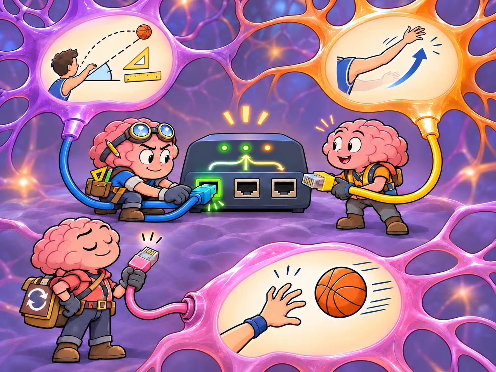

# How Rehabilitation Uses Learning

> **Working draft:** All three audience sections are human authored and project-lead approved November 10, 2026. Original-source and citation checks, editorial and Work audits, independent clinical review and publication decision remain pending.

Lesson 27 explores how rehabilitation uses neuroplastic learning through everyday examples and FND-related processes.

***
[For the Person With FND](#for-the-person-with-fnd) 
[For Family, Friends, and Other Supporters](#for-family-friends-and-other-supporters) 
[For Clinicians and the Care Team](#for-clinicians-and-the-care-team) 
[Research and Sources](#research-and-sources)

***

## For the Person With FND

<!-- Person section human-authored and approved by the project lead, with paragraph-flow revision November 10, 2026. Research/source reconciliation, lesson audits and independent clinical review remain pending. -->

### Learning something without realizing it

Natalie is sitting at her kitchen table, trying to order a few groceries on her tablet.

The supermarket has updated its website. The buttons have moved, the shopping list looks different, and something that used to take five minutes is becoming quite an adventure.

She wants to add a carton of milk. Instead, she opens a page about delivery charges. She goes back, finds the milk, and accidentally adds three cartons.

"Well, at least I won't run out," she mutters.

Natalie eventually finishes her order, although it takes more concentration than she'd expected. Her migraine makes looking at the screen uncomfortable, and she has to stop several times.

A few days later, she opens the website again. This time, she remembers where to find her shopping list. Some of the steps require less thought, and she finishes with fewer mistakes.

She hasn't been practising for a competition in online shopping. She's simply become more familiar with something through experience.

**How does an activity that once required so much attention become easier to do?**

### What actually changes when we learn?

Think about something you've learned, such as typing, preparing a favourite meal or playing a musical instrument. At first, you may have needed to think carefully about every step. Later, you could concentrate more on what you wanted to accomplish than on how to make each action happen.

Your nervous system had learned something. Scientists call its ability to change through experience **neuroplasticity**.

> **Neuroplasticity:** The nervous system's ability to change how it works or is organized through learning and experience.

Our brains contain enormous networks of nerve cells that communicate with one another. These networks help us recognize information, prepare movements, interpret sensations and remember experiences.

Learning can change how these networks function. Some connections may become more influential, while groups of nerve cells begin working together differently. Scientists can sometimes measure changes in the brain as people learn.

In one well-known study, researchers taught adults to juggle. Brain scans showed changes in particular areas of grey matter as participants learned the skill. After they stopped practising, some of those changes became smaller.

The scans couldn't reveal which tiny nerve-cell connections had changed, but they showed that learning in adulthood could be accompanied by measurable changes in brain structure. ([Draganski and colleagues, 2004](https://doi.org/10.1038/427311a))

And neuroplasticity isn't limited to learning movements. Experience can influence attention, predictions, sensory processing, memory and the responses that become familiar.

These are processes we've already explored. Now let's see how learning might help them change.

<figure class="image-60center" markdown="1">

<figcaption>Learning can change how nervous-system networks work together, one experience at a time.</figcaption>

</figure>

### How can we recognize learning?

Suppose Natalie's first shopping trip became easier because Leah sat beside her and pointed out the buttons. That helped Natalie complete the order.

But when Natalie returns a few days later and remembers where the buttons are herself, something different has happened. And if she can use what she learned to navigate another shopping website, some of that learning may be useful in a new situation.

Researchers use two terms to describe these changes.

> **Retention:** When something learned remains available after time has passed.
>
> **Transfer:** When learning from one situation helps with another situation.

These ideas are useful in rehabilitation. An ability might become easier during an appointment. Later, the person may discover that some of the improvement remains available, or that they can use it during an activity at home.

Sometimes the same cue or support remains necessary. That can still make an activity more accessible, even when a lasting change in the underlying ability hasn't been established.

### Attention and automatic control

> **Attention:** The process of giving some information or activities greater priority than others. It can influence how we experience sensations, prepare movements and carry out tasks.
>
> **Automatic control:** When the nervous system manages familiar actions without us consciously directing every part. Experience can make some actions easier to organize.

Neuroplastic learning may help an action become more automatic, so it requires less conscious attention.

Imagine Maya, who has a diagnosed functional voice difficulty. During speech therapy, she discovers that her voice sometimes becomes clearer in natural conversation than when she concentrates on producing individual sounds.

Her therapist helps her explore suitable ways of using that easier voice. With practice, Maya may begin finding it again during later appointments and eventually in conversations at home.

The possible neuroplastic change is that her nervous system becomes more familiar with organizing speech without so much conscious attention to each part.

Professional recommendations for functional movement and communication difficulties include approaches involving automatic actions and meaningful activities. ([Nielsen and colleagues, 2015](https://pmc.ncbi.nlm.nih.gov/articles/PMC4602268/); [Baker and colleagues, 2021](https://jnnp.bmj.com/content/92/10/1112))

### Predictions and feedback

> **Prediction:** The nervous system's best guess about what is likely to happen next, based on previous experiences and current information.
>
> **Feedback:** Information about what actually happened during an action or experience, which the nervous system can use to adjust future responses and predictions.

Imagine picking up your usual coffee cup and discovering that it's much lighter than expected. Your hand may lift it farther than intended. But the next time, your nervous system may already be better prepared for the lighter weight.

Researchers have demonstrated this kind of learning experimentally. In one study, people performed reaching movements while a device applied unexpected forces to their arms. Their movements gradually adjusted, showing that the nervous system had learned from experience. ([Shadmehr and Mussa-Ivaldi, 1994](https://pmc.ncbi.nlm.nih.gov/articles/PMC6577492/))

Now imagine someone with an assessed functional hand movement difficulty. During therapy, they discover that placing a card inside an envelope is easier than making a similar movement while concentrating on their fingers.

That provides an experience their nervous system may learn from. With suitable practice, preparing and organizing the movement might become more familiar.

Some researchers propose that differences in how the brain uses predictions and incoming information contribute to functional symptoms. **Neuroplasticity offers a possible way for experience to change those predictions**, although this proposed mechanism hasn't been established for every symptom or rehabilitation benefit. ([Edwards and colleagues, 2012](https://doi.org/10.1093/brain/aws129))

### Learning from our senses

> **Proprioception:** The nervous system's sense of where body parts are and how they're moving, even when we aren't looking at them.
>
> **Exteroception:** Information received from the outside world through senses such as sight, hearing and touch.

Neuroplastic learning may help the nervous system use different sources of information during an activity.

Imagine someone with an assessed functional movement difficulty who struggles to place a lid on a container. A therapist discovers that a clear visual target helps them position their hand. With appropriate practice, the person may become more familiar with using visual information to guide the movement.

Later, they might manage a similar activity at home with less assistance.

The possible neuroplastic benefit involves how sensory information is combined and used during the task. If the visual cue remains necessary, it can continue to serve as a useful adaptation.

Occupational-therapy recommendations recognize both meaningful rehabilitation and practical adaptations, although research hasn't established one sensory approach for every FND presentation. ([Nicholson and colleagues, 2020](https://jnnp.bmj.com/content/91/10/1037))

### Interoception and functional seizures

> **Interoception:** The nervous system's ability to sense and interpret conditions inside the body, including hunger, heartbeat, breathing and other internal changes. Detecting a signal, interpreting it and deciding how to respond are related but different processes.

Neuroplastic learning may help someone recognize a familiar internal signal or develop a more useful response to it.

Imagine someone whose functional seizures are sometimes preceded by a recognizable change in awareness. With professional guidance, they might become more familiar with that change and learn to use an agreed safety or support plan sooner.

Over time, the response may require less deliberate attention. **The learning concerns recognizing and responding to an experience, even if the seizures themselves continue.**

Not everyone has a recognizable warning. Someone whose seizures begin without one may need a different approach.

Researchers are also investigating how people with FND detect and interpret internal signals. In a small study, some heartbeat-detection measures were similar between people with and without FND, while other measures suggested differences in confidence or reported body-signal experiences.

The study didn't test rehabilitation, but it illustrates why sensing a signal and interpreting it deserve separate attention. ([Merritt Millman and colleagues, 2023](https://doi.org/10.1016/j.brat.2023.104379))

Seizure-focused treatments may involve other kinds of learning as well. We'll examine their outcomes in Lesson 29.

### Salience, arousal and emotional responses

> **Salience:** The importance or priority the nervous system gives to information.
>
> **Arousal:** The nervous system's level of readiness and responsiveness, which changes with activity, discomfort, excitement and other experiences.
>
> **Emotional regulation:** Processes involved in responding to and managing emotions. Some happen automatically, while others involve responses and skills that can be learned.

Through experience, the nervous system may learn which information deserves attention and which responses are useful in a particular situation.

Imagine someone who experiences word-finding difficulties during demanding conversations. With suitable support, they may discover that a brief pause or familiar cue helps them return to what they were saying.

Neuroplastic learning could help that response become more familiar. The word-finding difficulty may continue, but returning to a conversation might become easier.

The surroundings can also influence what's possible. Natalie's severe migraine and sound sensitivity make noisy places difficult. A quieter environment may allow her to concentrate on an activity or participate in a conversation.

That improvement comes from an accommodation rather than necessarily from a change in her symptoms. Sometimes such an accommodation also makes learning possible by reducing competing demands.

### Memory and thinking

> **Memory and thinking:** Processes that help us take in information, hold it briefly, store and retrieve experiences and knowledge, and organize our actions.

Neuroplastic learning may help parts of a complicated task become more familiar, reducing the attention or recall they require.

Natalie might discover that keeping her shopping list visible beside her grocery basket makes ordering easier. At first, she has to remind herself to arrange the screen that way. After several shopping trips, it becomes part of her usual routine.

Her memory difficulties may continue, but completing the order requires fewer repeated searches.

This distinction is especially useful for functional cognitive disorder, or FCD. Someone might learn a more reliable way to use reminders, develop a familiar routine or experience an improvement in the cognitive symptoms themselves.

These changes aren't identical. For someone whose symptoms remain difficult, a useful learned strategy may still make everyday life considerably easier.

Studies of FCD rehabilitation are beginning to examine both changes in symptoms and people's satisfaction with how their memory works. We'll look at those findings in Lesson 29.

### The sense of agency

> **Sense of agency:** The feeling that we are making an action happen, involving the connection between what we intend, what occurs and the result we notice.

Let's return briefly to Maya and her voice.

As speaking becomes easier to initiate, she might also notice a change in how it feels to control her voice. Perhaps she no longer needs to concentrate so carefully on producing the first sound, or perhaps speaking begins to feel more natural.

Her ability to produce speech and her experience of controlling it may both change through neuroplastic learning, but they aren't necessarily the same change.

Maya might develop a more reliable voice while still feeling uncertain about speaking. Or she might become more comfortable initiating conversations before her voice improves consistently.

Scientists are investigating how the sense of agency relates to FND recovery. For Maya, a more directly recognizable change would be whether speaking has become easier and whether that improvement is available during conversations that matter to her.

### What does this mean for rehabilitation?

We've now seen how neuroplastic learning might influence several familiar nervous-system processes.

Rehabilitation professionals sometimes build on this ability by helping people experience useful actions under suitable conditions and develop skills that may become more familiar over time.

A physiotherapist might work with movement. A speech-language therapist might help someone with functional communication difficulties. Other approaches may involve cognitive skills, daily activities or functional seizures. The appropriate treatment depends on the particular difficulties and the person's circumstances.

There's also an important scientific distinction.

**Knowing that neuroplasticity makes learning possible doesn't establish that a particular treatment works.**

Research must examine whether people receiving that treatment actually benefit. Even when improvement is demonstrated, scientists may still be investigating which nervous-system changes produced it.

Lesson 28 will explore what receiving rehabilitation can be like, including experiences of gradual improvement, setbacks and different kinds of progress. Lesson 29 will examine the treatment studies themselves.

### More than a theory about the brain

Later that afternoon, Natalie tells Leah about her adventures ordering groceries.

Leah laughs when she hears about the three cartons of milk.

"At least you've figured it out now."

"Mostly," Natalie replies. "Apparently I can learn new things after all."

She means it as a joke, but the experience has helped her understand something. Learning the website hasn't improved her functional seizures or taken away her migraine. Still, it has made the connection between experience and neuroplasticity easier to recognize.

Attention, predictions, sensory information and familiar routines all contribute to what we do. Through learning, some aspects of how these processes work can change.

Natalie doesn't know which of her abilities might improve through suitable rehabilitation. But she has a better understanding of what a rehabilitation professional might be helping her nervous system learn—and why it matters whether a useful change remains available in everyday life.

She looks at the shopping confirmation on her tablet.

One carton of milk this time.

Then she remembers the bread.

Perhaps there's still a little learning left to do.

### Something to think about

Since developing FND, have you learned to recognize a body signal, respond differently to a symptom, or adapt an everyday activity?

**Can you recognize how neuroplastic learning might have contributed to that change?**

### How might that feel?

How might you feel if rehabilitation helped you regain an ability or made something important easier, even while other symptoms remained difficult?

### One small step

If you're receiving rehabilitation, you could ask your therapist:

"What might my nervous system be learning through this activity, and how would we recognize that learning outside therapy?"

Perhaps the goal is to make an action more automatic, use sensory information differently or develop a more reliable response to a familiar difficulty.

You don't need to practise anything new or test your symptoms to complete this lesson.

Understanding the connection between **neuroplastic learning, a rehabilitation activity and something meaningful in your life** can help you take a more informed part in your rehabilitation.

### Optional crossword

Revisit the lesson with a crossword. The easy edition includes a word bank.

<a class="puzzle-card" href="{{ '/puzzles/' | relative_url }}?collection=crosswords&amp;puzzle=lesson-27" aria-label="Browse Lesson 27 crossword">How Rehabilitation Uses Learning</a>

<a href="{{ '/assets/puzzles/crosswords/Module-9-Lesson-27/how-rehabilitation-uses-learning-m9-27-easy.pdf' | relative_url }}" target="_blank" rel="noopener">Easy</a>
<a href="{{ '/assets/puzzles/crosswords/Module-9-Lesson-27/how-rehabilitation-uses-learning-m9-27-normal.pdf' | relative_url }}" target="_blank" rel="noopener">Normal</a>
<a href="{{ '/assets/puzzles/crosswords/Module-9-Lesson-27/how-rehabilitation-uses-learning-m9-27-answer-key.pdf' | relative_url }}" target="_blank" rel="noopener">Answer key</a>

PDFs open in a new tab.

### Optional colouring activity

<a href="{{ '/assets/puzzles/colouring/lesson-27-coloring-book.pdf' | relative_url }}" target="_blank" rel="noopener">Open the Lesson 27 colouring PDF (new tab)</a>, or <a href="{{ '/puzzles/' | relative_url }}?collection=colouring&amp;puzzle=lesson-27">browse the colouring collection</a>.

## For Family, Friends, and Other Supporters

<!-- Supporter section human-authored and approved November 10, 2026.
Two fictional person/supporter pairs; clinical research and source-audit work remain pending. -->

### Something worth celebrating

Amira has FND, and speaking has become unpredictable.

Sometimes her voice sounds fairly normal. Other times, words come out strained or barely audible. Occasionally, she can't manage more than a whisper.

She's been working with a speech-language therapist and has recently noticed some encouraging changes.

> **Neuroplastic learning:** When experience changes how the nervous system works, sometimes helping an ability become easier or more reliable over time.

Amira hopes that neuroplastic learning will help her voice become more reliable in everyday conversations. Her sister Jess has been pleased to hear about her progress.

Jess has helped with transportation, listened when Amira needed to talk about difficult appointments, and celebrated the little improvements along the way. The two sisters have always been close, although Jess admits that she still finds some of Amira's symptoms difficult to understand.

One Sunday, they're having lunch together.

Amira is telling Jess about something amusing that happened at the supermarket. She's halfway through the story when Jess realizes that Amira has been speaking comfortably for several minutes.

"Listen to you!" Jess exclaims. "You're sounding so much better!"

Amira smiles.

"I know! It's been a pretty good morning."

Jess is delighted. Their mother has been worried about Amira, and Jess immediately thinks how pleased she'd be to hear her daughter's voice sounding stronger.

"You should phone Mum! She'd love to hear you."

Amira hesitates.

"Maybe later."

"Come on, you're doing so well. Just give her a quick call."

Amira doesn't want to disappoint Jess. Besides, she *has* been speaking better today. Perhaps making the call would be another little victory.

She picks up her phone.

### When encouragement changes the moment

Their mother answers, pleased to hear from her.

"Hello, sweetheart! How are you feeling?"

Amira opens her mouth, but her voice catches. She tries again, concentrating on producing the words clearly.

"Hi, Mum. I was just..."

Her voice becomes strained. She pauses, then manages a few whispered words before handing the phone to Jess.

Jess finishes the conversation while Amira sits quietly beside her.

Afterward, Jess looks disappointed.

"Oh, that's a shame. You were speaking so well just a minute ago."

Amira nods.

"I know."

Jess thinks for a moment.

"Maybe you were trying too hard?"

"Maybe," Amira replies. "But I was just enjoying talking to you. Then suddenly I was thinking about whether I could still do it."

Jess hadn't considered that difference.

She wanted to celebrate something encouraging, and perhaps show their mother how much progress Amira had made.

She hadn't intended to turn lunch into another challenge.

"I'm sorry," she says. "I got excited."

Amira smiles.

"I was excited too. It just felt different when I had to prove it."

Jess understands a little more now.

The successful conversation was real. So was the difficulty that followed. **One didn't cancel out the other.** A good conversation might be an encouraging step, but neuroplastic learning isn't established by one good moment—or disproved by one difficult one.

### What might have changed?

We've already learned that familiar actions, including speaking and moving, can sometimes become easier through experience.

Speech-language therapy recommendations for functional communication difficulties recognize that the circumstances of speaking may influence how easily a person communicates. Different activities can place different demands on attention and automatic control. [4](#citation-4)

For Amira, chatting naturally with Jess and making an unexpected telephone call weren't quite the same experience. Neuroplastic learning might eventually help her voice become more reliable across different situations, but an improvement in one setting doesn't mean it's available on demand in another.

The difference doesn't tell us exactly why her voice changed. But it's something her therapist might find useful to understand.

And for Jess, there's another lesson.

She doesn't need to pretend she hasn't noticed an improvement.

Amira enjoyed hearing her sister say she sounded better. It was lovely to share that moment.

The difficulty came when Jess assumed that because Amira could speak comfortably during lunch, she could demonstrate the same ability on demand.

The following week, Jess notices that Amira is speaking more comfortably again.

This time she simply says, "It's really nice hearing you tell your stories again."

Amira grins.

"Careful. I've got about seventeen more."

"Wonderful," Jess says. "I'll put the kettle on."

They laugh, and the conversation continues.

Jess still hopes Amira's voice will improve. She still wants to help.

But she's learning that **celebrating progress and expecting someone to repeat it are two different things**.

### An ordinary afternoon with Natalie and Leah

Across town, Leah has come to visit Natalie.

Natalie lives alone with severe FND. Her functional seizures, walking difficulties, cognitive symptoms and continuous migraine make everyday activities unpredictable.

Leah visits when she can. They usually spend their time chatting, sharing food or laughing about something that happened during the week.

Today, Natalie is finishing an online grocery order when Leah arrives.

"Just a minute," Natalie calls. "I'm almost done!"

Leah settles into a chair.

A few weeks earlier, the supermarket had changed its website, and Natalie had struggled to find her usual shopping list. She'd accidentally ordered three cartons of milk.

Leah still finds that rather funny.

"How's your dairy business going?"

Natalie laughs.

"Very well, thank you. I've decided to branch into cheese."

She finishes adding her groceries, checks the order and puts down her tablet.

"Actually, I've gotten a lot better at using that thing. I can usually remember where everything is now."

"That's good!"

"It is. I don't have to keep going back and looking for things quite so much."

Becoming familiar with the new layout is an everyday example of neuroplastic learning. Natalie has learned where to find things through experience, even though her migraine and cognitive difficulties still vary.

Leah remembers how frustrated Natalie had been with the new website.

She could ask Natalie to show her how quickly she can complete another order. Perhaps she'd even be faster this time.

But Natalie has already finished shopping.

Instead, Leah asks, "Does that make grocery day a bit easier?"

"Sometimes. Especially if my head isn't too bad. Yesterday I could barely look at the screen."

Leah nods.

"Well, I'm glad today's going better."

And they move on to discussing what they've both been watching on television.

Nothing particularly remarkable has happened.

Natalie has shared an improvement she's noticed. Leah has shown interest, and they've enjoyed a little joke.

Neither has felt the need to turn it into something more.

### Not every improvement looks impressive

A few weeks later, Leah notices another change.

Natalie has started keeping a short list of things she wants to mention during their visits. She used to think of something important, get distracted and forget it before Leah arrived.

Now the list is usually sitting beside her favourite chair.

"That's clever," Leah says.

Natalie shrugs.

"I kept forgetting what I wanted to tell you. Now I don't have to remember everything."

Leah laughs.

"Does that mean you finally remembered the name of that television programme you recommended?"

Natalie checks the list.

"No. Apparently that one's gone forever."

They both laugh.

The little notebook hasn't necessarily improved Natalie's memory itself. But learning to reach for the reminder when she needs it is another possible form of neuroplastic learning: the *routine* can become more familiar even if the memory difficulty continues.

Research into learning shows that experience can make skills more familiar and that some improvements remain available over time. [1](#citation-1)

For Natalie, that may mean finding her shopping list more easily or remembering to use a written reminder.

For Amira, it might mean discovering that comfortable speech is becoming available in more situations.

These are different kinds of changes. Neither supporter can know exactly how much neurological learning has occurred by observing one moment.

But they can recognize when something has become easier or more useful in the person's life.

### Two relationships, two useful experiences

Jess and Leah both care about someone with FND.

Jess has been deeply involved in supporting her sister. She knows how much Amira wants her speech to improve, and she was genuinely delighted when it did.

Her excitement briefly changed an enjoyable conversation into something Amira felt she needed to demonstrate.

Once Jess understood what had happened, she adjusted how she responded.

Leah, meanwhile, doesn't see most of Natalie's week. She may never witness the frustrating attempts that come before an improvement, or the difficult days that follow it.

When Natalie tells her something has become easier, Leah can enjoy that news without needing to see proof.

Both relationships offer something valuable.

Jess knows Amira well enough to recognize when she has misunderstood a moment and talk about it.

Leah gives Natalie the pleasure of sharing her experiences with a friend, without making every improvement the centre of their time together.

And neither person with FND has to produce a successful performance to deserve encouragement.

### Let there be room for good news

Imagine Amira calling Jess one evening.

"I spoke to Mum today," she says.

"How did it go?"

"Pretty well! We talked for about ten minutes."

Jess is delighted.

"That's wonderful!"

She doesn't ask Amira to make another call. She doesn't need to know whether she'll manage fifteen minutes next time.

They just enjoy the news.

Later, Natalie mentions to Leah that grocery shopping has become easier again. Leah remembers the milk incident, and they share another laugh.

These little moments don't tell us everything about recovery. But they show why neuroplastic learning is worth noticing in ordinary life: an ability or useful routine may gradually become more reliable while people are doing things they enjoy, rather than demonstrating what they can do.

**Sometimes the nicest way to support someone's progress is to let them enjoy it.**

**Something to discuss together:** "When something gets easier for you, how do you like to share that news?"

**One small thing:** The next time someone tells you about an improvement, enjoy the moment with them. You don't have to turn it into a question about what they'll manage next.

***
[For the Person With FND](#for-the-person-with-fnd) 
[For Family, Friends, and Other Supporters](#for-family-friends-and-other-supporters) 
[For Clinicians and the Care Team](#for-clinicians-and-the-care-team) 
[Research and Sources](#research-and-sources)

***

## For Clinicians and the Care Team

<!-- Clinician section human-authored and approved November 10, 2026. The project lead selected "family doctor" throughout. Original research/source checks and independent clinical review remain pending. -->

### When an easier movement raises a new question

Natalie has longstanding FND, including an assessed functional gait disorder. She also experiences functional seizures, cognitive difficulties and severe migraine.

Her family doctor has referred her to a community physiotherapist because her walking remains unreliable.

During an appointment, Natalie struggles to coordinate her steps. But when she moves toward a chair during a supported activity, her walking becomes noticeably smoother.

The physiotherapist recognizes a familiar feature of functional movement disorders: performance can change with the task and the direction of attention.

This observation offers a possible starting point for rehabilitation. Yet a different question now becomes important.

**Can the movement Natalie found during that activity become something she can use more reliably?**

### From an easier movement to learning

The distinction between performing an action successfully and learning an ability is useful here.

> **Performance versus learning:** An improvement during one activity tells us what is possible under those conditions. Learning becomes more likely when the improvement remains available later or becomes useful in other situations.

Natalie walked more smoothly when the conditions changed. That tells the physiotherapist something about her movement, but not yet whether she has learned anything lasting.

General motor-learning research shows that experience can produce changes that remain available after practice and sometimes carry into other tasks. [1](#citation-1)

FND physiotherapy recommendations also describe using more automatic, goal-directed movements where appropriate. These recommendations offer a clinical reason to explore Natalie's response, although they don't establish which neurological process produced it. [2](#citation-2)

The physiotherapist might consider whether attention, prediction or another aspect of motor control contributed to the easier movement.

But deciding between those explanations isn't necessary before asking a more useful question:

**What happens when Natalie encounters the activity again?**

### What does the next appointment reveal?

A week later, Natalie returns.

Her walking remains difficult when she first enters the treatment room. But during the familiar supported activity, she finds the smoother movement more quickly.

This time, the physiotherapist also explores how the movement changes under another suitable, supported condition. Natalie's steps are less consistent.

At home, she reports that her walking remains unreliable. She hasn't been able to use the improvement safely in her usual surroundings.

The observations present an interesting picture.

Something about the familiar activity may be becoming easier to access. That could reflect developing learning, but the movement remains dependent on particular conditions.

There is some encouraging information about performance across appointments, while evidence of transfer into everyday walking remains limited.

Another possibility is that the familiar cue continues to help Natalie perform the task, without much lasting change in her movement ability.

Both possibilities could be worth exploring. The distinction becomes clearer through observations over time rather than from one successful appointment.

The physiotherapist now has a more specific question to investigate: **Is Natalie becoming better at accessing the movement only under familiar supported conditions, or is the ability beginning to become more widely available?**

### How does this influence rehabilitation?

The physiotherapist could consider the earlier successful movement as a useful opportunity for further assessment-informed rehabilitation.

The initial activity may provide a way to explore motor learning. The later appointment may help identify what remains accessible and which conditions still matter.

A more helpful record would describe those conditions and changes rather than simply reporting that Natalie walked better.

For example:

*During a supported, goal-directed walking activity, Natalie demonstrated smoother steps. At the following appointment, she accessed this movement more readily under similar conditions. Movement remained less consistent during another supported task, and she reported no reliable improvement in walking at home.*

That account gives the team information they can use.

It identifies a possible developing ability, shows where the improvement is currently available and leaves room for later observations to change the interpretation.

The rehabilitation question is becoming more precise.

Rather than simply asking whether Natalie can walk better, the physiotherapist is investigating **how the accessible movement might become more reliable and useful**.

### Where does the family doctor fit?

Natalie's family doctor receives the physiotherapist's findings.

The existing **biopsychosocial formulation** already provides a way to understand the rehabilitation findings alongside Natalie's other health conditions, treatment demands and daily circumstances.

The family doctor doesn't need to select the movement technique. But the distinction between an improvement in therapy and an ability available at home has consequences for ongoing care.

Natalie still requires appropriate mobility support. Her migraine and other difficulties also continue to affect her opportunities to participate in treatment.

The physiotherapist can investigate the movement response within their expertise. The family doctor can use those findings when considering Natalie's wider medical care, support needs and whether additional services might be useful.

Both professionals are working with the same developing picture, even though their contributions are different.

### What does the evidence allow us to conclude?

Neuroplasticity provides a scientific basis for understanding how experience can change nervous-system function. Motor-learning research supports investigating whether improvements remain available over time. [1](#citation-1)

Professional FND physiotherapy guidance offers ways to apply relevant rehabilitation principles, including the use of automatic movement and meaningful activities. [2](#citation-2)

For Natalie, the movement observations provide an opportunity to explore those principles.

They don't establish which neural changes occurred or predict how much function she might regain.

What can be investigated is more concrete: whether an ability becomes more accessible, reliable and useful as rehabilitation continues.

### What should clinicians take from this lesson?

Natalie's first successful movement was encouraging. The follow-up observations made it more informative.

The physiotherapist now has a clearer understanding of what appears to be changing and what has not yet become available outside treatment.

The family doctor can interpret that developing rehabilitation picture within Natalie's existing care.

**Clinical insight:** An easier movement can suggest an opportunity for neuroplastic learning. Observing what remains available over time—and what becomes useful beyond the original activity—helps clinicians determine whether that opportunity is developing into a lasting benefit.

***
[For the Person With FND](#for-the-person-with-fnd) 
[For Family, Friends, and Other Supporters](#for-family-friends-and-other-supporters) 
[For Clinicians and the Care Team](#for-clinicians-and-the-care-team) 
[Research and Sources](#research-and-sources)

***

## Research and Sources

General neuroscience, FND research findings, proposed mechanisms, professional consensus and treatment trials are distinguished in this lesson. Practical scenes and suggested conversations are illustrative; they are not tested treatment protocols. Community excerpts are individual accounts and do not establish diagnoses, typical outcomes or treatment effects.

| Citation | Figure | Full citation |
|---|---|---|
| **[1]** | — | Dayan E, Cohen LG. **Neuroplasticity subserving motor skill learning.** Neuron. 2011;72:443–454. doi:10.1016/j.neuron.2011.10.008. [Original](https://pmc.ncbi.nlm.nih.gov/articles/PMC3217208/). [FND-CIT-0306](../../research/citation-index.md#fnd-cit-0306). |
| **[2]** | — | Nielsen G, Stone J, Matthews A, et al. **Physiotherapy for functional motor disorders: a consensus recommendation.** JNNP. 2015;86:1113–1119. doi:10.1136/jnnp-2014-309255. [Original](https://pmc.ncbi.nlm.nih.gov/articles/PMC4602268/) · [PubMed](https://pubmed.ncbi.nlm.nih.gov/25433033/). [FND-CIT-0028](../../research/citation-index.md#fnd-cit-0028). |
| **[3]** | — | Nicholson C, Edwards MJ, Carson AJ, et al. **Occupational therapy consensus recommendations for functional neurological disorder.** JNNP. 2020;91:1037–1045. doi:10.1136/jnnp-2019-322281. [Original](https://jnnp.bmj.com/content/91/10/1037) · [PubMed](https://pubmed.ncbi.nlm.nih.gov/32732388/). [FND-CIT-0011](../../research/citation-index.md#fnd-cit-0011). |
| **[4]** | — | Baker J, Barnett C, Cavalli L, et al. **Management of functional communication, swallowing, cough and related disorders: consensus recommendations for speech and language therapy.** JNNP. 2021;92:1112–1125. doi:10.1136/jnnp-2021-326767. [Original](https://jnnp.bmj.com/content/92/10/1112) · [PubMed](https://pubmed.ncbi.nlm.nih.gov/34210802/). [FND-CIT-0025](../../research/citation-index.md#fnd-cit-0025). |
| **[5]** | — | Tolchin B, Goldstein LH, Reuber M, et al. **Management of functional seizures practice guideline executive summary: report of the AAN Guidelines Subcommittee.** Neurology. 2026;106:e214466; online December 10, 2025. doi:10.1212/WNL.0000000000214466. [Original](https://www.neurology.org/doi/10.1212/WNL.0000000000214466) · [PubMed](https://pubmed.ncbi.nlm.nih.gov/41370742/). [FND-CIT-0010](../../research/citation-index.md#fnd-cit-0010). |
| **[6]** | — | Nielsen G, Stone J, Lee TC, et al. **Specialist physiotherapy for functional motor disorder in England and Scotland (Physio4FMD): a pragmatic, multicentre, phase 3 randomised controlled trial.** Lancet Neurol. 2024;23:675–686. doi:10.1016/S1474-4422(24)00135-2. [PubMed](https://pubmed.ncbi.nlm.nih.gov/38768621/). [FND-CIT-0029](../../research/citation-index.md#fnd-cit-0029). |
| **[7]** | Figure 1 | Public Reddit contribution, r/FND. [Original](https://www.reddit.com/r/FND/comments/1v2tbfb/comment/oz7hya4/). Wording and relevant context checked October 26, 2026. Individual experience. [FND-CIT-0316](../../research/citation-index.md#fnd-cit-0316). |

*Authoring status: all three audience sections approved November 10, 2026. Audits and original-source/citation checks remain pending; independent clinical review has not occurred.*
