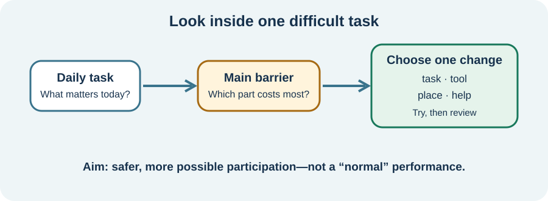

<!-- NAV-BREADCRUMB:START -->
[Home](../../README.md) › [Course](../README.md) › Part Five: Living With FND › [Module 17](README.md) › **Adapt Personal Care and Household Tasks**
<!-- NAV-BREADCRUMB:END -->

# Adapt Personal Care and Household Tasks

> **Working draft:** This page was automatically generated and is looking for [contributors and reviewers](https://fnd-education-project.github.io/FND-Education/).

A task can be hard for several reasons at once. Finding the hardest part often gives you more choices than trying harder at the whole task.

---
[For the Person With FND](#for-the-person-with-fnd) 
[For Family, Friends, and Other Supporters](#for-family-friends-and-other-supporters) 
[For Clinicians and the Care Team](#for-clinicians-and-the-care-team) 
[Research and Sources](#research-and-sources)
---

## For the Person With FND
{: #for-the-person-with-fnd .shareable }

### I'll get that

Aliyah liked getting things done.

If there was a dirty dish in the sink, she washed it. Food dried onto plates if you left them sitting around, and then they took twice as long to clean. If a laundry basket was full, she started the washing. She'd never understood the appeal of walking past something that needed doing and promising to deal with it tomorrow.

Her friend Beth had a different philosophy.

"Tomorrow is a perfectly respectable day," Beth liked to say.

Aliyah wasn't convinced.

Before developing FND at seventeen, Aliyah had handled most of the household chores at her parents' home. She was good at organizing things, and she enjoyed the satisfaction of finishing a job.

Then walking became difficult. Her gait was often unsteady, she experienced persistent dizziness, and fatigue could make ordinary activities difficult to sustain.

She spent the next four years living with her parents, learning about FND, working with her care team and finding ways to manage daily life. She knew that mornings were usually her best time. She'd learned to recognize changes in her walking and dizziness, and she'd made practical adjustments throughout her routine.

At twenty-one, though, she wanted something she'd been working towards for years: a home of her own.

Beth offered to share an apartment with her. Beth worked full-time, but she was willing to provide part-time practical support. Aliyah could continue her online bookkeeping job, contribute to the rent and manage many of her own needs.

They'd been living together for three months.

Aliyah loved it. She appreciated Beth's help, too, although accepting it wasn't always comfortable. Beth already worked hard, and Aliyah didn't want her coming home to a second job.

That Friday, the laundry needed doing.

And Beth had specifically asked her to leave it alone.

### A good morning for laundry

At seven-thirty, Aliyah's phone announced a message.

*I'll do the laundry tonight. Don't worry about it.*

Aliyah smiled at the wording.

She'd already decided to start the washing that morning. Her legs were usually steadier earlier in the day, and she knew from experience that household chores became more difficult after several hours of bookkeeping.

Besides, Beth had enough to do.

Aliyah stood up, waited for the familiar dizziness to settle and took her walker into the bedroom.

She'd arranged her apartment to make everyday activities easier. Her work area had a large water jug, a drinking glass and a few things she used regularly, saving unnecessary journeys to the kitchen. She kept frequently used clothing within easy reach and had a comfortable place to sit while folding laundry.

She also had a lightweight laundry basket that she could slide short distances along the smooth hallway floor rather than carry. Moving it still required care, particularly when she needed to reposition herself and her walker, but it reduced some of the lifting.

Aliyah began sorting the washing on her bed. She sat comfortably, checked the labels and separated everything into three loads: dark clothes, lighter clothes and towels.

She found a tissue in the pocket of Beth's jacket.

"Honestly, Beth," she muttered, dropping it into the bin.

Then she prepared the first load and moved it towards the laundry cupboard.

The washing machine was on the bottom, with the dryer stacked above it. Getting damp clothes into the upper dryer was one of the more demanding parts of the job, but that could wait until the first wash finished.

Aliyah started the machine, returned to her desk and opened her bookkeeping programme.

She felt reasonably well.

With the washing underway and her work started, she was rather pleased with herself.

### The first changeover

The machine finished while Aliyah was checking an invoice.

She saved her work, stood up and waited for the dizziness to pass. It took a little longer than it had earlier, but she recognized the sensation and felt steady enough to walk.

Using her walker, she returned to the laundry cupboard.

The wet clothes were heavier than when she'd put them in. Aliyah transferred them to the dryer in small amounts, pausing between reaches. She'd learned that trying to lift everything at once made the job unnecessarily difficult.

It was slower, but it worked.

When the dryer was running, she moved the second load over, put it into the washing machine and started another cycle.

Then she went back to her desk.

She noticed a little more tiredness in her legs, although nothing particularly unusual. She had plenty of bookkeeping to keep her occupied while the machines worked.

On her way back, she passed the kitchen and noticed her breakfast plate beside the sink.

She'd meant to wash it earlier.

Aliyah stopped, rinsed the plate before the remaining food could dry and put it away. It took less than a minute.

She returned to work.

A few minutes later, she needed the bathroom. When she stood up, her dizziness took a little longer to settle again. She waited beside her walker before continuing.

On the way back, she lightly brushed the hallway doorframe with her shoulder.

Aliyah stopped and adjusted her position.

That was one of her familiar signs that walking was becoming more demanding. Sometimes, as she tired, her steps grew less predictable. She might sway slightly, make an unexpectedly large step or feel a sudden jerk in one leg.

Her walker provided useful support when that happened, although it didn't remove the possibility of falling.

She reached her desk without further difficulty.

*Maybe take it easier for a while,* she thought.

She sat down, reached for her water jug and refilled her glass.

That was exactly why she'd started keeping water beside her chair. A trip to the kitchen every time she wanted a drink could add up to a surprising amount of walking.

Aliyah was pleased she'd thought of that adaptation.

She'd learned quite a few things over four years.

### The second changeover

The next washing cycle finished just before lunch.

Aliyah looked at the time.

She could leave the laundry until later. The clean clothes weren't going anywhere, and she was beginning to feel tired.

But the first load was already dry, and the second was ready to be moved. If she changed everything over now, the towels could wash while she finished working.

Then Beth wouldn't have to deal with any of it.

Aliyah stood up.

Her dizziness was more troublesome this time. She remained beside her chair, holding her walker and giving herself time before moving.

She recognized the warning. Standing up and walking again were becoming harder, and she had already spent much of the morning working and doing laundry.

*I can manage one more changeover,* she decided.

At the laundry cupboard, she removed the dry clothes in small amounts and placed them into a clean basket. She moved the basket to the table where she could fold everything while sitting down.

That part was sensible. She'd made the change months earlier because folding while standing used more of her available capacity.

She returned to the laundry cupboard, transferred the second load into the upper dryer and started it.

Then she brought the towels over for the third wash.

Moving the basket was taking more concentration now. Aliyah had to pay closer attention to her footing and the position of her walker. When she turned towards the machine, one leg made a larger step than she'd intended.

She stopped.

There it was again.

She knew what it meant for her: the task was becoming less reliable, and the cost of continuing was increasing.

She considered leaving the towels.

But they were already there, the machine was empty, and starting a wash required only a few more movements.

*I'm practically finished,* she told herself.

She loaded the towels and pressed Start.

By the time she returned to her desk, she was breathing a little harder and her legs felt heavy.

She sat down and rubbed her forehead.

*That was probably enough.*

Then she looked at the clock.

She still had work to finish.

### The things that hardly count

During the afternoon, Aliyah continued with her bookkeeping.

She was good at her job. Give her several confusing invoices and a payment that didn't match the records, and she could usually discover what had happened.

But concentrating for hours required effort too.

She took breaks, drank from the water jug beside her desk and kept the things she needed within reach.

Those adaptations helped.

Yet the ordinary demands of the day kept appearing.

She needed the bathroom again. On the way back, she noticed an envelope lying near the entrance. She considered picking it up, then decided to leave it because it was against the wall and wasn't creating a hazard.

That was something she'd worked hard to learn: noticing a job didn't mean she had to do it.

Later, she went into the kitchen to prepare lunch. She cleaned her plate while she was already standing at the sink, just as she always preferred.

None of these activities felt especially significant.

The bathroom trip was necessary. The meal was necessary. Washing the plate saved another job later. Even the extra movements involved in using her walker seemed ordinary because she'd been making them for years.

But Aliyah could feel the difference now.

Her legs were increasingly tired, and changing direction required more attention. When she stood after lunch, her dizziness lasted longer than it had in the morning.

She waited for it to settle.

*I know,* she thought, irritated with herself.

She wasn't unaware of her limits. She knew them very well.

What frustrated her was that ordinary life demanded so much planning in the first place.

She wanted to work, clean her home, cook a meal and still have enough left to enjoy an evening. She wanted to move around her own apartment without calculating whether another trip down the hallway was worthwhile.

And she wanted Beth to have a Friday evening that didn't begin with more chores.

Sometimes she was simply angry that FND made all of this so difficult.

### One last job

The towels finished drying shortly after three.

Aliyah was nearly finished working, and she could hear the dryer announcing the end of its cycle.

She looked towards the hallway.

Her first thought was to get up and empty it.

Her second was that she'd already noticed several warning signs.

She'd been less steady, had made an unexpected step and was taking longer to recover from standing. Those signs were familiar to her, and she knew they deserved attention.

Still, the laundry was almost finished.

If she emptied the dryer, she could fold the towels while sitting down. Then everything would be done before Beth arrived.

Aliyah placed her hands on the arms of her chair.

She hesitated.

*I'm not going to prove anything by falling over a basket of towels.*

The thought annoyed her. She wasn't trying to prove something, was she?

She was trying to keep her home tidy and give her friend a break.

Yet she could also admit something else: finishing the laundry mattered to her partly because she wanted to show that she could manage living independently.

She had waited four years to move out of her parents' home. She didn't want Beth regretting the arrangement after only three months.

Aliyah stayed seated.

The towels could remain in the dryer.

She was still frustrated, but she wasn't going to turn that frustration into another unsafe trip.

When Beth came home, the towels would be waiting.

### A second job

Beth arrived shortly after five.

"Aliyah? I'm home!"

"In the kitchen."

Beth came in, dropped her bag beside the door and noticed the folded clothes on the table.

She looked towards the laundry cupboard.

"Did you do the washing?"

"Most of it."

"Aliyah. I said I'd do it tonight."

"I know. I had more energy this morning."

Beth looked at her. Aliyah was sitting at the table, and even from the doorway Beth could see how tired she was.

"Have you been resting?"

"I took breaks. I used the basket, and I folded everything sitting down."

"I know you know how to do those things." Beth sat opposite her. "But you look exhausted."

Aliyah glanced at the washing.

"I was trying to give you a break."

"I know."

"You work all day. I don't want you coming home and having to do everything."

Beth was quiet for a moment.

Then she said, "Can I tell you something? Sometimes I feel like I have to race you to the chores."

Aliyah looked up.

"What?"

"If there's a dish in the sink, you'll wash it. If there's laundry, you'll start it. I know you don't want to bother me, but then I see how tired you are."

"I'm not asking you to rush."

"No. But if I don't do something first, you'll do it. So I feel like I need to get there before you."

Aliyah hadn't meant to make Beth feel that way.

She'd been trying to be helpful. Instead, Beth sometimes came home feeling that she needed to finish chores immediately to prevent Aliyah from overdoing things.

Beth continued. "I don't mind helping. I offered because I wanted us to live together. But I work all day, and sometimes I need to sit down when I get home. I can't always do everything as quickly as you would."

Aliyah looked down at her hands.

"I don't want you doing everything either."

"Then we need something between those two things."

### What actually needs changing?

Beth picked up a folded towel.

"Why did you do three loads today?"

"Because there were three loads."

Beth smiled.

"Yes, I understood the mathematics. But did we need all three done today?"

Aliyah considered the question.

The dark clothes had included things she needed for the weekend. The lighter clothes could probably have waited. The towels certainly weren't urgent.

"No," she admitted.

"Then maybe we don't have to finish every job just because it's there."

Aliyah looked unconvinced.

Beth continued. "You're much better at organizing the laundry than I am. You know what needs washing and what can wait. But perhaps we should change which parts each of us does."

"I can sort everything," Aliyah said. "And folding is fine when I'm sitting."

"Good."

"The baskets are difficult. And transferring wet clothes to the dryer takes a lot out of me."

"Then I can do those parts."

"Even if I start the washing?"

"Of course."

Aliyah thought about that.

She'd spent four years learning to adapt the movements involved in everyday activities. She'd become very good at finding ways to do things herself.

But she hadn't always considered changing who performed particular parts of a task.

"I don't want you to be tired because of me," she said.

Beth smiled.

"That's kind of you. But I'm allowed to decide what I can manage, too."

Aliyah looked at her friend.

Beth added, "And I'm allowed to leave the towels until Saturday."

"Apparently."

"Remarkable invention, Saturday."

They laughed.

The towels were already washed, but the conversation had given Aliyah something useful to consider.

### Looking at the whole activity

You've already learned about available capacity, functional movement and the ways different demands can affect what someone manages.

Now we can use that knowledge together.

Aliyah didn't spend the day ignoring everything she'd learned about FND. She deliberately chose the morning for laundry because she usually functioned better then. She avoided carrying heavy baskets, transferred clothes in smaller amounts and folded them while sitting.

She also kept water beside her work area to avoid unnecessary journeys and sometimes left minor chores alone rather than immediately completing them.

**Those were useful adaptations.**

So why was she still exhausted?

Consider what remained difficult.

Every laundry changeover involved walking, repositioning her walker, turning, reaching, moving clothes and returning to her work area. Some movements were repeated many times.

The adaptations reduced certain demands, but they didn't eliminate all of them.

And laundry wasn't the only activity in her day. She needed to work, eat, drink and use the bathroom. Those activities continued regardless of whether she was doing household chores.

**Being able to complete each activity separately didn't mean she could sustain all of them together.**

Aliyah's warning signs also mattered.

As the day progressed, she noticed changes in her gait, occasional unexpected steps and dizziness that lasted longer when she stood up.

She recognized these as signs that she was becoming less steady. They weren't universal warning signs for everyone with FND, and a new or substantially changed pattern would require medical reassessment rather than automatically being attributed to fatigue.

But for Aliyah, they were useful information about whether to continue an activity safely.

Her walker helped her move around, yet it didn't make every movement safe. In particular, repeatedly handling baskets and reaching into an upper dryer while unsteady created risks that a safer arrangement or appropriate professional assessment could address.

The question wasn't whether Aliyah was capable of doing laundry.

She clearly was capable of many parts of it.

The question was whether the complete routine was manageable and safe alongside everything else she needed and wanted to do.

### An adaptation can be reconsidered

An occupational therapist may use **activity analysis** to examine the individual steps of an activity and the demands involved. (*citation* [1](#citation-1))

> **Activity analysis:** Looking closely at the parts of an everyday task, the skills and movements they require, and the circumstances in which the activity takes place.

Laundry involves collecting, sorting, transporting, loading, transferring, drying, folding and putting away clothes.

For Aliyah, some of those steps were relatively manageable. Others required more difficult walking, reaching or repeated movements.

She'd already changed several parts of the routine, but she could reconsider the whole sequence.

> **Task adaptation:** Changing how an activity is done, the equipment or surroundings used, or the assistance available so that the activity is safer or more manageable.

*Illustration: adapting an activity can involve the task, a tool, the place or another person's help.*

Sometimes this means using a seat, moving supplies somewhere easier to reach or dividing a task into smaller parts.

Sometimes it means another person handling a particular movement while the person with FND retains responsibility for planning or completing other parts.

An adaptation can also stop being useful. A method that was manageable when Aliyah felt steadier might become unsafe as fatigue increased. The fact that she'd used it successfully before didn't mean she had to keep using it under every circumstance.

And sometimes the most useful change is deciding that a nonurgent part of an activity doesn't need to happen that day.

That's different from abandoning the task or giving up on rehabilitation.

It's examining the task realistically, including what it costs and what the person wants to preserve.

### Independence is more than doing everything

For Aliyah, the laundry was about more than clean clothes. After four years at her parents' home, sharing an apartment with Beth meant independence. Completing chores made her feel dependable, especially when she saw how much Beth already did.

But their good intentions had created a strange race. Aliyah tried to finish jobs to spare Beth the work; Beth felt she had to get to them first so Aliyah wouldn't exhaust herself. Neither wanted the other to feel responsible for everything. The answer wasn't for one of them to try harder.

Aliyah could still plan the laundry, sort it and fold it while seated. Beth could decide when she had time to handle the heavy baskets and awkward transfers. They didn't have to agree on how urgently every towel needed washing. They needed a workable plan for the parts of the task that mattered.

### Saturday morning

Saturday morning, Aliyah took her walker into the kitchen for breakfast. Beth's plate was by the sink, with a little food beginning to dry onto it. Aliyah rinsed the plate while she was already there. That was a small job worth doing immediately, and she hadn't needed an extra trip to manage it.

Beth appeared as Aliyah settled into a chair. She glanced at the basket of folded clothes near the table. "Are you planning to finish the rest before breakfast?" she asked.

"No," Aliyah replied. "The towels are still in the dryer. Could you bring them to the table later? I'll fold them here."

Beth nodded. "Of course. They can wait until we've eaten."

Aliyah still wanted the laundry finished. She also resented having to weigh an ordinary trip down the hallway against what it might cost her afterward. Yesterday she'd recognized her warning signs and eventually stopped, but not before the work had left her exhausted. She knew the adaptations that helped; now she was considering the entire task, including when it happened and which parts someone else could do. That didn't remove her frustration with FND, or make her less responsible for her home.

Beth filled the kettle. "Look at us, negotiating with towels like civilized adults."

Aliyah smiled. "Don't get too excited. I still think the bathroom cupboard needs organizing."

"Tomorrow is a perfectly respectable day," Beth said.

Aliyah took her tea. "We'll discuss it."

### Community experiences for editorial review

**Option 1 — cognitive help can be daily help**

> “Currently I can barely take care of myself ... My partner has to remind me.”

— One person's account of memory problems. [Read the public source](https://www.reddit.com/r/FND/comments/13rzn9o/memory_issues/).

**Option 2 — occupational therapy and overload**

> “My OT helped me ... learn exercises to calm myself and avoid sensory overwhelm.”

— One person's account of occupational therapy. [Read the public source](https://www.reddit.com/r/FND/comments/1j0nopp/tell_me_how_ot_will_help_my_fnd/).

*Quotation candidates carried forward from the generated draft. Their relevance and exact original wording must be reviewed before publication.*

### Thought, Heart, and Activity — editorial review pending

*The end-of-lesson reflections are awaiting project-lead approval against the course-wide Thought–Heart–Activity progression. The previously generated questions have not been adopted as the reflections for this human-authored story.*

***
[For the Person With FND](#for-the-person-with-fnd) 
[For Family, Friends, and Other Supporters](#for-family-friends-and-other-supporters) 
[For Clinicians and the Care Team](#for-clinicians-and-the-care-team) 
[Research and Sources](#research-and-sources)
***

## For Family, Friends, and Other Supporters
{: #for-family-friends-and-other-supporters .shareable }

Ask, “Which part would you like help with?” before taking over. A person may want practical help without being watched, corrected or hurried.

Notice your own safety too. Get advice for lifting and transfers; do not improvise a carry. If the task is unsafe today, help find another way without turning that decision into a judgement about effort.

***
[For the Person With FND](#for-the-person-with-fnd) 
[For Family, Friends, and Other Supporters](#for-family-friends-and-other-supporters) 
[For Clinicians and the Care Team](#for-clinicians-and-the-care-team) 
[Research and Sources](#research-and-sources)
### Community voice for editorial review

> “I'm making every meal that I can for her so she has to do very little when she's struggling but she then wants to cook when she's in a better space.”

— [Spouse describing how cooking shifts with her wife's abilities](https://www.reddit.com/r/FND/comments/1o5s0b8/wife_just_diagnosed_with_disassociative_fnd_feels/)

*Caregiver quotation bank Q011 / S04. Original wording, speaker and context require fresh verification before publication. One household's arrangement, not a rule about how much help any supporter must give.*

***

## For Clinicians and the Care Team
{: #for-clinicians-and-the-care-team .shareable }

### Research quotations for review

**Option 1 — Nicholson et al., 2020**

> “rehabilitation within functional activity”

**Option 2 — Rezaei and Stanley, 2025**

> “disruptions in daily life due to symptoms”

*Figure 1 — Research quotations offered for editorial selection. (*citations* [1](#citation-1), [2](#citation-2))*

### Begin with the person's activity

Assess what the person needs or wants to do, the task sequence, symptom variability, cognition, sensory load, pain, fatigue, strength, the environment and available help. Separate FND-related difficulty from injury, joint problems, cardiopulmonary limits, visual or vestibular conditions and other coexisting causes. More than one can be present.

Agree the goal before suggesting equipment. Trial the smallest useful change, teach safe use and record what changed: safety, assistance, time, effort, participation or recovery afterward. Consensus guidance is useful, but strong comparative evidence for specific daily-living adaptations in FND is limited. (*citation* [1](#citation-1))

When improvement is limited, accessibility and continuing care remain valid goals. Review after falls, skin problems, pain, unsafe transfers, caregiver injury, a major functional change or equipment no longer fitting.

***
[For the Person With FND](#for-the-person-with-fnd) 
[For Family, Friends, and Other Supporters](#for-family-friends-and-other-supporters) 
[For Clinicians and the Care Team](#for-clinicians-and-the-care-team) 
[Research and Sources](#research-and-sources)
***

<!-- NAV-CONTEXT:START -->
**Continue:** [Next page: Mobility Aids, Wheelchairs, Seating, and Fall Safety](02-mobility-aids-wheelchairs-seating-and-fall-safety.md)

**Navigate:** [← Module overview](README.md) · [Course](../README.md) · [Site Map](../../SITEMAP.md)
<!-- NAV-CONTEXT:END -->

***

## Research and Sources

| Citation | Figure | Full citation |
|---|---|---|
| **[1]** | Figure 1 | Nicholson C, Edwards MJ, Carson AJ, et al. Occupational therapy consensus recommendations for functional neurological disorder. *Journal of Neurology, Neurosurgery & Psychiatry*. 2020;91(10):1037–1045. [FND-CIT-0011](../../research/citation-index.md#fnd-cit-0011). [https://doi.org/10.1136/jnnp-2019-322281](https://doi.org/10.1136/jnnp-2019-322281) |
| **[2]** | Figure 1 | Rezaei O, Stanley M. Understanding the lived experiences of individuals with functional neurological disorder in Australia: an interpretative phenomenological analysis. *Disability and Rehabilitation*. 2025;47(24):6408–6415. [FND-CIT-0081](../../research/citation-index.md#fnd-cit-0081). [https://doi.org/10.1080/09638288.2025.2481986](https://doi.org/10.1080/09638288.2025.2481986) |

This page still needs review by people needing help with daily activities, occupational therapists and accessibility reviewers.

*Plain-language draft and research package prepared: September 8, 2026 · Clinical review pending*
