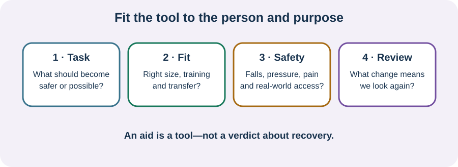

<!-- NAV-BREADCRUMB:START -->
[Home](../../README.md) › [Course](../README.md) › Part Five: Living With FND › [Module 17](README.md) › **Mobility Aids, Wheelchairs, Seating, and Fall Safety**
<!-- NAV-BREADCRUMB:END -->

# Mobility Aids, Wheelchairs, Seating, and Fall Safety

> **Editorial status:** The Person narrative is human-authored and approved for editorial preservation; its Thought–Heart–Activity reflections and clinical/source audit remain pending. Supporter and Clinician sections remain working drafts seeking review.

There is no honest rule that says every person with FND should use an aid—or that no person with FND should.

---
[For the Person With FND](#for-the-person-with-fnd) 
[For Family, Friends, and Other Supporters](#for-family-friends-and-other-supporters) 
[For Clinicians and the Care Team](#for-clinicians-and-the-care-team) 
[Research and Sources](#research-and-sources)
---

## For the Person With FND
{: #for-the-person-with-fnd .shareable }

### The walk everyone notices

Callum had become very good at pretending he didn't notice people watching him. For nearly two years, he'd lived with FND. Sometimes he couldn't speak properly, and sometimes his walking became unreliable. He'd learned ways to handle some of those difficulties, including using his phone when speaking wasn't available.

But five months ago, his walking had become considerably worse. It wasn't simply that he tired more quickly. Sometimes his left foot seemed to stick to the floor while the rest of him continued forward. Other times, a knee would bend unexpectedly, or one leg would make a much larger step than he'd intended.

His body could sway sharply sideways as he tried to correct himself. Occasionally he'd take three reasonably normal steps, followed by one awkward movement that looked as though he'd nearly fallen over an invisible object. Walking down a crowded school corridor had become particularly unpleasant. People noticed.

Some classmates politely moved aside or offered help. Others stared, whispered or looked away in embarrassment. A few had asked whether he was messing around, especially after seeing him walk reasonably well earlier in the day. One boy had even imitated his awkward steps behind him. Asha had seen it and told him to stop. Callum appreciated that, although he wished nobody had noticed in the first place.

He didn't want his classmates to regard him as the boy with the strange walk. He wanted to be Callum, who liked science, made jokes that hopefully people laughed at, and occasionally remembered to finish his homework. Instead, he sometimes felt as though his entire school day had become a public demonstration of FND.

### Another difficult afternoon

On Thursday, Callum was moving between classrooms when his right leg suddenly made an unusually wide step. His shoulder brushed against a locker. He steadied himself, but the movement attracted several glances. A younger student stopped and stared. Someone behind him asked whether he was all right, while another student muttered something about being drunk. Callum could feel his face getting hot. Asha appeared beside him.

"Want to stop for a minute?"

"Yeah."

She stayed nearby while he rested against a sturdy ledge. His legs weren't particularly painful, but he was finding it harder to control where his feet landed. He knew from experience that continuing through a busy corridor when his movements became unpredictable could be unsafe. A teacher came over and asked whether he needed assistance. Callum explained that his walking was worse and that he needed time before continuing. His speech was working well enough today, although he still had his phone available.

The teacher arranged for someone from the school office to help him reach a suitable place to rest. As he sat down, Callum noticed two students watching from the other end of the corridor. He wondered whether they'd tell their friends what had happened. The incident hadn't been especially dramatic. He hadn't fallen, and nobody had been injured. But Callum was tired of being watched whenever his legs did something unexpected. He was also getting worried about the school's upcoming science museum trip.

If he struggled just getting between classrooms, how would he manage an entire afternoon of exhibits?

### Five months is a long time

Callum and his father had already discussed the worsening with his doctor, and further assessment was being arranged. They knew that FND symptoms could fluctuate, sometimes considerably. But a change lasting five months wasn't something they could confidently dismiss as an ordinary bad day.

At home, Callum had been adapting. He avoided unnecessary trips between rooms, used sturdy seating when he needed to rest and tried to allow enough time for everyday activities. His father helped when necessary.

The trouble was that Callum couldn't always predict what his legs would do. He might cross the living room quite comfortably, then struggle to stand from the sofa twenty minutes later. He sometimes wondered whether the difficulties would improve again. On particularly bad days, he wondered whether this was simply how walking would be from now on. Neither question had an easy answer.

### Not a little boy anymore

On Saturday afternoon, Callum was sitting on the sofa while his father prepared dinner. When his father called that the meal was ready, Callum moved forward and tried to stand. His first attempt went nowhere. He rested for a moment, then tried again, but his legs weren't providing the support he expected. His father came into the room.

"Want some help?"

"Yeah, please."

They'd done this before. But when Callum attempted to rise, his legs suddenly yielded, and much more of his weight came onto his father than either expected. His father struggled to steady him. They stopped the attempt and got Callum safely back onto the sofa. His father sat down beside him, breathing harder than usual. Callum noticed him rubbing his back.

"Did I hurt you?"

"I don't think so. But that was way harder than I expected."

Callum looked away. He knew his father wasn't blaming him, but he hated seeing him struggle. His father studied him for a moment.

"When did you get so big?"

"I'm seventeen, Dad."

"I know. But I still remember carrying you upstairs after you fell asleep watching television."

"Well, I'm not asleep."

"You're also considerably heavier."

Callum managed a smile. The two of them sat quietly for a while. His father was older than he'd been when Callum was little, and he was suddenly aware that helping a nearly grown teenager could involve much more physical effort than he'd expected. They'd been managing these situations for months, but the increasing difficulty had changed what was safe. A few minutes later, Callum needed the bathroom. They couldn't simply wait indefinitely for another day when standing might be easier.

After resting, Callum found that his legs were supporting him better. They made another cautious attempt, and he was able to stand and reach the bathroom with his father nearby. His father waited outside to give him privacy. It worked this time. But neither of them could count on that happening every time.

At dinner, his father brought up the subject again.

"I think we need some proper advice about helping you move when your legs aren't working."

Callum nodded. He'd noticed how hard the earlier attempt had been. His father looked thoughtful.

"Can I ask you something? What happens at school when you can't stand?"

### Who helps at school?

Callum had become used to solving small problems as they appeared. If his walking became difficult, he stopped. If he needed help reaching somewhere, he asked. His classmates occasionally offered an arm, moved a chair or helped him up from a bench. Most of the time, those arrangements seemed ordinary enough. But the conversation with his father made him consider whether they were actually safe.

"Sometimes Asha helps me," he admitted.

"How?"

"Usually she just walks beside me. But once, when I couldn't stand up from a bench, two of the guys helped lift me."

His father stopped eating.

"Did a teacher know?"

"No."

"Callum, that's not something your friends should have to figure out themselves."

"I know. But I couldn't just stay there."

His father understood the problem. Callum had needed to get somewhere, and the people available were his friends. They'd tried to help. But another student could injure themselves trying to lift him, and Callum could be hurt if the transfer went wrong. His father suggested contacting the school to discuss what assistance was available when Callum couldn't stand or walk safely. Callum sighed. He'd already had enough meetings about his FND to last several lifetimes. He also disliked the idea of teachers watching him constantly or telling his friends they couldn't help with anything.

But he understood why his father was worried. They agreed that Callum would be involved in discussing any arrangements. His classmates could remain friends who offered ordinary help, without becoming responsible for physically lifting him.

### I think I need a wheelchair

A few days later, Callum raised a different possibility. He'd been reading about mobility aids and looking at photographs of lightweight wheelchairs.

"What do you think about me getting one of these?" he asked his father.

His father looked at the screen.

"A wheelchair?"

"Yeah. Maybe I could use it at school when my walking gets really bad. And for the museum trip."

They talked about how much walking Callum could manage, what happened when his legs became unreliable and how much effort was involved in getting between classrooms. Callum didn't expect a wheelchair to cure anything. He wanted to attend school without spending so much time wondering whether he would reach the next classroom safely. His father was supportive of having the need assessed. Callum still felt uneasy about asking.

He could imagine someone pointing out that he'd walked into the appointment. He could also imagine classmates asking why he needed a wheelchair when they'd seen him standing.

He'd already encountered something similar with his phone: people sometimes assumed that because he could speak at one moment, he shouldn't need another way to communicate later. Now he wondered whether the same argument would be made about his legs.

### A difficult question at the assessment

The occupational therapist listened as Callum explained his walking difficulties, the recent change and what he'd been experiencing at school. His father described the difficult transfer at home and his concerns about classmates helping Callum physically. The therapist acknowledged those problems, but she was cautious about recommending a wheelchair immediately.

"I'd like to understand what you can manage with different forms of support first," she explained. "A wheelchair changes how you get around, and we need to consider whether it would help with the difficulties you're describing or create other problems."

Callum felt disappointed. He'd expected some questions, but he was worried that the discussion would end with another suggestion to keep practising walking.

The therapist asked about his rehabilitation, how often he experienced near-falls, whether his arms could reliably support him, and what happened when his legs suddenly failed to cooperate. She was particularly concerned about what would happen if Callum tried to transfer between seats when he couldn't bear weight.

"A wheelchair wouldn't remove that difficulty," she explained. "You'd still need to move into and out of it safely. We'd need to assess how that could work."

That made sense to Callum. But he wanted to know what happened if his walking remained unreliable.

"I get that," he said. "But if I can't manage the school corridors, what am I supposed to do while we're figuring out my rehabilitation?"

The therapist considered the question. She explained that clinicians sometimes worry about equipment becoming unsuitable for a person's needs, creating new safety problems or replacing useful movement opportunities without a clear purpose. In FND rehabilitation, a device may also need to be considered alongside efforts to improve automatic movement and walking. Callum understood why those concerns mattered. But he pointed out that he wasn't asking to stop walking altogether. He wanted another way to manage situations where walking wasn't reliable.

His father added that they also needed a plan for situations where Callum couldn't stand, regardless of which mobility aid was chosen. The therapist agreed that the immediate safety problem couldn't be left unresolved while everyone waited to see whether his symptoms improved.

### Something else to try

Rather than choosing between walking without assistance and using a wheelchair, the therapist suggested evaluating another possibility. She showed Callum a four-wheeled walker with handgrips, brakes and a built-in seat. It was called a **rollator**.

Unlike a basic walking frame, this model rolled along as the person walked. The seat could provide somewhere to rest when needed, provided the device was positioned and secured properly. Callum was interested.

"That would help at school," he said. "Sometimes I don't need to stop walking completely. I just need to sit before things get worse."

The therapist explained that a rollator wouldn't be appropriate for everyone. Because it had wheels, Callum needed enough control to manage it without having it move unexpectedly. His irregular steps and episodes of poor weight support made proper assessment particularly important. They evaluated his walking with suitable supervision and discussed how he would manage the brakes, turns, crowded spaces and transitions between standing and sitting.

The therapist also checked the height of the handles and seat. A seat that was easier to rise from might be useful, but only if Callum could safely get onto and off it. He found the supported walking more manageable during the assessment, although his gait remained irregular. One feature particularly appealed to him: the model folded sideways into a narrower shape. It could be stored more easily and, with this design, still rolled when folded. His father imagined putting it into the car without wrestling with an enormous piece of equipment.

Callum imagined being able to stop in a school corridor and sit down instead of trying to remain upright while his legs became less reliable. For the first time in several weeks, he felt interested in a possibility rather than simply worried about what he might lose.

### Why not the wheelchair?

The therapist recommended a properly fitted seated rollator for a supervised trial in the situations where Callum could safely continue walking with support. She explained why.

Callum could still walk in many circumstances. During the assessment, he had enough control to manage the rollator under supervision, and having a readily available seat might help with some of the difficulties he described. That didn't establish that a wheelchair was unnecessary. It meant the rollator was a reasonable option to try for certain activities, with clear attention to safety and whether it actually improved his participation.

They would review how it worked at school, particularly when Callum was tired, when his steps became more unpredictable and when the corridors were crowded.

The plan also needed a separate response for occasions when he couldn't stand or transfer safely. **A rollator couldn't solve that problem**, and it wasn't meant to carry Callum while he sat on it. The therapist explained that if the rollator proved unsuitable, or if Callum still couldn't manage important activities safely, a wheelchair assessment remained appropriate. Callum appreciated that the decision wasn't being treated as permanent. He could try one aid, see what it helped with, recognize what it didn't help with and reconsider his options.

Meanwhile, his healthcare team would continue assessing the worsening in his walking, and the school would need a practical safety and assistance plan.

### Going back to school

A week later, Callum was looking forward to trying the rollator at school. He was also nervous. He already attracted attention when he walked strangely. Now he would be arriving with a device that was difficult to ignore. Asha met him near the entrance.

"New wheels?"

"Apparently."

She looked at the seat.

"That actually looks useful."

"Yeah. If my legs start being idiots, I can sit down."

"Can I sit on it?"

"No."

"Rude."

"It's not a bus."

They laughed, and Asha walked beside him towards their classroom. A few students looked at the rollator. One asked what had happened, and another wanted to know whether Callum was using it permanently. Callum didn't know the answer to that last question. He explained that he was trying it because walking had become more difficult. As they moved down the corridor, Callum concentrated on the route ahead. His steps weren't perfectly smooth, and he still noticed people watching him. But he wasn't trying to hide every awkward movement.

When he needed to stop, he found a suitable place and used the seat as he'd been instructed. Asha waited nearby, talking about their science assignment rather than his legs. Callum was grateful for that.

He still didn't know whether he'd manage the museum trip or whether a wheelchair might be useful for longer outings. The rollator would need a proper trial, and the school still had to finish arranging safe assistance for the times he couldn't stand. But the discussion was no longer limited to whether he could walk. It was becoming a question of how he could participate safely, with the right equipment and support for the situation. And that was worth working towards.

---

### Choosing equipment without choosing sides

Callum's first idea was a wheelchair. His therapist recommended trying a seated rollator instead. Neither suggestion was unreasonable simply because the other existed.

Callum was thinking about the difficulties he experienced during ordinary school days. His father was concerned about transfers and the safety of everyone helping him. The therapist was considering how different devices might affect walking, balance, transfers and rehabilitation. Each perspective revealed something important. The central question wasn't whether a person with FND was *disabled enough* to deserve equipment, or whether using an aid meant giving up on recovery. It was whether a particular device was **suitable for that person's actual activities, abilities and risks**.

A rollator may help someone who can still walk with appropriate support and needs a place to rest. It may be unsuitable for someone who cannot reliably control it or who needs full seated mobility.

A wheelchair may allow participation that would otherwise be impossible, but it introduces other considerations, including fit, transfers, pressure, transport and how it will be used. For some people, more than one device may be useful in different situations.

In Callum's case, the assessment led to a trial of a rollator. It didn't erase the need for a plan when he couldn't stand, and it didn't settle every question about longer journeys or rehabilitation.

The trial could provide information that a short examination alone could not: how reliably he could travel between classrooms, whether he could rest when necessary, whether the device remained safe on difficult days and whether it allowed him to participate more fully.

**An aid doesn't have to solve every problem to be useful. But the problems it doesn't solve still matter.**

That is why equipment decisions are best understood as individualized choices that can be assessed and reconsidered as circumstances change.

*Illustration: an aid is a tool for a particular person and purpose, not a verdict about recovery.*

### Community experiences for editorial review

**Option 1 — access to fuller life**

> “My mobility aids have been incredibly helpful and enable me to live life more fully.”

**Option 2 — independence**

> “The wheelchair has helped with independence a lot.”

— Two experiences from one public discussion about mobility aids. [Read the public source](https://www.reddit.com/r/FND/comments/106utzh/advice_needed_considering_using_mobility_aid_for/).

*These are individual community experiences, not proof that a particular aid is suitable for everyone; original wording and context require verification before publication.*

### Thought, Heart, and Activity — editorial review pending

*The project lead has approved the Person narrative for editorial preservation. Three personal Thought–Heart–Activity reflections will be developed against the course-wide progression and reviewed separately; the older generated questions have not been adopted.*
***
[For the Person With FND](#for-the-person-with-fnd) 
[For Family, Friends, and Other Supporters](#for-family-friends-and-other-supporters) 
[For Clinicians and the Care Team](#for-clinicians-and-the-care-team) 
[Research and Sources](#research-and-sources)
***

## For Family, Friends, and Other Supporters
{: #for-family-friends-and-other-supporters .shareable }

Do not hide an aid to make someone “try harder,” or insist on it when they have said no. Ask what makes the activity safer and what kind of help is wanted. Learn safe transfer and wheelchair handling from a qualified professional; supporter injury matters too.

***
[For the Person With FND](#for-the-person-with-fnd) 
[For Family, Friends, and Other Supporters](#for-family-friends-and-other-supporters) 
[For Clinicians and the Care Team](#for-clinicians-and-the-care-team) 
[Research and Sources](#research-and-sources)
### Community voice for editorial review

> “On days when she needs it, the wheelchair helps her get to school, be social, etc.”

— [Parent describing what a wheelchair makes possible for a child](https://www.reddit.com/r/FND/comments/1qb1nrq/comment/nzj6esm/)

*Caregiver quotation bank Q084 / S26. Original wording, speaker and context require fresh verification before publication. A report of access and participation, not proof that this equipment is safe or appropriate for everyone.*

***

## For Clinicians and the Care Team
{: #for-clinicians-and-the-care-team .shareable }

### Research quotations for review

**Option 1 — Nicholson et al., 2020**

> “independence in activities of daily living”

**Option 2 — Mohammadi et al., 2026**

> “a multidimensional approach to falls assessment”

*Figure 1 — Research quotations offered for editorial selection. (*citations* [1](#citation-1), [2](#citation-2))*

### Prescribe for function, not ideology

Assess the person's chosen task, gait or transfer pattern, variability, falls, injuries, strength, pain, fatigue, cognition, sensory or vestibular factors, home and community setting, transport and coexisting conditions. Consider immediate access and safety alongside conditioning and rehabilitation goals.

FND occupational-therapy guidance includes cautious, goal-led equipment use, but comparative trials of aid strategies are lacking. Document the indication, fitting and training, benefit, burden, maintenance and review point. Avoid both blanket prohibition and automatic prescription. (*citation* [1](#citation-1))

Persistent disability deserves continued equipment, pressure, pain, bone-health, falls and participation review even when symptom improvement is limited.

***
[For the Person With FND](#for-the-person-with-fnd) 
[For Family, Friends, and Other Supporters](#for-family-friends-and-other-supporters) 
[For Clinicians and the Care Team](#for-clinicians-and-the-care-team) 
[Research and Sources](#research-and-sources)
***

## Further reading in the Reference Library

- **[Self-Doubt, Legitimacy, and Dignity in Variable Disability](../../reference/biopsychosocial-experiences/03-self-doubt-legitimacy-and-dignity-in-variable-disability.md)** — “am I disabled enough?”, aid-related shame, variable ability and dignity when support needs change.

***

<!-- NAV-CONTEXT:START -->
**Continue:** [Next page: Sensory, Home, and Communication Access](03-sensory-home-and-communication-access.md)

**Navigate:** [← Previous page](01-adapting-personal-care-and-household-tasks.md) · [Module overview](README.md) · [Course](../README.md)
<!-- NAV-CONTEXT:END -->

***

## Research and Sources

| Citation | Figure | Full citation |
|---|---|---|
| **[1]** | Figure 1 | Nicholson C, Edwards MJ, Carson AJ, et al. Occupational therapy consensus recommendations for functional neurological disorder. *Journal of Neurology, Neurosurgery & Psychiatry*. 2020;91(10):1037–1045. [FND-CIT-0011](../../research/citation-index.md#fnd-cit-0011). [https://doi.org/10.1136/jnnp-2019-322281](https://doi.org/10.1136/jnnp-2019-322281) |
| **[2]** | Figure 1 | Mohammadi Z, Keyvanfar A, Higgins R, et al. Falls in Functional Neurological Disorder: Prevalence, Risk Factors and Clinical Implications. *European Journal of Neurology*. 2026;33(6):e70665. [FND-CIT-0085](../../research/citation-index.md#fnd-cit-0085). [https://doi.org/10.1111/ene.70665](https://doi.org/10.1111/ene.70665) |

This page still needs review by mobility-aid users, wheelchair users, occupational therapists, physiotherapists and seating or falls specialists.

*Plain-language draft and research package prepared: September 8, 2026 · Clinical review pending*
