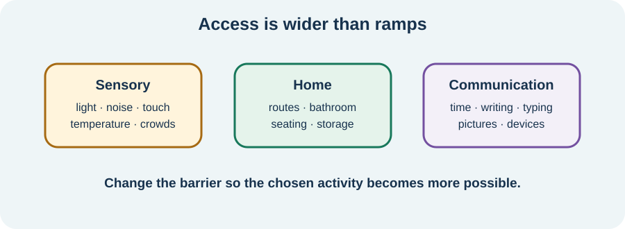

<!-- NAV-BREADCRUMB:START -->
[Home](../../README.md) › [Course](../README.md) › Part Five: Living With FND › [Module 17](README.md) › **Sensory, Home, and Communication Access**
<!-- NAV-BREADCRUMB:END -->

# Sensory, Home, and Communication Access

> **Editorial status:** The Person narrative is human-authored and project-lead-approved for editorial preservation. Its Thought–Heart–Activity reflections and clinical/source audit remain pending. The Supporter and Clinician sections remain working drafts seeking review.

Access can begin before symptoms improve. A quieter place, a safer layout or another way to communicate may make participation possible today.

---
[For the Person With FND](#for-the-person-with-fnd) 
[For Family, Friends, and Other Supporters](#for-family-friends-and-other-supporters) 
[For Clinicians and the Care Team](#for-clinicians-and-the-care-team) 
[Research and Sources](#research-and-sources)
---

## For the Person With FND
{: #for-the-person-with-fnd .shareable }

### The trouble with having company

Nadia missed having people over. Elise still visited, and Clare occasionally appeared with enough news to fill an entire afternoon. But visits had become shorter, less spontaneous and considerably more complicated.

Nadia lived with movement difficulties and functional seizures, and her migraines had worsened over the past several months. Her curtains were usually drawn, the lamps were dimmed, and she kept tinted glasses within reach. The quieter, darker rooms helped her manage some of the difficulties, but they weren't quite the cheerful apartment she'd imagined sharing with friends.

When Elise suggested coming for supper, Nadia was delighted. A café would mean bright windows, clattering dishes, music and several conversations happening at once. At home they could control at least some of that. Then Nadia started thinking about everything she wanted to do beforehand: wash her hair, tidy the living room and make something nice to eat.

Showering could leave her exhausted. Between the water, the noise, the lights and standing to wash, she sometimes needed a long rest afterward. If she spent most of her energy getting ready, she might have little left for Elise. She decided to wash her hair another day and leave the clutter alone. Elise was coming to visit, not inspect her housekeeping, although Nadia still wished preparation didn't require so many decisions.

### Two people, one kitchen

Elise arrived carrying groceries. "I brought everything," she announced. "You can supervise." Nadia told her that was a dangerous amount of authority to hand over, and Elise laughed as she unpacked the vegetables.

Then Elise reached for the kitchen light. "Can I turn this on? I can barely see what I'm doing." Nadia said yes, but the overhead light spilled into the living room, sending pain through her already troublesome migraine. She lowered her eyes and reached for her glasses. Elise switched it off again, apologizing, but Nadia pointed at the knife in her friend's hand. Neither wanted Elise preparing food in a kitchen she couldn't see properly.

They tried the smaller light above the counter. It gave Elise enough light for the vegetables while Nadia sat in the living room with the adjoining door partly closed. It seemed an elaborate arrangement for making supper, but it worked well enough until the chopping, clattering and hood fan became uncomfortable.

Nadia put in her earplugs. When Elise called out to ask whether she wanted mushrooms, Nadia didn't respond. Elise repeated the question more loudly, which startled Nadia when she finally heard it. They exchanged embarrassed smiles. Louder wasn't helping, and Elise didn't want to make every choice without asking. They agreed that Elise could send a short message from the kitchen when she needed an answer. Nadia could reply without removing her earplugs or shouting across the apartment.

After supper, Nadia needed the bathroom. She turned on the softer hallway light before standing because her movement difficulties sometimes made walking unreliable. Elise offered to help, but Nadia was steady enough to manage on her own. She appreciated having her friend nearby without having to be accompanied every time she moved.

By the end of the evening, Nadia was tired. Her migraine hadn't disappeared, and even the quieter conversation was becoming difficult to follow. Elise noticed and asked whether she'd like to rest. Nadia admitted that she did.

"We've had supper," Elise said, "and you've only complained about my cooking twice."

"Three times. You missed one."

They left the dishes for later, and Elise headed home.

Nadia had enjoyed herself. She was also surprised by how much they'd needed to negotiate over an ordinary evening. A change that helped one person could make things harder for the other. Keeping a room dark might protect her eyes, but someone still needed enough light to chop vegetables or find the bathroom safely.

### What the occupational therapist asked

A few weeks later, an occupational therapist visited Nadia's apartment. Nadia had asked her doctor about getting help with the way her home worked, rather than waiting for another appointment focused only on her symptoms.

The therapist didn't arrive with a list of equipment. She asked what Nadia wanted to do in her home that had become difficult. Nadia talked about showering, preparing food and having friends over. She explained that being able to host Elise for supper had mattered more to her than whether the apartment looked tidy.

"And what did you find hardest?" the therapist asked.

"Having to choose," Nadia said. "If I shower and clean before someone comes, sometimes I'm too tired to enjoy them being here. But when I don't, I feel like I've given up on having a normal home. And the lights that help me don't always work for someone else."

They went through what happened on an ordinary day rather than trying to decide everything from Nadia's best or worst hour. The therapist asked what changed when her migraines were worse, where she sat to rest, which sounds were difficult, and whether she could reach the bathroom safely when her walking became unreliable. She also asked what Nadia was already doing that helped, and what caused new problems.

In the kitchen, Nadia showed her the overhead light and the smaller one Elise had used. The therapist explained that good lighting wasn't always about making the whole room brighter or darker. It might mean having enough light over a work surface while keeping glare out of someone's eyes. She suggested trying changes in where the light pointed and how it reached the next room before making anything permanent.

They also looked at the route to the bathroom. Nadia sometimes kept the hallway nearly dark because the light bothered her, but she needed to see the floor and furniture when walking. A softer, well-placed light could make the route clearer without shining straight into her face. They would still need to consider her movement difficulties separately; lighting alone wouldn't prevent every fall.

### More than a dimmer switch

The bathroom raised another question. Nadia had been thinking mainly about the bright light and the sound of running water, but standing to wash could also be difficult. She wondered whether a shower seat or a grab bar would help her use the room more safely.

"Possibly," the therapist said, "but we'd need to look at how you get in and out, where you'd sit, and what you can hold safely."

A seat wouldn't stop the water from making noise or cure a migraine, and a bar had to be chosen and installed for the person and the wall it would be attached to. They discussed which changes could be tried simply and which needed a closer safety assessment.

The therapist noticed Nadia's earplugs on the kitchen counter.

"Do you wear these whenever you're cooking?"

"Usually. The hood fan and dishes can be pretty awful when my migraine's bad. Sometimes I wear them when someone else is cooking, too."

"And when you're wearing them, what can you still hear?"

Nadia thought about it. "People talking, sometimes. It depends how far away they are. Why?"

"I'm thinking about sounds you might need to notice. Someone calling for help, a timer going off, or a smoke alarm. Have you ever checked whether you can hear those clearly?"

Nadia hesitated. She'd spent years finding ways to make sounds less painful, but hadn't given much thought to which sounds she might be missing.

"I'm not sure," she admitted. "I usually just want everything to be quieter."

"That's understandable. Your hearing protection is helping you manage something difficult. We don't want to take that away. But we should find out whether you can still recognize important warnings. If you can't, there may be other ways to alert you."

Nadia looked towards the kitchen. A message from Elise had been useful for deciding what to have with supper, but a message she didn't notice wouldn't help if something needed immediate attention.

The therapist made a note to include important sounds and possible alternative alerts in their assessment. Nadia liked that they weren't asking her to stop wearing her earplugs. They were looking for a way to keep the protection while making her home safer.

Before leaving, the therapist helped Nadia choose a few things to explore first: better-directed kitchen lighting, a safer route to the bathroom, and a separate assessment of bathing and any equipment she might need. They also talked about how to notice whether a change actually made everyday activities easier or introduced a new difficulty. Nadia wasn't expected to solve every problem in one appointment.

### Making room for life

The next time Elise visited, Nadia didn't begin by apologizing for the state of the apartment. They agreed on a simpler supper, and Elise used the counter light without needing to ask. Nadia could sit nearby with less glare, and they knew they could use a quick message if the kitchen became too noisy.

Not everything worked. The hallway light still needed adjusting, and the bathroom changes hadn't happened yet. Nadia had another difficult migraine that afternoon, so they shortened the visit rather than insisting on the original plan. Elise had her own plans later, and Nadia didn't expect her to stay and do the dishes.

For Nadia, the useful change wasn't that her home had become perfectly quiet or that every symptom was under control. She was beginning to see that different rooms and activities could need different arrangements, and that her needs and her visitors' needs both mattered. She could ask for help making her home easier to live in without giving up control of it.

She still had FND, and she still had migraines. But there was room in her apartment for a friend, a shared meal and a good laugh about the cooking. That was part of what Nadia wanted her home to be for.

*Illustration: more than one layer may need changing. Access is not limited to ramps.*

### Community experiences for editorial review

**Option 1 — light**

> “I’ve got FL-41 lens coating sunglasses to help with light sensitivity.”

— One person's accessibility idea. [Read the public source](https://www.reddit.com/r/FND/comments/1h7poki/accessibility_aids/).

**Option 2 — loss of speech can last**

> “I have been mute for 2 weeks now and it doesn’t look like it’s going to resolve anytime soon.”

— One person's account of a prolonged communication barrier. [Read the public source](https://www.reddit.com/r/FND/comments/1mer8ej/tw_symptom_discussion_anyone_else_mute/).

*These are individual community experiences, not proof that the same aid or course applies to someone else. Original wording and context require verification before publication.*

### Thought, Heart, and Activity — editorial review pending

*The project lead has approved this Person narrative for editorial preservation. Three personal Thought–Heart–Activity reflections will be selected separately; the older autogenerated questions have not been adopted.*
***
[For the Person With FND](#for-the-person-with-fnd) 
[For Family, Friends, and Other Supporters](#for-family-friends-and-other-supporters) 
[For Clinicians and the Care Team](#for-clinicians-and-the-care-team) 
[Research and Sources](#research-and-sources)
***

### Access when vocal symptoms interrupt

For someone with vocal tic-like symptoms, agree on a backup way to finish a message: a pause, writing or typing may help. Ask what response they prefer in public. Access should remain available while symptoms continue; the person does not need to prove they can suppress them. [Diagnosis](../../reference/diagnostic-signs/17-functional-tics-and-tic-like-symptoms.md) · [Recovery and care](../../reference/recovery-techniques/17-functional-tics-and-tic-like-symptoms.md).

## For Family, Friends, and Other Supporters
{: #for-family-friends-and-other-supporters .shareable }

Ask before turning off lights, speaking for the person or moving their equipment. Give time for a reply. Agree a simple yes/no method and a way to pause if communication is unreliable. Keep addressing the person even when someone else is helping.

***
[For the Person With FND](#for-the-person-with-fnd) 
[For Family, Friends, and Other Supporters](#for-family-friends-and-other-supporters) 
[For Clinicians and the Care Team](#for-clinicians-and-the-care-team) 
[Research and Sources](#research-and-sources)
### Community voice for editorial review

> “My daughter's sensory diet and sensory go bag include something for every sense.”

— [Father describing sensory supports his daughter uses](https://www.reddit.com/r/FND/comments/1itk0q6/please_supporthelp/)

*Caregiver quotation bank Q047 / S11. Original wording, speaker and context require fresh verification before publication. A family's experience, not a prescribed sensory programme or proof that a particular item works.*

***

## For Clinicians and the Care Team
{: #for-clinicians-and-the-care-team .shareable }

### Research quotations for review

**Option 1 — Nicholson et al., 2020**

> “environmental adaptations”

**Option 2 — Bailey et al., 2024**

> “practical disability advice”

*Figure 1 — Research quotations offered for editorial selection. (*citations* [1](#citation-1), [2](#citation-2))*

### Make access part of care

Ask which settings and communication demands restrict participation. Assess cognition, vision, hearing, vestibular symptoms, pain, fatigue, migraine, neurodevelopmental needs and other contributors rather than assuming every barrier is FND.

Offer information in more than one format. Record the person's preferred communication method, response time, sensory needs and who may assist with consent. Coordinate occupational therapy, speech and language therapy, physiotherapy, audiology, optometry or other services according to the barrier. Evidence for specific sensory adaptations in FND is limited, so identify the goal, trial proportionately and review benefit and burden. (*citations* [1](#citation-1), [2](#citation-2))

***
[For the Person With FND](#for-the-person-with-fnd) 
[For Family, Friends, and Other Supporters](#for-family-friends-and-other-supporters) 
[For Clinicians and the Care Team](#for-clinicians-and-the-care-team) 
[Research and Sources](#research-and-sources)
***

## Further reading in the Reference Library

- **[Unpredictability, Overload, and Trusting Your Body](../../reference/biopsychosocial-experiences/05-unpredictability-overload-and-trusting-your-body.md)** — how sensory, social, cognitive and physical demands can stack without making “overload” a diagnosis.
- **[Self-Doubt, Legitimacy, and Dignity in Variable Disability](../../reference/biopsychosocial-experiences/03-self-doubt-legitimacy-and-dignity-in-variable-disability.md)** — using adaptations without treating them as evidence of failure.

***

<!-- NAV-CONTEXT:START -->
**Continue:** [Next page: Try and Review Equipment as Needs Change](04-trying-and-reviewing-equipment-as-needs-change.md)

**Navigate:** [← Previous page](02-mobility-aids-wheelchairs-seating-and-fall-safety.md) · [Module overview](README.md) · [Course](../README.md)
<!-- NAV-CONTEXT:END -->

***

## Research and Sources

**Source and limits:** Malaty IA, Anderson S, Bennett SM, et al. Diagnosis and management of functional tic-like phenomena. *Journal of Clinical Medicine*. 2022;11(21):6470. [Source](https://doi.org/10.3390/jcm11216470). [FND-CIT-0110](../../research/citation-index.md#fnd-cit-0110); expert guidance, not a trial of these accommodations.

| Citation | Figure | Full citation |
|---|---|---|
| **[1]** | Figure 1 | Nicholson C, Edwards MJ, Carson AJ, et al. Occupational therapy consensus recommendations for functional neurological disorder. *Journal of Neurology, Neurosurgery & Psychiatry*. 2020;91(10):1037–1045. [FND-CIT-0011](../../research/citation-index.md#fnd-cit-0011). [https://doi.org/10.1136/jnnp-2019-322281](https://doi.org/10.1136/jnnp-2019-322281) |
| **[2]** | Figure 1 | Bailey C, Agrawal N, Cope S, et al. Illness perceptions, experiences of stigma and engagement in functional neurological disorder (FND): exploring the role of multidisciplinary group education sessions. *BMJ Neurology Open*. 2024;6(1):e000633. [FND-CIT-0091](../../research/citation-index.md#fnd-cit-0091). [https://doi.org/10.1136/bmjno-2024-000633](https://doi.org/10.1136/bmjno-2024-000633) |

This page still needs review by people with sensory or communication barriers and relevant accessibility and clinical specialists.

*Plain-language draft and research package prepared: September 8, 2026 · Clinical review pending*
