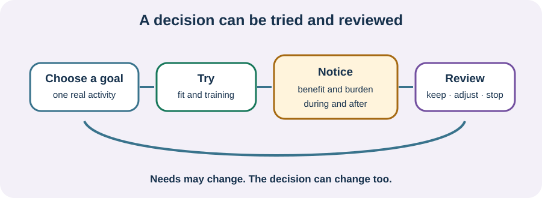

<!-- NAV-BREADCRUMB:START -->
[Home](../../README.md) › [Course](../README.md) › Part Five: Living With FND › [Module 17](README.md) › **Try and Review Equipment as Needs Change**
<!-- NAV-BREADCRUMB:END -->

# Try and Review Equipment as Needs Change

> **Editorial status:** The Person narrative is human-authored and project-lead-approved for editorial preservation; Thought–Heart–Activity reflections and clinical/source audit remain pending. Supporter and Clinician sections remain working drafts seeking review.

Equipment decisions are easier to understand when they are treated as a trial with a purpose, not as a permanent judgement about you.

---
[For the Person With FND](#for-the-person-with-fnd) 
[For Family, Friends, and Other Supporters](#for-family-friends-and-other-supporters) 
[For Clinicians and the Care Team](#for-clinicians-and-the-care-team) 
[Research and Sources](#research-and-sources)
---

## For the Person With FND
{: #for-the-person-with-fnd .shareable }

### Better, but not every day

Callum had used his new rollator at school for a few weeks. He could reach more of his classes without searching for somewhere to lean, and the built-in seat gave him a place to rest when his walking became unpredictable. Asha still walked with him sometimes, but they talked about homework and their friends more often than his legs. Callum liked that.

Then Wednesday happened. His foot kept sticking, his steps became strangely wide, and the rollator wasn't giving him enough support to keep walking safely. He stopped while he still felt able to stand. A teacher arranged help using the plan Callum and the school had agreed on. He got to a safe place, but missed part of a lesson.

The science museum trip was coming up. Callum wanted to go, and he knew the rollator had helped at school. Would it help for an entire afternoon away from familiar classrooms?

At his follow-up appointment, the occupational therapist asked how he was finding the rollator. "Better," he said. He thought about Wednesday. "Mostly."

She smiled. "Tell me about the 'mostly.'"

### What did we hope it would help with?

When they first met, Callum wanted to reach his classes safely and have somewhere to sit when his legs became difficult to control. After checking how he managed the rollator, the therapist agreed to a supervised trial at school.

> **Equipment trial:** Trying a suitable aid for a particular activity, with enough guidance and support to use it safely.
>
> **Review:** Looking again at how an aid is helping and whether it still suits the person and the activity.

*Illustration: the result may be keep, adjust, use only in some settings, replace or stop. None is a moral score.*

Now they had real school days to discuss. The rollator made many journeys easier, and Callum worried less about finding somewhere to rest. On Wednesday, he needed more help than it could provide.

The **goal** comes first. A goal is something the person wants to do. "Walk better" is understandable, but "get to my next class safely" gives everyone a clearer question: when does the rollator help Callum reach that class, and when does he need something else?

Think back to Aliyah, who had been working out how to manage her laundry. Her goal was bigger than carrying a basket. She wanted to care for her home while keeping enough energy for her bookkeeping work and her life with Beth. A lighter basket could be useful, but the whole activity still had to work for her.

The value of an aid lies in what it makes possible. That may mean doing something alone or choosing when to accept help.

### When a helpful change brings another question

Callum showed the therapist how he turned the rollator in a narrow space. It worked well in the quiet room. At school, crowded corridors gave him less room to turn, and he sometimes worried that someone would bump into the wheels. The seat helped when he could stop safely. When his legs could no longer support him, he needed a different plan. The therapist wanted to understand those concerns alongside the benefits he had noticed.

Nadia had learned something similar about her home. Dim lighting helped with her migraine, while a brighter light over the kitchen counter helped Elise prepare dinner. Nadia's earplugs made kitchen noise easier to manage, and her occupational therapist had raised the question of hearing important warnings while wearing them. Keeping the earplugs and finding a reliable way to notice an alarm might meet both needs.

Sometimes an aid needs a better fit or a change to the surroundings. Other times, a different device suits the job better. **Finding a problem with an aid gives us something useful to solve.**

It also helps to think about what happens after an activity. Suppose Aliyah can finish her laundry with a new basket but has shoulder pain later that evening. The basket has helped with carrying, yet the pain deserves attention. Looking at the full day gives a clearer picture than judging the basket by the few minutes she used it.

### What happens in everyday life?

The therapist asked Callum about a good school day and then about Wednesday. That difficult afternoon stood out, but other days blurred together.

"We don't need a perfect record," she told him. "A couple of examples are a good start. I also want to hear what matters to you."

Callum told her that he was spending less time wondering whether he'd reach the next classroom. That mattered to him every day, even though a few steps across the clinic couldn't show it.

An appointment shows what someone can manage at that moment. With variable FND symptoms, a comfortable morning and a difficult afternoon can both be part of the picture. A review brings those experiences together with what the clinician observes.

Having fewer symptoms may be one important goal. Being able to attend school or enjoy time with friends is important too. An aid might make the second goal possible even while symptoms continue. That is a real benefit, and it's worth recognizing.

When memory or concentration makes examples hard to recall, a short note or help from someone trusted may be useful. The aim is enough information for a decision, rather than a detailed record of every symptom.

### Why look again if the aid is helping?

Callum asked a question he'd been holding back. The possibility had been worrying him since he started using the rollator.

"If I say I'm walking better, are you going to take it away?"

"I'm interested in what you need now," the therapist replied. "If it's helping, that's an important reason to keep it. If part of your day is still difficult, we need to work on that too."

Callum relaxed a little. He wanted his walking to improve, but he also wanted to get through school while he worked towards that goal.

A **review** can lead to keeping an aid exactly as it is. It can also lead to changing the fit, arranging more help for certain activities or considering something different. If a person improves and feels ready to manage an activity with less support, they can explore that safely with the people helping them. If their difficulties increase, they may need more support. The decision follows the person's current needs.

This matters in rehabilitation. Callum might practise walking with his physiotherapist in a carefully planned setting and use his rollator at school. Those activities have different purposes. Practising a skill and taking part in everyday life can both be worthwhile.

The museum trip needed its own plan. First they could consider whether the museum's layout suited the rollator. They could also ask what assistance would make the outing safe, and whether another mobility aid deserved assessment. His actual needs on the outing would guide the decision.

### When should someone ask for another check?

A problem with the brakes calls for prompt attention because it can affect safety. So does a change that makes getting on or off equipment less steady. New pain, sore skin from pressure or repeated near-falls deserve attention before someone gets hurt.

A major new change in walking or another symptom deserves medical assessment as well. Having FND doesn't mean every new difficulty comes from FND. Keeping track of safety and health changes helps the person get the right kind of help.

A planned review date is useful, especially with unfamiliar equipment. Important changes deserve attention sooner. Supporters can share observations while respecting the person's choices and privacy.

### When the right help is hard to get

Sometimes people know what activity they want to do and still have trouble getting suitable equipment. An assessment may take time. A device may be expensive, or a funding decision may take longer than expected. Meanwhile, everyday life continues.

These barriers are worth discussing openly. A care team may be able to explain the need clearly, look for appropriate services or help make a safe plan during the wait. Equipment borrowed from a friend or bought cheaply still needs to suit the person and be safe to use. What matters is how it works, rather than how easy it was to obtain.

People may disagree about which aid is best. A clinician may focus on rehabilitation, a supporter on safety, and the person with FND on getting to school tomorrow. A good discussion makes room for each concern while keeping the person involved in the decision.

### The plan can change with you

Callum left the appointment with a clearer picture. The rollator was helping him through much of the school day. Wednesday had shown that the school still needed a safe way to help him when walking wasn't possible. The museum trip needed its own plan, and they would consider more equipment if his needs called for it. The progress he'd made still mattered, and so did these new challenges.

Aliyah's laundry routine and Nadia's home changes could be reviewed in the same spirit. As their lives changed, they could keep what helped and find better answers to what had become difficult. They were making room for ordinary life, rather than waiting for every symptom to disappear.

As you finish this module, start with **What do I want to be able to do?** Then you and the people helping you can learn what works and look again as life changes.

The best choice is the one that makes something important safer or more possible for you. And you are allowed to change that choice as your needs change.

### Community experiences for editorial review

**Option 1 — different aids in different settings**

> “I still do PT and walk without them in safe environments/when I feel good.”

— One person's account of flexible aid use. [Read the public source](https://www.reddit.com/r/FND/comments/1hypc8n/how_i_explain_fnd_to_others_and_how_i_wish_it_was/).

**Option 2 — an aid as a way through an episode**

> “The only thing that gets my walking happening again is using a walker.”

— One person's account of paralysis episodes. [Read the public source](https://www.reddit.com/r/FND/comments/1kchl1l/how_to_get_out_of_paralysis_epsiode/).

*These are community quotation candidates, not clinical guidance. Their original wording and context still need verification.*

### Thought, Heart, and Activity — editorial review pending

*The Person narrative is lead-approved for editorial preservation. Three new personal Thought–Heart–Activity prompts will be selected separately; the older generated questions have not been adopted.*
***
[For the Person With FND](#for-the-person-with-fnd) 
[For Family, Friends, and Other Supporters](#for-family-friends-and-other-supporters) 
[For Clinicians and the Care Team](#for-clinicians-and-the-care-team) 
[Research and Sources](#research-and-sources)
***

## For Family, Friends, and Other Supporters
{: #for-family-friends-and-other-supporters .shareable }

Help observe practical outcomes without turning the trial into surveillance. Ask the person what counts as benefit. A less visible outcome—being able to stay at an event, wash privately or recover sooner—may matter most.

***
[For the Person With FND](#for-the-person-with-fnd) 
[For Family, Friends, and Other Supporters](#for-family-friends-and-other-supporters) 
[For Clinicians and the Care Team](#for-clinicians-and-the-care-team) 
[Research and Sources](#research-and-sources)
### Community voice for editorial review

> “She doesnt use either every day or even every week. But when she needs them, she needs them.”

— [Father describing his daughter's variable need for equipment](https://www.reddit.com/r/FND/comments/1qb1nrq/comment/nz7roir/)

*Caregiver quotation bank Q081 / S25. Original wording, speaker and context require fresh verification before publication. Intermittent use can be meaningful; this account does not establish which aid another person should choose.*

***

## For Clinicians and the Care Team
{: #for-clinicians-and-the-care-team .shareable }

### Research quotations for review

**Option 1 — Nicholson et al., 2020**

> “individualised assessment and treatment”

**Option 2 — Lehn et al., 2025**

> “person-centred treatment”

*Figure 1 — Research quotations offered for editorial selection. (*citations* [1](#citation-1), [2](#citation-2))*

### Document a reviewable decision

Record the functional goal, alternatives considered, setting, fit, training, risks, maintenance, funding constraints and agreed review trigger. Measure outcomes the person values as well as observable performance. One clinic observation is not a reliable summary of variable function.

Reassessment should allow continuation, different use, modification, replacement or withdrawal after discussion. Do not make equipment removal a test of motivation. If rehabilitation and present access appear to conflict, make the trade-off explicit and decide with the person. Consensus is stronger than direct trial evidence in this area. (*citations* [1](#citation-1), [2](#citation-2))

***
[For the Person With FND](#for-the-person-with-fnd) 
[For Family, Friends, and Other Supporters](#for-family-friends-and-other-supporters) 
[For Clinicians and the Care Team](#for-clinicians-and-the-care-team) 
[Research and Sources](#research-and-sources)
***

<!-- NAV-CONTEXT:START -->
**Continue:** [Next module: Relationships, Identity, and Grief](../module-14-relationships-identity-and-grief/README.md)

**Navigate:** [← Previous page](03-sensory-home-and-communication-access.md) · [Module overview](README.md) · [Course](../README.md)
<!-- NAV-CONTEXT:END -->

***

## Research and Sources

| Citation | Figure | Full citation |
|---|---|---|
| **[1]** | Figure 1 | Nicholson C, Edwards MJ, Carson AJ, et al. Occupational therapy consensus recommendations for functional neurological disorder. *Journal of Neurology, Neurosurgery & Psychiatry*. 2020;91(10):1037–1045. [FND-CIT-0011](../../research/citation-index.md#fnd-cit-0011). [https://doi.org/10.1136/jnnp-2019-322281](https://doi.org/10.1136/jnnp-2019-322281) |
| **[2]** | Figure 1 | Lehn A, Petrie D, Palmer D, et al. Managing functional neurological disorder: treatment recommendations for health professionals in Australia. *BMJ Neurology Open*. 2025;7(1):e000970. [FND-CIT-0076](../../research/citation-index.md#fnd-cit-0076). [https://doi.org/10.1136/bmjno-2024-000970](https://doi.org/10.1136/bmjno-2024-000970) |

This page still needs review by equipment users, prescribers, repair services and people navigating funding systems.

*Plain-language draft and research package prepared: September 8, 2026 · Clinical review pending*
