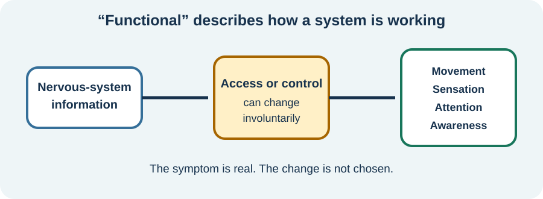

<!-- NAV-BREADCRUMB:START -->
[Home](../../../README.md) › [Course](../../README.md) › Part One: Understanding FND › [Module 1: What FND Is](README.md) › **What “Functional” Means and How FND Can Appear**
<!-- NAV-BREADCRUMB:END -->

# What “Functional” Means and How FND Can Appear

> **Working draft:** This page contains human authored and AI-assisted material and is looking for [contributors and reviewers](https://fndeducationproject.org/contact/).

Functional Neurological Disorder (FND) describes genuine neurological symptoms involving how the nervous system functions.

It can affect movement, sensation, awareness, speech, vision and other abilities. The word *functional* does not mean the symptoms are imaginary, intentionally produced or unimportant. (*citations* [1](#citation-1), [2](#citation-2))

---

[For the Person With FND](#for-the-person-with-fnd) 
[For Family, Friends, and Other Supporters](#for-family-friends-and-other-supporters) 
[For Clinicians and the Care Team](#for-clinicians-and-the-care-team) 
[Research and Sources](#research-and-sources)

---

## For the Person With FND
{: #for-the-person-with-fnd .shareable }

### What does “functional” mean?

Your brain, spinal cord, nerves and the rest of your body are always sending messages back and forth. These messages help you move, feel, speak and pay attention.

With FND, the brain may interpret or use some of this information differently. This can affect what your body can do and what you experience. **The symptoms are real and are not deliberately produced.**

Researchers are studying several possible changes in how the brain uses this information. These changes may differ from person to person, and many questions remain unanswered. (*citations* [1](#citation-1), [3](#citation-3))

<figure class="image-60center" markdown="1">

<figcaption>Illustration: “Functional” describes how the system is working. The symptom is real, and the change is not chosen.</figcaption>

</figure>

Many routine scans, such as MRI and CT, mainly look for changes in the body's structure, such as damage from a stroke, a tumour or an injury.

FND symptoms can be severe even when a scan does not show damage that explains them. A person may also have FND together with an injury, a neurological disease or another medical condition. **One does not rule out the other.**

Clinicians identify FND by looking for recognizable patterns in a person's symptoms, medical history and examination. Sometimes specialized tests also help. Normal test results alone cannot diagnose FND. (*citations* [1](#citation-1), [2](#citation-2))

### How can FND begin?

FND can begin in different ways. Some people first notice symptoms during or after an illness, such as an infection, or following an injury or medical procedure. Others notice symptoms around a stressful time, while some cannot identify anything unusual before their symptoms began.

**There doesn't have to be an obvious reason why your FND started.**

Something happening around the time symptoms begin does not necessarily mean it caused FND. Researchers are still working to understand why FND develops in different people. (*citations* [1](#citation-1), [3](#citation-3), [4](#citation-4))

### What FND can look like

FND does not have one required symptom. Examples include:

- **Movement difficulties:** Weakness, paralysis, shaking, jerks, changes in walking, or unusual fixed postures.
- **Episodes:** Functional seizures or other temporary changes in awareness, movement or responsiveness.
- **Sensory and communication difficulties:** Altered feeling, some visual symptoms, or problems speaking or using the voice.
- **Thinking and everyday function:** Difficulties with concentration, remembering, finding words or carrying out activities. Several conditions may contribute to these difficulties.

Not all these problems automatically mean a person has FND. Similar symptoms can come from other health conditions. A clinician considers the individual history and appropriate examination findings.

Our [Reference Library](../../../reference/README.md#find-an-fnd-symptom) provides more detailed explanations of individual symptoms, their diagnostic assessments and possible recovery techniques.

### Why symptoms can vary

FND symptoms can behave in ways that seem confusing or contradictory.

For example, a person may struggle to lift a leg when concentrating on the movement, yet move it more easily during another activity. A hand might shake strongly during one task but become steadier when attention shifts elsewhere.

These differences may relate to how the brain uses **attention, automatic movement patterns and predictions** about what the body will do.

A doctor can sometimes use these patterns as positive signs that support an FND diagnosis. **They do not mean the symptoms are deliberate, or that a movement performed successfully once can simply be repeated whenever the person wants.** (*citations* [1](#citation-1), [2](#citation-2))

Symptoms may be constant, intermittent or unpredictable. A brief successful movement in a clinic does not tell the whole story about fatigue, safety, the help someone needs or what happens afterwards.

### What a diagnosis should explain

A useful explanation of an FND diagnosis includes the recognizable signs and symptom patterns that support it, as well as any other conditions that may need consideration.

Anxiety, stress or trauma can affect the nervous system and may influence symptoms in some people with FND.

For some, these experiences are an important part of understanding their health and planning treatment. Their influence differs from person to person, and many people with FND do not identify them as a cause of their symptoms.

**A person does not need to have experienced anxiety, significant stress or trauma to develop FND or receive the diagnosis.** (*citations* [2](#citation-2), [3](#citation-3), [5](#citation-5))

### Questions to reflect on

How would you explain your FND diagnosis to someone else?

### One small step

Write down how you would explain your FND diagnosis to someone else.

You might include what FND means, how it affects the nervous system, why symptoms can change, and what you want the other person to understand about your experience.

Use your own words. This is not a test, and your explanation can change as you learn more.

### Optional learning activity

Choose a preview to open a printable PDF. These activities are optional.

<a class="puzzle-card" href="{{ '/assets/puzzles/crosswords/What-is-FND-crossword-09-2026.pdf' | relative_url }}">
  
  What is FND? — Normal <small>PDF</small>
</a>
<a class="puzzle-card" href="{{ '/assets/puzzles/crosswords/What-is-FND-crossword-easy-09-2026.pdf' | relative_url }}">
  
  What is FND? — Easy <small>PDF</small>
</a>
<a class="puzzle-card" href="{{ '/assets/puzzles/crosswords/What-is-FND-crossword-answer-key-09-2026.pdf' | relative_url }}">
  
  What is FND? — Answer key <small>PDF</small>
</a>
<a class="puzzle-card" href="{{ '/assets/puzzles/colouring/lesson-1-coloring-book.pdf' | relative_url }}">
  
  What is FND? — Colouring page <small>PDF</small>
</a>

---

[For the Person With FND](#for-the-person-with-fnd) 
[For Family, Friends, and Other Supporters](#for-family-friends-and-other-supporters) 
[For Clinicians and the Care Team](#for-clinicians-and-the-care-team) 
[Research and Sources](#research-and-sources)

---

## For Family, Friends, and Other Supporters
{: #for-family-friends-and-other-supporters .shareable }

Thank you for taking the time to learn about FND and to better understand the experience of someone you care about. Your interest, patience and willingness to listen can make a meaningful difference.

The everyday examples below offer a simple way to explore how attention, the brain's expectations and signals from inside the body can influence movement and sensation without conscious choice.

They are comparisons, not exact explanations of any person's symptoms.

<figure class="image-60center" markdown="1">

<figcaption>Left to right: attention, prediction and awareness of internal bodily signals.</figcaption>

</figure>

### Attention: The squirrel beside the path

Think about walking along a path. You notice a squirrel beside the trail and turn your attention toward it.

Without deciding to change direction, you might begin drifting slightly toward where you're looking.

Your **attention has influenced your movement** without you consciously choosing it.

### Prediction: The missing stair

Now imagine walking up a staircase.

You think there is one more step, but you've already reached the top. Your leg lifts higher than necessary, and you may stumble or make an awkward movement to regain your balance.

You didn't decide to move that way. **Your brain predicted another step, and your body prepared for one that wasn't there.**

### Interoception: Not noticing exhaustion

Finally, think about becoming exhausted.

Have you ever been so absorbed in an activity that you didn't realize how tired you were until you stopped?

Your brain is constantly receiving and interpreting signals from inside your body, including signs of fatigue, hunger and physical effort.

This awareness of internal bodily signals is called *interoception*. We don't consciously control every part of how these signals reach our awareness.

### Bringing these ideas together

These examples illustrate three normal functions of the nervous system:

- **Attention:** What our brain focuses on.
- **Prediction:** What our brain expects to happen.
- **Interoception:** How we sense what is happening inside our bodies.

Researchers are investigating how changes in these functions may contribute to FND. The examples don't prove what causes any particular symptom, but they demonstrate something important:

**The nervous system can produce movements and sensations that we haven't consciously chosen.**

### How your understanding can help

You don't need to understand every detail of FND to make a positive difference.

Listening, showing patience and asking what helps can be valuable forms of support. When someone manages an activity successfully, recognize it as something encouraging without expecting them to repeat it every time.

Symptoms and abilities may change from day to day, so working together to find what is comfortable, safe and meaningful can make everyday life easier.

If symptoms are new or significantly different, help the person seek appropriate medical advice.

---

[For the Person With FND](#for-the-person-with-fnd) 
[For Family, Friends, and Other Supporters](#for-family-friends-and-other-supporters) 
[For Clinicians and the Care Team](#for-clinicians-and-the-care-team) 
[Research and Sources](#research-and-sources)

---

## For Clinicians and the Care Team
{: #for-clinicians-and-the-care-team .shareable }

### Current understanding of FND

Contemporary models of Functional Neurological Disorder examine altered interactions within brain networks rather than relying on a single psychological or structural explanation.

Current research investigates several potentially interacting mechanisms, including:

- Sensorimotor integration
- Attention and predictive processing
- Sense of agency and voluntary control
- Interoception and sensory processing
- Arousal regulation and interactions between brain networks

These functions normally work together to produce coordinated movement, sensation and awareness.

Predictive-processing models propose that the brain continually combines prior expectations with incoming sensory information to guide perception and action. Altered weighting of expectations and sensory signals is one proposed contributor to some FND symptoms.

Changes in these interactions may contribute to symptoms experienced as involuntary. Their relative importance likely differs between individuals and symptom presentations. **No single mechanism has been established as an explanation for all FND symptoms.** (*citations* [2](#citation-2), [3](#citation-3))

### What brain research is showing

Functional neuroimaging studies have reported group-level differences in brain activity and connectivity involving networks associated with movement, attention, salience and emotion.

Emerging neurometabolic research has also examined differences in brain chemistry in selected groups of patients, including a study in children and adolescents with FND.

These findings are important research developments, but they do not yet establish individual causes or provide validated diagnostic biomarkers. (*citations* [3](#citation-3), [7](#citation-7))

### How FND can begin

FND has a heterogeneous onset. Symptoms may emerge during or after physical illness, injury, medical events or psychological stress, while some patients identify no preceding event. A history of psychological trauma, an identifiable stressor or a psychiatric disorder is not required. An event preceding symptom onset should not automatically be interpreted as its cause.

> “Psychological stressors are important risk factors but are neither necessary nor sufficient for the diagnosis.” — Stone, Burton and Carson, 2020. (*citation* [4](#citation-4))

Four useful research starting points illustrate the evidence and its boundaries:

- **[Stone, Burton and Carson (2020), *BMJ*](https://doi.org/10.1136/bmj.m3745):** Clinical review explaining why psychological stressors are neither necessary nor sufficient for an FND diagnosis. [4](#citation-4)
- **[Hallett et al. (2022), *The Lancet Neurology*](https://doi.org/10.1016/S1474-4422(21)00422-1):** Reviews contemporary mechanisms and recognizes that psychological stressors, although common risk factors, may be absent. [3](#citation-3)
- **[Ludwig et al. (2018), *The Lancet Psychiatry*](https://doi.org/10.1016/S2215-0366(18)30051-8):** A systematic review and meta-analysis finding group-level associations with stressful life events and maltreatment, while also documenting patients without identified stressors. These associations do not establish individual causation. [5](#citation-5)
- **[Ercoli et al. (2021), *Movement Disorders Clinical Practice*](https://doi.org/10.1002/mdc3.13322):** Examines acute peripheral trauma in functional dystonia. Its findings concern that presentation and do not establish physical trauma as a universal cause of FND. [6](#citation-6)

Taken together, these findings support distinguishing possible precipitating events from established causes, rather than assuming an undisclosed psychological explanation when no clear event can be identified. For more detail, see the course's [Causes, Risk Factors, Triggers, and Maintaining Factors](../module-03-causes-mechanisms-and-honest-uncertainty/01-causes-risk-factors-triggers-and-maintaining-factors.md) lesson.

### Understanding the history of FND

Our [History of FND](../../../reference/history-of-fnd.md) explores how the field developed from earlier concepts of hysteria and conversion disorder toward contemporary neurological models.

It highlights important changes in clinical thinking, the development of positive neurological signs, advances in functional neuroimaging and emerging neurometabolic findings.

The timeline also helps clinicians interpret older literature.

In particular, research conducted before the 2013 DSM-5 changes may reflect different patient-selection criteria and assumptions about psychological causation. Earlier studies can still provide valuable evidence, but their findings should be interpreted in their historical and methodological context.

### Exploring the Reference Library

The [FND Reference Library](../../../reference/README.md) offers more detailed material beyond the scope of this introductory course.

**Understanding and diagnosis**

The [Diagnostic Techniques collection](../../../reference/diagnostic-signs/README.md) covers individual symptom presentations, examination methods, supporting research and the limitations of particular findings.

The [shared diagnostic explanations](../../../reference/diagnostic-concepts/README.md) discuss positive clinical evidence, investigations and the relationship between examination findings and everyday functioning.

**Recovery and management**

The [Recovery Techniques collection](../../../reference/recovery-techniques/README.md) explores rehabilitation approaches, supporting evidence, practical applications and treatment limitations.

These resources are organized by symptom so clinicians can focus on their own specialty or explore approaches used by other members of the care team.

The [Professional Roles in FND Care](../../../reference/professional-roles-in-fnd-care.md) page explains how different clinical specialties may contribute to assessment, rehabilitation and ongoing support.

### Essential reading

Three publications provide useful starting points for clinicians seeking a broader understanding of FND.

**[Bennett et al. (2021) — A Practical Review of FND](https://doi.org/10.7861/clinmed.2020-0987)** [1](#citation-1)

A practical clinical overview of FND, including its presentation, explanation and management.

**[Espay et al. (2018) — Current Concepts in Diagnosis and Treatment](https://doi.org/10.1001/jamaneurol.2018.1264)** [2](#citation-2)

An overview of modern diagnostic and treatment concepts and their scientific foundations.

**[Hallett et al. (2022) — New Subtypes and Shared Mechanisms](https://doi.org/10.1016/S1474-4422(21)00422-1)** [3](#citation-3)

A discussion of FND subtypes and proposed shared neurological mechanisms.

The Reference Library and History of FND provide more recent and symptom-specific research, including developments beyond these introductory publications.

[For the Person With FND](#for-the-person-with-fnd) 
[For Family, Friends, and Other Supporters](#for-family-friends-and-other-supporters) 
[For Clinicians and the Care Team](#for-clinicians-and-the-care-team) 
[Research and Sources](#research-and-sources)

---

<!-- NAV-CONTEXT:START -->
**Continue:** [Next page: The Biopsychosocial Model and Misconceptions](02-the-biopsychosocial-model-misconceptions-and-recovery.md)

**Navigate:** [Home](../../../README.md) · [Course](../../README.md) · [Reference Library](../../../reference/README.md) · [Site Map](../../../SITEMAP.md)
<!-- NAV-CONTEXT:END -->

## Research and Sources
{: #research-and-sources .shareable }

The sources below support this introductory account. Studies of proposed mechanisms, physical events preceding symptoms and group-level neuroimaging findings do not establish why FND began in an individual. The linked [History of FND](../../../reference/history-of-fnd.md) provides further recent and historical studies. This lesson remains open to human, clinical and accessibility review.

### Citation table

| Citation | Source |
|---|---|
| **[1]** | Bennett K, Diamond C, Hoeritzauer I, Gardiner P, McWhirter L, Carson A, Stone J. A practical review of functional neurological disorder (FND) for the general physician. *Clinical Medicine*. 2021;21(1):28–36. [FND-CIT-0001](../../../research/citation-index.md#fnd-cit-0001). [DOI](https://doi.org/10.7861/clinmed.2020-0987). |
| **[2]** | Espay AJ, Aybek S, Carson A, et al. Current concepts in diagnosis and treatment of functional neurological disorders. *JAMA Neurology*. 2018;75(9):1132–1141. [FND-CIT-0002](../../../research/citation-index.md#fnd-cit-0002). [DOI](https://doi.org/10.1001/jamaneurol.2018.1264). |
| **[3]** | Hallett M, Aybek S, Dworetzky BA, McWhirter L, Staab JP, Stone J. Functional neurological disorder: new subtypes and shared mechanisms. *The Lancet Neurology*. 2022;21(6):537–550. [FND-CIT-0003](../../../research/citation-index.md#fnd-cit-0003). [DOI](https://doi.org/10.1016/S1474-4422(21)00422-1). |
| **[4]** | Stone J, Burton C, Carson A. Recognising and explaining functional neurological disorder. *BMJ*. 2020;371:m3745. [FND-CIT-0043](../../../research/citation-index.md#fnd-cit-0043). [DOI](https://doi.org/10.1136/bmj.m3745). |
| **[5]** | Ludwig L, Pasman JA, Nicholson T, et al. Stressful life events and maltreatment in conversion (functional neurological) disorder: systematic review and meta-analysis of case-control studies. *The Lancet Psychiatry*. 2018;5(4):307–320. [FND-CIT-0079](../../../research/citation-index.md#fnd-cit-0079). [DOI](https://doi.org/10.1016/S2215-0366(18)30051-8). |
| **[6]** | Ercoli T, Defazio G, Geroin C, et al. Sudden onset, fixed dystonia and acute peripheral trauma as diagnostic clues for functional dystonia. *Movement Disorders Clinical Practice*. 2021;8(7):1107–1111. [FND-CIT-0136](../../../research/citation-index.md#fnd-cit-0136). [DOI](https://doi.org/10.1002/mdc3.13322). |
| **[7]** | Charney M, Foster S, Shukla V, et al. Neurometabolic alterations in children and adolescents with functional neurological disorder. *NeuroImage: Clinical*. 2024;41:103557. [FND-CIT-0044](../../../research/citation-index.md#fnd-cit-0044). [DOI](https://doi.org/10.1016/j.nicl.2023.103557). |
