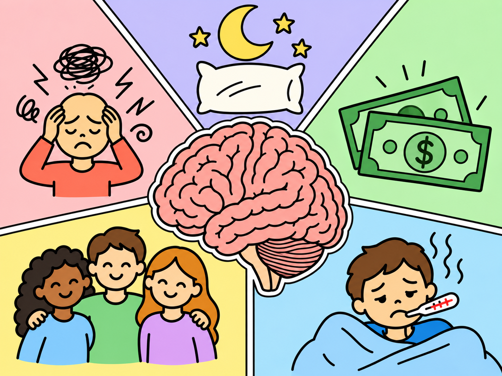

<!-- NAV-BREADCRUMB:START -->
[Home](../../../README.md) › [Course](../../README.md) › Part One: Understanding FND › [Module 1: What FND Is](README.md) › **The Biopsychosocial Model and Misconceptions**
<!-- NAV-BREADCRUMB:END -->

# The Biopsychosocial Model and Misconceptions

> **Working draft:** This page contains human authored and AI-assisted material and is looking for [contributors and reviewers](https://fndeducationproject.org/contact/).

Living with FND can affect nearly every part of life. At the same time, what is happening in our lives can sometimes affect our health and symptoms.

The **[biopsychosocial model](../../../glossary/README.md#biopsychosocial-model)** is one way to understand these relationships. It looks at three parts of our lives: our physical health, our thoughts and emotions, and the world around us.

The model can help us understand what might make life more difficult and what could help. **It does not prove what caused someone's FND.** (*citations* [1](#citation-1), [2](#citation-2), [3](#citation-3))

---

[For the Person With FND](#for-the-person-with-fnd) 
[For Family, Friends, and Other Supporters](#for-family-friends-and-other-supporters) 
[For Clinicians and the Care Team](#for-clinicians-and-the-care-team) 
[Research and Sources](#research-and-sources)

---

## For the Person With FND
{: #for-the-person-with-fnd .shareable }

### What is the biopsychosocial model?

FND is a neurological disorder that can be better understood and managed by considering different parts of our lives.

When we talk about the *biopsychosocial model*, we're talking about how different parts of our lives and health may affect our symptoms and everyday abilities.

The word looks complicated, but let's break it down.

- **The *bio* part means biology:** Your brain, nervous system and physical health. This includes other illnesses, pain, sleep, injuries and medications. It also includes what we learned in Lesson 1 about how the brain and body communicate.

- **The *psycho* part means psychological:** Our thoughts, emotions, attention, expectations, learning and ways of coping. Stress or past experiences can matter for some people, but they do not affect everyone in the same way.

- **The *social* part means the world around us:** Our family, friendships, culture, relationships, living conditions, financial situation and access to healthcare. Support from other people is also part of this picture. (*citations* [1](#citation-1), [3](#citation-3))

### How these parts of life can affect symptoms

<figure class="image-60right" markdown="1">

<figcaption>Illustration: Stress, sleep, finances, social support and physical illness may influence health and everyday life. No factor is required to have caused FND.</figcaption>

</figure>

Let's talk about this in a more familiar way: **the common headache.**

A headache might be affected by lack of sleep, illness, muscle tension, injury or stress.

You might notice that getting some rest makes your headache less troublesome, while spending time in a noisy environment makes it harder to cope.

Different things can affect the same symptom.

FND symptoms can also change with physical, psychological or social influences, although each person's experience is different. (*citations* [1](#citation-1), [3](#citation-3))

For example, imagine someone with FND who has had a poor night's sleep.

They might find it harder to concentrate the following day. Their pain may be worse, or activities that are usually manageable might feel overwhelming.

If their home is noisy or they have several appointments, that might make the day more difficult. A quiet space, help with transportation or simply being able to rest could make things easier.

Notice that these influences come from different parts of their life.

**We can sometimes make a difficult situation more manageable without knowing why the FND began.**

FND is not the same thing as a headache. It can cause substantial disability, and its symptoms and effects on quality of life vary greatly. (*citations* [5](#citation-5), [6](#citation-6))

Improvement may be possible in symptoms, daily activities or quality of life, even when difficulties remain. (*citation* [4](#citation-4))

### What the model does not mean

There's an important distinction here. **The biopsychosocial model cannot tell us what caused someone's FND.**

For example, a person with FND might also experience [anxiety, depression or difficulties related to past trauma](../../../reference/biopsychosocial-experiences/02-mental-health-stigma-and-being-believed.md). These problems can affect their wellbeing and deserve appropriate care, but their presence does not mean they caused the neurological disorder.

Being referred for psychological therapy can sometimes leave people wondering whether their doctor believes their FND is a psychological illness.

**A recommendation for therapy does not, by itself, mean the doctor has identified a psychological cause.**

Consider someone who experiences functional seizures. They might worry about having a seizure while shopping, getting injured, or being alone when an episode occurs. These are understandable concerns about living with unpredictable symptoms.

Psychological therapy might help the person manage those fears, rebuild confidence or find ways to participate in activities that matter to them. (*citations* [4](#citation-4), [5](#citation-5))

**Helping someone manage the consequences of FND is different from treating something believed to have caused it.**

The same distinction applies to physical treatments.

For example, physiotherapy may help someone with functional leg weakness improve their movement and walking. That improvement does not establish what originally caused their FND.

Treatments can be worthwhile because they improve someone's life, even when the cause of their disorder remains unknown. (*citations* [1](#citation-1), [2](#citation-2), [4](#citation-4))

### What can the biopsychosocial model help us understand?

When a clinician asks about your sleep, stress, relationships or living conditions, you might wonder why these things matter to a neurological disorder.

The reason is that understanding your everyday circumstances may help them find ways to improve your care.

It's helpful to distinguish three questions:

1. **How do clinicians know I have FND?** They use your medical history, symptoms and recognizable clinical findings that support the diagnosis. The biopsychosocial model is not a diagnostic test. (*citation* [5](#citation-5))

2. **Why did my FND begin?** We may know what happened around the time symptoms started, but that doesn't necessarily tell us what caused them. The biopsychosocial model cannot establish that cause.

3. **What could improve my health and everyday life now?** This is where the model can be especially useful. It encourages us to consider physical health, emotional wellbeing and everyday circumstances together.

For example, someone may benefit from better pain treatment, help with transportation and support in managing their worries. Each addresses a different part of their life, and none requires us to know why their FND began.

**The goal is to identify what might help you now, not to find a psychological explanation for your illness.**

### Common misunderstandings

There are a few misunderstandings worth clearing up.

**"It's all in your mind."**

No. FND involves genuine neurological symptoms. Psychological factors may matter for some individuals but are not required for the diagnosis. (*citations* [1](#citation-1), [2](#citation-2))

**"If stress makes symptoms worse, stress must have caused FND."**

No. Something that affects symptoms today may have had nothing to do with their beginning.

**"If psychological therapy helps, that proves the symptoms were psychological."**

No. A treatment helping does not establish what caused the original condition.

**"You must be able to find your triggers to get better."**

No. Some people notice patterns, while others do not. Neither experience makes their FND less real.

### Questions to reflect on

How do you think having a good support group around you could improve your ability to manage everyday life?

Have you noticed anything that repeatedly affects your symptoms, whether physical, psychological or social? Or are your symptoms sometimes unpredictable?

### One small step

If you're able and find it useful, you might write down what was happening around a change in your symptoms.

Try three headings:

- **Body and brain**
- **Thoughts and feelings**
- **Life and surroundings**

You can leave any heading blank if you don't know what belongs there.

This isn't about proving why you have FND. It is simply a way of looking for patterns that might help you make everyday life a little easier.

**Don't worry if you can't journal!**

Personally, my functional symptoms affect my memory, and I've found journaling nearly impossible. Over time, I have still been able to notice some patterns in my own symptoms.

Your experience may be different. Not finding a pattern is useful information too.

If keeping notes is difficult, you might instead choose one small practical change, such as reducing noise, asking for help with an activity or allowing more time to recover after an appointment.

You don't need to keep records or perform exercises to prove that you are trying.

### Optional learning activity

Choose a preview to open the printable PDF. These activities are optional.

<a class="puzzle-card" target="_blank" rel="noopener" title="Opens PDF in a new tab or window" href="{{ '/assets/puzzles/crosswords/Biopsychosocial-What-crossword-09-2026.pdf' | relative_url }}">
  
  Biopsychosocial What? — Normal <small>PDF</small>
</a>
<a class="puzzle-card" target="_blank" rel="noopener" title="Opens PDF in a new tab or window" href="{{ '/assets/puzzles/crosswords/Biopsychosocial-What-crossword-easy-09-2026.pdf' | relative_url }}">
  
  Biopsychosocial What? — Easy <small>PDF</small>
</a>
<a class="puzzle-card" target="_blank" rel="noopener" title="Opens PDF in a new tab or window" href="{{ '/assets/puzzles/crosswords/Biopsychosocial-What-crossword-answer-key-09-2026.pdf' | relative_url }}">
  
  Biopsychosocial What? — Answer key <small>PDF</small>
</a>

#### Colouring page

<a class="puzzle-card" target="_blank" rel="noopener" title="Opens PDF in a new tab or window" href="{{ '/assets/puzzles/colouring/lesson-2-coloring-book.pdf' | relative_url }}">
  
  Biopsychosocial What? — Colouring page <small>PDF</small>
</a>

---

[For the Person With FND](#for-the-person-with-fnd) 
[For Family, Friends, and Other Supporters](#for-family-friends-and-other-supporters) 
[For Clinicians and the Care Team](#for-clinicians-and-the-care-team) 
[Research and Sources](#research-and-sources)

---

## For Family, Friends, and Other Supporters
{: #for-family-friends-and-other-supporters .shareable }

The biopsychosocial model offers a useful way to think about how you can help someone living with FND.

You are already part of their **social environment**, and your support can make a meaningful difference.

Think about the three areas we discussed earlier.

### Helping with physical needs

You might help someone attend medical appointments, obtain suitable equipment, arrange transportation or make their home easier to navigate.

You may also help them access rehabilitation, medical care and other services.

These are practical ways of supporting someone's health, even when symptoms remain.

### Helping with emotional wellbeing

Living with an unpredictable neurological disorder can be frustrating, frightening and exhausting.

Listening, respecting the person's feelings and encouraging activities they value can make life more manageable.

Some people with FND may also benefit from psychological therapy, particularly when they want help with anxiety, trauma, depression, adjustment or other difficulties.

However, **psychological treatment should not be assumed necessary for every person with FND.**

Some therapists have limited experience with FND, and older explanations of the disorder may still influence the care they offer.

Rather than pushing someone into therapy, help them find an appropriate professional when they are interested and ready. (*citations* [4](#citation-4), [5](#citation-5))

One person's lived experience illustrates why this matters:

> For the first few years, it was too triggering for me to attempt therapy but later, when I was ready, it proved helpful to work with some of my past traumas. The biggest thing I got from therapy was a better attitude towards my symptoms.

— *Lived experience*

### Helping with everyday life

Your support might include assistance with household tasks, personal care, school, employment, relationships, finances or simply providing companionship.

It's important to recognize that **making someone's life better does not always mean making their symptoms disappear.**

Sometimes the most valuable help is something that improves comfort, safety, independence or dignity.

Another lived experience makes this distinction:

> I also found it unhelpful when my support person's optimism was misplaced; all the many positive things they were doing for me made my life more comfortable, easier to adapt to, and made me feel safe. But, no matter what they did, FND was not going to go away. Our life had permanently changed.

— *Lived experience*

*(This describes one person's experience, not a prediction that another person's FND cannot improve or enter remission.)*

### Supporting the person's choices

You cannot control another person's FND symptoms, and they may not be able to identify what causes a particular flare.

You can, however, ask what help they would find useful.

Respect their privacy and their choices about treatment, relationships and daily activities.

Encouragement can be valuable, especially when someone is grieving changes to their health or independence. But encouragement works best when it does not create [pressure to recover on a particular timetable](../../../reference/biopsychosocial-experiences/06-recovery-pressure-self-blame-and-feeling-like-you-are-failing.md#for-family-friends-and-other-supporters).

New or substantially changed symptoms also deserve appropriate medical attention rather than automatically being assumed to be FND.

**Your care and support have value in their own right, even when the person's symptoms do not improve.**

---

[For the Person With FND](#for-the-person-with-fnd) 
[For Family, Friends, and Other Supporters](#for-family-friends-and-other-supporters) 
[For Clinicians and the Care Team](#for-clinicians-and-the-care-team) 
[Research and Sources](#research-and-sources)

---

## For Clinicians and the Care Team
{: #for-clinicians-and-the-care-team .shareable }

### Understanding the biopsychosocial framework

Contemporary FND models recognize interactions between neurological functioning, psychological experiences and social circumstances.

Hallett and colleagues describe FND as existing at the interface between neurology and psychiatry. This reflects the involvement of multiple fields in research and care, rather than establishing a required psychological cause. (*citations* [1](#citation-1), [2](#citation-2))

The biopsychosocial framework helps clinicians develop an individualized understanding of the person’s difficulties and a care plan.

It is not a biological test for FND or a proven explanation of how every case develops. Nor does it require all three areas to contribute to every person's FND. (*citations* [1](#citation-1), [2](#citation-2), [3](#citation-3))

### Why the framework matters in clinical care

The biopsychosocial model can be useful because patients with similar FND symptoms may have very different needs.

For example, two patients may both experience functional gait difficulties.

One may have poorly controlled migraine and disrupted sleep. The other may have enough physical stamina for a proposed rehabilitation activity. Yet transportation difficulties, financial limitations or an inaccessible home may make it hard to attend appointments.

Their neurological presentations may be similar, but an effective care plan needs to account for these differences.

The framework encourages clinicians to identify relevant health conditions, barriers to treatment, available supports and opportunities for improving daily function.

It can also help explain why a treatment that is appropriate for one patient may be unsuitable or insufficient for another.

**Its relevance extends across specialties, although each profession contributes differently.**

A neurologist may identify important coexisting conditions and referral needs. Primary care can coordinate ongoing medical treatment.

Physiotherapists and occupational therapists can adapt rehabilitation to the patient's abilities, physical demands and environment.

Psychologists may address emotional distress or behavioural goals when relevant and agreed upon. Social workers can help resolve barriers involving finances, housing or access to services.

No individual clinician needs to provide every aspect of this care.

**The value of the model is in recognizing which needs matter, who can address them, and how the different parts of care can work together.** (*citations* [4](#citation-4), [5](#citation-5))

Identifying a problem that affects treatment or daily life does not establish that it caused the patient's FND.

### What these three areas may include

| Area | Examples worth considering |
|---|---|
| **Biological / physical** | Pain, fatigue, migraine, sleep disorders, gastrointestinal symptoms, medication effects, other medical conditions and neurological [comorbidities](../../../glossary/README.md#coexisting-condition--comorbidity) such as epilepsy. |
| **Psychological** | Attention, expectations, learning, emotional wellbeing, anxiety, depression, trauma-related symptoms, [dissociation](../../../glossary/README.md#dissociation) and coping. Their relevance is individual, not assumed. |
| **Social** | Access to care, relationships, work or education, financial pressure, housing, transport, stigma, independence, caregiver needs and social support. |

Some conditions, including migraine, persistent pain, sleep disturbance and mental-health disorders, may warrant treatment in their own right.

Having these conditions alongside FND does not establish that they caused it. (*citations* [5](#citation-5), [6](#citation-6), [7](#citation-7))

### Using the framework without assuming causation

It is useful to distinguish between:

- **Diagnostic evidence:** The clinical features that support an FND diagnosis.
- **Possible contributing factors:** Events or circumstances that may have influenced symptom onset or vulnerability.
- **Current influences:** Conditions, demands or experiences that may affect symptoms, functioning or wellbeing now.
- **Care goals:** What the patient wants help with, whether that involves symptoms, independence, comfort, safety or participation.

A proposed factor should not be treated as an established cause merely because it is plausible or because an intervention addressing it appears helpful.

This distinction matters particularly when considering psychological stressors, trauma histories, illness and injury.

The biopsychosocial model can guide care without requiring clinicians or patients to construct a complete explanation for why FND began.

### Improving care beyond symptom reduction

Patients may need medical treatment, rehabilitation, psychological support, occupational therapy, social work, accessible housing or equipment, and help participating in work or education.

These needs may continue even when FND-specific treatment is unavailable, unsuccessful or only partly effective.

Improvement should therefore be considered across several outcomes, including everyday function, independence, safety, participation and quality of life—not symptom frequency alone. (*citations* [8](#citation-8), [9](#citation-9))

**Community observation:** People describe frustration when a diagnosis is followed by little explanation or practical assistance.

Providing a website can be a helpful starting point, but it should not substitute for appropriate individualized follow-up. (*citations* [4](#citation-4), [5](#citation-5))

The [NeuroSymptoms website](https://neurosymptoms.org/en/symptoms/) is a useful additional educational resource, but its general explanations cannot decide whether a particular new symptom in one patient is functional.

### Avoiding diagnostic overshadowing: looking beyond FND

An FND diagnosis does not exclude additional neurological or medical conditions.

New, severe or substantially changed symptoms need appropriate clinical assessment, including investigations when indicated. (*citations* [2](#citation-2), [5](#citation-5))

One lived experience illustrates this concern:

> When I developed bowel and urinary problems, an MRI appeared to show spinal-cord compression at T10–11, and surgery was being considered. However, the neurosurgeon examined me first and found that the examination did not match the MRI. A second MRI confirmed there was no herniation—the first image was misleading.
>
> I had previously experienced genuine bowel and bladder problems from a T6–7 disc herniation, so the new symptoms could not simply be dismissed as FND. My experience shows why new symptoms must be investigated, but also why imaging should be interpreted alongside the clinical examination before deciding on treatment.

— *Lived experience*

*(This account illustrates the importance of correlating symptoms, examination findings and imaging. It does not establish the diagnosis of another patient with similar symptoms.)*

### A final clinical consideration

The strength of the biopsychosocial model is its ability to bring together aspects of health that might otherwise be treated separately.

An overly broad explanation can be difficult to test or challenge. This is a weakness if every symptom or treatment outcome is treated as confirmation of the model.

**Individualized care should therefore be guided by evidence, the patient's reported experience, identifiable needs and shared goals—not by requiring the patient to accept a particular explanation for their FND.**

---

### Further reading in the Reference Library

Our [Reference Library](../../../reference/README.md) provides symptom-specific material on diagnostic techniques, recovery approaches, coexisting conditions and experiences associated with FND.

- [Biopsychosocial Experiences Associated with FND](../../../reference/biopsychosocial-experiences/README.md) — Stigma, disbelief, emotional regulation, unpredictable symptoms and the social effects of disability, without automatically explaining the disorder's cause.
- [Professional Roles in FND Care](../../../reference/professional-roles-in-fnd-care.md) — How different specialties can contribute to care.

[For the Person With FND](#for-the-person-with-fnd) 
[For Family, Friends, and Other Supporters](#for-family-friends-and-other-supporters) 
[For Clinicians and the Care Team](#for-clinicians-and-the-care-team) 
[Research and Sources](#research-and-sources)

---

<!-- NAV-CONTEXT:START -->
**Continue:** [Next page: Remission, Recovery, and What Improvement Can Mean](03-remission-recovery-and-what-improvement-can-mean.md)

**Navigate:** [Home](../../../README.md) · [Course](../../README.md) · [Reference Library](../../../reference/README.md) · [Site Map](../../../SITEMAP.md)
<!-- NAV-CONTEXT:END -->

## Research and Sources
{: #research-and-sources .shareable }

*Evidence and readability review: October 12, 2026. This remains a working draft.*

The research discussed here supports a whole-person approach to care while recognizing that the causes and mechanisms of FND remain incompletely understood.

Clinical reviews, patient surveys, systematic reviews and personal experiences provide different kinds of information. They should not automatically be treated as equivalent evidence.

### Selected findings from the literature

**Hallett et al. (2022)** describe psychological stressors as common risk factors that may nevertheless be absent. (*citation* [1](#citation-1))

**Butler et al. (2021)** report that many respondents in an international online FND survey identified multiple possible influences, including physical and psychological factors. This reflects respondents' experiences and beliefs, not proof of causation. (*citation* [6](#citation-6))

**Sekine et al. (2025)** review factors associated with outcomes. They explain that a change in seizure frequency may not mean a change in participation in everyday life. (*citation* [9](#citation-9))

### Citation table

| Citation | Source | Supports on this page |
|---|---|---|
| **[1]** | Hallett M, Aybek S, Dworetzky BA, McWhirter L, Staab JP, Stone J. Functional neurological disorder: new subtypes and shared mechanisms. *The Lancet Neurology*. 2022;21(6):537–550. [FND-CIT-0003](../../../research/citation-index.md#fnd-cit-0003). [DOI](https://doi.org/10.1016/S1474-4422(21)00422-1). | Clinical review: varied presentations, psychological stress not required, and individualized care. |
| **[2]** | Espay AJ, Aybek S, Carson A, et al. Current concepts in diagnosis and treatment of functional neurological disorders. *JAMA Neurology*. 2018;75(9):1132–1141. [FND-CIT-0002](../../../research/citation-index.md#fnd-cit-0002). [DOI](https://doi.org/10.1001/jamaneurol.2018.1264). | Clinical review: positive diagnosis, causally neutral diagnostic criteria and coexisting conditions. |
| **[3]** | Pick S, Goldstein LH, Perez DL, Nicholson TR. Emotional processing in functional neurological disorder: a review, biopsychosocial model and research agenda. *Journal of Neurology, Neurosurgery & Psychiatry*. 2019;90(6):704–711. [FND-CIT-0005](../../../research/citation-index.md#fnd-cit-0005). [DOI](https://doi.org/10.1136/jnnp-2018-319201). | Review and proposed model: interactions between emotional, environmental and brain processes; not a universal cause. |
| **[4]** | Dworetzky BA, Baslet G. Functional neurological disorder: Practical management. *Neurotherapeutics*. 2025;22(4):e00612. [FND-CIT-0013](../../../research/citation-index.md#fnd-cit-0013). [DOI](https://doi.org/10.1016/j.neurot.2025.e00612). | Clinical review: selecting treatments, multidisciplinary care and shared decisions. |
| **[5]** | Bennett K, Diamond C, Hoeritzauer I, Gardiner P, McWhirter L, Carson A, Stone J. A practical review of functional neurological disorder (FND) for the general physician. *Clinical Medicine*. 2021;21(1):28–36. [FND-CIT-0001](../../../research/citation-index.md#fnd-cit-0001). [DOI](https://doi.org/10.7861/clinmed.2020-0987). | Clinical review: diagnosis, psychological and physical treatment, follow-up and avoiding diagnostic overshadowing. |
| **[6]** | Butler M, Shipston-Sharman O, Seynaeve M, et al. International online survey of 1048 individuals with functional neurological disorder. *European Journal of Neurology*. 2021;28(11):3591–3602. [FND-CIT-0014](../../../research/citation-index.md#fnd-cit-0014). [DOI](https://doi.org/10.1111/ene.15018). | Online survey: associated symptoms and respondents’ views; self-report does not establish causation or population prevalence. |
| **[7]** | Steinruecke M, Mason I, Keen M, McWhirter L, Carson AJ, Stone J, Hoeritzauer I. Pain and functional neurological disorder: a systematic review and meta-analysis. *Journal of Neurology, Neurosurgery & Psychiatry*. 2024;95(9):874–885. [FND-CIT-0015](../../../research/citation-index.md#fnd-cit-0015). [DOI](https://doi.org/10.1136/jnnp-2023-332810). | Systematic review and meta-analysis: pain and pain-related conditions alongside FND. |
| **[8]** | Rutten S, Bradley-Westguard A, Nicholson TR, Pick S. Outcome measurement in functional neurological disorder: a qualitative study on the views of patients, caregivers and healthcare professionals. *Journal of Neurology*. 2025;272:189. [FND-CIT-0012](../../../research/citation-index.md#fnd-cit-0012). [DOI](https://doi.org/10.1007/s00415-025-12912-9). | Qualitative study: patient, caregiver and clinician priorities beyond symptom counts; not a treatment-effect study. |
| **[9]** | Sekine ER, Kanaan RA, McMillan J, Oxford S, Iles RA. Biopsychosocial prognostic indicators in Functional Neurological Disorder: a systematic review. *Journal of Psychosomatic Research*. 2025;195:112201. [FND-CIT-0017](../../../research/citation-index.md#fnd-cit-0017). [DOI](https://doi.org/10.1016/j.jpsychores.2025.112201). | Systematic review: prognostic associations and the distinction between seizure frequency and participation. |
