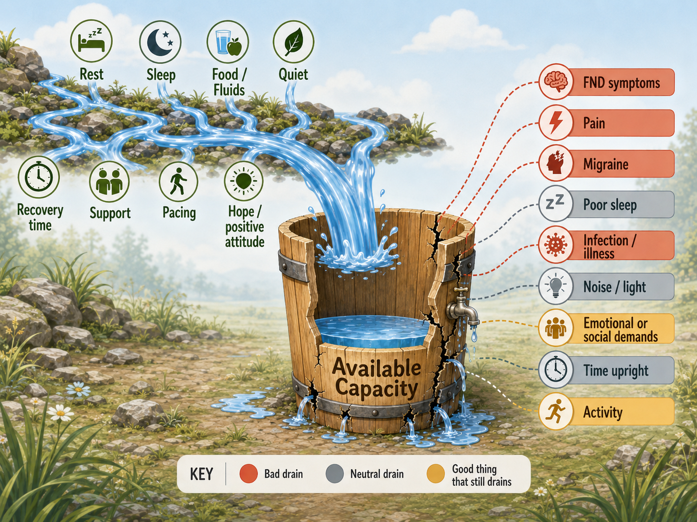

<!-- NAV-BREADCRUMB:START -->
[Home](../../../README.md) › [Course](../../README.md) › Part One: Understanding FND › [Module 1: What FND Is](README.md) › **Available Capacity, Spoons, and Early Action**
<!-- NAV-BREADCRUMB:END -->

# Available Capacity, Spoons, and Early Action

> **Working draft:** This page contains human authored and AI-assisted material and is looking for [contributors and reviewers](https://fndeducationproject.org/contact/).

Have you ever noticed that something you could manage yesterday feels almost impossible today?

Perhaps you can have a conversation for twenty minutes on one day, but on another day, just a few minutes of talking leaves you exhausted.

FND symptoms and the demands of daily life can affect what we are able to do at different times.

In this lesson, we'll explore a way of describing those changing abilities called [available capacity](../../../glossary/README.md#available-capacity).

We'll also introduce Spoon Theory, look at some signs that capacity may be getting low, and consider small changes that might make everyday life more manageable.

> **Available capacity is what you can use right now—not what you should be able to do, and not a measure of effort or worth.**

---

[For the Person With FND](#for-the-person-with-fnd) 
[For Family, Friends, and Other Supporters](#for-family-friends-and-other-supporters) 
[For Clinicians and the Care Team](#for-clinicians-and-the-care-team) 
[Research and Sources](#research-and-sources)

---

## For the Person With FND
{: #for-the-person-with-fnd .shareable }

### What does "available capacity" mean?

When people talk about capacity, they often mean how much energy they have.

But there's more to it than that.

Think about the difference between having tired legs after walking and having a tired brain after concentrating on something difficult.

Both can affect what you are able to do, but they don't necessarily feel the same.

In this course, available capacity means what you can handle at a certain time. This includes physical tasks, thinking, emotions, social situations and things you see, hear or feel.

It also includes how much rest or recovery you may need afterward.

Some activities may require several kinds of capacity at once.

For example, think about a doctor's appointment. First, you may need to travel there and sit upright. You may have to cope with bright lights. During the appointment, you need to follow the conversation and remember information. At the same time, you may be managing your symptoms.

You might complete the appointment successfully but have little capacity left to prepare dinner or enjoy time with family.

**Being able to do something once doesn't always mean you can do it again or do it without feeling the effects later.**

Available capacity is a practical way to describe this experience. It is not a medical measurement.

### What are "spoons"?

You may have heard someone with a chronic illness say, "I'm running low on spoons."

What does that mean?

In 2003, Christine Miserandino introduced Spoon Theory while explaining what it was like to live with lupus.

She used a limited number of spoons to represent the capacity needed to complete ordinary activities. Each activity used some of those spoons.

The idea became popular in chronic illness and disability communities. It gave people a simple way to explain limits that others may not be able to see. (*citation* [1](#citation-1))

For example, someone might say:

"I'd love to go shopping, but I don't have enough spoons left today."

Or:

"If I use my spoons to prepare dinner, I might not have enough left to visit friends tonight."

Spoons aren't a real unit of energy. There is no medical test that tells us exactly how many we have.

But they can be a useful way to communicate our changing limits.

Throughout this course, we'll often use the term available capacity because it includes more than physical tiredness alone.

### Why does available capacity change?

Your available capacity can change during the day. It can also change over weeks or months.

And the things that affect it may be different for each person.

Things that can affect your capacity include:

- **Physical health:** Pain, migraine, illness, sleep problems or other medical conditions.

- **Thinking and concentration:** Following conversations, making decisions, remembering things or working through complicated tasks.

- **Sensory demands:** Bright lights, loud sounds, busy environments or several people speaking at once.

- **Emotional demands:** Worry, frustration, excitement, conflict or difficult experiences.

- **Social demands:** Conversations, appointments, visitors or being around other people.

- **Physical activity and posture:** Walking, standing, sitting upright, travelling or changing positions.

These things can overlap. We discussed this idea in Lesson 2 when we looked at the biopsychosocial model.

Here's one example from my experience:

> "I can usually talk to someone for fifteen or twenty minutes before I get too tired. But if two people talk over each other, or more than one conversation is happening, I might not last thirty seconds!"

— *Lived experience*

The conversation may not take more physical effort. But my brain now has more information to deal with.

This is why available capacity can be more useful than simply saying someone is tired.

### The cost of everyday activities

With FND, everyday activities can take much more effort than other people may realize.

Getting dressed, showering, preparing food and even eating may use capacity that could otherwise go toward something else.

> "I learned that I only had enough capacity to do a certain amount of tasks in a day and those tasks had to include getting dressed, showering and even eating. All of these things lowered how much available capacity I had left."

— *Lived experience*

For some people, functional seizures or other episodes can also cause exhaustion or more symptoms.

The time and support needed afterward can vary.

Sometimes you don't feel the full effects of a task until later.

Before an activity, it may help to think about two things: Can I manage this right now? And what might I need afterward?

You won't always be able to predict the answer, but thinking ahead may help you plan for recovery or support.

### Can available capacity be restored?

<figure class="image-60left" markdown="1">

<figcaption>Illustration: A bucket offers one way to imagine changing capacity. It is a comparison, not a measurement of the nervous system.</figcaption>

</figure>

Sometimes.

Rest or sleep may help you get some capacity back. Treatment may help too. Sometimes a quieter place or practical help makes a difference. At other times, switching activities may help. (*citation* [2](#citation-2))

But this isn't always predictable.

A person may rest and still experience worsening symptoms. Another may feel better after changing activities rather than stopping everything.

There isn't one answer that works for everyone.

For this reason, the aim isn't to calculate every spoon or to control every part of the day.

It's to become more familiar with your own needs and notice changes that may be useful.

### How is this different from pacing or managing energy?

You may hear several different explanations of these experiences.

They can sound similar, but they aren't exactly the same thing.

Spoon Theory is a way of communicating that our capacity feels limited and can change.

Load and recovery is a way of thinking about the demands placed on us, including what an activity costs and what recovery might involve.

[Pacing](../../../glossary/README.md#pacing) means changing what you do, when you do it or when you take breaks so daily life is easier to manage. Some types of pacing also look at symptoms that get worse later. (*citation* [2](#citation-2))

The autonomic nervous system helps regulate automatic functions such as heart rate and digestion. Researchers are studying how changes in these functions may relate to FND symptoms. (*citation* [6](#citation-6))

These ideas can be helpful, but they do not explain every FND symptom.

For example, counting spoons can't tell us whether one part of our autonomic nervous system is more active than another. (*citations* [5](#citation-5), [6](#citation-6))

The Energy Envelope Theory was created for a different condition called ME/CFS. That doesn't mean the same research findings apply to FND. (*citations* [3](#citation-3), [4](#citation-4))

We'll explore pacing and activity management more fully in [Module 15: Pacing, Activity, and the Boom-and-Bust Cycle](../../part-4-treatment-and-rehabilitation/module-15-pacing-activity-and-the-boom-and-bust-cycle/README.md).

### What can low capacity look like?

For some people, there are recognizable signs that their available capacity is becoming limited.

You might notice:

- An ordinary task requires more concentration, time or effort.

- Standing, walking, speaking or making decisions becomes harder.

- Light, sound or busy environments become more difficult to tolerate.

- Familiar symptoms appear earlier or become more intense.

- You have less ability to manage interruptions or unexpected demands.

- You need longer to recover from an activity.

The signs may be different for you.

You might notice several at once, just one, or none at all before a symptom worsens.

And something you managed comfortably last week might be difficult today.

The reverse can also happen. Something you couldn't manage a few months ago may become possible again.

**Low capacity does not mean you failed to manage your activities properly.**

Some symptoms and flares occur without any warning or identifiable reason.

### Noticing changes before things become difficult

We can't prevent every symptom flare. Still, noticing your own patterns may help.

For example, you might notice that your speech becomes more difficult after a long conversation.

If that happens, you could try moving to a quieter location, communicating by text or taking a break.

Or perhaps standing becomes more difficult when you're preparing meals.

You might choose to sit for part of the preparation, use equipment or ask for help with one step.

The goal is to find a practical adjustment.

It isn't to prove that you can prevent every symptom.

### A quick capacity check

You don't need to give yourself a score or count your spoons.

Instead, you might ask yourself three questions:

1. **How am I doing right now?**

   Does your capacity feel fairly normal for you, somewhat limited or very low?

2. **What is making things more difficult?**

   Think about what your body is doing. Then notice how well you can concentrate. Pay attention to the space around you, including noise and light. Your symptoms and other demands may matter too.

   You may not be able to identify anything, and that's okay.

3. **Is there one thing I could change?**

   Perhaps sitting down would help. You might use an aid or reduce background noise. An appointment could be moved. Or you could ask someone for help.

   Sometimes the answer is that nothing practical can be changed immediately.

This check is meant to help you make decisions. It is not another task you have to do perfectly.

### When capacity becomes very low

Sometimes you need to change or stop an activity quickly because symptoms are severe or the activity is no longer safe.

For example, if weakness, loss of awareness, dizziness or another symptom makes an activity unsafe, you may need to stop that activity and follow your established safety plan.

Some activities need extra care when symptoms are severe. Driving is one example. So are climbing stairs and cooking over heat. Other activities may also need special precautions if a sudden symptom could make them unsafe.

Don't assume that new or very different symptoms are caused by low capacity or FND. They could be signs of another medical problem.

Our [Medical Safety and New Symptoms](../../part-2-safety-and-symptoms/module-05-medical-safety-and-new-symptoms/README.md) module explores these situations in greater detail.

### Questions to reflect on

When your available capacity starts to drop, what changes do you notice first?

Is there something you already do that helps make the situation more manageable?

### One small step

Think about a familiar situation in which your capacity sometimes becomes limited.

Try completing these three sentences:

- **My early sign:** "One change I sometimes notice is..."

- **My first adjustment:** "One thing I could change is..."

- **My safety limit:** "If this happens, I need to stop or get help..."

If you have no reliable early sign, you can say so. Your plan can focus on what helps when symptoms occur.

You don't have to write the answers down if that is difficult.

You can think about the questions on your own. You could talk them through with someone you trust. Or you could ask a supporter to help you remember.

And if a flare happens despite your plan, that doesn't mean the plan was worthless or that you did something wrong.

Sometimes a plan can't stop a flare. It can still help keep you safer or make it easier to get help when you need it.

### Optional learning activity

<a href="{{ "/puzzles/" | relative_url }}?collection=crosswords&amp;puzzle=lesson-4">Browse crosswords for this lesson</a>

For colouring activities, visit the [colouring-page collection](../../../assets/puzzles/README.md#colouring-pages).

Choose a preview to open the printable PDF. These activities are optional.

<a class="puzzle-card" target="_blank" rel="noopener" title="Opens PDF in a new tab or window" href="{{ '/assets/puzzles/crosswords/Module-1-Lesson-4/available-capacity-and-spoons-m1-4-normal.pdf' | relative_url }}">
  
  Available Capacity and Spoons — Normal <small>PDF</small>
</a>
<a class="puzzle-card" target="_blank" rel="noopener" title="Opens PDF in a new tab or window" href="{{ '/assets/puzzles/crosswords/Module-1-Lesson-4/available-capacity-and-spoons-m1-4-easy.pdf' | relative_url }}">
  
  Available Capacity and Spoons — Easy <small>PDF</small>
</a>
<a class="puzzle-card" target="_blank" rel="noopener" title="Opens PDF in a new tab or window" href="{{ '/assets/puzzles/crosswords/Module-1-Lesson-4/available-capacity-and-spoons-m1-4-answer-key.pdf' | relative_url }}">
  
  Available Capacity and Spoons — Answer key <small>PDF</small>
</a>

---

[For the Person With FND](#for-the-person-with-fnd) 
[For Family, Friends, and Other Supporters](#for-family-friends-and-other-supporters) 
[For Clinicians and the Care Team](#for-clinicians-and-the-care-team) 
[Research and Sources](#research-and-sources)

---

## For Family, Friends, and Other Supporters
{: #for-family-friends-and-other-supporters .shareable }

A person with FND may manage an activity at one time but struggle with it at another because their symptoms, surroundings and earlier activities can all affect what they can do.

You might see someone with FND walk comfortably around the house one day, only to have significant difficulty walking outdoors the next.

Or perhaps they can enjoy a family conversation but become exhausted when several people speak at once.

These differences can seem contradictory when we're only looking at the activity itself.

But an activity takes place within a much larger picture.

Pain and fatigue may matter. So can attention and sensory demands. Other symptoms may matter too. The environment can make a difference. And earlier activities may still be affecting the person.

And seeing someone complete an activity doesn't tell us what it cost them or how much recovery they'll need afterwards.

### Asking what would help

Before trying to manage another person's activities, ask what they would find useful.

For example:

- "What's taking the most out of you right now?"

- "Would it help if I took care of part of this, or changed something around you?"

- "What would feel best right now—some quiet, some company, a hand with something or time on your own?"

Remember that their answer may change from day to day, or even from one hour to the next.

Someone who needs quiet today may welcome company tomorrow.

And sometimes asking for quiet can unintentionally lead to isolation if friends and family begin staying away altogether.

The aim is to respect the person's needs while keeping relationships and opportunities for connection available.

### Helping without taking control

One piece of advice often given to supporters is not to "police someone's spoons."

For example, don't say, “You used all your energy shopping, so you shouldn't go out tonight.” Let the person decide what matters to them and how they want to use their capacity.

But there's an important distinction between controlling someone's activities and helping them notice something they might otherwise miss.

*The following is my lived experience.*

I learned this through my own experience.

My caregiver sometimes noticed changes in my speech or walking before I recognized them myself.

Because FND also affects aspects of my memory, she sometimes reminded me that we'd planned to have visitors later, or that I'd experienced a functional seizure the previous day.

These reminders were useful when I was deciding whether to begin another activity.

The important part was that she reminded me rather than telling me what I could or couldn't do.

I still made my own decisions.

Sometimes I made a choice that left me with fewer spoons later. That affected me. It could affect my caregiver too.

We had to find a balance. The reminders needed to be helpful. My choices still needed to be mine. Getting there took communication and understanding.

### What supporters can do when capacity is low

When the person begins having more difficulty, focus on practical support.

You might make the space quieter or dim the lights. You could make the activity simpler. You might help with transportation. Or you could take care of a task that can safely be handed over.

Sometimes your most valuable contribution is simply helping the person feel safe.

Support can also include helping them participate in something important, even when the activity may have a cost.

An important activity is not automatically a bad decision simply because it uses capacity.

The person may reasonably choose to spend some of their available capacity on relationships, enjoyment or something personally meaningful.

**It is their life to live.**

Learn the person's safety plan before a severe event. If symptoms worsen, help reduce immediate risks and follow the agreed plan rather than debating why the symptoms occurred.

### Working together

Good support is not about making every decision for someone with FND.

It's about understanding the person's changing needs, respecting their choices and working together to make daily life safer and more manageable.

Sometimes that means offering assistance.

Sometimes it means sharing an observation.

And sometimes it means giving the person space while making sure they know you are still there.

For further reading, see [Unpredictability, Overload, and Trusting Your Body](../../../reference/biopsychosocial-experiences/05-unpredictability-overload-and-trusting-your-body.md) and [Emotional Regulation, Irritability, and Overwhelm](../../../reference/biopsychosocial-experiences/01-emotional-regulation-irritability-and-overwhelm.md).

---

[For the Person With FND](#for-the-person-with-fnd) 
[For Family, Friends, and Other Supporters](#for-family-friends-and-other-supporters) 
[For Clinicians and the Care Team](#for-clinicians-and-the-care-team) 
[Research and Sources](#research-and-sources)

---

## For Clinicians and the Care Team
{: #for-clinicians-and-the-care-team .shareable }

### Understanding available capacity

The term available capacity is used in this course as a patient-centred description of what a person can manage at a given time, including the immediate and delayed costs of activity.

It is not an established physiological quantity, autonomic measurement or validated clinical scale.

Understanding available capacity helps clinicians interpret changes in function more accurately and plan care that a patient can use. It can support more productive discussions about treatment, participation, recovery, safety and access needs.

Performance during an examination provides valuable information about what the patient can do in that setting and at that time. Understanding available capacity adds context by considering whether the activity can be repeated and sustained in everyday life. (*citation* [2](#citation-2))

For more on this distinction, see [Assessment and Everyday Function](../../../reference/diagnostic-concepts/10-assessment-and-everyday-function.md).

### Why this matters in clinical care

A patient's difficulty with an activity may reflect several interacting contributors. Neurological symptoms, fatigue or pain may be relevant. Migraine, sensory demands and cognitive load may also affect participation. In other cases, time upright, coexisting medical conditions or limited access to support may be important.

Identifying the main contributors can help clinicians make treatment more accessible and sustainable. It can guide decisions about activity demands, safety measures and the support a patient may need to participate.

For example, a patient who finds outpatient rehabilitation exhausting may benefit from a shorter appointment or a different schedule. Transport needs and communication methods may also be reviewed. In some cases, changes to the rehabilitation setting may improve participation.

Another patient may need treatment for a coexisting sleep disorder or migraine before they can participate comfortably in a proposed program.

The concept is most useful when it helps clinicians understand the patient's individual circumstances and identify workable supports. Reduced capacity may shape the patient's experience and care needs, but it should not be assumed to have caused the FND symptoms.

### Important clinical distinctions

Several related concepts should not be treated as interchangeable.

| Concept | Important distinction |
|---|---|
| **Available capacity** | Descriptive language for what someone can manage now and the possible cost afterwards; not a validated biological measure. |
| **Fatigue** | The experience of tiredness or exhaustion, which may be physical, cognitive or otherwise. |
| **Fatigability** | A decline in performance or ability during sustained or repeated effort. |
| **Delayed symptom worsening** | Symptoms become worse after an activity, sometimes following a delay. The timing and pattern require individual assessment. |
| **[Post-exertional malaise (PEM)](../../../glossary/README.md#post-exertional-malaise-pem)** | A more specific pattern of symptom exacerbation associated with conditions such as ME/CFS. FND fatigue alone does not establish PEM or ME/CFS. |
| **Autonomic activity** | Physiological regulation involving sympathetic and parasympathetic influences, among others. These cannot be reduced to a single capacity or spoon score. |

These distinctions matter when clinicians are deciding whether a patient's presentation reflects FND, a coexisting disorder, treatment-related effects or several contributors. For assessment and supporting sources, see [Fatigue and Post-Activity Worsening](../../../reference/co-occurring-conditions/06-fatigue.md#for-clinicians-and-the-care-team).

### Spoon Theory, pacing and autonomic explanations

Spoon Theory is a communication metaphor. It does not identify the neurological mechanisms of FND. (*citations* [1](#citation-1))

The FND occupational-therapy consensus discusses individualized activity planning, fatigue and pain management, pacing, diaries and relapse planning. These recommendations can inform clinical practice but are not evidence that a single pacing formula prevents functional symptoms. (*citations* [2](#citation-2))

Energy Envelope Theory was developed in the context of ME/CFS. Evidence from that condition may be relevant to specific clinical questions, but it should not be treated as validation of the theory for FND. (*citations* [3](#citation-3), [4](#citation-4))

Similarly, sympathetic and parasympathetic nervous-system activity cannot accurately be represented as opposite ends of one simple scale.

Autonomic research in FND has reported heterogeneous group-level findings, but the cited review does not establish a reliable individual measure of available capacity. (*citations* [5](#citation-5), [6](#citation-6))

When patients report delayed or prolonged worsening after exertion, it is important to assess the pattern and consider appropriate differential diagnoses rather than assuming one mechanism.

### Making a useful plan with the patient

A brief individualized plan can help the patient and care team recognize relevant changes, respond consistently and make timely adjustments. This may be more useful than an elaborate system for monitoring symptoms.

It might identify:

- The patient's familiar early signs of reduced capacity.

- One or two practical adjustments that may help.

- Activities or situations that pose particular safety risks.

- The role of family members or other supporters.

- When symptoms require reassessment or medical attention.

Where appropriate, a plan can address the timing and size of tasks. It may include changes to posture, communication methods or sensory surroundings. Equipment and access to support can also be considered.

Activity progression should be individualized rather than assuming that every patient can tolerate fixed increases. (*citation* [2](#citation-2))

### Supporting patients when capacity remains low

Some patients may continue to experience severe limitations despite rehabilitation or appropriate activity management. Continued care can still support comfort, safety, accessibility and meaningful participation.

Persistent low capacity does not establish poor effort, inappropriate beliefs or unwillingness to participate.

A successful plan may focus on reducing unnecessary demands. It may involve modifying the environment or providing equipment. These changes can support safety, access and meaningful participation without requiring an immediate increase in activity.

The patient's goals, individual response and other medical needs should guide care—not an assumed capacity target. (*citation* [2](#citation-2))

---

[For the Person With FND](#for-the-person-with-fnd) 
[For Family, Friends, and Other Supporters](#for-family-friends-and-other-supporters) 
[For Clinicians and the Care Team](#for-clinicians-and-the-care-team) 
[Research and Sources](#research-and-sources)

---

<!-- NAV-CONTEXT:START -->
**Continue:** [Next module: How Is FND Diagnosed?](../module-02-how-fnd-is-diagnosed/README.md)

**Navigate:** [Home](../../../README.md) · [Course](../../README.md) · [Reference Library](../../../reference/README.md) · [Site Map](../../../SITEMAP.md)
<!-- NAV-CONTEXT:END -->

## Research and Sources
{: #research-and-sources .shareable }

### What the evidence tells us

Spoon Theory began as a lived-experience metaphor for chronic illness. It is not a physiological theory of FND. (*citations* [1](#citation-1))

FND occupational therapy guidance supports individualized rehabilitation and practical management of symptoms, fatigue, activity and relapse. It does not establish that every flare is caused by exceeding available capacity. (*citations* [2](#citation-2))

Energy Envelope Theory was developed for ME/CFS. Evidence from that condition should not automatically be generalized to FND. (*citations* [3](#citation-3), [4](#citation-4))

Autonomic physiology research describes more complex interactions than a simple sympathetic-versus-parasympathetic scale. The cited FND review does not establish an individual autonomic capacity meter. (*citations* [5](#citation-5), [6](#citation-6))

The practical approaches on this page are intended to help people recognize possible patterns, communicate their needs and adapt daily activities.

They are not diagnostic tests, explanations for all functional symptoms or guarantees that a flare can be prevented.

### Citation table

| Citation | Full citation | Supports / limits |
|---|---|---|
| **[1]** | Miserandino C. The Spoon Theory. *But You Don’t Look Sick*. 2003. Accessed September 2, 2026. [FND-CIT-0062](../../../research/citation-index.md#fnd-cit-0062). [https://butyoudontlooksick.com/articles/written-by-christine/the-spoon-theory/](https://butyoudontlooksick.com/articles/written-by-christine/the-spoon-theory/) | Lived-experience metaphor originating in lupus; not a physiological measure or FND treatment study. |
| **[2]** | Nicholson C, Edwards MJ, Carson AJ, et al. Occupational therapy consensus recommendations for functional neurological disorder. *Journal of Neurology, Neurosurgery & Psychiatry*. 2020;91(10):1037–1045. [FND-CIT-0011](../../../research/citation-index.md#fnd-cit-0011). [https://doi.org/10.1136/jnnp-2019-322281](https://doi.org/10.1136/jnnp-2019-322281) | Expert consensus on assessment, fatigue management and individualized activity planning; not a guarantee against flares. |
| **[3]** | Jason LA, Muldowney K, Torres-Harding S. The Energy Envelope Theory and myalgic encephalomyelitis/chronic fatigue syndrome. *AAOHN Journal*. 2008;56(5):189–195. [FND-CIT-0065](../../../research/citation-index.md#fnd-cit-0065). [https://doi.org/10.3928/08910162-20080501-06](https://doi.org/10.3928/08910162-20080501-06) | Energy-envelope model in ME/CFS; not validated for FND. |
| **[4]** | Sanal-Hayes NEM, McLaughlin M, Hayes LD, et al. A scoping review of “pacing” for management of myalgic encephalomyelitis/chronic fatigue syndrome (ME/CFS): lessons learned for the long COVID pandemic. *Journal of Translational Medicine*. 2023;21:720. [FND-CIT-0066](../../../research/citation-index.md#fnd-cit-0066). [https://doi.org/10.1186/s12967-023-04587-5](https://doi.org/10.1186/s12967-023-04587-5) | ME/CFS pacing review with heterogeneous findings and limited study quality; no direct FND efficacy evidence. |
| **[5]** | Berntson GG, Cacioppo JT, Quigley KS. Autonomic determinism: the modes of autonomic control, the doctrine of autonomic space, and the laws of autonomic constraint. *Psychological Review*. 1991;98(4):459–487. [FND-CIT-0063](../../../research/citation-index.md#fnd-cit-0063). [https://doi.org/10.1037/0033-295X.98.4.459](https://doi.org/10.1037/0033-295X.98.4.459) | Conceptual autonomic physiology; does not measure individual capacity. |
| **[6]** | Paredes-Echeverri S, Maggio J, Bègue I, et al. Autonomic, endocrine, and inflammation profiles in functional neurological disorder: a systematic review and meta-analysis. *Journal of Neuropsychiatry and Clinical Neurosciences*. 2022;34(1):30–43. [FND-CIT-0064](../../../research/citation-index.md#fnd-cit-0064). [https://doi.org/10.1176/appi.neuropsych.21010025](https://doi.org/10.1176/appi.neuropsych.21010025) | Group-level FND review, with searches through September 2020; not an individual capacity measure. |

*Evidence and editorial review: 13 October 2026. Working draft; clinical and community review welcome.*
