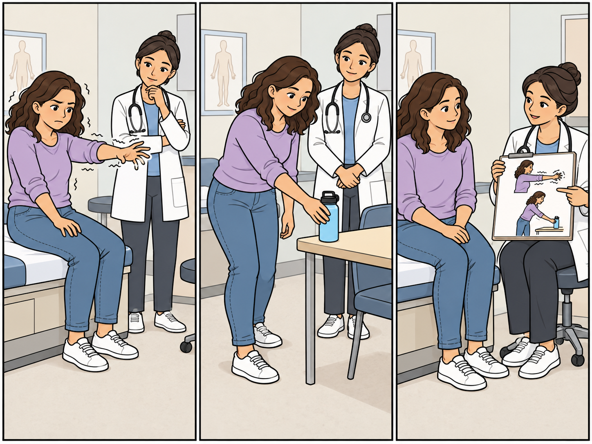

<!-- NAV-BREADCRUMB:START -->
[Home](../../../README.md) › [Course](../../README.md) › Part One: Understanding FND › [Module 2: How FND Is Diagnosed](README.md) › **Positive Signs and the Neurological Examination**
<!-- NAV-BREADCRUMB:END -->

# Positive Signs and the Neurological Examination

> **Working draft:** This page contains human authored and AI-assisted material and is looking for [contributors and reviewers](https://fndeducationproject.org/contact/).

FND should not be diagnosed simply because a scan was normal or because no other explanation has been found. The diagnosis should be supported by features in the history or examination that positively fit a functional neurological problem. This page explains what those features may show, as well as what they cannot show.

---

[For the Person With FND](#for-the-person-with-fnd) 
[For Family, Friends, and Other Supporters](#for-family-friends-and-other-supporters) 
[For Clinicians and the Care Team](#for-clinicians-and-the-care-team) 
[Research and Sources](#research-and-sources)

---

## For the Person With FND
{: #for-the-person-with-fnd .shareable }

The word **positive** has a special meaning here. It means the clinician has noticed a pattern that supports an FND diagnosis. You may also hear this called a **[rule-in sign](../../../glossary/README.md#positive-diagnosis--rule-in-diagnosis)**.

A neurological examination looks at how your body works in several situations. For example, a clinician may first ask you to make a movement on purpose. Then they may see what happens when the same muscles move more automatically, when your attention is on another task, or when you copy a rhythm.

Each task gives one piece of information. The pattern across the tasks can help the clinician understand how your nervous system is working. (*citations* [1](#citation-1), [2](#citation-2))

You may notice that a movement changes from one task to another. A leg that feels stuck during one task may move more freely during another. A tremor may change when the other hand follows a rhythm. Walking may become easier with a different direction or timing.

These changes give useful information. They can show that your nervous system can still reach the function in some situations. The symptom is still real and involuntary, and this preserved ability may give treatment something to build on. (*citations* [1](#citation-1), [3](#citation-3))

<figure class="image-60center" markdown="1">

<figcaption>Movement can change with the task. The clinician considers the pattern across the examination and explains what it may show.</figcaption>

</figure>

### Some examples of positive signs

**Hoover’s sign** may be used when one leg feels weak. The clinician compares how strongly you can press that heel down on purpose with the automatic downward pressure it produces when you lift the other leg against resistance. These movements involve straightening one hip and bending the other.

Stronger automatic pressure can show movement ability that is harder to access on purpose. The clinician interprets this finding alongside the rest of the assessment. (*citations* [1](#citation-1), [4](#citation-4))

**[Distractibility](../../../glossary/README.md#distractibility)** means that a movement symptom changes while your attention is on another task.

> “The tremor stops when I think about my answer and speak it.”

— *Lived experience:* a community member describing an attention-shifting cue suggested by a physiotherapist. [Read the public source](https://www.reddit.com/r/FND/comments/1nzuyuz/comment/ni918wf/).

> “She handed me a rainbow coloured dodgeball and asked me to rotate it ... And the tremors stopped.”

— *Lived experience:* a community member describing a task tried with a physiotherapist. The author reports that the tremor returned when the rotation stopped. [Read the public source](https://www.reddit.com/r/FND/comments/1pslgkk/there_is_a_light_at_the_end_of_the_tunnel/).

These accounts illustrate personal responses to a task or attention shift. A clinician uses a structured examination to assess their diagnostic meaning.

**[Entrainment](../../../glossary/README.md#entrainment)** is a specific tremor sign. You make a rhythm with another hand or foot, and the tremor changes to match that rhythm. Other changes—such as the tremor pausing or becoming smaller—may also be useful observations. The clinician looks for a pattern that is clear and can be repeated. (*citation* [5](#citation-5))

**The principle is the same across FND: the evidence needs to fit the symptom.** The assessment may look different for speech, vision, sensation, memory or episodes such as functional seizures. Each calls for its own explanation. (*citations* [1](#citation-1), [2](#citation-2))

For [speech and voice symptoms](../../../reference/diagnostic-signs/09-functional-speech-and-voice-symptoms.md), a clinician may compare conversation with other speaking tasks. They look at what changes and whether the whole pattern supports a functional explanation. For [functional tic-like symptoms](../../../reference/diagnostic-signs/17-functional-tics-and-tic-like-symptoms.md), the history of how movements or sounds began and developed helps the clinician interpret what they observe. Changes with attention can occur in both functional tic-like symptoms and other tic disorders, so that feature needs context. (*citations* [2](#citation-2), [8](#citation-8))

These examples teach an important distinction: **a positive diagnosis comes from a meaningful pattern, rather than simply noticing that a symptom varies.** The useful findings and the strength of evidence supporting them differ by symptom.

### What a positive sign can tell you

A positive finding can help your clinician explain why a functional diagnosis fits your symptoms. In [functional cognitive disorder (FCD)](../../../reference/diagnostic-signs/12-functional-cognitive-disorder.md), this concerns difficulties with abilities such as memory or attention. A clinician may find that the same ability is more available in one situation than another, after considering the demands of each task and other possible explanations. This pattern is called **internal inconsistency**. (*citation* [7](#citation-7))

For example, remembering details during conversation may be easier than recalling them when deliberately trying. Your clinician considers how this fits the wider assessment; an ordinary lapse or a good test score alone does not establish FCD. The difficulties are real, and understanding the pattern can help you and your care team discuss support. (*citation* [7](#citation-7))

What you manage during an appointment is one part of the picture. Understanding how memory and attention affect daily life helps your care team plan the support you need.

Your clinician will consider the sign together with your health history and the rest of the examination. They will also think about pain, injury, tiredness, medicines, how clear the task was, and any other health conditions. This helps them decide what the sign means for you. (*citations* [1](#citation-1), [4](#citation-4))

> A positive sign supports an FND diagnosis for the symptom being examined. Your clinician will continue to consider each symptom carefully.

Your clinician should explain the diagnosis in a way you can understand. You can ask which sign they found, what it showed, and what other possibilities they considered. When appropriate, you can also ask them to demonstrate the sign. If you notice a new symptom or a major change, tell a healthcare professional so it can be assessed.

### Questions to reflect on

Which part of the explanation made the most sense to you? Which part would you like explained again?

If your clinician showed you a positive sign, how would you explain what it showed about your nervous system?

### One small step

Write down or talk through the explanation in two parts: **the sign that was found** and **what the clinician believes it shows**. You can bring a note or ask someone to help you remember it at your next appointment. Ask for any part to be explained again.

Use the positive sign as information from your clinician rather than as a test to repeat by yourself. Hoover’s sign, tremor tests, and other neurological tests need training and context to interpret. At home, focus on the strategies recommended by your care team and note any changes you want to discuss with them.

### Optional learning activity

<a href="{{ "/puzzles/" | relative_url }}?collection=crosswords&amp;puzzle=lesson-5">Browse crosswords for this lesson</a> · <a href="{{ "/puzzles/" | relative_url }}?collection=colouring&amp;puzzle=lesson-5">Browse colouring pages for this lesson</a>

Choose a crossword below. Normal and easy editions are fillable PDFs; the easy edition includes a word bank.

<a class="puzzle-card" target="_blank" rel="noopener" title="Opens PDF in a new tab or window" href="{{ '/assets/puzzles/crosswords/Module-2-Lesson-5/positive-signs-and-the-neuro-exam-m2-5-normal.pdf' | relative_url }}">
  
  Positive Signs and the Neuro Exam — Normal <small>PDF</small>
</a>
<a class="puzzle-card" target="_blank" rel="noopener" title="Opens PDF in a new tab or window" href="{{ '/assets/puzzles/crosswords/Module-2-Lesson-5/positive-signs-and-the-neuro-exam-m2-5-easy.pdf' | relative_url }}">
  
  Positive Signs and the Neuro Exam — Easy <small>PDF</small>
</a>
<a class="puzzle-card" target="_blank" rel="noopener" title="Opens PDF in a new tab or window" href="{{ '/assets/puzzles/crosswords/Module-2-Lesson-5/positive-signs-and-the-neuro-exam-m2-5-answer-key.pdf' | relative_url }}">
  
  Positive Signs and the Neuro Exam — Answer key <small>PDF</small>
</a>

#### Colouring page

Choose the preview to open the printable colouring PDF. Use landscape orientation and fit to page when printing. You can also browse the [puzzles collection](../../../assets/puzzles/README.md).

<a class="puzzle-card" target="_blank" rel="noopener" title="Opens PDF in a new tab or window" href="{{ '/assets/puzzles/colouring/lesson-5-coloring-book.pdf' | relative_url }}">
  
  Positive signs — Colouring page <small>PDF</small>
</a>

---

[For the Person With FND](#for-the-person-with-fnd) 
[For Family, Friends, and Other Supporters](#for-family-friends-and-other-supporters) 
[For Clinicians and the Care Team](#for-clinicians-and-the-care-team) 
[Research and Sources](#research-and-sources)

---

## For Family, Friends, and Other Supporters
{: #for-family-friends-and-other-supporters .shareable }

A positive sign can offer hope. It may show that an ability is available in some situations and give the care team useful information for treatment. The symptom is still real and involuntary. The encouraging message is that the nervous system may have capacity that rehabilitation can build on.

### Helping the explanation feel clear

If the person invites you to an appointment, you can help them remember what was discussed. Write down the name of the positive sign, what the clinician observed, and how it may guide treatment. Afterwards, ask which parts made sense and which parts they would like explained again. A calm conversation gives them time to absorb the information at their own pace.

If the person has functional seizures, you can also help describe episodes you have witnessed, with their agreement. Explain what happened before, during and afterwards, how long the episode lasted, and whether it differed from their usual episodes. These observations help the clinician understand the pattern while leaving its medical interpretation to the care team. (*citation* [1](#citation-1))

Helpful questions can include:

- **“What did the clinician show you?”**

- **“What does that mean for treatment?”**

- **“Would you like me to write that down or ask about it with you?”**

### Supporting progress at home

Your role is to support the strategies chosen by the person and their care team. Notice and encourage conditions that make an activity feel more manageable, while letting the person lead. A change in a symptom can be useful information about the nervous system; it is not a test of effort or willpower.

You can help by:

- asking what kind of help would be useful today;

- following rehabilitation strategies the care team has recommended;

- making room for rest, practice, and gradual progress;

- recognizing effort and small gains without adding pressure;

- writing down patterns the person wants to discuss with their clinician; and

- keeping everyday connection, interests, and enjoyment part of your time together.

Trust can grow when support feels collaborative. Let the clinician or therapist perform neurological tests. At home, focus on agreed strategies rather than trying to trigger, check, or interpret signs yourself.

### Responding to changes

Keep communication open about new or substantially changed symptoms. Encourage the person to share these changes with a healthcare professional so each concern can be assessed carefully. FND can exist alongside other neurological or medical conditions.

### Looking after yourself, too

> **A boundary is a clear, respectful limit that explains what help you can offer, what you need, and what another person remains responsible for.**

Supporting someone can take time and energy. You might set boundaries about when you are available, which daily tasks you can help with, and when you need rest or time for your own responsibilities. You can agree to support care-team strategies while leaving neurological tests and medical decisions to clinicians. You can also decide together who will record symptom changes, arrange appointments, or ask for extra help.

State these limits kindly and early, review them as needs change, and seek support for yourself when needed. Clear boundaries and shared plans can help the relationship stay caring and sustainable.

---

[For the Person With FND](#for-the-person-with-fnd) 
[For Family, Friends, and Other Supporters](#for-family-friends-and-other-supporters) 
[For Clinicians and the Care Team](#for-clinicians-and-the-care-team) 
[Research and Sources](#research-and-sources)

---

## For Clinicians and the Care Team
{: #for-clinicians-and-the-care-team .shareable }

### Begin with positive evidence

> “The diagnosis of FND should rest on clear positive evidence”

*Figure 1.* Short excerpt from Bennett et al., 2021, abstract. The sentence continues by referring to examination signs or seizure characteristics. (*citation* [1](#citation-1))

### Help the patient understand the sign

Start by naming the diagnosis. Then identify the positive sign and connect it directly to the patient’s symptom. This sequence gives the patient time to understand what was observed and why it matters.

When appropriate and with consent, demonstrate the finding rather than only describing it. Explain preserved capacity without suggesting conscious control. For example: **“Your leg produced stronger automatic movement during this task, even though deliberate movement remains difficult.”**

Base the explanation on the positive clinical finding. A normal scan, a history of stress, or the absence of another diagnosis does not provide the same rule-in explanation. (*citations* [1](#citation-1), [2](#citation-2))

### Assess positive signs carefully

Choose signs validated for the presenting phenotype. Interpret each sign alongside the history, the complete neurological examination, and the relevant differential diagnosis.

Before attributing a finding to FND, consider:

- whether the finding is reproducible and clinically meaningful;

- whether the sign matches the symptom being assessed;

- pain, fatigue, medication, comprehension, neglect, or biomechanical limits; and

- coexisting neurological or medical disease.

Several weak or inapplicable signs do not become strong evidence simply because there are several of them. Aim for a clear pattern that fits the patient’s presentation. (*citations* [1](#citation-1), [2](#citation-2), [4](#citation-4), [5](#citation-5))

### Connect the examination to treatment

A respectfully demonstrated sign can do more than support the diagnosis. It can show that a function is available under some conditions. That observation may help identify a first rehabilitation strategy.

Possible starting points include changing attentional focus, rhythm, automatic movement, or the task context. Keep the demonstration collaborative and explain what the change may offer treatment. (*citation* [6](#citation-6))

Assess how that ability translates into safe, repeatable and sustainable daily activities, including fatigue, recovery time and support needs. The Reference page on [Assessment and Everyday Function](../../../reference/diagnostic-concepts/10-assessment-and-everyday-function.md) develops this distinction.

### Know when to revisit the formulation

Reassess when the original diagnosis lacks a clearly described positive sign, when the sign does not match the symptom, or when objective findings conflict with the formulation. A new or substantially different symptom pattern also deserves fresh assessment.

FND can coexist with another neurological or medical condition. Continued care should balance two needs: limiting unnecessary repeated investigation and remaining alert to clinically important change. (*citations* [1](#citation-1), [2](#citation-2))

### A reminder for deeper clinical reading

The Reference Library provides fuller examination methods, interpretation and evidence limits. For this lesson, start with [Hoover’s Sign](../../../reference/diagnostic-signs/functional_limb_weakness/01-hoovers-sign.md) and [Entrainment in Functional Tremor](../../../reference/diagnostic-signs/functional_tremor/02-entrainment.md). The [Diagnostic Signs collection](../../../reference/diagnostic-signs/README.md) organizes the wider material by symptom.

Older papers often use terms such as *psychogenic*, *hysteria* or *conversion disorder*. Reading them in their historical context helps retain useful observations while interpreting their explanations through current evidence. Today’s approach emphasizes positive clinical features, genuinely experienced symptoms and an individual assessment of contributing factors; a psychological stressor is not required for diagnosis. (*citations* [1](#citation-1), [2](#citation-2), [3](#citation-3))

Some older labels remain in newer papers and diagnostic systems, so consider each paper’s definitions, methods and claims alongside its date. [A Brief History of FND](../../../reference/history-of-fnd.md) explains this development and why 2013 is a useful diagnostic landmark rather than a cut-off for valuable research.

---

[For the Person With FND](#for-the-person-with-fnd) 
[For Family, Friends, and Other Supporters](#for-family-friends-and-other-supporters) 
[For Clinicians and the Care Team](#for-clinicians-and-the-care-team) 
[Research and Sources](#research-and-sources)

---

<!-- NAV-CONTEXT:START -->
**Continue:** [Next page: Tests, Diagnostic Uncertainty, and Coexisting Conditions](02-tests-diagnostic-uncertainty-and-coexisting-conditions.md)

**Navigate:** [Home](../../../README.md) · [Course](../../README.md) · [Reference Library](../../../reference/README.md) · [Site Map](../../../SITEMAP.md)
<!-- NAV-CONTEXT:END -->

---

## Research and Sources
{: #research-and-sources .shareable }

### What this evidence can and cannot establish

Bennett and Espay are clinical reviews that support an inclusionary, positive diagnosis and phenotype-appropriate signs. Hallett and colleagues provide a broader account of genuinely experienced, variable symptoms and developing shared-mechanism research. These reviews do not make every bedside observation a validated sign or allow one sign to be applied across every FND presentation. (*citations* [1](#citation-1), [2](#citation-2), [3](#citation-3))

### Citation table

| Citation | Figure | Full citation | Supports |
|---|---|---|---|
| **[1]** | Figure 1 | Bennett K, Diamond C, Hoeritzauer I, Gardiner P, McWhirter L, Carson A, Stone J. A practical review of functional neurological disorder (FND) for the general physician. *Clinical Medicine*. 2021;21(1):28–36. [FND-CIT-0001](../../../research/citation-index.md#fnd-cit-0001). [https://doi.org/10.7861/clinmed.2020-0987](https://doi.org/10.7861/clinmed.2020-0987) | Positive diagnosis, explanation, coexistence and reassessment. |
| **[2]** | — | Espay AJ, Aybek S, Carson A, et al. Current concepts in diagnosis and treatment of functional neurological disorders. *JAMA Neurology*. 2018;75(9):1132–1141. [FND-CIT-0002](../../../research/citation-index.md#fnd-cit-0002). [https://doi.org/10.1001/jamaneurol.2018.1264](https://doi.org/10.1001/jamaneurol.2018.1264) | Phenotype-appropriate diagnosis and interpretation; historical diagnostic changes. |
| **[3]** | — | Hallett M, Aybek S, Dworetzky BA, McWhirter L, Staab JP, Stone J. Functional neurological disorder: new subtypes and shared mechanisms. *The Lancet Neurology*. 2022;21(6):537–550. [FND-CIT-0003](../../../research/citation-index.md#fnd-cit-0003). [https://doi.org/10.1016/S1474-4422(21)00422-1](https://doi.org/10.1016/S1474-4422(21)00422-1) | Genuinely experienced symptoms, variability and developing mechanisms. |
| **[4]** | — | Dolbow J, El-Azzouni S, Zhang Y, Geiger C. A practical guide to assessing functional motor weakness: a review of validated techniques. *Journal of Neurology*. 2025;272(6):427. [DOI](https://doi.org/10.1007/s00415-025-13139-4). [PMID: 40423819](https://pubmed.ncbi.nlm.nih.gov/40423819/). [FND-CIT-0183](../../../research/citation-index.md#fnd-cit-0183). | Hoover’s sign technique, suitability and confounders. |
| **[5]** | — | Edwards MJ, Koens LH, Liepert J, Nonnekes J, Schwingenschuh P, van de Stouwe AMM, Morgante F. Clinical neurophysiology of functional motor disorders: IFCN Handbook Chapter. *Clinical Neurophysiology Practice*. 2024;9:69–77. [https://doi.org/10.1016/j.cnp.2023.12.006](https://doi.org/10.1016/j.cnp.2023.12.006) [FND-CIT-0022](../../../research/citation-index.md#fnd-cit-0022). | Specialist tremor assessment: entrainment, suppression and variability. |
| **[6]** | — | Nielsen G, Stone J, Matthews A, et al. Physiotherapy for functional motor disorders: a consensus recommendation. *Journal of Neurology, Neurosurgery & Psychiatry*. 2015;86(10):1113–1119. [https://doi.org/10.1136/jnnp-2014-309255](https://doi.org/10.1136/jnnp-2014-309255) [FND-CIT-0028](../../../research/citation-index.md#fnd-cit-0028). | Physiotherapy consensus: explanation and individualized motor retraining. |
| **[7]** | — | Ball HA, McWhirter L, Ballard C, et al. Functional cognitive disorder: dementia’s blind spot. *Brain*. 2020;143(10):2895–2903. [FND-CIT-0071](../../../research/citation-index.md#fnd-cit-0071). [DOI](https://doi.org/10.1093/brain/awaa224). | Positive FCD formulation, internal inconsistency and consideration of alternative explanations. |
| **[8]** | — | Malaty IA, Anderson S, Bennett SM, et al. Diagnosis and management of functional tic-like phenomena. *Journal of Clinical Medicine*. 2022;11(21):6470. [FND-CIT-0110](../../../research/citation-index.md#fnd-cit-0110). [DOI](https://doi.org/10.3390/jcm11216470). | History and overall clinical pattern in tic assessment; attention-related changes can occur in functional and primary tic disorders. |

This page still needs review by people with FND, supporters and clinicians, including a clinician experienced in neurological diagnosis.

*Human-authored revision, evidence and editorial review: October 14, 2026 · Clinical review pending*
