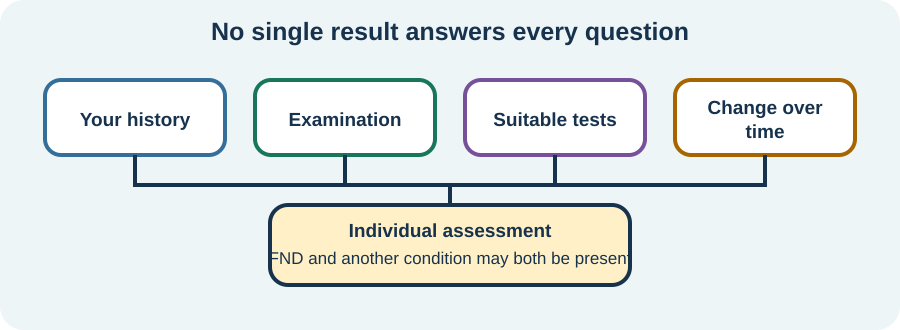

<!-- NAV-BREADCRUMB:START -->
[Home](../../../README.md) › [Course](../../README.md) › Part One: Understanding FND › [Module 2: How FND Is Diagnosed](README.md) › **Tests, Diagnostic Uncertainty, and Coexisting Conditions**
<!-- NAV-BREADCRUMB:END -->

# Tests, Diagnostic Uncertainty, and Coexisting Conditions

> **Working draft:** This page contains human authored and AI-assisted material and is looking for [contributors and reviewers](https://fndeducationproject.org/contact/).

Tests can help answer medical questions, but they cannot diagnose FND simply by coming back normal. FND may also exist alongside another condition. This lesson explains what those facts mean for your diagnosis, what to do when questions remain and where to find details about tests for your particular symptoms.

---

[For the Person With FND](#for-the-person-with-fnd) 
[For Family, Friends, and Other Supporters](#for-family-friends-and-other-supporters) 
[For Clinicians and the Care Team](#for-clinicians-and-the-care-team) 
[Research and Sources](#research-and-sources)

---

## For the Person With FND
{: #for-the-person-with-fnd .shareable }

This part is written for you. Take it at your own pace. You can read one question, take a break and come back later. Each part makes sense on its own.

### What do test results tell me?

Tests help your clinician answer specific medical questions. Your clinician is the doctor, nurse or other health professional who looks after your care.

Each test is chosen to check one particular thing. For example, a scan can show whether there are signs of a stroke.

A normal result is useful information. It helps your care team set aside some other explanations and focus on what is really going on.

Your symptoms are real, whatever a test shows. FND is recognized through characteristic features of your symptoms and examination. Tests help your clinician assess other possible explanations and coexisting conditions.

An FND diagnosis is built on recognizable features of your symptoms and examination. These are called [positive signs](../../../glossary/README.md#positive-clinical-sign--positive-diagnostic-sign). We introduced them in [Lesson 5: Positive Signs and the Neurological Examination](01-positive-signs-and-the-neurological-examination.md). You can ask your clinician to show you which positive signs support your diagnosis. (*citations* [1](#citation-1), [2](#citation-2))

<figure class="image-60center" markdown="1">

<figcaption>Each piece of information can answer a different question. No single result tells the whole story.</figcaption>

</figure>

- **Your story.** What you have noticed, when it started and how it changes from day to day. This is called your history, and it is one of the most important pieces.

- **The examination.** What your clinician notices when they check how your body moves, feels and responds. Positive signs may be found here or in the characteristic features of an episode.

- **Tests.** Answers to specific questions, such as what a scan or a blood test shows.

- **Changes over time.** How your symptoms develop over weeks and months. This helps your care team keep the picture up to date.

**Key idea: Tests answer specific questions. Positive signs support an FND diagnosis.**

### Can I have FND and another medical condition?

Yes. You can have FND and another health condition at the same time, such as migraine or epilepsy.

Each symptom can have its own explanation, and your care team can look at each one on its own. Your FND diagnosis and another diagnosis can both be correct at the same time. Every condition you have deserves to be recognized and treated. (*citations* [1](#citation-1), [3](#citation-3))

### More than one condition can be present

*An FND diagnosis can sit alongside other diagnoses. Each condition deserves recognition and an appropriate care plan.*

| Condition | What this means for you |
| --- | --- |
| [Postural orthostatic tachycardia syndrome (POTS)](../../../reference/co-occurring-conditions/08-autonomic-symptoms.md) | POTS and FND can occur together. Symptoms related to standing deserve assessment for their own cause. How often the two coexist remains uncertain. (*citations* [6](#citation-6)) |
| [Myalgic encephalomyelitis/chronic fatigue syndrome (ME/CFS)](../../../reference/co-occurring-conditions/06-fatigue.md) | ME/CFS may coexist with FND. Tell your clinician about delayed or prolonged worsening after activity. There is no dependable overall percentage: studies of fatigue or “ME/CFS-like” symptoms do not necessarily establish ME/CFS. (*citations* [7](#citation-7), [13](#citation-13)) |
| Attention-deficit/hyperactivity disorder (ADHD) | ADHD can be present alongside FND. In one large health-record study, it was recorded in approximately 13% of adults aged 19–50 and 21% of young people aged 10–18 with FND without recorded autism. (*citations* [8](#citation-8)) |
| Autism | Autistic people can also develop FND. A large health-record study found recorded autism in approximately 2% of people with FND; this does not include everyone whose autism remains unrecognised. (*citations* [8](#citation-8)) |
| Post-traumatic stress disorder (PTSD) | PTSD can coexist with FND and deserves support in its own right. A recent meta-analysis estimated PTSD in approximately 38% of people with functional seizures—a figure specific to that FND presentation. (*citations* [9](#citation-9)) |
| [Migraine](../../../reference/co-occurring-conditions/01-migraine.md) | Migraine is a distinct condition that can occur alongside FND. You can ask for a migraine treatment plan as well as your FND care plan. Approximately 32% of people with functional seizures had migraine in a systematic review. (*citations* [10](#citation-10)) |

**Key idea: Each condition you have deserves its own care. Your care team can plan for all of them together.**

<figure class="image-60center" markdown="1">

<figcaption>Your care can make room for each health condition and the things that matter to you.</figcaption>

</figure>

### What if some questions remain unanswered?

Your clinician can be confident that you have FND while still checking another symptom. Some questions take more time or information to answer. Taking that time is part of good, careful care.

Open questions can show that your care team is being careful and honest with you. You can ask them about three things:

- “What do we know?” This is what your care team is confident about right now.

- “What are we still finding out?” These are the questions that are still open.

- “What happens next?” This is the plan, such as a test, an appointment or time to see how things change.

### When should I ask for another look?

You can always ask for a clearer explanation or a fresh look at your diagnosis. Two times are especially good for asking:

When you want to know what supports your diagnosis. Your clinician can explain which positive signs support FND, so the diagnosis makes sense to you.

When something new or different happens. New symptoms, or symptoms that change a lot, are worth having checked. Sudden stroke-like symptoms need emergency assessment, even when you have FND.

A second opinion may give you and your care team more information. It might confirm your diagnosis, answer an open question or find another condition that needs care. These outcomes can help clarify the next steps in your care.

### Where can I learn about tests for my symptoms?

This lesson gives you the big picture. You can learn about specific tests whenever you feel ready.

In the [Reference Library, find your symptom](../../../reference/README.md#find-an-fnd-symptom), then follow Understanding & Diagnosis. There you will find explanations of the examinations and tests for that symptom.

For a broader explanation, see [What Tests and Investigations Can Tell Us](../../../reference/diagnostic-concepts/03-tests-and-investigations.md).

### Questions to reflect on

Take your time with these. Any answer you have is a good starting point.

Which part of the explanation for your diagnosis makes sense to you?

Is there one question you would still like your clinician to answer?

### One small step

Choose one question to bring to your next appointment. You can write it down, record a voice note or ask someone to help you remember it. For example: “What findings support my FND diagnosis, and is there anything else we still need to check?”

Your care team is there to explain test results with you. You can ask for explanations in a form that works for you, with support whenever you want it.

### Optional learning activity

<a href="{{ "/puzzles/" | relative_url }}?collection=crosswords&amp;puzzle=lesson-6">Browse crosswords for this lesson</a> · <a href="{{ "/puzzles/" | relative_url }}?collection=colouring&amp;puzzle=lesson-6">Browse colouring pages for this lesson</a>

Choose a crossword below. Normal and easy editions are fillable PDFs; the easy edition includes a word bank.

<a class="puzzle-card" target="_blank" rel="noopener" title="Opens PDF in a new tab or window" href="{{ '/assets/puzzles/crosswords/Module-2-Lesson-6/tests-uncertainty-and-coexisting-conditions-m2-6-normal.pdf' | relative_url }}">
  
  Tests, Uncertainty, and CoExisting Conditions — Normal <small>PDF</small>
</a>
<a class="puzzle-card" target="_blank" rel="noopener" title="Opens PDF in a new tab or window" href="{{ '/assets/puzzles/crosswords/Module-2-Lesson-6/tests-uncertainty-and-coexisting-conditions-m2-6-easy.pdf' | relative_url }}">
  
  Tests, Uncertainty, and CoExisting Conditions — Easy <small>PDF</small>
</a>
<a class="puzzle-card" target="_blank" rel="noopener" title="Opens PDF in a new tab or window" href="{{ '/assets/puzzles/crosswords/Module-2-Lesson-6/tests-uncertainty-and-coexisting-conditions-m2-6-answer-key.pdf' | relative_url }}">
  
  Tests, Uncertainty, and CoExisting Conditions — Answer key <small>PDF</small>
</a>

#### Colouring page

Choose the preview to open the printable colouring PDF. Use landscape orientation and fit to page when printing. You can also browse the [puzzles collection](../../../assets/puzzles/README.md).

<a class="puzzle-card" target="_blank" rel="noopener" title="Opens PDF in a new tab or window" href="{{ '/assets/puzzles/colouring/lesson-6-coloring-book.pdf' | relative_url }}">
  
  Lesson 6: Care for the whole person — Colouring page <small>PDF</small>
</a>

---

[For the Person With FND](#for-the-person-with-fnd) 
[For Family, Friends, and Other Supporters](#for-family-friends-and-other-supporters) 
[For Clinicians and the Care Team](#for-clinicians-and-the-care-team) 
[Research and Sources](#research-and-sources)

---

## For Family, Friends, and Other Supporters
{: #for-family-friends-and-other-supporters .shareable }

After an FND diagnosis, many people think of their most important questions only once the appointment is over. Tests, new words and changing symptoms are a lot to take in at once, and the details can be hard to hold on to afterwards.

Supporters can make a real difference here. The most helpful support usually keeps the person with FND at the centre of their own care, with you alongside them.

### Before the appointment

People differ in the kind of support they want. Some like company at appointments. Some appreciate help with notes or preparation. Some prefer to go alone. Asking what they would like lets them shape the support around their own needs.

Appointments are often short. One or two questions that matter most to the person tend to receive fuller answers than a long list. If something is new or has changed, a clear description of what changed and when is especially valuable. Your observations give the clinician the details they need to work out the cause.

### During the appointment

When the person leads the conversation, they build confidence and a clearer understanding of their own care. Many people appreciate being asked before someone adds information or speaks for them.

When an explanation is unclear, certain questions tend to open up helpful conversations. Each one serves a different purpose.

- “What findings support the FND diagnosis?” This invites the clinician to explain the positive signs they found, which helps the diagnosis make sense to everyone.

- “What did this test tell us, and which questions are still open?” Each test is chosen to answer a specific question. Knowing its purpose makes the result easier to understand.

- “Could another condition be contributing to these symptoms?” FND can occur alongside other conditions. This question helps make sure each condition receives its own care.

- “What changes should prompt another assessment, and whom should we contact?” This gives you both a clear plan and the confidence of knowing where to turn.

One or two of these questions are usually plenty. Choosing the ones that fit the situation keeps the conversation focused.

You can ask clinicians to say things more simply or write down the main points. If you witnessed an episode, a brief factual description can be valuable to the assessment, especially when the person would like you to share it.

### After the appointment

Comparing notes afterwards, with the person's agreement, helps you both remember the same plan. Three questions give a useful structure: What has been established? What is still being explored? What happens next?

A written record of follow-up tests or appointments, who is arranging them and how to raise a new concern makes the next steps easier to follow. Contacting the care team to clarify the plan is a normal part of care.

Another medical condition can exist alongside FND. Everyone deserves a clear explanation of their diagnosis, whatever the full picture turns out to be. The shared goal is to understand the diagnosis, keep communication open and make sure new or substantially changed symptoms receive appropriate attention.

### Help communicate what matters

*Supporters can help describe changes and prepare questions, while clinicians assess the cause.*

| What you notice | A useful way to help |
| --- | --- |
| Headaches or migraine episodes | Help describe their frequency, duration and effect on daily life. Ask: “Does migraine need its own treatment plan?” |
| Different kinds of attacks or blackouts | Help describe how the episodes differ and follow the agreed safety plan. Ask: “Could these events have more than one cause?” |
| Symptoms after standing or activity | Note when symptoms start, including any delayed worsening, and how long recovery takes. Ask: “Does this pattern need separate assessment?” |
| A new or clearly different symptom | Help explain what has changed from the person’s usual pattern. Sudden stroke-like symptoms need emergency assessment, even when the person has FND. |

These supporter prompts reflect the clinical guidance to consider coexisting conditions and assess new symptoms individually. (*citations* [1](#citation-1), [3](#citation-3))

Useful support helps someone ask their own questions, hear the answers and make sense of them in their own way.

---

[For the Person With FND](#for-the-person-with-fnd) 
[For Family, Friends, and Other Supporters](#for-family-friends-and-other-supporters) 
[For Clinicians and the Care Team](#for-clinicians-and-the-care-team) 
[Research and Sources](#research-and-sources)

---

## For Clinicians and the Care Team
{: #for-clinicians-and-the-care-team .shareable }

This section looks at how tests, diagnostic certainty and coexisting conditions fit together in FND care. Each part builds on the one before, so reading it in order may be most useful.

### How often do neurological conditions coexist?

Coexisting neurological disease is a well-documented part of FND care. Functional seizures offer the clearest numerical example.

A systematic review and meta-analysis by Kutlubaev and colleagues (2018) looked at this overlap from both directions. Among people with psychogenic nonepileptic seizures ([PNES](../../../glossary/README.md#pnes), commonly called functional seizures), approximately 22% also had epilepsy. Among people with epilepsy, approximately 12% also had PNES. (*citations* [5](#citation-5))

Because the two figures come from different starting populations, each answers a different question. The included studies mostly drew on selected clinical groups, often from epilepsy services, and their estimates varied. The figures describe those groups as a whole, rather than everyone with FND or the likelihood for an individual patient. Their real value lies in encouraging careful assessment of each event type, with room for more than one diagnosis to explain a person's symptoms.

### Similar symptoms, potentially different treatment

*Conditions that may resemble or coexist with FND. Assess which condition explains each presentation and treat each identified condition appropriately.*

| Condition | Why consider it—and a simple frequency estimate |
| --- | --- |
| Migraine | Aura can involve visual, sensory, speech or motor symptoms. Migraine warrants its own assessment and treatment alongside FND. Approximately 32% of patients with functional seizures had migraine in a systematic review. (*citations* [10](#citation-10)) |
| Epilepsy | Epileptic and functional seizures can occur in the same person, requiring different management. Approximately 22% of patients with functional seizures also had epilepsy in a meta-analysis. (*citations* [5](#citation-5)) |
| Stroke | Sudden weakness, sensory loss or speech disturbance requires assessment on its own merits, including in someone with established FND. Functional presentations account for approximately 2% of suspected strokes; this measures diagnostic resemblance, not stroke prevalence in FND. (*citations* [11](#citation-11)) |
| Multiple sclerosis | Weakness, sensory changes and walking difficulties can overlap with FND. Both diagnoses may be present: MS occurred in approximately 1.5% of one adult motor-FND registry. (*citations* [12](#citation-12)) |
| Parkinson’s disease/parkinsonism | Tremor, slowness and gait changes may require assessment for both functional and other movement disorders. Parkinson’s disease/parkinsonism occurred in approximately 1.3% of that registry. (*citations* [12](#citation-12)) |
| Syncope | Fainting may resemble functional attacks and can coexist with them. Identifying the cause guides treatment. A dependable overall coexistence percentage is unavailable. (*citations* [1](#citation-1), [3](#citation-3)) |

Figures come from different populations; the motor-FND registry included 466 adults.

### How can test results and the positive diagnosis be explained together?

Patients often hear their test results and their FND diagnosis in the same conversation, so the two can easily blur together. Presenting them as separate pieces of information helps each one make sense.

For example, “The MRI showed no sign of a stroke” and “The examination showed a positive functional sign” answer different questions. The first describes what an investigation clarified. The second describes the evidence for FND. (*citations* [1](#citation-1), [2](#citation-2))

This distinction reflects FND's standing as a positive diagnosis. Espay and colleagues capture the principle in a single phrase:

> “…does not depend on excluding other disorders…”

*Figure 1 — Excerpt from Espay et al., 2018, “Phenomenology and Diagnosis,” PDF page 2. The authors describe a diagnosis supported by positive clinical signs.* (*citations* [2](#citation-2))

Patients also benefit from hearing what each test was able to clarify, which questions remain open and how much further testing is likely to add. This gives them a realistic picture of what investigations can offer.

### How are investigations best selected?

Investigations are most informative when each one answers a defined clinical question. The starting point is the person's actual presentation: the phenotype, time course, examination findings and any relevant red flags.

From there, imaging, laboratory testing, neurophysiology, EEG, video-EEG, cardiac assessment, sleep evaluation or other specialist input can each be matched to a specific question. This proportionate approach keeps the [differential](../../../glossary/README.md#differential-diagnosis) open long enough to be thorough, while sparing the patient investigations unlikely to change their care.

Results also benefit from careful interpretation. An incidental abnormality is best weighed for whether it truly explains the symptoms before it is treated as causal.

For seizure-like events, a detailed history and semiology from the patient and witnesses form the foundation. Reviewing available recordings adds further detail, and video-EEG of typical event types is valuable where feasible.

The meaning of a scalp EEG depends on factors including whether a typical event was captured, the event's suspected origin and the technical quality of the recording. Some epileptic seizures show no clear change on scalp EEG, so the recording must be interpreted alongside the event's clinical features. (*citations* [4](#citation-4))

Because epilepsy and functional seizures can occur in the same person, each event type benefits from its own evaluation, along with assessment for other relevant conditions. (*citations* [3](#citation-3))

### How can diagnostic certainty and overlap be communicated?

Diagnoses carry different levels of certainty, and naming the level helps everyone understand where things stand. A confirmed diagnosis, a probable working diagnosis and an unresolved differential each call for a different conversation.

Clear documentation supports continuity of care. Useful elements include the positive signs supporting FND, the alternatives considered, any conditions that may coexist and the evidence that would change the formulation.

Sharing this explanation with the patient and other clinicians gives each later symptom an open assessment on its own merits, free from an assumed “all functional” or “all structural” interpretation.

### When should the diagnosis be reviewed?

Reassessment is valuable when the clinical picture changes. Signals include new focal findings, a materially different episode, progressive loss of previously stable abilities, injury, abnormal objective findings or a course that no longer fits the original formulation.

Review is also helpful when the original diagnosis rested on exclusion alone, or when the patient has yet to receive an understandable explanation of its positive basis.

The aim throughout is a proportionate plan: one that stays alert to coexisting conditions while keeping each investigation purposeful.

---

[For the Person With FND](#for-the-person-with-fnd) 
[For Family, Friends, and Other Supporters](#for-family-friends-and-other-supporters) 
[For Clinicians and the Care Team](#for-clinicians-and-the-care-team) 
[Research and Sources](#research-and-sources)

---

<!-- NAV-CONTEXT:START -->
**Continue:** [Next module: What May Cause or Affect FND?](../module-03-causes-mechanisms-and-honest-uncertainty/README.md)

**Navigate:** [Home](../../../README.md) · [Course](../../README.md) · [Reference Library](../../../reference/README.md) · [Site Map](../../../SITEMAP.md)
<!-- NAV-CONTEXT:END -->

---

## Research and Sources
{: #research-and-sources .shareable }

### What this evidence can and cannot establish

Bennett and Espay support a positive FND diagnosis while warning against exclusion-only reasoning and missed comorbidity. Kutlubaev and colleagues provide group-level estimates of epilepsy and functional-seizure coexistence; the percentages apply to the specific populations studied and are not FND-wide prevalence figures. (*citations* [5](#citation-5))

The Tolchin guideline applies specifically to functional seizures: it supports history, semiology, appropriate use of video-EEG and assessment for co-occurring epilepsy. It should not be generalized to every FND symptom or treated as a requirement that video-EEG is always possible. (*citations* [1](#citation-1), [2](#citation-2), [3](#citation-3))

### Citation table

| Citation | Full citation | Supports | Figure |
| --- | --- | --- | --- |
| **[1]** | Bennett K, Diamond C, Hoeritzauer I, et al. A practical review of functional neurological disorder (FND) for the general physician. Clinical Medicine. 2021;21(1):28–36. [FND-CIT-0001](../../../research/citation-index.md#fnd-cit-0001) · [DOI](https://doi.org/10.7861/clinmed.2020-0987). | Positive diagnosis, coexistence and reassessment. | — |
| **[2]** | Espay AJ, Aybek S, Carson A, et al. Current concepts in diagnosis and treatment of functional neurological disorders. JAMA Neurology. 2018;75(9):1132–1141. [FND-CIT-0002](../../../research/citation-index.md#fnd-cit-0002) · [DOI](https://doi.org/10.1001/jamaneurol.2018.1264). | Positive clinical evidence and diagnostic explanation. | Figure 1 |
| **[3]** | Tolchin B, Goldstein LH, Reuber M, et al. Management of Functional Seizures Practice Guideline Executive Summary. Neurology. 2026;106(1):e214466. [FND-CIT-0010](../../../research/citation-index.md#fnd-cit-0010) · [DOI](https://doi.org/10.1212/WNL.0000000000214466). | Functional-seizure assessment and coexisting epilepsy. | — |
| **[4]** | Whitehead K, Kane N, Wardrope A, Kandler R, Reuber M. Proposal for best practice in the use of video-EEG when psychogenic non-epileptic seizures are a possible diagnosis. Clinical Neurophysiology Practice. 2017;2:130–139. [FND-CIT-0233](../../../research/citation-index.md#fnd-cit-0233) · [DOI](https://doi.org/10.1016/j.cnp.2017.06.002). | Scalp-EEG interpretation and limitations. | — |
| **[5]** | Kutlubaev MA, Xu Y, Hackett ML, Stone J. Dual diagnosis of epilepsy and psychogenic nonepileptic seizures: systematic review and meta-analysis of frequency, correlates, and outcomes. Epilepsy & Behavior. 2018;89:70–78. [FND-CIT-0274](../../../research/citation-index.md#fnd-cit-0274) · [DOI](https://doi.org/10.1016/j.yebeh.2018.10.010). | Epilepsy/functional-seizure coexistence with different denominators. | — |
| **[6]** | Nagata R, Matsuura E, Nozuma S, et al. Anti-ganglionic acetylcholine receptor antibodies in functional neurological symptom disorder/conversion disorder. *Frontiers in Neurology*. 2023;14:1137958. [FND-CIT-0275](../../../research/citation-index.md#fnd-cit-0275) · [Source](https://doi.org/10.3389/fneur.2023.1137958). | Documented POTS coexistence in a selected cohort; not general prevalence. | — |
| **[7]** | Gaber TAZK, Shippen C, Jones F. Temporal Sequence of Onset: ME/CFS-like Fatigue and Functional Neurological Disorder. *Advances in Rehabilitation Science and Practice*. 2026. [FND-CIT-0276](../../../research/citation-index.md#fnd-cit-0276) · [Source](https://doi.org/10.1177/27536351261496336). | ME/CFS-like symptoms versus formal diagnosis; no reliable general coexistence estimate. | — |
| **[8]** | Smythe L, Asan L, Nicholson TR, Happé F, Edwards MJ. Co-occurring functional neurological disorder and autism: an exploratory study of comorbidities in a retrospective cohort study using TriNetX. *Journal of Neurology*. 2025;272:653. [FND-CIT-0277](../../../research/citation-index.md#fnd-cit-0277) · [Source](https://doi.org/10.1007/s00415-025-13385-6). | Recorded autism and age-restricted ADHD comorbidity; cumulative health-record diagnoses. | — |
| **[9]** | Nicholson D, Gaskell C, Rawlings GH, et al. The prevalence of post-traumatic stress disorder in functional / dissociative seizures: A systematic review and meta-analysis. *Seizure*. 2026;141:223–232. [FND-CIT-0278](../../../research/citation-index.md#fnd-cit-0278) · [Source](https://doi.org/10.1016/j.seizure.2026.07.027). | PTSD estimate in functional seizures; ascertainment includes screening, interviews and records. | — |
| **[10]** | Kyrgyzbay G, Kalinina D, Akhmedullin R, et al. Prevalence of migraine in individuals with functional seizures: A systematic review and meta-analysis. *Epilepsy Research*. 2025;216:107596. [FND-CIT-0279](../../../research/citation-index.md#fnd-cit-0279) · [Source](https://doi.org/10.1016/j.eplepsyres.2025.107596). | Aggregate migraine proportion in functional seizures; ascertainment varies across studies. | — |
| **[11]** | Jones AT, O’Connell NK, David AS. Epidemiology of functional stroke mimic patients: a systematic review and meta-analysis. *European Journal of Neurology*. 2020;27(1):18–26. [FND-CIT-0280](../../../research/citation-index.md#fnd-cit-0280) · [Source](https://doi.org/10.1111/ene.14069). | Functional presentations among suspected strokes, not stroke prevalence in FND. | — |
| **[12]** | Nisticò V, Demartini B, et al. Pain in Functional Motor Disorders: Clinical Correlates From the Italian Registry. *European Journal of Neurology*. 2026;33(5):e70634. [FND-CIT-0281](../../../research/citation-index.md#fnd-cit-0281) · [Source](https://doi.org/10.1111/ene.70634). | Table 1: MS and Parkinson’s disease/parkinsonism in 466 adults with motor FND. | — |
| **[13]** | National Institute for Health and Care Excellence. *Myalgic encephalomyelitis (or encephalopathy)/chronic fatigue syndrome: diagnosis and management*. NG206. 2021. [FND-CIT-0206](../../../research/citation-index.md#fnd-cit-0206) · [Source](https://www.nice.org.uk/guidance/ng206/chapter/recommendations). | ME/CFS assessment and post-exertional malaise; not FND prevalence. | — |

This page still needs review by people with FND, supporters and clinicians, including clinicians experienced in neurological diagnosis and seizure assessment.

*Evidence and editorial review: October 15, 2026. Clinical and lived-experience review pending.*
