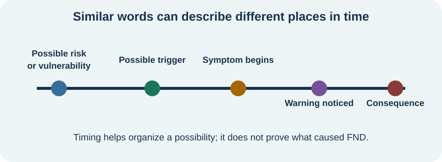

<!-- NAV-BREADCRUMB:START -->
[Home](../../../README.md) › [Course](../../README.md) › Part One: Understanding FND › [Module 3: Causes, Mechanisms, and Honest Uncertainty](README.md) › **Causes, Risk Factors, Triggers, and Maintaining Factors**
<!-- NAV-BREADCRUMB:END -->

# Causes, Risk Factors, Triggers, and Maintaining Factors

> **Working draft:** AI-assisted editorial revision under human and clinical review. [Contributors and reviewers](https://fndeducationproject.org/contact/) are welcome.

This lesson begins with a difficult question: **why did FND happen to me?** It separates what may have happened around the beginning, what the nervous system might be doing, and what can affect symptoms today. These questions are related, but they have different answers. (*citations* [1](#citation-1), [2](#citation-2))

---
[For the Person With FND](#for-the-person-with-fnd) 
[For Family, Friends, and Other Supporters](#for-family-friends-and-other-supporters) 
[For Clinicians and the Care Team](#for-clinicians-and-the-care-team) 
[Research and Sources](#research-and-sources)
---

## For the Person With FND
{: #for-the-person-with-fnd .shareable }

### Why did this happen to me?

Did an illness change something in my brain? Why can my body struggle to move when my muscles still work? Are functional seizures really panic attacks?

These are reasonable questions. Scientists have discovered useful things about FND, but they cannot yet explain every person's symptoms from beginning to end.

This lesson looks at **what may have started FND** and **what may affect it now**. [Lesson 8](02-brain-networks-prediction-attention-and-agency.md) explores what researchers think may be happening inside the nervous system.

### What do we mean by a cause?

A **cause** is something that actually helps bring about an outcome. Finding the cause of FND would mean understanding what happened and how it contributed to the condition.

Imagine a person who develops FND symptoms during an infection.

The infection happened first. It might have helped **trigger** the symptoms. But the timing alone cannot tell us whether the infection caused FND or how it might have done so.

A **mechanism** is the process that produces a symptom: *how* it happens inside the nervous system. A trigger and a mechanism are not the same thing.

For example, scientists are studying whether changes in the way brain networks work together could help explain FND symptoms. Those studies tell us something about possible mechanisms, but they do not yet prove that an infection caused a particular person's FND. (*citations* [1](#citation-1), [2](#citation-2))

**Key idea:** Knowing *when* FND began is different from knowing *why* it began or *how* symptoms happen.

### Does FND always have a clear beginning?

No. Some people first notice symptoms during illness, after an injury, or near a stressful period. Others cannot remember anything unusual happening. (*citations* [1](#citation-1), [2](#citation-2), [4](#citation-4))

One community member described a new symptom this way:

> “This tremor just came out of nowhere.”

— *Lived experience:* the writer described a new tremor after earlier symptoms had improved. [Read the public source](https://www.reddit.com/r/FND/comments/1dde4p6/my_journey_with_functional_neurological_disorder/).

Stress and trauma can matter for some people. **Neither is required to develop FND or receive an FND diagnosis.** An unknown beginning does not make the symptoms less real.

### What might affect my FND today?

Let's return to the person whose symptoms began during an infection.

Months later, the infection has gone. The person notices that poor sleep makes difficult days even harder.

Sleep may affect their symptoms *now*. That does not prove it caused the FND at the beginning.

Pain, migraine, sensory overload and other demands may also affect how a person feels or functions. These are sometimes called **maintaining factors** when evidence suggests they help a problem continue. They may also be separate health concerns needing care of their own. (*citations* [5](#citation-5), [6](#citation-6), [7](#citation-7))

Another community member wrote:

> “My FND symptoms, especially risk of seizures, get worse around sensory overload.”

— *Lived experience:* the writer described their own pattern, not a cause that applies to everyone. [Read the public source](https://www.reddit.com/r/FND/comments/1bpx5du/how_many_autistics_are_here/).

Some people notice patterns. Others do not. Neither is doing anything wrong.

<figure class="image-60center" markdown="1">

<figcaption>A timeline can help us tell when something happened. Timing is one clue, not proof of cause.</figcaption>

</figure>

### Can treatment help before we know the cause?

Yes. A care team can work with what is happening today, even while the original cause remains uncertain.

For example, treating migraine may make daily life easier for a person who has both migraine and FND. That improvement would not prove migraine caused the FND. (*citation* [6](#citation-6))

Scientists are also studying how brain activity, signalling and chemistry might be involved in functional symptoms. There are promising findings, but no single proven explanation for everyone. The next lesson takes a closer look.

**Key idea:** You do not have to solve the cause of your FND before you can receive useful care.

### Questions to reflect on

What do you remember about the time your FND began? It's fine if the answer is *nothing unusual*.

Does something affect your symptoms or daily activities **now**, even if it had nothing to do with the beginning?

### One small step

Choose **one question** you would like your clinician to answer. For example:

*“What do we know about what happened to me, and which parts are still possibilities?”*

You don't need a complete timeline, a symptom diary or an explanation for every difficult day. New or substantially different symptoms should still be medically assessed.

***
[For the Person With FND](#for-the-person-with-fnd) 
[For Family, Friends, and Other Supporters](#for-family-friends-and-other-supporters) 
[For Clinicians and the Care Team](#for-clinicians-and-the-care-team) 
[Research and Sources](#research-and-sources)
***

## For Family, Friends, and Other Supporters
{: #for-family-friends-and-other-supporters .shareable }

### Why the question matters

Someone with FND may be trying to understand what happened to their body. When an answer is missing, other people may offer confident explanations: an old injury, stress, a particular memory or an illness.

Imagine that symptoms began after an infection. One family member believes the infection caused FND; another believes stress did. Both may care deeply about the person, but neither has established the cause.

The most helpful starting point is curiosity: *“What have you been told? What still doesn't make sense?”*

### Help separate the past from today

There are two useful conversations.

**What happened at the beginning?** Offer to help remember dates, illnesses or appointments **if the person wants that help**. A remembered event is information, not a verdict about cause.

**What helps or makes life harder now?** You might notice that quieter surroundings make an outing easier, or that sleep and migraine need attention. Ask what support the person would find useful rather than turning these observations into explanations of why FND developed.

A change in symptoms is real information, not a test of effort or willpower. (*citations* [1](#citation-1), [6](#citation-6))

### Help the person get answers

With permission, you could help them ask their clinician:

- “What do we know about how these symptoms happen?”
- “Which parts of the explanation are still theories?”
- “What can help now, even if we don't know the cause?”

Listen first. Help with notes or the follow-up plan if invited. Keep the person's own goals and choices at the centre of the conversation.

New or substantially different symptoms deserve medical assessment just as they would for anyone else.

***
[For the Person With FND](#for-the-person-with-fnd) 
[For Family, Friends, and Other Supporters](#for-family-friends-and-other-supporters) 
[For Clinicians and the Care Team](#for-clinicians-and-the-care-team) 
[Research and Sources](#research-and-sources)
***

## For Clinicians and the Care Team
{: #for-clinicians-and-the-care-team .shareable }

### Three questions, three kinds of evidence

A patient asking “Why did I develop FND?” may be asking about **onset**, **mechanism** or **ongoing influences**. An explanation becomes clearer when these are named separately.

Consider a patient whose functional symptoms emerged during an infection and continue after the infection resolves. The timing is an **observation**. The infection's possible role in the onset is a **causal hypothesis**. Changes in motor control, attention, awareness or other neural processes are candidate **mechanisms**. Sleep loss, pain or migraine may be **current contributors** or separate diagnoses. The same patient can have evidence for all four without a single proven causal chain. (*citations* [1](#citation-1), [2](#citation-2), [5](#citation-5), [6](#citation-6))

This separation gives the patient something more useful than a search for a hidden cause: an account of what has been observed, what research can explain and which questions remain open.

### What does the research actually establish?

The 2022 clinical review by Hallett and colleagues describes multiple FND presentations and developing accounts of shared neurological processes. The review supports studying symptoms as involuntary changes in function, while recognizing that different symptoms and patients may not share one mechanism. (*citation* [2](#citation-2))

Pick and colleagues' 2019 review brings emotional processing into a biopsychosocial research model. It is evidence that emotional processing is a serious subject of scientific study, **not** proof that an individual patient's FND began with trauma or emotional distress. (*citation* [3](#citation-3))

A 2021 international survey described experiences and perceived causes among **1,048 respondents** with FND. It demonstrates how patients themselves describe varied possible influences. Because recruitment was online and self-selected, their reports are not estimates of how often a particular cause explains FND in the general population. (*citation* [4](#citation-4))

The 2024 systematic review of pain and FND, the 2025 migraine review and the 2022 autonomic/endocrine/inflammation synthesis examine clinically relevant overlap and physiology. Their populations, measures and evidence types vary. They make a strong case for investigating and treating specific accompanying problems while leaving individual causation an open scientific question. (*citations* [5](#citation-5), [6](#citation-6), [7](#citation-7))

### Explaining an observed pattern

A practical explanation may sound like this:

> “Your symptoms began while you were ill. We know when that happened. We have clinical evidence supporting your FND diagnosis. Research suggests several ways brain functions might be affected, but it hasn't shown exactly what happened in your case. We can still address the problems affecting you now.”

The clinician can then explain the **positive diagnostic findings** from the examination or symptom history, and separately describe the evidence for any proposed contributor. This honours the patient's wish for a biological explanation while matching certainty to the evidence. (*citations* [1](#citation-1), [2](#citation-2))

### Why present-day care remains useful

An infection at onset, migraine during flares, poor sleep and accessibility difficulties are different clinical questions. Each can inform appropriate treatment, rehabilitation, safety planning or support without being assigned the role of original cause.

If treating migraine helps daily function, that is evidence of a useful treatment effect. It does not retrospectively prove migraine caused FND. Likewise, response to movement rehabilitation or psychological therapy does not test a single theory of origin. (*citations* [1](#citation-1), [6](#citation-6))

The patient leaves with an understandable account of **what is known, what is being investigated and what can be done**. [Lesson 8](02-brain-networks-prediction-attention-and-agency.md) develops the neurological mechanisms and the evidence for them.

***
[For the Person With FND](#for-the-person-with-fnd) 
[For Family, Friends, and Other Supporters](#for-family-friends-and-other-supporters) 
[For Clinicians and the Care Team](#for-clinicians-and-the-care-team) 
[Research and Sources](#research-and-sources)
***

<!-- NAV-CONTEXT:START -->
**Continue:** [Next page: Brain Networks, Prediction, Attention, and Agency](02-brain-networks-prediction-attention-and-agency.md)

**Navigate:** [Home](../../../README.md) · [Course](../../README.md) · [Reference Library](../../../reference/README.md) · [Site Map](../../../SITEMAP.md)
<!-- NAV-CONTEXT:END -->

***

## Research and Sources

### What this evidence can and cannot establish

The diagnostic and broad clinical reviews support a positive diagnosis of FND and investigate varied possible mechanisms. The emotional-processing review studies psychosocial experiences as potential contributors in some groups, without establishing a universal causal explanation. The online survey records respondents’ own views and symptom reports but was recruited through social media and patient groups, so its percentages should not be treated as population prevalence. The pain, migraine and autonomic reviews support attention to common overlap and comorbidity while also reporting heterogeneous evidence. None of these sources establishes the cause of one person’s FND. (*citations* [1](#citation-1), [2](#citation-2), [3](#citation-3), [4](#citation-4), [5](#citation-5), [6](#citation-6), [7](#citation-7))

### Citation table

| Citation | Figure | Full citation |
|---|---|---|
| **[1]** | — | Espay AJ, Aybek S, Carson A, et al. Current concepts in diagnosis and treatment of functional neurological disorders. *JAMA Neurology*. 2018;75(9):1132–1141. [FND-CIT-0002](../../../research/citation-index.md#fnd-cit-0002). [https://doi.org/10.1001/jamaneurol.2018.1264](https://doi.org/10.1001/jamaneurol.2018.1264) |
| **[2]** | Figure 1 | Hallett M, Aybek S, Dworetzky BA, McWhirter L, Staab JP, Stone J. Functional neurological disorder: new subtypes and shared mechanisms. *The Lancet Neurology*. 2022;21(6):537–550. [FND-CIT-0003](../../../research/citation-index.md#fnd-cit-0003). [https://doi.org/10.1016/S1474-4422(21)00422-1](https://doi.org/10.1016/S1474-4422(21)00422-1) |
| **[3]** | — | Pick S, Goldstein LH, Perez DL, Nicholson TR. Emotional processing in functional neurological disorder: a review, biopsychosocial model and research agenda. *Journal of Neurology, Neurosurgery & Psychiatry*. 2019;90(6):704–711. [FND-CIT-0005](../../../research/citation-index.md#fnd-cit-0005). [https://doi.org/10.1136/jnnp-2018-319201](https://doi.org/10.1136/jnnp-2018-319201) |
| **[4]** | Figure 1 | Butler M, Shipston-Sharman O, Seynaeve M, et al. International online survey of 1048 individuals with functional neurological disorder. *European Journal of Neurology*. 2021;28(11):3591–3602. [FND-CIT-0014](../../../research/citation-index.md#fnd-cit-0014). [https://doi.org/10.1111/ene.15018](https://doi.org/10.1111/ene.15018) |
| **[5]** | — | Steinruecke M, Mason I, Keen M, McWhirter L, Carson AJ, Stone J, Hoeritzauer I. Pain and functional neurological disorder: a systematic review and meta-analysis. *Journal of Neurology, Neurosurgery & Psychiatry*. 2024;95(9):874–885. [FND-CIT-0015](../../../research/citation-index.md#fnd-cit-0015). [https://doi.org/10.1136/jnnp-2023-332810](https://doi.org/10.1136/jnnp-2023-332810) |
| **[6]** | — | Stone J, Coebergh J, Khoja L, Butler M, Nicholson TR, Dodick DW. Migraine and functional neurological disorder (FND)—a review of comorbidity and potential overlap. *Brain Communications*. 2025;7(4):fcaf288. [FND-CIT-0049](../../../research/citation-index.md#fnd-cit-0049). [https://doi.org/10.1093/braincomms/fcaf288](https://doi.org/10.1093/braincomms/fcaf288) |
| **[7]** | — | Paredes-Echeverri S, Maggio J, Bègue I, Pick S, Nicholson TR, Perez DL. Autonomic, endocrine, and inflammation profiles in functional neurological disorder: a systematic review and meta-analysis. *Journal of Neuropsychiatry and Clinical Neurosciences*. 2022;34(1):30–43. [FND-CIT-0064](../../../research/citation-index.md#fnd-cit-0064). [https://doi.org/10.1176/appi.neuropsych.21010025](https://doi.org/10.1176/appi.neuropsych.21010025) |

This page still needs review by people with FND, supporters, clinicians and researchers, including review of how the evidence categories and uncertainties are explained.

*Plain-language draft prepared: September 4, 2026 · Research package added September 4, 2026 · Clinical review pending*
