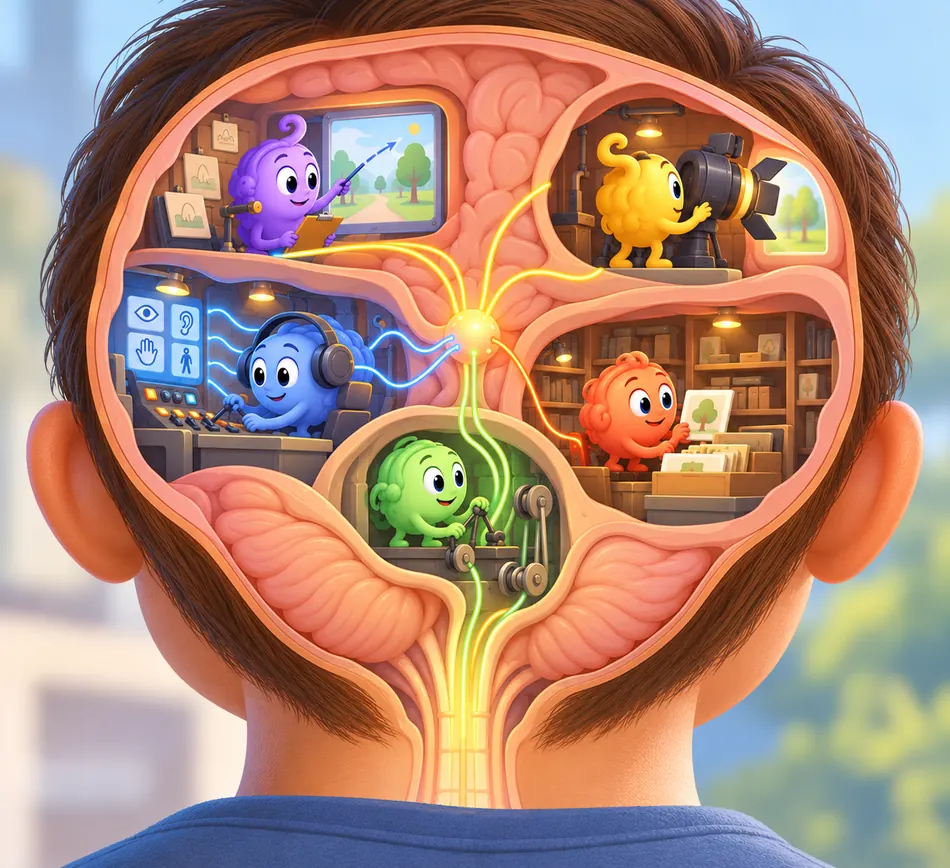

<!-- NAV-BREADCRUMB:START -->
[Home](../../../README.md) › [Course](../../README.md) › Part One: Understanding FND › [Module 3: Causes, Mechanisms, and Honest Uncertainty](README.md) › **Brain Networks, Prediction, Attention, and Agency**
<!-- NAV-BREADCRUMB:END -->

# Brain Networks, Prediction, Attention, and Agency

> **Working draft:** Person and supporter sections revised by the human author; the clinician section is an AI-assisted editorial draft awaiting human and clinical review. [Contributors and reviewers](https://fndeducationproject.org/contact/) are welcome.

This lesson explores what may happen in the nervous system during functional symptoms. Learn what studies of brain networks, attention and chemistry can tell us.

---
[For the Person With FND](#for-the-person-with-fnd) 
[For Family, Friends, and Other Supporters](#for-family-friends-and-other-supporters) 
[For Clinicians and the Care Team](#for-clinicians-and-the-care-team) 
[Research and Sources](#research-and-sources)
---

## For the Person With FND
{: #for-the-person-with-fnd .shareable }

### What might be happening inside my nervous system?

Maybe your leg sometimes feels stuck. Maybe a memory slips away just when you reach for it. Maybe you have functional seizures, changes in feeling, pain, speech difficulties, dizziness, or something else entirely.

FND can look different from person to person. You may experience a few of these symptoms, different ones, or symptoms that change over time.

A standard brain scan can look healthy while your symptoms remain very real. That tells us to look at how the nervous system is working and communicating, as well as at its physical structure.

Think of your nervous system as a busy behind-the-scenes crew. It helps prepare movement, sort sensations, aim attention, find memories, and keep track of what is happening around you. Researchers are learning how some of this teamwork may change in FND. (*citations* [1](#citation-1), [3](#citation-3))

### What is a brain network?

Picture a band playing a song. The drummer, singer, and guitarist each have a different job. The song comes together when they keep time and listen to one another.

Your brain works through teams too. Groups of brain areas pass information back and forth to help with movement, awareness, memory, and other skills. Scientists call each team a brain network.

In studies, some groups of people with FND show different patterns of activity or communication between these networks. These patterns give researchers clues about coordination and control. Each person can still have their own mix of symptoms and experiences. (*citations* [1](#citation-1), [2](#citation-2))

<figure class="image-60center" markdown="1">

<figcaption>Brain areas work together on many jobs. This playful illustration represents their teamwork, not a literal brain map or a proven explanation of FND.</figcaption>

</figure>

### Why might a movement or feeling change?

Your nervous system handles many actions on autopilot. When you walk toward a chair, you usually focus on where you are going instead of giving each muscle a separate instruction.

Now imagine watching every step and trying to control it perfectly. The movement may feel less smooth, like walking while balancing a full cup.

During an examination, a movement may become easier when the task changes. Clinicians can use that change as a helpful clue. It may show that automatic control and focused control are working along different routes. The change happens involuntarily, just like the symptom itself. (*citations* [4](#citation-4), [5](#citation-5))

Researchers are also exploring how the brain understands signals from the body. Your brain mixes new information with what it has learned before, a little like guessing the next word in a familiar song. Scientists call this prediction. The bigger idea is called [predictive processing](../../../glossary/README.md#predictive-processing).

Usually, predictions and incoming signals work as a team. Some theories suggest that their balance can shift in FND and shape movement or sensation. This is one possible model among several, and researchers are still testing where it fits. (*citations* [1](#citation-1), [3](#citation-3))

### How can attention affect a symptom?

Attention is like a spotlight. It can swing toward pain, a loud sound, danger, or something surprising before you have time to choose where it points.

For some people, a functional symptom changes when that spotlight moves or when the task changes. One community member described head movements this way:

> “If I meditate or focus on something else I can stop it.”

— Lived experience: this was one person's experience. Your symptoms may respond differently. [Read the public source](https://www.reddit.com/r/FND/comments/17jx51h).

A change with attention can give researchers useful information. The symptom remains involuntary.

Scientists also study [agency](../../../glossary/README.md#agency). Agency is the feeling that “I made that action happen.” With some FND symptoms, a movement or sensation can feel as though it arrived on its own. Researchers are studying how the brain creates that sense of ownership and control. (*citations* [1](#citation-1), [3](#citation-3))

### What are researchers learning about brain chemistry?

Brain cells communicate with electrical activity and chemical messengers. You can picture those messengers as tiny notes passed between cells.

In a 2024 study, researchers used a special MRI method to compare brain chemistry in children and teenagers with FND and young people without FND. In one movement-related area, the groups had different amounts of some chemicals compared with a reference chemical. The result describes an average difference between groups. Each person can have a different result. (*citation* [7](#citation-7))

This study opens another door for research. Scientists can now ask whether these differences come before symptoms, develop afterward, or connect with other parts of health.

For now, brain chemistry gives researchers clues. Clinicians diagnose FND by listening to the person, examining the symptoms, and using suitable tests. Brain-chemistry research may add to that picture as it grows.

Researchers also use network ideas to explore symptoms that involve awareness and movement, including functional seizures. Functional seizures are genuine and involuntary; although fear, shaking, or breathing changes can also happen during panic attacks, clinicians can tell these events apart by listening to the person’s experience, looking at the event pattern, and choosing helpful tests. (*citations* [1](#citation-1), [8](#citation-8))

The [functional seizures Reference page](../../../reference/diagnostic-signs/06-functional-seizures.md) explores this assessment in more detail.

### What does the research tell us today?

Imagine taking one photo during a long movie. A study can capture something important, such as how a group performs a task or how brain activity looks at one moment. The photo gives us a clue, while the full story keeps unfolding.

A finding shared by a group may fit some people closely and others only a little. Researchers compare many clues before deciding what an idea can explain.

This work is already helping clinicians ask better questions and shape rehabilitation around what they observe. In the next lesson, we will look at how physical health, emotions, and surroundings can join the picture in everyday life.

### Questions to reflect on

Which part of your nervous system experience would you most like to understand?

You might choose movement, awareness, memory, seizures, sensation, speech, pain, fatigue, or something else.

As you think back over this lesson, can you spot one measured research finding and one idea that scientists are still testing?

### One small step

At your next appointment, you could ask:

> “What have researchers measured about symptoms like mine, and which ideas are they still exploring?”

Your job is to share what you notice, at a pace that works for you. Your clinician can help connect those experiences with the examination and the growing research.

### Optional learning activity

<a href="{{ '/puzzles/' | relative_url }}?collection=colouring&amp;puzzle=lesson-8">Open the Lesson 8 colouring page</a> (printable PDF).

---
[For the Person With FND](#for-the-person-with-fnd) 
[For Family, Friends, and Other Supporters](#for-family-friends-and-other-supporters) 
[For Clinicians and the Care Team](#for-clinicians-and-the-care-team) 
[Research and Sources](#research-and-sources)
---
## For Family, Friends, and Other Supporters
{: #for-family-friends-and-other-supporters .shareable }

### What can a change in movement tell us?

You may notice that someone has trouble lifting a leg during an examination, then moves it more easily during another task. At first, that can seem puzzling.

For the clinician, the change is a useful clue about how the nervous system is controlling the movement. For the person, the difficulty is still genuine and involuntary. One easier moment is only one piece of the puzzle; it may not show how safely or reliably the movement works at home, at school, or out in the community. (*citations* [4](#citation-4), [5](#citation-5))

Understanding that difference can help supporters hold two ideas at once: improvement may be possible, and the person may still need patience, practical help, or adjustments today.

A gentle response could sound like: “That seems like a useful clue for your care team. What did they say it might mean for you?”

### How can these explanations help day to day?

Ideas about brain networks can offer a way to understand why a symptom may change with the task, surroundings, or attention. For some people, that explanation feels like a light switching on. For others, it may take time to fit—or may never feel like the right picture.

What matters most is whether the explanation helps the person make sense of their own experience. A supporter might listen for the part that clicks, then help put the clinician’s explanation into the person’s own words. This can make the information easier to remember and bring to future appointments.

The theory does not have to be fully understood before practical support can help. A quieter space, time to rest, a mobility aid, seizure safety planning, or company at rehabilitation may make the day more manageable. The most useful support will depend on the person, the symptom, and the situation.

**Suggestibility** is a word that can feel uncomfortable. It may sound like someone is easily led, but here it means that expectations, suggestions, or things we see can sometimes influence a symptom. Every brain uses expectations, and each person responds differently. Someone with FND may find that a particular cue affects a symptom even when they are quite independent in everyday decisions. When watching a movement seems to influence a similar symptom, this is sometimes called **symptom modelling**. **Entrainment** is different: it describes a tremor changing rhythm to match another movement during an examination. These responses vary from person to person, and the symptoms remain real and involuntary. At home, supporters can carry on naturally, listen to the person's experience, and make practical adjustments together when a clear pattern emerges.

### Why is it helpful to leave room for uncertainty?

Research into prediction, attention, and brain chemistry is still growing. These ideas can guide useful questions, while the person’s needs today remain the starting point for support.

A movement that works once may be difficult to repeat. A clearer moment may be followed by fog. Knowing that symptoms can vary may help supporters respond with curiosity instead of pressure.

Friendly support can focus on what matters to the person: feeling believed, staying safe, saving energy, joining in where possible, and working toward meaningful goals.

New or noticeably different symptoms are also worth bringing to a clinician. FND can be part of the picture while the care team still considers other health changes.

---
[For the Person With FND](#for-the-person-with-fnd) 
[For Family, Friends, and Other Supporters](#for-family-friends-and-other-supporters) 
[For Clinicians and the Care Team](#for-clinicians-and-the-care-team) 
[Research and Sources](#research-and-sources)
---
## For Clinicians and the Care Team
{: #for-clinicians-and-the-care-team .shareable }

### What are these neurological models trying to explain?

FND brings together two kinds of evidence. The clinical examination shows **how a particular function behaves**. Research into brain networks explores **how the nervous system might produce that behaviour**.

Brain networks coordinate movement, sensation, attention and awareness. Hallett and colleagues (2022) review findings across FND presentations. Drane and colleagues (2021) describe five related areas of research: emotion and salience, attention, predictive processing, interoception and agency. (*citations* [1](#citation-1), [3](#citation-3))

These concepts are most useful when considered one at a time and connected with something the patient experiences.

### Attention: which information receives priority?

Attention helps the nervous system select information for action. Some attention is deliberate; other shifts happen automatically when something seems important.

Researchers use **salience** to describe how a stimulus gains priority. Pain, an unfamiliar sensation or a sudden sound may capture attention without conscious choice. (*citation* [3](#citation-3))

Consider functional tremor. During examination, its rhythm may change when the person performs a separate rhythmic movement. That change is an **observed clinical sign**. It can suggest that the organisation of movement depends partly on the task and attentional context. (*citations* [4](#citation-4), [5](#citation-5))

The practical implication is worth exploring: changing how a movement is approached may sometimes make useful abilities more accessible. Rehabilitation can build on this observation through appropriately selected tasks.

### Prediction: how does the brain prepare for what comes next?

The nervous system continually uses earlier experience to anticipate incoming information and prepare actions. Much of this prediction happens automatically.

**Predictive processing** describes the interaction between those expectations and current sensory evidence. **Precision weighting** is the proposed process that determines how much influence each receives. (*citations* [1](#citation-1), [3](#citation-3))

Think of reaching for a familiar object. The brain prepares an action using what it expects about the object's position and weight, then adjusts as new information arrives.

Some FND models propose that this balance of prediction and sensory evidence may change. Such a model could help explain why a function feels different from what the person intends or why it varies with context.

This offers a possible account of *how* a symptom occurs. A positive examination finding remains the clinical observation on which an individualized explanation can be built.

### Interoception: how are signals from inside the body understood?

**Interoception** involves sensing and interpreting internal bodily states, including aspects of heartbeat, breathing and visceral sensation.

These signals are processed alongside attention, prior experience and the body's changing needs. Researchers are investigating how altered processing of internal signals may contribute to some FND experiences. (*citation* [3](#citation-3))

A patient might describe an internal sensation as unusually strong, unfamiliar or difficult to interpret. That account gives the clinician a starting point for discussing what the person experiences and which processes researchers are studying.

Functional seizures offer a related clinical example: they may involve changes in awareness, responsiveness or movement, with or without panic. Overlapping features such as altered breathing or shaking make a careful event history important; the AAN guideline also addresses evaluation for coexisting epilepsy. (*citation* [8](#citation-8))

Interoception is one research perspective among several rather than a demonstrated explanation for all functional seizures.

### Agency: why can an action feel outside one's control?

**Agency** is the experience of being the person who initiates or controls an action. It depends on more than whether a muscle moves.

In FND, a person may experience a movement as happening to them, even when the examination shows that the nervous system can produce the movement under certain conditions. Research into agency asks how the brain develops this sense of control. (*citations* [1](#citation-1), [3](#citation-3))

This distinction can help clinicians explain involuntary symptoms. A movement may be physically possible and still be difficult for the person to initiate or control reliably.

### What have studies measured?

The four concepts above are **models of neurological processes**. Imaging and clinical studies provide observations against which those models can be examined.

**Functional imaging.** Studies have reported group differences in activity or connectivity involving networks for movement, attention, salience, emotion and agency. Their interpretation depends on the tasks, patient groups and methods used. The findings support continuing investigation of network function. (*citations* [1](#citation-1), [3](#citation-3))

### What a structural imaging study can show
{: #what-a-structural-imaging-study-can-show .shareable }

**Structural MRI** addresses a different question: whether brain anatomy varies in association with FND or particular experiences.

Bègue and colleagues (2019) review structural findings and consider whether these differences could precede symptoms, follow them or relate to other factors. (*citation* [2](#citation-2))

For example, Perez and colleagues (2018) compared **26 people with motor FND and 27 controls**. They found no whole-brain-corrected cortical-thickness difference across the complete groups. Specific analyses linked dissociation measures to regional findings involving the **left caudal anterior cingulate cortex** and **right lateral occipital cortex**. (*citation* [6](#citation-6))

These associations suggest research questions about neurobiology and dissociation in motor FND. The study's population, analyses and results define how far the interpretation can extend.

### What has brain-chemistry research added?

**Magnetic resonance spectroscopy** estimates selected brain metabolites. It provides biochemical measurements that complement research on brain activity and anatomy.

Charney and colleagues (2024) compared **32 children and adolescents with mixed FND presentations** and **41 controls**. In the supplementary motor area, the FND group had lower ratios of **N-acetylaspartate (NAA)** and **gamma-aminobutyric acid (GABA)** to creatine. Ratios in an anterior default-mode network region were similar between groups. (*citation* [7](#citation-7))

The results identify regional biochemical differences in a paediatric study group. Longitudinal and replicated work may help establish whether these changes precede symptoms, follow them or arise alongside other processes.

For patients asking whether their brain chemistry has changed, these findings provide a concrete example of what scientists can now investigate.

### How does this understanding support rehabilitation?

The link to care begins with an **individual observation**, rather than requiring the patient to accept a particular theory.

For example, a person may find movement easier when it becomes part of another action. That observation can guide a therapist toward tasks that make useful movement more accessible. Research into attention and prediction offers possible reasons that approach may help. (*citations* [4](#citation-4), [5](#citation-5))

A clinician can therefore explain three connected ideas, in order:

**What was observed:** a function changed under specific examination conditions.

**What may explain it:** automatic control, attention or prediction may be relevant; research continues to test these processes.

**What the finding may help us do:** explore suitable rehabilitation strategies and meaningful goals with the patient.

The same reasoning helps supporters understand how a capacity demonstrated in clinic can coexist with difficulty in daily life.

This is where mechanism research becomes useful for care: it gives clinicians and patients a shared language for exploring possibilities, while treatment decisions remain grounded in observed abilities, individual needs and outcomes.

---
[For the Person With FND](#for-the-person-with-fnd) 
[For Family, Friends, and Other Supporters](#for-family-friends-and-other-supporters) 
[For Clinicians and the Care Team](#for-clinicians-and-the-care-team) 
[Research and Sources](#research-and-sources)
---

<!-- NAV-CONTEXT:START -->
**Continue:** [Next page: Physical, Psychological, and Social Factors—and How to Judge Claims](03-physical-psychological-and-social-factors-and-how-to-judge-claims.md)

**Navigate:** [Home](../../../README.md) · [Course](../../README.md) · [Reference Library](../../../reference/README.md) · [Site Map](../../../SITEMAP.md)
<!-- NAV-CONTEXT:END -->

---

## Research and Sources
{: #research-and-sources .shareable }

### What this evidence can and cannot establish

The Hallett review and Drane perspective describe developing network and predictive-processing models. Bègue's review and Perez's study examine structural imaging findings and their possible meanings. (*citations* [1](#citation-1), [2](#citation-2), [3](#citation-3), [6](#citation-6))

Charney's paediatric spectroscopy study adds an early brain-chemistry line of investigation. The AAN guideline addresses functional-seizure assessment and care, including coexisting conditions. These sources answer different questions. (*citations* [7](#citation-7), [8](#citation-8))

Bennett's clinical review and the physiotherapy consensus connect observations of attention and automatic movement to clinical explanation and rehabilitation. The consensus is professional guidance, with a motor-symptom scope. Together, these sources inform clinical understanding while individual diagnosis continues to rely on appropriate clinical findings. (*citations* [4](#citation-4), [5](#citation-5))

### Citation table

| Citation | Full citation |
|---|---|
| **[1]** | Hallett M, Aybek S, Dworetzky BA, McWhirter L, Staab JP, Stone J. Functional neurological disorder: new subtypes and shared mechanisms. *The Lancet Neurology*. 2022;21(6):537–550. [FND-CIT-0003](../../../research/citation-index.md#fnd-cit-0003). [https://doi.org/10.1016/S1474-4422(21)00422-1](https://doi.org/10.1016/S1474-4422(21)00422-1) |
| **[2]** | Bègue I, Adams C, Stone J, Perez DL. Structural alterations in functional neurological disorder and related conditions: a software and hardware problem? *NeuroImage: Clinical*. 2019;22:101798. [FND-CIT-0004](../../../research/citation-index.md#fnd-cit-0004). [https://doi.org/10.1016/j.nicl.2019.101798](https://doi.org/10.1016/j.nicl.2019.101798) |
| **[3]** | Drane DL, Fani N, Hallett M, Khalsa SS, Perez DL, Roberts NA. A framework for understanding the pathophysiology of functional neurological disorder. *CNS Spectrums*. 2021;26(6):555–561. [FND-CIT-0006](../../../research/citation-index.md#fnd-cit-0006). [https://doi.org/10.1017/S1092852920001789](https://doi.org/10.1017/S1092852920001789) |
| **[4]** | Bennett K, Diamond C, Hoeritzauer I, Gardiner P, McWhirter L, Carson A, Stone J. A practical review of functional neurological disorder (FND) for the general physician. *Clinical Medicine*. 2021;21(1):28–36. [FND-CIT-0001](../../../research/citation-index.md#fnd-cit-0001). [https://doi.org/10.7861/clinmed.2020-0987](https://doi.org/10.7861/clinmed.2020-0987) |
| **[5]** | Nielsen G, Stone J, Matthews A, et al. Physiotherapy for functional motor disorders: a consensus recommendation. *Journal of Neurology, Neurosurgery & Psychiatry*. 2015;86(10):1113–1119. [FND-CIT-0028](../../../research/citation-index.md#fnd-cit-0028). [https://doi.org/10.1136/jnnp-2014-309255](https://doi.org/10.1136/jnnp-2014-309255) |
| **[6]** | Perez DL, Matin N, Williams B, et al. Cortical thickness alterations linked to somatoform and psychological dissociation in functional neurological disorders. *Human Brain Mapping*. 2018;39(1):428–439. [DOI](https://doi.org/10.1002/hbm.23853). [FND-CIT-0190](../../../research/citation-index.md#fnd-cit-0190). Motor-FND/dissociation associations; not causal evidence or an FCD biomarker. |
| **[7]** | Charney M, Foster S, Shukla V, et al. Neurometabolic alterations in children and adolescents with functional neurological disorder. *NeuroImage: Clinical*. 2024;41:103557. [FND-CIT-0044](../../../research/citation-index.md#fnd-cit-0044). [DOI](https://doi.org/10.1016/j.nicl.2023.103557). Small paediatric neurometabolic study; neither causal proof nor a diagnostic biomarker. |
| **[8]** | Tolchin B, Goldstein LH, Reuber M, Stone J, Perez DL, LaFrance WC Jr, et al. Management of Functional Seizures Practice Guideline Executive Summary: Report of the AAN Guidelines Subcommittee. *Neurology*. 2026;106(1):e214466. [FND-CIT-0010](../../../research/citation-index.md#fnd-cit-0010). [DOI](https://doi.org/10.1212/WNL.0000000000214466). Diagnosis-informed management and co-occurring epilepsy; not evidence of a single functional-seizure mechanism. |

This page still needs review by people with FND, supporters, clinicians and researchers, especially to ensure that proposed models remain clearly separate from diagnostic evidence.

*Plain-language draft prepared: September 4, 2026 · Research package added September 4, 2026 · Editorial audit completed October 17, 2026 · Human authoring and clinical review pending*
