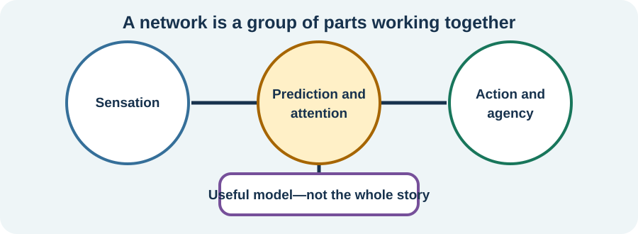

<!-- NAV-BREADCRUMB:START -->
[Home](../../../README.md) › [Course](../../README.md) › Part One: Understanding FND › [Module 3: Causes, Mechanisms, and Honest Uncertainty](README.md) › **Brain Networks, Prediction, Attention, and Agency**
<!-- NAV-BREADCRUMB:END -->

# Brain Networks, Prediction, Attention, and Agency

> **Editorial review:** Person and supporter sections revised by the human author; clinician section is an AI-assisted editorial draft awaiting human and clinical review. [Contributors and reviewers](https://fndeducationproject.org/contact/) are welcome.

This lesson explores what may happen in the nervous system during functional symptoms. Learn what studies of brain networks, attention and chemistry can tell us.

---
[For the Person With FND](#for-the-person-with-fnd) 
[For Family, Friends, and Other Supporters](#for-family-friends-and-other-supporters) 
[For Clinicians and the Care Team](#for-clinicians-and-the-care-team) 
[Research and Sources](#research-and-sources)
---

## For the Person With FND
{: #for-the-person-with-fnd .shareable }

### What might be happening inside my nervous system?

Maybe your leg sometimes feels stuck. Maybe a memory slips away just when you reach for it. Maybe you have functional seizures, changes in feeling, pain, speech difficulties, dizziness, or something else entirely.

FND can look different from person to person. You may experience a few of these symptoms, different ones, or symptoms that change over time.

A standard brain scan can look healthy while your symptoms remain very real. That tells us to look at how the nervous system is working and communicating, as well as at its physical structure.

Think of your nervous system as a busy behind-the-scenes crew. It helps prepare movement, sort sensations, aim attention, find memories, and keep track of what is happening around you. Researchers are learning how some of this teamwork may change in FND. (*citations* [1](#citation-1), [3](#citation-3))

### What is a brain network?

Picture a band playing a song. The drummer, singer, and guitarist each have a different job. The song comes together when they keep time and listen to one another.

Your brain works through teams too. Groups of brain areas pass information back and forth to help with movement, awareness, memory, and other skills. Scientists call each team a brain network.

In studies, some groups of people with FND show different patterns of activity or communication between these networks. These patterns give researchers clues about coordination and control. Each person can still have their own mix of symptoms and experiences. (*citations* [1](#citation-1), [2](#citation-2))

<figure class="image-60center" markdown="1">

<figcaption>Brain networks share information like members of a band. This picture is a simple model, rather than a map of any one person's FND.</figcaption>

</figure>

### Why might a movement or feeling change?

Your nervous system handles many actions on autopilot. When you walk toward a chair, you usually focus on where you are going instead of giving each muscle a separate instruction.

Now imagine watching every step and trying to control it perfectly. The movement may feel less smooth, like walking while balancing a full cup.

During an examination, a movement may become easier when the task changes. Clinicians can use that change as a helpful clue. It may show that automatic control and focused control are working along different routes. The change happens involuntarily, just like the symptom itself. (*citations* [4](#citation-4), [5](#citation-5))

Researchers are also exploring how the brain understands signals from the body. Your brain mixes new information with what it has learned before, a little like guessing the next word in a familiar song. Scientists call this prediction. The bigger idea is called [predictive processing](../../../glossary/README.md#predictive-processing).

Usually, predictions and incoming signals work as a team. Some theories suggest that their balance can shift in FND and shape movement or sensation. This is one possible model among several, and researchers are still testing where it fits. (*citations* [1](#citation-1), [3](#citation-3))

### How can attention affect a symptom?

Attention is like a spotlight. It can swing toward pain, a loud sound, danger, or something surprising before you have time to choose where it points.

For some people, a functional symptom changes when that spotlight moves or when the task changes. One community member described head movements this way:

> “If I meditate or focus on something else I can stop it.”

— Lived experience: this was one person's experience. Your symptoms may respond differently. [Read the public source](https://www.reddit.com/r/FND/comments/17jx51h).

A change with attention can give researchers useful information. The symptom remains involuntary.

Scientists also study [agency](../../../glossary/README.md#agency). Agency is the feeling that “I made that action happen.” With some FND symptoms, a movement or sensation can feel as though it arrived on its own. Researchers are studying how the brain creates that sense of ownership and control. (*citations* [1](#citation-1), [3](#citation-3))

### What are researchers learning about brain chemistry?

Brain cells communicate with electrical activity and chemical messengers. You can picture those messengers as tiny notes passed between cells.

In a 2024 study, researchers used a special MRI method to compare brain chemistry in children and teenagers with FND and young people without FND. In one movement-related area, the groups had different amounts of some chemicals compared with a reference chemical. The result describes an average difference between groups. Each person can have a different result. (*citation* [7](#citation-7))

This study opens another door for research. Scientists can now ask whether these differences come before symptoms, develop afterward, or connect with other parts of health.

For now, brain chemistry gives researchers clues. Clinicians diagnose FND by listening to the person, examining the symptoms, and using suitable tests. Brain-chemistry research may add to that picture as it grows.

Researchers also use network ideas to explore symptoms that involve awareness and movement, including functional seizures. Functional seizures are genuine and involuntary; although fear, shaking, or breathing changes can also happen during panic attacks, clinicians can tell these events apart by listening to the person’s experience, looking at the event pattern, and choosing helpful tests. (*citations* [1](#citation-1), [8](#citation-8))

The [functional seizures Reference page](../../../reference/diagnostic-signs/06-functional-seizures.md) explores this assessment in more detail.

### What does the research tell us today?

Imagine taking one photo during a long movie. A study can capture something important, such as how a group performs a task or how brain activity looks at one moment. The photo gives us a clue, while the full story keeps unfolding.

A finding shared by a group may fit some people closely and others only a little. Researchers compare many clues before deciding what an idea can explain.

This work is already helping clinicians ask better questions and shape rehabilitation around what they observe. In the next lesson, we will look at how physical health, emotions, and surroundings can join the picture in everyday life.

### Questions to reflect on

Which part of your nervous system experience would you most like to understand?

You might choose movement, awareness, memory, seizures, sensation, speech, pain, fatigue, or something else.

As you think back over this lesson, can you spot one measured research finding and one idea that scientists are still testing?

### One small step

At your next appointment, you could ask:

> “What have researchers measured about symptoms like mine, and which ideas are they still exploring?”

Your job is to share what you notice, at a pace that works for you. Your clinician can help connect those experiences with the examination and the growing research.

---
[For the Person With FND](#for-the-person-with-fnd) 
[For Family, Friends, and Other Supporters](#for-family-friends-and-other-supporters) 
[For Clinicians and the Care Team](#for-clinicians-and-the-care-team) 
[Research and Sources](#research-and-sources)
---
## For Family, Friends, and Other Supporters
{: #for-family-friends-and-other-supporters .shareable }

### What can a change in movement tell us?

You may notice that someone has trouble lifting a leg during an examination, then moves it more easily during another task. At first, that can seem puzzling.

For the clinician, the change is a useful clue about how the nervous system is controlling the movement. For the person, the difficulty is still genuine and involuntary. One easier moment is only one piece of the puzzle; it may not show how safely or reliably the movement works at home, at school, or out in the community. (*citations* [4](#citation-4), [5](#citation-5))

Understanding that difference can help supporters hold two ideas at once: improvement may be possible, and the person may still need patience, practical help, or adjustments today.

A gentle response could sound like: “That seems like a useful clue for your care team. What did they say it might mean for you?”

### How can these explanations help day to day?

Ideas about brain networks can offer a way to understand why a symptom may change with the task, surroundings, or attention. For some people, that explanation feels like a light switching on. For others, it may take time to fit—or may never feel like the right picture.

What matters most is whether the explanation helps the person make sense of their own experience. A supporter might listen for the part that clicks, then help put the clinician’s explanation into the person’s own words. This can make the information easier to remember and bring to future appointments.

The theory does not have to be fully understood before practical support can help. A quieter space, time to rest, a mobility aid, seizure safety planning, or company at rehabilitation may make the day more manageable. The most useful support will depend on the person, the symptom, and the situation.

### Why is it helpful to leave room for uncertainty?

Research into prediction, attention, and brain chemistry is still growing. These ideas can guide useful questions, while the person’s needs today remain the starting point for support.

A movement that works once may be difficult to repeat. A clearer moment may be followed by fog. Knowing that symptoms can vary may help supporters respond with curiosity instead of pressure.

Friendly support can focus on what matters to the person: feeling believed, staying safe, saving energy, joining in where possible, and working toward meaningful goals.

New or noticeably different symptoms are also worth bringing to a clinician. FND can be part of the picture while the care team still considers other health changes.

---
[For the Person With FND](#for-the-person-with-fnd) 
[For Family, Friends, and Other Supporters](#for-family-friends-and-other-supporters) 
[For Clinicians and the Care Team](#for-clinicians-and-the-care-team) 
[Research and Sources](#research-and-sources)
---
## For Clinicians and the Care Team
{: #for-clinicians-and-the-care-team .shareable }

### From a positive sign to a question about function

A positive neurological sign and a proposed mechanism answer different questions. The examination establishes a reproducible clinical pattern in a defined context. Mechanism research investigates the processes that could produce that pattern.

In some functional motor presentations, movement varies across tasks or becomes more accessible during an automatic action. These findings can contribute to a positive diagnosis. They also identify potentially preserved capacities that physiotherapy can build upon. Bennett and colleagues (2021) describe this clinical approach, while the Nielsen and colleagues (2015) consensus discusses its application to motor retraining. (*citations* [4](#citation-4), [5](#citation-5))

The distinction matters for daily life. An easier movement during an examination demonstrates an ability under those conditions; the person's safety, endurance and reliability in other settings are additional clinical questions.

### What do brain-network studies contribute?

Functional MRI studies examine blood-oxygen-related signals associated with neural activity. Researchers compare activity and connections across brain regions during tasks and at rest.

FND studies have described group-level differences involving motor control, attention, emotion, salience and the sense of agency. *Salience* concerns how the nervous system selects information that is important at a particular moment. *Interoception* concerns the processing and interpretation of signals from inside the body.

Hallett and colleagues (2022) synthesize findings across FND presentations. Drane and colleagues (2021) organize five related research constructs: emotion processing and salience, agency, attention, interoception and predictive processing. Together, they offer a framework for investigating how symptoms might emerge from interactions among networks. (*citations* [1](#citation-1), [3](#citation-3))

These are group findings across differing symptoms, tasks and study populations. Their clinical contribution is to inform testable explanations. A patient's diagnosis continues to rest on the appropriate history and positive findings for that presentation.

### What a structural imaging study can show
{: #what-a-structural-imaging-study-can-show .shareable }

Structural MRI asks a related question: are there measurable anatomical differences associated with FND or particular experiences within it?

Bègue and colleagues (2019) review reported structural differences and consider several possible relationships: vulnerability before symptoms, adaptation or consequences afterward, and other associated factors. (*citation* [2](#citation-2))

Perez and colleagues (2018) compared **26 people with motor FND and 27 controls**. At the whole-brain-corrected level, cortical thickness was similar across the complete groups. More focused analyses linked higher somatoform dissociation with findings involving the **left caudal anterior cingulate cortex**, and depersonalization/derealization with findings involving the **right lateral occipital cortex**. (*citation* [6](#citation-6))

The regional associations emerged in specified subgroup or correlation analyses. This makes them useful questions for research on dissociation and neurobiology, while the positive neurological examination remains the basis for clinical diagnosis. The study concerned motor FND, so its findings have a defined population and symptom scope.

### What does brain-chemistry research add?

Magnetic resonance spectroscopy estimates concentrations of selected metabolites in a brain region. It provides a different biological measurement from structural imaging or task-based functional MRI.

Charney and colleagues (2024) compared **32 children and adolescents with mixed FND presentations** with **41 healthy controls**. The FND group had lower ratios of **N-acetylaspartate (NAA)** and **gamma-aminobutyric acid (GABA)** to creatine in the supplementary motor area. Metabolite ratios in the anterior default-mode network region were similar between groups. (*citation* [7](#citation-7))

These regional measurements identify a line of inquiry into metabolism and inhibitory signalling; spectroscopy estimates metabolites rather than recording communication between individual neurons. Replication, longitudinal studies and work across age groups can help establish how the differences relate to symptom development and clinical presentations.

For the patient wondering whether their brain chemistry has changed, the study offers a concrete example of biological processes under investigation and a clear description of what was measured.

### How could prediction, attention and agency fit together?

Predictive-processing models propose that the nervous system combines incoming sensory evidence with expectations informed by prior experience. **Precision weighting** describes the relative influence given to those sources. Attention can alter the priority of information automatically, while **agency** refers to the experience of initiating or causing an action. (*citations* [1](#citation-1), [3](#citation-3))

Consider a functional tremor that changes during a competing rhythmic task. The observed change is a clinical finding. A predictive-processing account offers one possible explanation involving attention, expectations and sensorimotor control.

This separation between observation and explanation is useful in rehabilitation. Therapists can build on an observed capacity, explore how task conditions influence movement and evaluate whether a chosen strategy improves the person's meaningful activities. Clinical response informs care, while the broader mechanism remains a research question. (*citations* [4](#citation-4), [5](#citation-5))

### Functional seizures and panic: related physiology, distinct events

Functional seizures and panic attacks can share features such as changes in breathing, shaking or fear. Their clinical patterns and diagnostic questions are distinct. Functional seizures may occur with or without a subjective experience of panic.

The AAN functional-seizures guideline addresses assessment through event history, observed or recorded features and appropriate investigations, including assessment for coexisting epilepsy. These findings support diagnostic differentiation; network research explores possible contributions from awareness, attention, movement and bodily-signal processing. (*citations* [1](#citation-1), [8](#citation-8))

For a patient asking whether their seizures are “just panic,” the explanation can distinguish the event from any accompanying fear. Emotional and neurological processes are both embodied, and identifying their possible interaction provides a more precise clinical discussion of involuntary symptoms.

### Turning research into an explanation a patient can use

A useful explanation can connect **what was observed**, **what research suggests**, and **what that means for the person's care**.

For example, a task-dependent movement change may support a positive motor-FND finding. Network research offers hypotheses about the control processes involved. Rehabilitation can then explore that person's accessible movements and goals.

The same explanation can help supporters understand why an easier moment in clinic may coexist with substantial difficulty at home. Practical support can be guided by safety, accessibility and the person's own priorities as clinical and research understanding develops.

This approach gives patients a clear scientific account of the evidence, a reason for proposed treatment strategies and room for discoveries still to come.

---
[For the Person With FND](#for-the-person-with-fnd) 
[For Family, Friends, and Other Supporters](#for-family-friends-and-other-supporters) 
[For Clinicians and the Care Team](#for-clinicians-and-the-care-team) 
[Research and Sources](#research-and-sources)
---

<!-- NAV-CONTEXT:START -->
**Continue:** [Next page: Physical, Psychological, and Social Factors—and How to Judge Claims](03-physical-psychological-and-social-factors-and-how-to-judge-claims.md)

**Navigate:** [Home](../../../README.md) · [Course](../../README.md) · [Reference Library](../../../reference/README.md) · [Site Map](../../../SITEMAP.md)
<!-- NAV-CONTEXT:END -->

---

## Research and Sources
{: #research-and-sources .shareable }

### What this evidence can and cannot establish

The Hallett review and Drane perspective describe developing network and predictive-processing models. Bègue's review and Perez's study examine structural imaging findings and their possible meanings. (*citations* [1](#citation-1), [2](#citation-2), [3](#citation-3), [6](#citation-6))

Charney's paediatric spectroscopy study adds an early brain-chemistry line of investigation. The AAN guideline addresses functional-seizure assessment and care, including coexisting conditions. These sources answer different questions. (*citations* [7](#citation-7), [8](#citation-8))

Bennett's clinical review and the physiotherapy consensus connect observations of attention and automatic movement to clinical explanation and rehabilitation. The consensus is professional guidance, with a motor-symptom scope. Together, these sources inform clinical understanding while individual diagnosis continues to rely on appropriate clinical findings. (*citations* [4](#citation-4), [5](#citation-5))

### Citation table

| Citation | Full citation |
|---|---|
| **[1]** | Hallett M, Aybek S, Dworetzky BA, McWhirter L, Staab JP, Stone J. Functional neurological disorder: new subtypes and shared mechanisms. *The Lancet Neurology*. 2022;21(6):537–550. [FND-CIT-0003](../../../research/citation-index.md#fnd-cit-0003). [https://doi.org/10.1016/S1474-4422(21)00422-1](https://doi.org/10.1016/S1474-4422(21)00422-1) |
| **[2]** | Bègue I, Adams C, Stone J, Perez DL. Structural alterations in functional neurological disorder and related conditions: a software and hardware problem? *NeuroImage: Clinical*. 2019;22:101798. [FND-CIT-0004](../../../research/citation-index.md#fnd-cit-0004). [https://doi.org/10.1016/j.nicl.2019.101798](https://doi.org/10.1016/j.nicl.2019.101798) |
| **[3]** | Drane DL, Fani N, Hallett M, Khalsa SS, Perez DL, Roberts NA. A framework for understanding the pathophysiology of functional neurological disorder. *CNS Spectrums*. 2021;26(6):555–561. [FND-CIT-0006](../../../research/citation-index.md#fnd-cit-0006). [https://doi.org/10.1017/S1092852920001789](https://doi.org/10.1017/S1092852920001789) |
| **[4]** | Bennett K, Diamond C, Hoeritzauer I, Gardiner P, McWhirter L, Carson A, Stone J. A practical review of functional neurological disorder (FND) for the general physician. *Clinical Medicine*. 2021;21(1):28–36. [FND-CIT-0001](../../../research/citation-index.md#fnd-cit-0001). [https://doi.org/10.7861/clinmed.2020-0987](https://doi.org/10.7861/clinmed.2020-0987) |
| **[5]** | Nielsen G, Stone J, Matthews A, et al. Physiotherapy for functional motor disorders: a consensus recommendation. *Journal of Neurology, Neurosurgery & Psychiatry*. 2015;86(10):1113–1119. [FND-CIT-0028](../../../research/citation-index.md#fnd-cit-0028). [https://doi.org/10.1136/jnnp-2014-309255](https://doi.org/10.1136/jnnp-2014-309255) |
| **[6]** | Perez DL, Matin N, Williams B, et al. Cortical thickness alterations linked to somatoform and psychological dissociation in functional neurological disorders. *Human Brain Mapping*. 2018;39(1):428–439. [DOI](https://doi.org/10.1002/hbm.23853). [FND-CIT-0190](../../../research/citation-index.md#fnd-cit-0190). Motor-FND/dissociation associations; not causal evidence or an FCD biomarker. |
| **[7]** | Charney M, Foster S, Shukla V, et al. Neurometabolic alterations in children and adolescents with functional neurological disorder. *NeuroImage: Clinical*. 2024;41:103557. [FND-CIT-0044](../../../research/citation-index.md#fnd-cit-0044). [DOI](https://doi.org/10.1016/j.nicl.2023.103557). Small paediatric neurometabolic study; neither causal proof nor a diagnostic biomarker. |
| **[8]** | Tolchin B, Goldstein LH, Reuber M, Stone J, Perez DL, LaFrance WC Jr, et al. Management of Functional Seizures Practice Guideline Executive Summary: Report of the AAN Guidelines Subcommittee. *Neurology*. 2026;106(1):e214466. [FND-CIT-0010](../../../research/citation-index.md#fnd-cit-0010). [DOI](https://doi.org/10.1212/WNL.0000000000214466). Diagnosis-informed management and co-occurring epilepsy; not evidence of a single functional-seizure mechanism. |

This page still needs review by people with FND, supporters, clinicians and researchers, especially to ensure that proposed models remain clearly separate from diagnostic evidence.

*Plain-language draft prepared: September 4, 2026 · Research package added September 4, 2026 · Editorial audit completed October 17, 2026 · Human authoring and clinical review pending*
