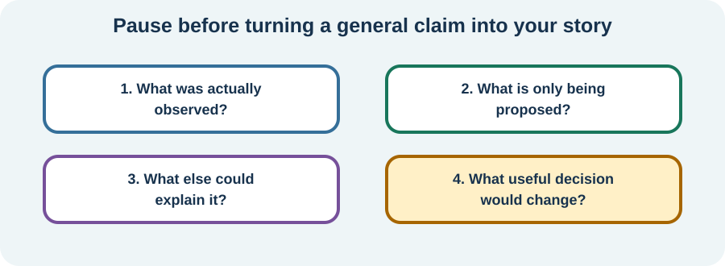

<!-- NAV-BREADCRUMB:START -->
[Home](../../../README.md) › [Course](../../README.md) › Part One: Understanding FND › [Module 3: Causes, Mechanisms, and Honest Uncertainty](README.md) › **Physical, Psychological, and Social Factors—and How to Judge Claims**
<!-- NAV-BREADCRUMB:END -->

# Physical, Psychological, and Social Factors—and How to Judge Claims

> **Working draft:** AI-assisted editorial revision under human and clinical review. [Contributors and reviewers](https://fndeducationproject.org/contact/) are welcome.

We have considered why FND may begin and what researchers are learning about the nervous system. This lesson asks a more everyday question: **what else in a person's life might affect their health, choices and care?** Physical, psychological and social factors can all matter, but they do different jobs. The aim is a useful personal understanding, backed by evidence rather than a one-size-fits-all explanation. (*citations* [1](#citation-1), [3](#citation-3), [6](#citation-6))

---
[For the Person With FND](#for-the-person-with-fnd) 
[For Family, Friends, and Other Supporters](#for-family-friends-and-other-supporters) 
[For Clinicians and the Care Team](#for-clinicians-and-the-care-team) 
[Research and Sources](#research-and-sources)
---

## For the Person With FND
{: #for-the-person-with-fnd .shareable }

### What can affect my life with FND?

Imagine someone with FND who also has migraine.

On a day when their migraine is painful, a noisy classroom or busy supermarket may be especially difficult. They may need a quieter place and time to rest.

Three things are involved: a **physical condition** (migraine), the person's **experience** of coping with pain and noise, and their **surroundings** (the classroom or shop).

Looking at all three helps us see where care or practical changes may help. None of them, on its own, proves why the FND began.

This is the idea behind the **biopsychosocial** approach: consider the body and brain, thoughts and feelings, and the world a person lives in. You met this idea in [Module 1](../module-01-what-fnd-is/02-the-biopsychosocial-model-misconceptions-and-recovery.md). Here, we'll use it to understand individual needs.

### The physical side

Physical health includes things such as sleep, pain, migraine, injuries, medicines, other illnesses and changes in the body.

A person can have FND **and** a separate medical condition. Both deserve appropriate assessment and care.

For instance, treating migraine may reduce one source of pain and help someone take part in daily activities. It would not prove that migraine caused their FND. (*citations* [1](#citation-1), [5](#citation-5), [7](#citation-7))

One community member described how limits can continue even after some treatment benefit:

> “Treatment at a clinic ... has helped a little, but I’m still extremely sensitive and can crash if I push past my threshold even slightly.”

— *Lived experience:* the writer described several sensory and physical symptoms. [Read the public source](https://www.reddit.com/r/FND/comments/1qjpe0n/extremely_sensitive_nervous_system/).

That experience is a reminder that support may also mean helping someone manage what daily life asks of them.

### Thoughts and feelings are part of health, too

Pain, fear, frustration, hope and attention involve real body and brain processes. They can affect how anyone feels and copes with illness.

Imagine that someone worries about an unpredictable functional seizure when they're away from home. The worry makes sense: they want to stay safe. A helpful conversation might focus on a safety plan and what would make an outing feel manageable.

A person may also have anxiety, PTSD or another mental-health condition that deserves care in its own right. Having such a condition does not mean it caused their FND.

Another community member wrote:

> “Sometimes I get stressed and have a seizure and our conversation sort of ends, is interrupted.”

— *Lived experience:* the writer was asking about difficult conversations in a relationship. [Read the public source](https://www.reddit.com/r/FND/comments/1g8ebg3/i_need_advice/).

This describes one person's experience of stress near an episode. It does not tell us the cause of their FND.

### What about the world around me?

The social side includes family and friendships, school or work, finances, housing, transportation, healthcare access and how other people respond.

For example, a teenager with FND might understand their lessons perfectly well but struggle with bright classroom lights or getting between rooms.

A more accessible environment could help them keep learning and seeing friends, even if their FND symptoms stay the same.

Support is meaningful when it helps someone do things that matter to them. (*citation* [6](#citation-6))

### How do I know whether an explanation is trustworthy?

It helps to ask **four simple questions**:

**1. What do we actually know?** For example, a clinician diagnosed migraine. That is different from saying migraine caused FND.

**2. What is still an idea?** A researcher may find a pattern in a group of people. It may offer an explanation worth studying without proving it applies to you.

**3. What else might explain it?** Perhaps a separate health condition or something in your surroundings also matters.

**4. What useful choice follows?** Perhaps migraine treatment, a quieter room or support with an appointment. Would that still help even if the explanation of FND later changed?

<figure class="image-60center" markdown="1">

<figcaption>Good questions help separate what is known from what is possible, and turn an explanation into a helpful decision.</figcaption>

</figure>

**Key idea:** A useful explanation helps you understand your health and your options. You deserve evidence, clear answers and choices that suit your life.

### Questions to reflect on

Which part of daily life—physical health, feelings or surroundings—would you most like help with?

Have you heard an explanation for FND that left you wanting to know what evidence supports it?

### One small step

Choose **one change** that could make an important activity easier. It might be medical treatment, a shorter visit, a quiet place or help getting somewhere.

You can ask your care team: *“What do we know about this problem, and what could we try to make it more manageable?”*

You do not need to agree on one theory about FND to ask for useful care. New or substantially changed symptoms still deserve assessment.

***
[For the Person With FND](#for-the-person-with-fnd) 
[For Family, Friends, and Other Supporters](#for-family-friends-and-other-supporters) 
[For Clinicians and the Care Team](#for-clinicians-and-the-care-team) 
[Research and Sources](#research-and-sources)
***

## For Family, Friends, and Other Supporters
{: #for-family-friends-and-other-supporters .shareable }

### Think about the whole situation

Imagine someone with FND who wants to attend a family gathering. Migraine pain, worries about having an episode and the noise of a busy room may all matter.

Each concern suggests a different kind of help: medical care for migraine, an agreed safety plan and a quieter place to take breaks.

This is the value of considering physical, psychological and social factors **together**. The aim is to understand the person's needs, not decide which factor caused their FND.

### Ask what would make participation possible

You could ask:

- “What part of this feels hardest today?”
- “Would changing the setting or timing help?”
- “What kind of help would you like from me?”

The answers may change from day to day. Supporting a meaningful activity sometimes means choosing a shorter visit or another way to participate.

A person may also benefit from a clinician reviewing sleep, pain, migraine or mental-health concerns as separate issues. These possibilities are useful questions to bring to the care team, not diagnoses for supporters to make.

### Learn from what helps

If a change makes an outing easier, celebrate the improvement in access or comfort. That is worthwhile even if the person's symptoms do not change.

Ask permission before keeping notes or contacting a clinician. Sharing factual observations and the person's questions can strengthen a care plan while preserving their independence.

When new or substantially different symptoms appear, help the person seek appropriate assessment. Their existing FND diagnosis remains part of the picture, not the entire picture.

***
[For the Person With FND](#for-the-person-with-fnd) 
[For Family, Friends, and Other Supporters](#for-family-friends-and-other-supporters) 
[For Clinicians and the Care Team](#for-clinicians-and-the-care-team) 
[Research and Sources](#research-and-sources)
***

## For Clinicians and the Care Team
{: #for-clinicians-and-the-care-team .shareable }

### Why use a biopsychosocial formulation?

A positive FND diagnosis describes the clinical findings that support a functional presentation. A **biopsychosocial formulation** answers a different question: *what else matters to this person's functioning, health and care?*

For example, a patient with functional seizures may also have migraine, disrupted sleep, fear of injury during an episode and limited transportation to treatment. Each factor has a different clinical role. The migraine and sleep difficulties invite condition-specific assessment; the fear invites an individualized discussion of safety; transportation affects access. None needs to be labelled the original cause of FND for the formulation to improve care. (*citations* [1](#citation-1), [2](#citation-2), [3](#citation-3), [7](#citation-7))

### What supports considering the physical dimension?

Steinruecke and colleagues' **2024 systematic review and meta-analysis** documents that pain symptoms and pain-related diagnoses are common in people with FND. This establishes an important accompanying burden and supports pain assessment. It does not tell us whether pain preceded, followed or contributed causally to FND in each patient. (*citation* [5](#citation-5))

The 2025 review by Stone and colleagues examines migraine alongside FND and possible overlap. Migraine has its own diagnostic and treatment pathway; addressing it may improve function and quality of life even where the two conditions' relationship remains uncertain. (*citation* [7](#citation-7))

Paredes-Echeverri and colleagues' 2022 systematic review and meta-analysis examines autonomic, endocrine and inflammatory findings. Such physiological research expands the questions that can be investigated, but the measures and clinical populations vary. Individual medical assessment remains directed by the patient's symptoms and findings. (*citation* [8](#citation-8))

### What does the psychological dimension contribute?

Attention, emotional processing, expectations, fear and coping are real physiological and behavioural processes. Pick and colleagues' 2019 review proposes ways these processes may interact in FND, while identifying the need for further research. This is a framework for studying possible relationships, not a test for a patient's original cause. (*citation* [3](#citation-3))

For a patient who worries about a functional seizure while travelling, the clinical question may be what makes travel safer and more achievable. A safety plan, education, treatment of a separate anxiety disorder where present, and support for participation can each be valuable. Psychological care can be chosen for a personally meaningful goal without making psychological distress the explanation for every symptom.

### What can social information explain?

Relationships, work and school demands, accessibility, housing, benefits, care access and the practical costs of illness shape participation. The same neurological symptoms can have very different effects in a supportive environment and an inaccessible one.

The 2025 systematic review of prognostic indicators by Sekine and colleagues examines factors associated with longer-term outcomes. Because studies differ in population, measures and follow-up, such findings inform planning for a group rather than predict one patient's outcome. (*citation* [6](#citation-6))

The 2021 international survey by Butler and colleagues adds patients' own reports of burdens and perceived influences, with the important context that **1,048 respondents** came from a self-selected online sample. The survey is useful for understanding experiences and priorities; it is not a population-based causal study. (*citation* [4](#citation-4))

### From a proposed explanation to a useful decision

A practical formulation can be written as a short series of connected questions:

| Question | Example in a person's care |
| --- | --- |
| **What is established?** | Positive findings support FND; migraine is separately diagnosed |
| **What may be contributing today?** | Pain, disrupted sleep and a crowded environment increase difficulty |
| **What matters to the person?** | Being able to attend school or visit friends |
| **What can we change or evaluate?** | Migraine care, environmental adjustments, an agreed safety plan and follow-up |

This structure makes room for uncertainty without losing momentum. An intervention can improve an important outcome even when its effect on the underlying FND symptoms is small or unknown.

### How strong is an explanation?

Research may identify an **association**, a possible **mechanism**, or an actual **treatment effect**. These are different types of evidence.

A cross-sectional group association shows that two findings occur together; it cannot, by itself, establish which came first. A mechanism model proposes how a process could work. A controlled treatment study can test whether an intervention helps a measured outcome in the population studied, though response alone does not establish the original cause. (*citations* [2](#citation-2), [3](#citation-3), [5](#citation-5), [6](#citation-6))

Patients can be invited into this reasoning with an example: *“We have evidence for your FND diagnosis and for your migraine. We don't know whether one helped start the other, but both can shape how you feel. We can work on a migraine plan and ways to make daily life more manageable.”*

The scientific value of the formulation is its openness to new information. The human value is that the patient gets useful care, even while some explanations remain under study.

***
[For the Person With FND](#for-the-person-with-fnd) 
[For Family, Friends, and Other Supporters](#for-family-friends-and-other-supporters) 
[For Clinicians and the Care Team](#for-clinicians-and-the-care-team) 
[Research and Sources](#research-and-sources)
***

<!-- NAV-CONTEXT:START -->
**Continue:** [Next module: Map Your FND and Other Health Conditions](../module-04-mapping-your-individual-condition/README.md)

**Navigate:** [Home](../../../README.md) · [Course](../../README.md) · [Reference Library](../../../reference/README.md) · [Site Map](../../../SITEMAP.md)
<!-- NAV-CONTEXT:END -->

***

## Research and Sources
{: #research-and-sources .shareable }

### What this evidence can and cannot establish

The diagnostic and clinical reviews support an evidence-based diagnosis and a separate, individualized formulation of care needs. Pick and colleagues propose an integrated emotional-processing model, while Butler's survey describes the experiences and views of 1,048 self-selected respondents. The pain, prognosis, migraine and autonomic reviews show why physical, psychological and social categories should not be collapsed into one causal story: their findings concern different populations, outcomes and evidence types. Much of this literature is cross-sectional or heterogeneous, so association must not be presented as proof of direction or cause in one person. (*citations* [1](#citation-1), [2](#citation-2), [3](#citation-3), [4](#citation-4), [5](#citation-5), [6](#citation-6), [7](#citation-7), [8](#citation-8))

### Citation table

| Citation | Full citation |
|---|---|
| **[1]** | Bennett K, Diamond C, Hoeritzauer I, Gardiner P, McWhirter L, Carson A, Stone J. A practical review of functional neurological disorder (FND) for the general physician. *Clinical Medicine*. 2021;21(1):28–36. [FND-CIT-0001](../../../research/citation-index.md#fnd-cit-0001). [https://doi.org/10.7861/clinmed.2020-0987](https://doi.org/10.7861/clinmed.2020-0987) |
| **[2]** | Espay AJ, Aybek S, Carson A, et al. Current concepts in diagnosis and treatment of functional neurological disorders. *JAMA Neurology*. 2018;75(9):1132–1141. [FND-CIT-0002](../../../research/citation-index.md#fnd-cit-0002). [https://doi.org/10.1001/jamaneurol.2018.1264](https://doi.org/10.1001/jamaneurol.2018.1264) |
| **[3]** | Pick S, Goldstein LH, Perez DL, Nicholson TR. Emotional processing in functional neurological disorder: a review, biopsychosocial model and research agenda. *Journal of Neurology, Neurosurgery & Psychiatry*. 2019;90(6):704–711. [FND-CIT-0005](../../../research/citation-index.md#fnd-cit-0005). [https://doi.org/10.1136/jnnp-2018-319201](https://doi.org/10.1136/jnnp-2018-319201) |
| **[4]** | Butler M, Shipston-Sharman O, Seynaeve M, et al. International online survey of 1048 individuals with functional neurological disorder. *European Journal of Neurology*. 2021;28(11):3591–3602. [FND-CIT-0014](../../../research/citation-index.md#fnd-cit-0014). [https://doi.org/10.1111/ene.15018](https://doi.org/10.1111/ene.15018) |
| **[5]** | Steinruecke M, Mason I, Keen M, McWhirter L, Carson AJ, Stone J, Hoeritzauer I. Pain and functional neurological disorder: a systematic review and meta-analysis. *Journal of Neurology, Neurosurgery & Psychiatry*. 2024;95(9):874–885. [FND-CIT-0015](../../../research/citation-index.md#fnd-cit-0015). [https://doi.org/10.1136/jnnp-2023-332810](https://doi.org/10.1136/jnnp-2023-332810) |
| **[6]** | Sekine ER, Kanaan RA, McMillan J, Oxford S, Iles RA. Biopsychosocial prognostic indicators in Functional Neurological Disorder: a systematic review. *Journal of Psychosomatic Research*. 2025;195:112201. [FND-CIT-0017](../../../research/citation-index.md#fnd-cit-0017). [https://doi.org/10.1016/j.jpsychores.2025.112201](https://doi.org/10.1016/j.jpsychores.2025.112201) |
| **[7]** | Stone J, Coebergh J, Khoja L, Butler M, Nicholson TR, Dodick DW. Migraine and functional neurological disorder (FND)—a review of comorbidity and potential overlap. *Brain Communications*. 2025;7(4):fcaf288. [FND-CIT-0049](../../../research/citation-index.md#fnd-cit-0049). [https://doi.org/10.1093/braincomms/fcaf288](https://doi.org/10.1093/braincomms/fcaf288) |
| **[8]** | Paredes-Echeverri S, Maggio J, Bègue I, Pick S, Nicholson TR, Perez DL. Autonomic, endocrine, and inflammation profiles in functional neurological disorder: a systematic review and meta-analysis. *Journal of Neuropsychiatry and Clinical Neurosciences*. 2022;34(1):30–43. [FND-CIT-0064](../../../research/citation-index.md#fnd-cit-0064). [https://doi.org/10.1176/appi.neuropsych.21010025](https://doi.org/10.1176/appi.neuropsych.21010025) |

This page still needs review by people with FND, supporters, clinicians and researchers, especially to check that each factor’s possible role and evidence level remain clear.

*Plain-language draft prepared: September 4, 2026 · Research package added September 4, 2026 · Clinical review pending*
