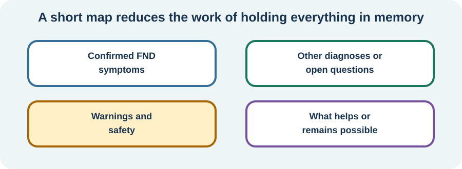

<!-- NAV-BREADCRUMB:START -->
[Home](../../../README.md) › [Course](../../README.md) › Part One: Understanding FND › [Module 4: Mapping Your Individual Condition](README.md) › **Building and Using Your Personal Symptom Map**
<!-- NAV-BREADCRUMB:END -->

# Building and Using Your Personal Symptom Map

> **Working draft:** The person-with-FND section was revised with the project lead. Other audience sections and research need the normal editorial and clinical audits.

In [Lesson 10](01-build-and-use-your-personal-symptom-map.md), we began sorting our health story into known diagnoses and open questions. Now let's make a short map that also shows what helps and what remains possible.

---
[For the Person With FND](#for-the-person-with-fnd) 
[For Family, Friends, and Other Supporters](#for-family-friends-and-other-supporters) 
[For Clinicians and the Care Team](#for-clinicians-and-the-care-team) 
[Research and Sources](#research-and-sources)
---

## For the Person With FND
{: #for-the-person-with-fnd .shareable }

### Remember what remains possible, too

In [Lesson 10](01-build-and-use-your-personal-symptom-map.md), we began sorting out diagnosed symptoms, other health conditions and unanswered questions.

Now let's think about what your map can say about daily life.

When symptoms are difficult, it's natural for much of our attention to go toward the things we're struggling with.

Your map can also record the things that work better.

Perhaps speaking is easier in a quiet room.

Maybe walking is more manageable with a particular aid or support.

Someone with functional cognitive difficulties might find that written instructions help them follow a conversation or complete a task.

Another person may have good periods between episodes, even though the episodes themselves are very disabling.

These details can help show where useful adjustments or treatment might begin.

And an ability that comes and goes is still a real ability, just as the difficulty is real when it happens. Changes in what you can do are a recognized part of how some FND symptoms appear. (*citations* [1](#citation-1), [5](#citation-5))

One community member described noticing a possible connection between sound overload and symptoms they experienced after eating. They wrote:

> “I was able to figure out that my post-eating issues were actually auditory sensory overload ... and really cut those specific symptoms down by using ear plugs.”

[Read their community post](https://www.reddit.com/r/FND/comments/1nk6chc/choking/).

That's one person's experience, rather than an explanation that will fit everyone.

It shows how noticing something about our surroundings might lead to a useful adjustment. Symptoms involving choking or swallowing also deserve medical assessment so that swallowing safety is properly considered.

Sometimes a helpful change begins with a small observation.

### Building your own map

Ready to give it a try?

You can begin with four short lines.

Imagine writing:

- **My diagnosed conditions:** Functional leg weakness and migraine.
- **My unanswered question:** New dizziness — needs assessment.
- **My safety needs:** A walking aid and a plan for getting help when needed.
- **What helps:** Quieter surroundings, written reminders and rest between demanding activities.

There you go. You've started a symptom map.

It's hardly a bestselling novel, but it could make a doctor's appointment a lot easier!

You might use different headings. Perhaps your symptoms involve seizures, speech, movement, thinking or sensation. Your map could focus on safety, communication or something you want to be able to do.

You can gradually add details that matter to you.

For example, if a medication change seems connected with a new symptom, that's worth noting and discussing with your clinician.

If an activity becomes easier with support, that can go on the map as well.

And if your symptoms change substantially, the map can help you explain what's different.

The one-page version is your quick reference. More detailed medical records can stay somewhere else.

*An example of how different parts of your health story can share one page.*

### When is tracking useful?

You might be wondering whether you should keep a diary of everything that happens.

Here's a question that can help:

**What would I use this information for?**

Suppose appointments leave you exhausted. You're wondering whether a quieter waiting area or a break beforehand might help.

For a short time, you could make a note of what the appointment involved, how you managed and what recovery was like afterwards.

That gives you something practical to discuss with your care team.

Maybe you discover a pattern. Perhaps the information shows that something else deserves attention.

Either way, you've learned something useful.

A pattern is a **clue**, rather than proof of a cause. Symptoms can vary naturally, and a few observations may tell only part of the story. (*citations* [3](#citation-3), [6](#citation-6))

You can decide with your care team how long to track something and when to review it.

Once the question has been answered as well as possible, you can set the diary aside.

After all, there's more to life than keeping records!

### A map that grows with you

Your health may change over time. So can your map.

A newly diagnosed condition can move from the questions section to the diagnoses section.

A helpful strategy can be added when you discover it.

A safety plan can be updated when your needs change.

If a symptom is new, severe or substantially different, appropriate medical assessment comes first. The map can help you describe the change and the timing, alongside the care you receive.

You can also make the map easier to create.

Perhaps someone you trust could write while you explain what you want included. Maybe you prefer typing a few words on your phone.

If concentrating on symptoms starts to feel overwhelming, a shorter version or a break from tracking may serve you better.

The map belongs to you. It can be as simple as you need.

### Something to think about

Imagine showing your map to someone who knows very little about your health.

What is the first thing you'd want them to understand?

And what one unanswered question would you most like help with?

Those two thoughts could be a good place to start.

### What can you try at home?

Find a piece of paper or open a note on your phone.

Write down one health condition that's been diagnosed, one question you'd like to ask and one thing that helps you manage daily life.

That's enough for a first version.

You can build on it whenever it would be useful.

**Your health story is much bigger than a page of notes. The map simply helps you carry the important pieces when you need them.**

***
[For the Person With FND](#for-the-person-with-fnd) 
[For Family, Friends, and Other Supporters](#for-family-friends-and-other-supporters) 
[For Clinicians and the Care Team](#for-clinicians-and-the-care-team) 
[Research and Sources](#research-and-sources)
***

## For Family, Friends, and Other Supporters
{: #for-family-friends-and-other-supporters .shareable }

### A clearer story can make care easier

Imagine trying to explain several health problems during a short appointment. You may need to remember when something started, how it changed, which clinician diagnosed it and what has happened since. That can be difficult, especially when speech, thinking, fatigue or other symptoms add to the effort.

A short map can take some of that work off the person's shoulders. You might offer to write down the information they choose, or bring their notes to an appointment if they'd like you to.

A gentle starting question is: *“What's the most important thing you'd like the care team to understand?”*

### Observation is different from explanation

Sometimes you notice details the person may have difficulty seeing or remembering, such as what an episode looked like from the outside or how long recovery took. These observations can be useful when shared with permission.

For example, *“Their speech changed before the episode”* describes what you saw. Whether that change was part of the episode is a clinical question.

Keeping observations separate from possible explanations helps everyone work with clearer information. The person's own experience matters, including things that others can't observe.

A new, severe or substantially changed symptom deserves appropriate medical assessment even when someone has lived with FND for a long time. The map can make it easier to explain what has changed.

### What helps belongs on the map

A person's health story includes things they can do, activities they enjoy and adjustments that make daily life easier. The map can keep those strengths visible alongside symptoms and safety needs.

Maybe an activity is easier with different lighting, a walking aid, written reminders or a quieter space. Recording what helps can give the person and their care team useful ideas for planning.

A question such as *“Which change would make that activity a little more manageable?”* can be a friendly place to start.

### Choose a purpose for tracking

Brief notes can help answer a specific question about an appointment, activity or adjustment. Perhaps you're wondering if an accessibility change has made something easier.

Together, you might decide what to note and when to look at the information again.

Constant watching or repeated symptom-checking can make daily life feel like a test that never ends. A smaller record, with a clear purpose, leaves more room for the rest of life.

The person gets to decide what goes on their map, whom to share it with and when it needs updating. You can help organize it if that support is welcome.

When diagnoses, treatment plans or safety needs change, the map can change too. Medical assessment remains the right next step for new or substantially different symptoms.
***
[For the Person With FND](#for-the-person-with-fnd) 
[For Family, Friends, and Other Supporters](#for-family-friends-and-other-supporters) 
[For Clinicians and the Care Team](#for-clinicians-and-the-care-team) 
[Research and Sources](#research-and-sources)
***

## For Clinicians and the Care Team
{: #for-clinicians-and-the-care-team .shareable }

### Preserve the clinical reasoning

Lesson 10 distinguished what was positively diagnosed, what belonged to another condition and what still required assessment. The personal symptom map gives that reasoning a place to remain accessible after the appointment.

A useful summary can name the confirmed functional presentation and the positive findings that supported it, alongside coexisting diagnoses and unresolved questions. It can also describe what would prompt reconsideration of the formulation. This is more informative than recording “FND” against every symptom. (*citations* [1](#citation-1), [4](#citation-4))

Such a summary can reduce the burden of repeatedly reconstructing a complex history, especially when fatigue, speech or memory difficulties make appointments demanding. It remains a communication tool rather than a diagnostic instrument.

### Include available abilities and participation

The clinical picture also includes what the person can do under particular conditions.

A task may become more manageable with an adaptation, a familiar movement pattern or environmental support. That variation can guide rehabilitation planning without implying that the harder version of the task is voluntary. The individual's symptoms, safety needs and recovery costs remain part of the picture. (*citations* [2](#citation-2), [5](#citation-5))

One qualitative study of FND outcome measurement emphasized the value of the patient's experience:

> “all believed that the patient’s subjective experience should be central.”

*Research quotation retained for verification during the evidence audit.* (*citation* [3](#citation-3))

### Give tracking a clinical purpose

A diary or measure becomes useful when it can answer a specific care question.

For example, brief information about symptoms and recovery around appointments may help evaluate a change to the waiting environment or visit format. A patient report, objective finding or consent-based account from a supporter can each contribute different information.

The value comes from linking those observations to a decision, while recognizing variable symptoms, recall limitations and the risk of reading causation into a short sequence. A planned review point helps keep tracking proportionate. (*citations* [3](#citation-3), [6](#citation-6))

### Make follow-up workable

The map can include agreed safety information, changes that call for reassessment and practical routes to care.

For a person who finds travel or clinical environments particularly symptom-provoking, the follow-up arrangement itself can influence whether care is accessible. Written communication, a telephone appointment or other adjustments may allow a question to be addressed with less added burden when an in-person examination is not clinically necessary.

A clear arrangement also distinguishes routine follow-up from situations where timely or emergency assessment matters. The purpose is to make the clinical reasoning usable between appointments, while allowing the plan to change when new findings or diagnoses emerge. (*citations* [1](#citation-1), [2](#citation-2))

Progress can include better participation, comfort, safety or quality of life even when symptoms remain significant. These outcomes deserve a place on the map alongside treatment changes. (*citations* [2](#citation-2), [3](#citation-3), [6](#citation-6))
***
[For the Person With FND](#for-the-person-with-fnd) 
[For Family, Friends, and Other Supporters](#for-family-friends-and-other-supporters) 
[For Clinicians and the Care Team](#for-clinicians-and-the-care-team) 
[Research and Sources](#research-and-sources)
***

<!-- NAV-CONTEXT:START -->
**Continue:** [Next module: Medical Safety and New Symptoms](../../part-2-safety-and-symptoms/module-05-medical-safety-and-new-symptoms/README.md)

**Navigate:** [Home](../../../README.md) · [Course](../../README.md) · [Reference Library](../../../reference/README.md) · [Site Map](../../../SITEMAP.md)
<!-- NAV-CONTEXT:END -->

## Research and Sources

### What this evidence can and cannot establish

Occupational-therapy and physiotherapy consensus guidance discusses variable function, meaningful activity and individualized care. Qualitative and systematic outcome studies highlight patients' experiences and limitations of individual measures. None validates the one-page symptom map as a diagnostic or treatment instrument. The community experience illustrates a possible adjustment for one person and does not establish the cause of another person's symptoms. (*citations* [1](#citation-1), [2](#citation-2), [3](#citation-3), [5](#citation-5), [6](#citation-6))

### Citation table

| Citation | Figure | Full citation |
|---|---|---|
| **[1]** | Figure 1 | Bennett K, Diamond C, Hoeritzauer I, Gardiner P, McWhirter L, Carson A, Stone J. A practical review of functional neurological disorder (FND) for the general physician. *Clinical Medicine*. 2021;21(1):28–36. [FND-CIT-0001](../../../research/citation-index.md#fnd-cit-0001). [https://doi.org/10.7861/clinmed.2020-0987](https://doi.org/10.7861/clinmed.2020-0987) |
| **[2]** | — | Nicholson C, Edwards MJ, Carson AJ, et al. Occupational therapy consensus recommendations for functional neurological disorder. *Journal of Neurology, Neurosurgery & Psychiatry*. 2020;91(10):1037–1045. [FND-CIT-0011](../../../research/citation-index.md#fnd-cit-0011). [https://doi.org/10.1136/jnnp-2019-322281](https://doi.org/10.1136/jnnp-2019-322281) |
| **[3]** | Figure 1 | Rutten S, Bradley-Westguard A, Nicholson TR, et al. Outcome measurement in functional neurological disorder: a qualitative study on the views of patients, caregivers and healthcare professionals. *Journal of Neurology*. 2025;272:189. [FND-CIT-0012](../../../research/citation-index.md#fnd-cit-0012). [https://doi.org/10.1007/s00415-025-12912-9](https://doi.org/10.1007/s00415-025-12912-9) |
| **[4]** | — | Butler M, Shipston-Sharman O, Seynaeve M, et al. International online survey of 1048 individuals with functional neurological disorder. *European Journal of Neurology*. 2021;28(11):3591–3602. [FND-CIT-0014](../../../research/citation-index.md#fnd-cit-0014). [https://doi.org/10.1111/ene.15018](https://doi.org/10.1111/ene.15018) |
| **[5]** | — | Nielsen G, Stone J, Matthews A, et al. Physiotherapy for functional motor disorders: a consensus recommendation. *Journal of Neurology, Neurosurgery & Psychiatry*. 2015;86(10):1113–1119. [FND-CIT-0028](../../../research/citation-index.md#fnd-cit-0028). [https://doi.org/10.1136/jnnp-2014-309255](https://doi.org/10.1136/jnnp-2014-309255) |
| **[6]** | — | Pick S, Anderson DG, Asadi-Pooya AA, et al. Outcome measurement in functional neurological disorder: a systematic review and recommendations. *Journal of Neurology, Neurosurgery & Psychiatry*. 2020;91(6):638–649. [FND-CIT-0067](../../../research/citation-index.md#fnd-cit-0067). [https://doi.org/10.1136/jnnp-2019-322180](https://doi.org/10.1136/jnnp-2019-322180) |

This page still needs review by people with FND, supporters and clinicians, including review of whether the map is practical without increasing monitoring burden.

*Plain-language draft prepared: September 4, 2026 · Research package added September 4, 2026 · Clinical review pending*

