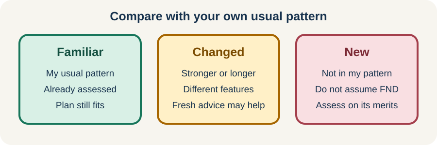

<!-- NAV-BREADCRUMB:START -->
[Home](../../../README.md) › [Course](../../README.md) › Part Two: Safety and Symptom Knowledge › [Module 5: Medical Safety and New Symptoms](README.md) › **Familiar Symptoms, New Symptoms, and Medical Change**
<!-- NAV-BREADCRUMB:END -->

# Familiar Symptoms, New Symptoms, and Medical Change

> **Working draft:** This page was automatically generated and is looking for [contributors and reviewers](https://fnd-education-project.github.io/FND-Education/).

FND can explain real and disabling symptoms. It does not protect you from another illness, injury or medical emergency. The safest question is often not “Is this FND?” but “Is this my usual, medically assessed pattern?” (*citations* [1](#citation-1), [2](#citation-2), [3](#citation-3))

---
[For the Person With FND](#for-the-person-with-fnd) 
[For Family, Friends, and Other Supporters](#for-family-friends-and-other-supporters) 
[For Clinicians and the Care Team](#for-clinicians-and-the-care-team) 
[Research and Sources](#research-and-sources)
---

## For the Person With FND
{: #for-the-person-with-fnd .shareable }

### When something feels different

You're making lunch when your hand begins to shake.

"Oh, this again."

You've experienced this before. Usually, the shaking settles after a while, and you know what helps you get through it.

But today, it's lasting much longer.

Hmm. That's different.

Is this still your usual FND? Or is something else going on?

That's one of the tricky things about FND. Your symptoms might change quite a bit, even when nothing new is wrong.

So how do you know when a change is worth checking out?

You don't have to figure out what's causing it. That's a job for your healthcare team.

But knowing what makes an experience different can help you explain what's happening.

### Familiar, changed, or new?

There are three terms worth knowing. They're useful when you're talking with a doctor.

A **familiar symptom** is something you've experienced before that fits a pattern your clinician has already assessed.

Maybe it comes and goes. Maybe some days are worse than others. It can still be familiar.

A **changed symptom** is one you recognise, but something important about it is different.

Remember that shaking hand? Perhaps it usually settles within a few minutes, but today it's lasted much longer.

A **new symptom** is something that hasn't been part of your previously assessed pattern.

It might turn out to be related to FND. It might have another explanation.

That's what an assessment can help work out.

*Illustration: Familiar, changed and new symptoms. These terms can help you explain what's happening.*

### If you remember one thing

**A familiar symptom can have a familiar response. Something new or meaningfully different may need a fresh medical look.**

### So, what's different this time?

Let's go back to your shaking hand.

You've had shaking before, but this time something has caught your attention.

Perhaps you're thinking, "I know this symptom, but it doesn't usually happen quite like this."

That's useful information.

When you're talking with a clinician, a few details can help:

- **The beginning:** Did it start the way it usually does?
- **The symptoms:** Is it affecting the same parts of your body?
- **The length:** Is it lasting about as long as usual?
- **The recovery:** Are you recovering in your usual way?
- **Anything else:** Have you been ill, injured, or started or changed a medication?

You might remember only one or two of those things.

That's still useful.

And if memory is giving you trouble, perhaps your symptom map has something that helps. Someone who was there might remember a detail, too.

The idea is to describe what stood out, rather than spend your day watching for every little change.

A symptom behaving differently doesn't automatically mean something dangerous is happening.

It gives you something worth considering with your care team.

### When everything gets blamed on FND

Here's something that can be especially frustrating.

You develop a new problem, visit a doctor, and the conversation quickly turns to your FND.

But you're sitting there thinking, "Hang on. Could we look at this new problem?"

There's actually a medical term for what can sometimes happen.

It's called **diagnostic overshadowing**.

That's when an existing diagnosis gets so much attention that another possible health problem is overlooked.

One person in an online FND community described developing light sensitivity after being diagnosed with FND.

They eventually saw an eye doctor, who identified a pollen allergy and prescribed treatment.

The person wrote:

> "He gave me steroid droplets ... and since then my light sensitivity is gone."

*— A comment from a now-deleted account in an [FND community discussion](https://www.reddit.com/r/FND/comments/1ievray/sharing_my_success_story/).*

For this person, getting their eyes checked led to treatment that helped.

Someone else's light sensitivity could have a completely different explanation.

That's the point, really.

**You can have FND and another medical problem at the same time.** We covered that in earlier lessons, but it's especially important when something changes. (*citations* [1](#citation-1), [2](#citation-2))

### But more medical treatment isn't always better, either

Now let's look at the other side.

Imagine someone who has familiar functional seizures.

Their episodes have been assessed. Their healthcare team knows what usually happens, and they've worked out what kind of help is useful.

Would it make sense to put that person through the same emergency tests and treatments every single time?

Sometimes an episode really does need emergency attention.

But when it's a familiar, previously assessed event, an agreed response may be safer and more helpful than repeating treatments that aren't needed.

Medical procedures and medications can have risks of their own. And repeated emergency visits can be exhausting.

This is where an **individual safety plan** comes in.

It's guidance worked out with your clinicians about what helps during familiar symptoms, how to keep you safe, and when it's time to get more medical help. (*citations* [2](#citation-2), [3](#citation-3), [4](#citation-4))

You may already have one.

If you haven't, that's something we'll work toward in the next lesson.

### Wait. Didn't we just make a symptom map?

We did!

And the good news is that the work you put into it can help here, too.

Think of it this way:

**Your symptom map describes what's going on with your health.**

**Your safety plan explains what to do when help is needed.**

The map can hold a short safety summary or point to the plan.

You certainly don't need two enormous documents. There's enough paperwork in life already!

In Lesson 13, we'll look at turning the useful information you've gathered into a safety plan with your care team.

Then, in Lesson 14, we'll see how to use it.

### When is it time to get more help?

Sometimes a change can be discussed with your regular healthcare team.

Other times, getting help quickly is important.

For example, sudden symptoms that could be a stroke, such as new one-sided weakness, facial drooping or difficulty speaking, need emergency assessment. Severe breathing problems, serious injuries or other immediate dangers also call for emergency help.

**When something could be a medical emergency, seek emergency care right away.**

For changes that aren't emergencies, your healthcare team can help decide what needs checking.

Maybe it's a conversation and an examination. Maybe some tests would be useful.

You can start with something as simple as:

"I've had this symptom before, but this time something feels different. Could we check it out?"

You don't have to walk in with a theory about what's wrong.

A good description of what's happening is a great place to start.

### Something to think about

Think of a symptom or episode you've experienced before.

What makes it familiar to you?

Now imagine something important about it changes.

Would you know who to ask for medical advice?

If you're unsure, that's a useful question to bring to your next appointment.

### One small thing you can do

Remember your symptom map?

If you'd like, choose one familiar, medically assessed symptom and add a short description of what usually happens.

For example:

"My usual episodes involve shaking and difficulty speaking. Afterwards, I generally need some quiet time to recover."

Already have something like that written down? Great. You can leave it as it is.

You could also ask your clinician which changes would mean getting more medical help.

And if writing or remembering feels like too much today, this activity can wait.

**The idea is to make getting care easier, not give yourself another chore.**

Next, we'll use what you've learned to help prepare your individual safety plan.

***
[For the Person With FND](#for-the-person-with-fnd) 
[For Family, Friends, and Other Supporters](#for-family-friends-and-other-supporters) 
[For Clinicians and the Care Team](#for-clinicians-and-the-care-team) 
[Research and Sources](#research-and-sources)
***

## For Family, Friends, and Other Supporters
{: #for-family-friends-and-other-supporters .shareable }

Follow the person’s plan for a familiar event, while noticing what is different today. Describe what you observe: timing, movement, responsiveness, breathing, colour, injury and recovery. You do not have to decide the diagnosis.

Avoid saying either “This is definitely FND” or “This must be an emergency” without considering the plan and circumstances. If the pattern is new or clearly changed, or you are worried about immediate safety, seek appropriate medical help. Preserve the person’s privacy and choices whenever the situation allows.

***
[For the Person With FND](#for-the-person-with-fnd) 
[For Family, Friends, and Other Supporters](#for-family-friends-and-other-supporters) 
[For Clinicians and the Care Team](#for-clinicians-and-the-care-team) 
[Research and Sources](#research-and-sources)
***

## For Clinicians and the Care Team
{: #for-clinicians-and-the-care-team .shareable }

### Research quotations for review

**Option 1 — Finkelstein et al., 2021**

> “the presence of positive clinical signs of FND does not exclude the presence of a concomitant neurological condition.”

**Option 2 — Mcloughlin et al., 2025**

> “A balanced approach is needed not to over or under-investigate new symptoms on their own merits.”

*Figure 1 — Research quotations offered for editorial selection. (*citations* [2](#citation-2), [3](#citation-3))*

### Reassess the presentation, not the person’s credibility

Start with physiological stability and time-sensitive differentials. Then compare the current semiology with documented event types. Separate: confirmed diagnoses; the usual presentation; current differences; objective observations; and unresolved risk.

Positive FND signs can support a diagnosis, but they do not rule out comorbidity. Conversely, a stereotyped event with an established plan may not benefit from repeated low-yield investigation or harmful acute treatment. Explain the reasoning for either investigation or non-investigation. (*citations* [1](#citation-1), [2](#citation-2), [3](#citation-3), [4](#citation-4))

When uncertainty remains, name it. Arrange a route for follow-up and revise the safety plan after a new diagnosis, medication change, injury or material change in events.

***
[For the Person With FND](#for-the-person-with-fnd) 
[For Family, Friends, and Other Supporters](#for-family-friends-and-other-supporters) 
[For Clinicians and the Care Team](#for-clinicians-and-the-care-team) 
[Research and Sources](#research-and-sources)
***

<!-- NAV-CONTEXT:START -->
**Continue:** [Next page: Emergency Information and Individual Safety Plans](02-emergency-information-and-individual-safety-plans.md)

**Navigate:** [Home](../../../README.md) · [Course](../../README.md) · [Reference Library](../../../reference/README.md) · [Site Map](../../../SITEMAP.md)
<!-- NAV-CONTEXT:END -->

***

## Research and Sources

The emergency-department reviews and iatrogenic-harm review support positive FND diagnosis alongside appropriate assessment of changed symptoms. They are reviews and clinical guidance, not a validated decision rule for one person. (*citations* [2](#citation-2), [3](#citation-3), [4](#citation-4))

| Citation | Figure | Full citation |
|---|---|---|
| **[1]** | — | Bennett K, Diamond C, Hoeritzauer I, Gardiner P, McWhirter L, Carson A, Stone J. A practical review of functional neurological disorder (FND) for the general physician. *Clinical Medicine*. 2021;21(1):28–36. [FND-CIT-0001](../../../research/citation-index.md#fnd-cit-0001). [https://doi.org/10.7861/clinmed.2020-0987](https://doi.org/10.7861/clinmed.2020-0987) |
| **[2]** | Figure 1 | Finkelstein SA, Cortel-LeBlanc MA, Cortel-LeBlanc A, Stone J. Functional neurological disorder in the emergency department. *Academic Emergency Medicine*. 2021;28(6):685–696. [FND-CIT-0068](../../../research/citation-index.md#fnd-cit-0068). [https://doi.org/10.1111/acem.14263](https://doi.org/10.1111/acem.14263) |
| **[3]** | Figure 1 | Mcloughlin C, Lee WH, Carson A, Stone J. Iatrogenic harm in functional neurological disorder. *Brain*. 2025;148(1):27–38. [FND-CIT-0069](../../../research/citation-index.md#fnd-cit-0069). [https://doi.org/10.1093/brain/awae283](https://doi.org/10.1093/brain/awae283) |
| **[4]** | — | Anderson JR, Nakhate V, Stephen CD, Perez DL. Functional (psychogenic) neurological disorders: assessment and acute management in the emergency department. *Seminars in Neurology*. 2019;39(1):102–114. [FND-CIT-0070](../../../research/citation-index.md#fnd-cit-0070). [https://doi.org/10.1055/s-0038-1676844](https://doi.org/10.1055/s-0038-1676844) |

This page still needs review by people with FND, supporters, emergency clinicians and neurologists.

*Plain-language draft prepared: September 4, 2026 · Research package added September 4, 2026 · Clinical review pending*
