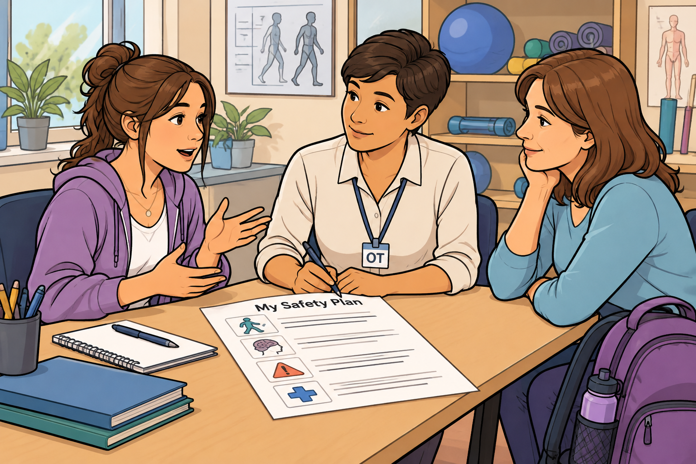

<!-- NAV-BREADCRUMB:START -->
[Home](../../../README.md) › [Course](../../README.md) › Part Two: Safety and Symptom Knowledge › [Module 5: Medical Safety and New Symptoms](README.md) › **Emergency Information and Individual Safety Plans**
<!-- NAV-BREADCRUMB:END -->

# Emergency Information and Individual Safety Plans

> **Working draft:** This page was automatically generated and is looking for [contributors and reviewers](https://fnd-education-project.github.io/FND-Education/).

An emergency plan is easiest to use when it is brief, specific to you and agreed with the clinicians who know your health. It is not a document that asks strangers to ignore every symptom. (*citations* [1](#citation-1), [2](#citation-2))

---
[For the Person With FND](#for-the-person-with-fnd) 
[For Family, Friends, and Other Supporters](#for-family-friends-and-other-supporters) 
[For Clinicians and the Care Team](#for-clinicians-and-the-care-team) 
[Research and Sources](#research-and-sources)
---

## For the Person With FND
{: #for-the-person-with-fnd .shareable }

### When a little preparation makes a big difference

Imagine you're at a medical appointment when your words suddenly become difficult to find.

Someone asks what's happening.

You know what you want to say. You've explained this before. But right now, getting the words out feels almost impossible.

Wouldn't it be helpful if the person beside you already knew what to do?

Perhaps they could show the doctor a short note you've prepared. Or give you time to communicate another way.

That's the sort of thing a **safety plan** can help with.

And here's the good news.

You've already made a start.

### Remember that symptom map?

In Lesson 11, you wrote down some of your symptoms, safety needs and things that help.

You may have written something like:

*"Sometimes I can't speak during an episode."*

That's useful information.

Now we can do something with it.

Perhaps you and your care team decide that a note on your phone would help you communicate when speaking becomes difficult.

You could also arrange for someone you trust to help explain your needs, if that's what you'd prefer.

See the difference?

**Your symptom map identifies the need. Your safety plan helps you prepare for it.**

And your plan can be much more than a piece of paper.

Sometimes it's a change to your surroundings. Sometimes it's equipment, supplies or an agreement with someone who helps you.

Let's look at how one person's plan grew over time.

### How my own safety plan came together

*An experience from the founder of the FND Education Project*

When my wife and I first started dealing with my FND symptoms, we certainly didn't have everything figured out.

Over time, we began noticing the same problems coming up again and again.

Sometimes I needed help moving around safely. During my functional seizures, I could lose control of my movements. Light and noise could make an already difficult situation much harder.

And when we went somewhere, we often found ourselves needing the same things.

Eventually, we began asking a pretty simple question:

**"What could we have ready, or change ahead of time, to make this easier next time?"**

Some of the answers came from an occupational therapist who was assigned to help us.

An **occupational therapist**, or OT, helps people find ways to make everyday activities safer, easier or more manageable.

Our OT helped arrange safety bars around our home, a wheelchair and a walker.

They also helped us arrange dimmers for our LED ceiling lights. Those lights were the only ones I could tolerate, and being able to control their brightness made a real difference.

We made other changes ourselves.

We soundproofed our bedroom to give me a quieter place to recover.

We installed fold-down head supports in our vehicle so my head could be supported when needed during an episode.

And then there's the backpack.

We seemed to need the same collection of things every time we left home. So rather than having to remember everything before each outing, we decided to keep a bag ready.

Here's what's in mine:

- Prescription medications and familiar pain-relief supplies
- A neck brace we've kept for particular situations when I'm sitting upright
- Kleenex
- Identification
- Spare earplugs for my hyperacusis (painful sensitivity to sound)
- A sleep mask to block out light
- Two medical information handouts

The earplugs and sleep mask are particularly useful for me because a dark, quiet environment helps with my recovery after functional seizures.

That's my experience, though. Someone else's needs could look completely different.

Our safety equipment and medication arrangements are individual choices, some made with professional help. Things such as neck supports, seizure positioning and medication use need their own medical safety guidance.

What matters about our story isn't the particular equipment we chose.

It's how we got there.

**We kept noticing what was making life difficult, found ways to make those situations safer or more comfortable, and gradually put those solutions in place.**

We didn't create everything in one afternoon.

In fact, many of these adaptations happened over several years.

And we're still learning.

<figure class="image-60center" markdown="1">

<figcaption>Your experience, your supporter's needs and professional advice can come together in a plan that fits everyday life.</figcaption>

</figure>

### Your safety plan might look completely different

Maybe you have difficulty walking, and a physiotherapist or occupational therapist helps you find a safer way to get around.

Perhaps your symptoms affect thinking or memory, and having important instructions available on your phone makes appointments easier.

Or maybe certain episodes leave you needing a quiet place to recover.

Your needs will depend on your symptoms, your surroundings and the help available to you.

Some changes might be simple.

Others may need equipment, professional assessment, funding or help from someone you trust.

Your plan can grow as you find out what works.

And something that makes everyday life safer or more accessible is valuable even when it doesn't change the FND symptoms themselves.

### There's another important part of the plan

Preparing your surroundings and supplies can make a big difference.

But what happens when an episode actually begins?

That's something to work through with your healthcare team, too.

An **individual safety plan** brings together practical preparation and medically agreed instructions.

For example, your clinicians can help establish what support is appropriate during your familiar symptoms, how recovery usually looks, and which changes mean you need further medical help.

Those instructions are particularly important if your episodes affect movement, awareness, breathing or your ability to communicate.

Your plan might also explain what another person should do if you're unable to respond.

And if you have more than one diagnosed condition, the plan should account for those differences.

There's no one-size-fits-all set of instructions for FND.

**The aim is to have useful arrangements in place before you need them, while leaving room for medical professionals to assess anything new or concerning.** (*citations* [1](#citation-1), [2](#citation-2), [3](#citation-3))

### Something to think about

Look back at the safety needs you identified on your symptom map.

Has one particular difficulty come up more than once?

Maybe you've repeatedly found yourself wishing you had something with you.

Or perhaps there's a situation where you'd feel more comfortable knowing someone understood how to help.

What small change might make that situation easier next time?

You may already have a solution in place.

If so, that's part of your safety planning too.

### One small thing you can do

Choose **one safety need** you've already identified.

Rather than writing it down all over again, think about what might help with it.

Perhaps there's something you could prepare, a change to your surroundings worth exploring, or a question you'd like to ask an occupational therapist or another clinician.

You can add that next step to your existing map, if you want.

And if you've already made an adaptation that helps, take a moment to recognise it.

You've been doing some safety planning already.

### Two handouts that have been especially helpful to us

There's one more part of our plan that I want to share.

Remember those two medical handouts in my backpack?

They serve different purposes, and we've found them useful for different situations.

#### 1. A short emergency information sheet

The first is a simple, bullet-point document.

It begins with something like:

**"I have Functional Neurological Disorder (FND). These are my medically assessed symptoms."**

It gives someone unfamiliar with my condition a quick explanation of what they might be seeing.

Your own short emergency sheet could include:

- Your name, diagnoses and emergency contact
- Your familiar, medically assessed symptoms or episodes
- How your symptoms may affect your ability to speak, move or respond
- Important medicines, allergies and medical needs
- Clinician-agreed instructions for familiar episodes and when to seek emergency care
- A reliable source of additional information about FND, such as [Neurosymptoms.org](https://neurosymptoms.org/en/)

A few short bullets are enough to make a useful first version. Ask your care team to check any medical or emergency instructions.

For me, it's especially useful when explaining things is difficult.

The sheet gives someone a place to start, while allowing emergency professionals to assess what's happening.

#### 2. A longer explanation for doctors

Our second handout serves another purpose.

It's a more detailed explanation of FND, intended for doctors who may be unfamiliar with the condition.

I believe our original handout may have come from FND Hope.

It explains the condition in greater depth than our short emergency sheet.

We keep it available for situations where a clinician wants more information, especially when meeting someone new.

**A one-page FND information handout for healthcare professionals is included with this lesson.** <a href="{{ '/assets/downloads/meeting-a-person-with-fnd-clinician-handout.pdf' | relative_url }}" target="_blank" rel="noopener">Download the clinician handout (PDF, new tab)</a> and keep a copy alongside your own short emergency sheet.

It's a way of sharing useful medical education without having to explain everything from memory.

And that's a pretty big advantage when memory and communication can be difficult!

One handout gives someone the essentials about *you*. The other gives them more background about *FND*.

Keep them somewhere easy to find, whether that's on your phone, with your medical information or in a bag.

**The important thing is having useful information ready for the moments when explaining everything yourself might be difficult.**

And that brings us to the next lesson.

We've looked at how safety preparations can grow from real needs.

Now we'll explore what happens when you actually need to use them, including how to recognise when it's time for more medical help.

### Optional crossword

Revisit the lesson with a crossword. The easy edition includes a word bank.

<a class="puzzle-card" href="{{ '/puzzles/' | relative_url }}?collection=crosswords&amp;puzzle=lesson-13" aria-label="Browse the Lesson 13 crossword">Lesson 13 crossword</a>

<a href="{{ '/assets/puzzles/crosswords/Module-5-Lesson-13/the-individual-safety-plan-m5-13-easy.pdf' | relative_url }}" target="_blank" rel="noopener" aria-label="Easy crossword PDF for Lesson 13 (opens in a new tab)">Easy</a>
<a href="{{ '/assets/puzzles/crosswords/Module-5-Lesson-13/the-individual-safety-plan-m5-13-normal.pdf' | relative_url }}" target="_blank" rel="noopener" aria-label="Normal crossword PDF for Lesson 13 (opens in a new tab)">Normal</a>
<a href="{{ '/assets/puzzles/crosswords/Module-5-Lesson-13/the-individual-safety-plan-m5-13-answer-key.pdf' | relative_url }}" target="_blank" rel="noopener" aria-label="Answer key crossword PDF for Lesson 13 (opens in a new tab)">Answer key</a>

PDFs open in a new tab.

### Optional colouring activity

<a href="{{ '/assets/puzzles/colouring/lesson-13-coloring-book.pdf' | relative_url }}" target="_blank" rel="noopener">Open the Lesson 13 colouring PDF (new tab)</a>, or <a href="{{ '/puzzles/' | relative_url }}?collection=colouring&amp;puzzle=lesson-13">browse the colouring collection</a>.

***
[For the Person With FND](#for-the-person-with-fnd) 
[For Family, Friends, and Other Supporters](#for-family-friends-and-other-supporters) 
[For Clinicians and the Care Team](#for-clinicians-and-the-care-team) 
[Research and Sources](#research-and-sources)
***

## For Family, Friends, and Other Supporters
{: #for-family-friends-and-other-supporters .shareable }

### When helping becomes part of everyday life

It's Friday evening.

Someone you care about had planned to help make dinner, but their FND symptoms have been particularly difficult today.

So you're making dinner instead.

And doing the dishes.

And perhaps there's laundry waiting, an appointment to arrange, or someone else in the family who needs your attention.

None of these things is especially dramatic.

It's just that the ordinary jobs of life keep arriving, whether you're ready for them or not.

You want to help.

You might also be exhausted.

And perhaps you miss how things used to be.

There's room for all those feelings.

Supporting someone through a long-term illness can bring love, frustration, uncertainty and grief into the same day.

Sometimes into the same hour!

Understanding those feelings can help you find ways of supporting each other that are sustainable.

### Remember available capacity?

Back in Lesson 4, we introduced **available capacity**.

It's a way of describing how much someone can manage at a particular time, considering the demands on their body and mind.

Someone with FND might have enough capacity to make breakfast but struggle to prepare dinner later.

Or perhaps they can help with household chores one day, then need more support the next.

That can be especially difficult when they used to do those jobs regularly.

They may miss contributing in familiar ways, caring for others or taking part in family routines.

And you might miss those things, too.

But there's another part of this picture worth remembering.

**Supporters have available capacity as well.**

Perhaps you've had a difficult day at work or school. Maybe you're dealing with pain, poor sleep or worries of your own.

Taking on additional responsibilities uses some of that capacity.

Over time, even small extra demands can add up.

So what can you do when the household needs more than either person can comfortably manage?

Sometimes the answer is sharing a task differently.

Perhaps the person with FND can help plan meals while someone else handles the cooking.

Maybe a demanding chore can be broken into smaller jobs or done less often.

Some families may be able to arrange outside assistance.

Other arrangements will depend on who's available and what support they can access.

**The aim is to find ways for everyone to contribute where they can, while recognising that both people have limits.**

### You may be grieving changes, too

There's something else that can be difficult to talk about.

You might love someone dearly and still feel sad about how life has changed.

Perhaps outings take more planning.

Maybe you now manage responsibilities you once shared.

Or perhaps you're worried about the future and wish you knew what to expect.

The person with FND may be experiencing similar feelings, although their losses and worries might look different.

It can help to understand that two people can be affected by the same illness in different ways.

And sometimes those differences create misunderstandings.

One person might feel guilty about needing help.

The other might feel guilty about being tired.

That's a lot of guilt to carry around!

Making room for honest conversations can help both people understand what's happening.

You might discover that a job can be shared differently, that someone needs a break, or that additional support would make a meaningful difference.

**Caring for someone and caring for your own wellbeing belong in the same conversation.**

### Two people, one safety plan

In the previous lesson, we explored how being a receptive observer can help you better understand someone's symptoms.

Now it's time to use that understanding.

Remember the symptom map from Lesson 11?

Perhaps it includes a note about falls, difficulty speaking, sensory overload or trouble moving during episodes.

That identifies something important.

The next question is:

**"What could make this situation safer or easier for both of us?"**

Let's imagine the person you're supporting sometimes loses the ability to stand or walk during an episode.

You might have been helping them move to a chair.

But perhaps that assistance is becoming physically difficult.

Maybe you've already hurt your back, or you're worried about someone falling while you're trying to help.

Those concerns belong in the safety plan too.

Helping someone move when their strength, balance or control is affected can be dangerous for both people.

An occupational therapist or physiotherapist can help assess the situation and explore safer equipment, movement methods or alternatives.

Sometimes the safer solution is to make the surroundings safe and get additional help rather than attempt a difficult transfer.

And if you're a young supporter, physically demanding care and emergency responsibilities need appropriate adult and professional support.

Here's why this matters.

A plan built around help that someone cannot safely provide is likely to let both people down when it's needed most.

**A useful safety plan considers what the person needs and what the supporter can safely manage.**

### The person with FND knows things you might not

Remember how we talked about listening in Lesson 12?

That becomes especially important when you're developing a plan together.

Perhaps the person knows that a particular sensation often comes before an episode.

Maybe certain sounds make their symptoms worse, or a quieter environment makes recovery more comfortable.

Those details can be difficult for someone else to observe.

And you may have noticed things they haven't.

Perhaps you've seen that a particular doorway is difficult to get through with a wheelchair.

Or maybe you've noticed how physically demanding some of your usual ways of helping have become.

You're bringing different information to the same problem.

That can be incredibly useful.

It also means you might occasionally disagree.

Perhaps you think a particular arrangement would make things safer, while the person with FND finds it uncomfortable or limiting.

That's a good reason to explore other options together.

The most useful solution is one that takes account of the person's wishes, the supporter's needs and any relevant medical guidance.

### When the same problem keeps coming back

Sometimes a safety plan begins with something quite ordinary.

Imagine that every time you go out together, someone has to hurry back into the house for a forgotten item.

Perhaps it's an aid, a pair of earplugs or important medical information.

After the fifth trip back to the front door, you might start thinking there has to be an easier way!

Maybe a small bag kept ready would help.

Or perhaps the problem is getting to medical appointments.

A person may struggle with bright waiting rooms, speaking during an episode or remembering what they wanted to discuss.

That might lead to arranging a quieter waiting area, preparing a communication note or carrying a short medical information sheet.

These ideas are about solving practical problems.

Some can be tried easily. Others, particularly those involving medicines, mobility equipment, transfers or emergency responses, need professional advice.

An occupational therapist can be especially helpful when exploring how changes to activities, equipment or surroundings might improve safety and participation.

**You don't have to anticipate every possible difficulty. Repeated problems can show you where a useful change might begin.**

### Making agreements that work for both of you

Some parts of a plan need a conversation before they're needed.

For example, if the person experiences episodes that affect their ability to speak, what kind of help would they like?

Perhaps they'd prefer you to give them more time to respond.

Maybe they'd like you to show a clinician their short emergency information sheet when speaking becomes difficult.

You can also discuss what you're comfortable doing.

What happens if you're unavailable?

What if the situation requires more physical help than you can safely provide?

Who else could assist?

Those questions help turn good intentions into arrangements that are more dependable.

It's also worth recognising that supporters aren't all spouses or parents.

You might be a friend, sibling, teenager or someone who provides occasional assistance.

Your responsibilities, abilities and available support may be quite different.

A useful plan can reflect the role you're actually able and willing to take on.

### When medical information is part of the plan

The Person section of this lesson introduces two useful handouts.

The first is a short, personal emergency information sheet. It describes the person's diagnosed conditions, familiar symptoms, communication needs and important medical information.

The second is a one-page explanation of FND for healthcare professionals. <a href="{{ '/assets/downloads/meeting-a-person-with-fnd-clinician-handout.pdf' | relative_url }}" target="_blank" rel="noopener">Download the clinician handout (PDF, new tab)</a>.

As a supporter, you may be able to help the person prepare or organise this information, if they'd like your involvement.

You might also know something useful about the timing or appearance of familiar episodes.

Your observations can help make the information clearer.

Medical instructions need another kind of input.

The person's clinicians should help establish appropriate responses to familiar episodes and the circumstances that call for additional medical attention.

That helps everyone understand where an agreed home response ends and professional medical care is needed.

The handouts can then be kept somewhere accessible, with the person's knowledge and agreement.

It's a small preparation that may make a difficult conversation much easier later.

### A plan can make room for your limits

There's one more thing worth thinking about.

Sometimes supporters gradually take on more responsibilities without ever really discussing them.

One job becomes two. Then three.

Eventually, helping can begin to feel like being permanently on call.

That's a difficult arrangement to sustain.

A safety plan offers an opportunity to talk about what is realistic.

Perhaps you can provide certain kinds of assistance but need additional help with others.

Maybe you need a reliable break during the week.

Or perhaps a physical injury means an arrangement that used to work needs to change.

These are practical needs worth addressing.

Sometimes involving another family member, a healthcare professional or a community service may help.

And if support isn't available, that limitation matters too. The plan needs to reflect the resources people actually have.

**A sustainable plan helps protect the relationship as well as the people in it.**

### Something to think about

Is there a situation where you've been providing the same help over and over?

Does that arrangement work comfortably for both of you?

Perhaps there's something you could change together.

Or maybe there's a question you'd like to ask an occupational therapist, physiotherapist or another member of the healthcare team.

### One small thing you can try

Choose one repeated difficulty you've noticed.

At a comfortable time, ask the person you're supporting what they think might help.

You can share your own thoughts about what's practical for you as well.

Perhaps you'll find an easy adjustment.

Maybe you'll discover that professional advice would be useful.

Either way, you've begun turning an identified need into a shared plan.

**The best arrangements make room for the person receiving help and the person providing it.**

### Coming up next

You've looked at recognising useful information and working together to prepare for familiar difficulties.

Next, we'll explore what happens when those preparations meet real life.

How do you support someone's choices while helping them understand possible consequences?

What happens when thinking or memory makes a decision more difficult?

And how do you respond when an ordinary outing becomes a situation where safety needs to come first?

That's where we'll take this next.

***
[For the Person With FND](#for-the-person-with-fnd) 
[For Family, Friends, and Other Supporters](#for-family-friends-and-other-supporters) 
[For Clinicians and the Care Team](#for-clinicians-and-the-care-team) 
[Research and Sources](#research-and-sources)
***

## For Clinicians and the Care Team
{: #for-clinicians-and-the-care-team .shareable }

### A diagnosis is useful. A coordinated response makes it actionable.

Return to the 18-year-old woman from Lesson 12.

Her functional weakness and seizures were supported by clinical evidence. Further investigation identified coexisting POTS, providing an additional explanation for her orthostatic symptoms.

The published report describes POTS-directed management alongside continuing FND care, followed by improvement in mobility.

The authors could not isolate the effects of individual interventions. (*citation* [4](#citation-4))

Now consider what happens beyond the diagnostic encounter.

The patient still has functional neurological symptoms. Standing may be difficult. Episodes may affect her independence, and more than one condition can contribute to her limitations.

What should her clinical team do next?

**Who is best placed to address each problem, and who ensures that their recommendations work together?**

The following is a clinical planning exercise informed by the published case, rather than a description of the patient's documented rehabilitation arrangements.

### Begin with the problem, then choose the professional

Consider three needs that might arise in a patient with this combination of diagnoses.

**First: standing produces significant symptoms.**

The clinician responsible for autonomic care would assess the relevant physiology, treatment options and monitoring requirements.

That information matters to the rehabilitation team.

A mobility programme developed without considering clinically significant orthostatic intolerance may prove difficult to tolerate, even when its motor-retraining goals are appropriate.

**Second: functional weakness affects walking and mobility.**

A physiotherapist with suitable neurological rehabilitation expertise may assess movement, balance, gait and safe transfers while developing an individualized rehabilitation approach.

But what if the patient can demonstrate improved movement during an appointment yet still struggles to get to the bathroom or prepare meals at home?

That raises a related question for occupational therapy.

An OT can examine the activities, equipment and environments involved, helping identify ways to support safety, access and participation alongside rehabilitation.

The disciplines overlap, but their contributions can answer different questions. (*citations* [5](#citation-5), [6](#citation-6))

**Third: episodes affect safety and communication.**

The clinician overseeing the functional-seizure diagnosis can help establish the familiar event pattern, relevant comorbidities and medically appropriate response instructions.

Nursing, occupational therapy and other professionals may help translate those decisions into usable arrangements.

The person and their supporters contribute knowledge about what happens outside clinical appointments.

The result should be an agreed response that reflects both clinical evidence and the circumstances in which it will be used.

These are examples of professional contributions, not a recommendation that every patient with FND needs all these referrals.

**The most useful team is organised around the patient's identified needs, rather than a standard list of specialties.**

### One plan, several forms of expertise

The symptom map from Lesson 11 helps identify the problems.

Lesson 12 helps establish which symptoms are clinically understood and where uncertainty remains.

Now the team needs to decide what can actually be done.

A workable safety plan has two connected parts.

The first is practical: accessible surroundings, appropriate equipment, safer daily activities, communication methods and realistic support.

The second is medical: instructions for familiar events, relevant diagnoses and medicines, warning signs that warrant reassessment, and clear routes to additional care.

Both matter.

An emergency instruction may be clinically sound but difficult to use if the person cannot communicate during an episode.

A mobility recommendation may be appropriate in the clinic but unrealistic if the patient's home has inaccessible stairs.

And a transfer arrangement may benefit the patient while placing an injured supporter at further risk.

These are reasons to bring the relevant professionals and lived experience together.

The plan should identify what is being addressed, what action has been agreed, who is responsible and when the arrangement needs review.

For example, an OT and physiotherapist may collaborate on safe mobility and transfers, while a physician retains responsibility for medical escalation criteria.

A designated clinician or service should coordinate the overall plan so that recommendations remain consistent. (*citation* [8](#citation-8))

### The cost of care deserves clinical attention

Consider the patient who repeatedly attends appointments but continues to encounter the same practical difficulties.

The neurologist has documented the diagnosis.

The physiotherapist has recommended rehabilitation.

The patient still cannot safely manage a particular household activity.

Their supporter is compensating as best they can and is becoming physically exhausted.

Each professional may have contributed appropriately within their own scope.

Yet the care remains incomplete if nobody has addressed the unresolved activity or the supporter's limitations.

That incompleteness can carry substantial costs.

For the patient and family, costs may include travel, time away from employment, equipment, lost participation, physical injury and the effort required to coordinate appointments.

For healthcare services, costs may include repeated assessments, duplicated referrals and emergency presentations that could sometimes be managed differently with clearer information and suitable ongoing care.

These are potential consequences, rather than evidence that any particular intervention will automatically reduce expenditure.

The financial implications of professional involvement deserve the same careful reasoning.

An OT assessment, equipment trial or coordinated rehabilitation programme may involve an immediate cost.

The decision should consider what clinically meaningful problem that investment is intended to address.

Does it improve safe access to an essential activity?

Could it reduce an identified injury risk?

Will it make the agreed treatment more achievable?

Does it lessen an unsustainable demand on a supporter?

**Cost-conscious care means allocating resources to needs that matter, while evaluating the benefits, burdens and feasibility of the intervention.**

A promising coordinated approach should still be assessed through outcomes. Reduced emergency use or overall cost savings should be demonstrated rather than assumed.

### Rehabilitation and accessibility can advance together

Equipment decisions in FND sometimes expose a clinical tension.

A mobility aid may support immediate safety and participation, while rehabilitation aims to improve movement and independence over time.

Those goals can coexist.

The appropriate choice depends on the patient's disability, injury risk, treatment goals, environment and response to rehabilitation.

An aid should neither become a permanent default without review nor be withheld solely because the neurological diagnosis is functional.

A collaboratively assessed aid may allow someone to participate in daily life while pursuing rehabilitation.

That decision should also account for the effort required to use the equipment, the possibility of dependence or deconditioning, and whether circumstances may change.

Occupational therapy consensus guidance supports individualized assessment of aids and adaptations. Physiotherapy consensus guidance provides a separate framework for functional motor rehabilitation.

Neither establishes a universal equipment rule for all patients with FND. (*citations* [5](#citation-5), [6](#citation-6))

The practical question is:

**What arrangement offers an appropriate balance of safety, access, participation and rehabilitation for this patient now?**

Module 17 will examine equipment selection and reassessment in greater detail.

### When another specialty is the better answer

The same reasoning applies beyond motor symptoms.

A patient with functional cognitive difficulties may struggle to remember medical instructions or combine information needed for decisions.

Depending on the problem, occupational therapy, neuropsychology or another appropriately qualified professional may contribute assessment, communication strategies or practical cognitive supports.

A patient with swallowing difficulties presents a different clinical need.

Appropriate medical assessment and, when indicated, speech-language pathology can help establish swallowing safety and individualized recommendations.

A patient with sensory intolerance may benefit from environmental adaptations or access arrangements, informed by relevant medical assessment.

The specialist contribution follows the clinical question.

The team's structure may therefore look very different for someone with functional seizures, functional weakness, swallowing difficulties, cognitive symptoms or several coexisting conditions. (*citations* [6](#citation-6), [7](#citation-7), [8](#citation-8))

### Make the plan usable beyond the originating service

Clinical coordination also affects the information a patient carries into other healthcare settings.

This lesson introduces two complementary resources.

The **short personal emergency information sheet** summarises the person's diagnoses, familiar symptom patterns, communication needs, relevant medical information and clinician-agreed reasons to seek additional care.

Its purpose is rapid orientation.

The **one-page FND information handout for healthcare professionals** provides a concise orientation to the condition and its clinical assessment. <a href="{{ '/assets/downloads/meeting-a-person-with-fnd-clinician-handout.pdf' | relative_url }}" target="_blank" rel="noopener">Download the clinician handout (PDF, new tab)</a>.

The longer document explains FND.

The personal sheet explains what matters for this particular patient.

The clinical team should ensure that individualized emergency instructions are accurate, proportionate and reviewable. A general educational handout cannot substitute for those decisions.

For patients with more than one diagnosed condition, distinctions between their event types and associated risks may be particularly important.

A useful handover should also identify the clinician or service responsible for reviewing the plan after an important change.

### What should success look like?

Symptom severity and frequency remain relevant outcomes.

But a useful safety plan can provide benefits even when symptoms persist.

Someone may be able to leave home more often because they have appropriate access arrangements.

A supporter may be able to assist without repeatedly risking injury.

An emergency clinician may have better information available when deciding what requires reassessment.

The patient may find it easier to communicate their needs when speech, concentration or memory is affected.

These are worthwhile outcomes to evaluate alongside clinical improvement.

Their value should be determined with the patient, considering safety, function, participation, treatment burden and quality of life.

The case from Lesson 12 illustrates why a more complete clinical formulation matters.

This lesson takes the next step: ensuring that the formulation leads to **coordinated actions that are workable for the person living with its consequences**.

### Moving into Lesson 14

A plan may be clinically appropriate and still encounter practical difficulties.

What happens when the available supporter cannot safely perform the agreed task?

How should clinicians approach a patient's informed choice when it involves manageable risk?

And how can functional cognitive difficulties be accommodated while preserving the person's decision-making authority?

Lesson 14 will examine how clinical teams support those decisions, respond to changing circumstances and use real-world experience to improve the plan.

***
[For the Person With FND](#for-the-person-with-fnd) 
[For Family, Friends, and Other Supporters](#for-family-friends-and-other-supporters) 
[For Clinicians and the Care Team](#for-clinicians-and-the-care-team) 
[Research and Sources](#research-and-sources)
***

<!-- NAV-CONTEXT:START -->
**Continue:** [Next page: Using Your Safety Plan and Deciding When to Get Urgent Help](03-using-your-safety-plan-and-deciding-when-to-get-urgent-help.md)

**Navigate:** [Home](../../../README.md) · [Course](../../README.md) · [Reference Library](../../../reference/README.md) · [Site Map](../../../SITEMAP.md)
<!-- NAV-CONTEXT:END -->

***

## Research and Sources

These clinical reviews, practice guidance and consensus recommendations inform individualized safety information, professional roles and coordinated rehabilitation. The 2026 FND/POTS report is a case illustration, not evidence of a particular team's cost effectiveness or proof of causation. No universal emergency card format, staffing arrangement or cost saving is established. (*citations* [1](#citation-1), [2](#citation-2), [3](#citation-3), [4](#citation-4), [5](#citation-5), [6](#citation-6), [7](#citation-7), [8](#citation-8))

| Citation | Figure | Full citation |
|---|---|---|
| **[1]** | — | Anderson JR, Nakhate V, Stephen CD, Perez DL. Functional (psychogenic) neurological disorders: assessment and acute management in the emergency department. *Seminars in Neurology*. 2019;39(1):102–114. [FND-CIT-0070](../../../research/citation-index.md#fnd-cit-0070). [https://doi.org/10.1055/s-0038-1676844](https://doi.org/10.1055/s-0038-1676844) |
| **[2]** | — | Finkelstein SA, Cortel-LeBlanc MA, Cortel-LeBlanc A, Stone J. Functional neurological disorder in the emergency department. *Academic Emergency Medicine*. 2021;28(6):685–696. [FND-CIT-0068](../../../research/citation-index.md#fnd-cit-0068). [https://doi.org/10.1111/acem.14263](https://doi.org/10.1111/acem.14263) |
| **[3]** | — | Tolchin B, Goldstein LH, Reuber M, Stone J, Perez DL, LaFrance WC Jr, et al. Management of Functional Seizures Practice Guideline Executive Summary: Report of the AAN Guidelines Subcommittee. *Neurology*. 2026;106(1):e214466. [FND-CIT-0010](../../../research/citation-index.md#fnd-cit-0010). [https://doi.org/10.1212/WNL.0000000000214466](https://doi.org/10.1212/WNL.0000000000214466) |

| **[4]** | Case report | Das S, Yerraballa SRN, Shekhawat P. Coexisting postural orthostatic tachycardia syndrome on autonomic reflex testing in functional neurologic disorder. *American Journal of Case Reports*. 2026;27:e953323. [https://doi.org/10.12659/AJCR.953323](https://doi.org/10.12659/AJCR.953323) |
| **[5]** | Physiotherapy consensus | Nielsen G, Stone J, Matthews A, et al. Physiotherapy for functional motor disorders: a consensus recommendation. *Journal of Neurology, Neurosurgery & Psychiatry*. 2015;86(10):1113–1119. [FND-CIT-0028](../../../research/citation-index.md#fnd-cit-0028). [https://doi.org/10.1136/jnnp-2014-309255](https://doi.org/10.1136/jnnp-2014-309255) |
| **[6]** | Occupational therapy consensus | Nicholson C, Edwards MJ, Carson AJ, et al. Occupational therapy consensus recommendations for functional neurological disorder. *Journal of Neurology, Neurosurgery & Psychiatry*. 2020;91(10):1037–1045. [FND-CIT-0011](../../../research/citation-index.md#fnd-cit-0011). [https://doi.org/10.1136/jnnp-2019-322281](https://doi.org/10.1136/jnnp-2019-322281) |
| **[7]** | Speech-language therapy consensus | Baker J, Barnett C, Cavalli L, et al. Management of functional communication, swallowing, cough and related disorders: consensus recommendations for speech and language therapy. *Journal of Neurology, Neurosurgery & Psychiatry*. 2021;92(10):1112–1125. [FND-CIT-0025](../../../research/citation-index.md#fnd-cit-0025). [https://doi.org/10.1136/jnnp-2021-326767](https://doi.org/10.1136/jnnp-2021-326767) |
| **[8]** | Multidisciplinary recommendations | Lehn A, Petrie D, Palmer D, et al. Managing functional neurological disorder: treatment recommendations for health professionals in Australia. *BMJ Neurology Open*. 2025;7(1):e000970. [FND-CIT-0076](../../../research/citation-index.md#fnd-cit-0076). [https://doi.org/10.1136/bmjno-2024-000970](https://doi.org/10.1136/bmjno-2024-000970) |

This page still needs review by people with FND, supporters and emergency-care teams, including a check that the suggested card fields are practical.

*Plain-language draft prepared: September 4, 2026 · Research package added September 4, 2026 · Clinical review pending*
