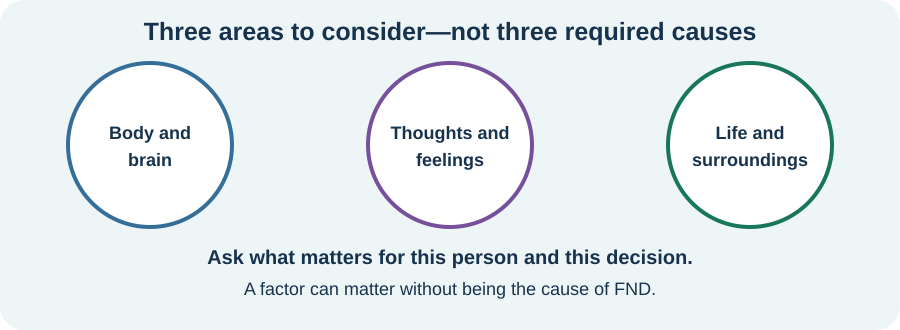
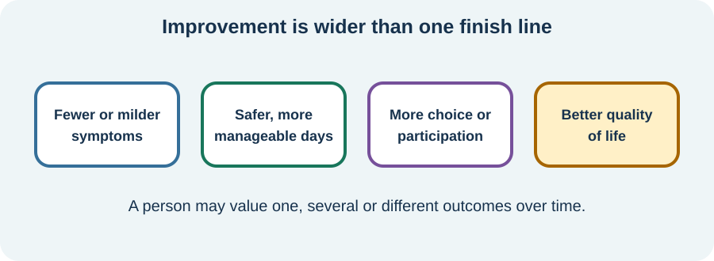

# Human-authored course source archive — Module 1

Archived October 12, 2026, before any generated replacements or course–reference–glossary audits. This editorial archive is **excluded from the published website**, but **not private** because the GitHub repository is public. Never copy these snapshots to public site routes automatically.

## Provenance and preservation

- Source repository: `FND-Education-Project/FND-Education`
- Exact base commit: `f1427f75d248e6713d124cdfc974f028cde99332`
- Original paths are specified in each section; preserve each entire Markdown file as shown, including its author notice, citations, quotations, and navigation.
- Mixed historical AI contributions or editorial amendments inside these files are not individually tagged. The archive records the whole source and must not be interpreted as claiming every sentence is human-written.
- Source snapshots preserve original relative paths, which are interpreted relative to the **original course file**, not this archive.
- For historical context, Lessons 1 and 2 originally began as human-authoring templates, not complete AI-written lessons. Lessons 3 and 4 have earlier, pre-human-revision working drafts in Git history.
- If the generated replacements are withdrawn or an author wants to resume editing, restore from these snapshots, not from a reconstructed paraphrase.

## Snapshot 1: 01-what-functional-means-and-how-fnd-can-appear.md

**Original:** `course/part-1-understanding-fnd/module-01-what-fnd-is/01-what-functional-means-and-how-fnd-can-appear.md`  
**Blob SHA:** `bb27ab62d4c57d63610fb795a1765061f3ab650c`

~~~~~~markdown
<!-- NAV-BREADCRUMB:START -->
[Home](../../../README.md) › [Course](../../README.md) › Part One: Understanding FND › [Module 1: What FND Is](README.md) › **What “Functional” Means and How FND Can Appear**
<!-- NAV-BREADCRUMB:END -->

# What “Functional” Means and How FND Can Appear

> **Working draft:** This page is human authored and is looking for [reviewers](https://fnd-education-project.github.io/FND-Education/).

This page explains what the word “functional” means, how FND can appear, how clinicians can identify it, and why the symptoms are real and involuntary.

>*"Functional disorders are conditions whose origin arises primarily from a disorder of nervous system functioning rather than clearly identifiable pathophysiological disease... It causes considerable physical disability and distress..."* - Professor Jon Stone, neurologist (BMJ 2020;371:m3745)

>*"FND is currently defined as a 'clinical syndrome with genuinely experienced neurological symptoms which are distressing or impairing, and show dysfunction of the nervous system with variability in performance within a task or between task'"* -Functional neurological disorder: Practical management. Barbara A. Dworetzky, Gaston Baslet

*Figure 1*

The word 'functional' tells us that the way the nervous system transmits information throughout the brain and body is no longer working correctly. This affects actions like movement, sensation, attention and awareness. (*citations* [2](#citation-2), [9](#citation-9)) 

*Illustration: “functional” describes how the system is working. The symptom is real, and the change is not chosen.*

> ### Quick Fact
> Functional Neurological Disorder (FND) and Functional Seizures (FS) are known by other names.
> - *PNES (Psychogenic non-epileptic seizures), Pseudoseizure, Dissociative Attack*
> - *Conversion Disorder, Functional Cognitive Disorder (a subtype), Functional Neurological Disorders (FNDs)*
> - *Functional Movement Disorder (FMD) (a subtype)*
> However, Conversion Disorder and PNES are going out of use. Also, the term 'pseudoseizures' is offensive to many sufferers. (*citations* [2](#citation-2), [4](#citation-4), [9](#citation-9))

---
[For the Person With FND](#for-the-person-with-fnd) 
[For Family, Friends, and Other Supporters](#for-family-friends-and-other-supporters) 
[For Clinicians and the Care Team](#for-clinicians-and-the-care-team) 
[Research and Sources](#research-and-sources)
---

## For the Person With FND
{: #for-the-person-with-fnd .shareable }

If you have been recently diagnosed, you might be wondering how the clinician knew your symptoms were FND. You may have had tests looking for other neurological or medical explanations, but FND should not be diagnosed only because those tests were normal. Clinicians can also look for **positive signs**—recognizable features on the history or examination that show how the nervous system is functioning differently. Education about these positive diagnostic methods is still uneven, so some people are not shown the evidence supporting their diagnosis. (*citations* [1](#citation-1)) 

> A very common question is, **"Does an FND diagnosis mean my symptoms are caused by a psychological problem?"** *No.* A psychological stressor, trauma history, or psychiatric diagnosis is not required to diagnose FND. 

Researchers have found differences in brain structure, activity or chemistry when groups of people with FND are compared with other groups. These findings are still being studied. They cannot yet diagnose FND in one person or tell us whether a difference caused FND or developed afterward. The chemistry study cited here involved young people with functional seizures; it does not speak for everyone with FND. The important thing to know is **Your symptoms ARE REAL** and they are not faked or imaginary. (*citations* [2](#citation-2), [3](#citation-3), [5](#citation-5), [6](#citation-6), [9](#citation-9))

So what does [functional](../../../glossary/README.md#functional) actually mean? In short it describes how your nervous system is processing motor and sensory information. In FND there is a problem with how our brain and nervous system interact. FND belongs to a wider family of overlapping functional disorders that can include fibromyalgia, chronic fatigue and irritable bowel syndrome. (*citations* [1](#citation-1), [3](#citation-3), [13](#citation-13)) 

***

**How did I get Functional Neurological Disorder?**
*Researchers have not identified one cause that explains every person's FND. Symptoms may begin around a physical illness or injury, migraine, fainting episode, stressful event, trauma, or with no clear preceding event at all. Something happening near the beginning can be a useful clue without proving that it caused the disorder. Later in the course we separate possible causes, risk factors, triggers, mechanisms, and things that may affect symptoms now.* (*citations* [1](#citation-1), [2](#citation-2), [7](#citation-7), [9](#citation-9)) 

**Can FND be cured? Is it permanent?**
*There is no cure for FND but many have found improvements in their condition that can be considered 'remission' of the disease. Many believe that understanding your disease is the key first step in making improvements.* (*citations* [1](#citation-1), [3](#citation-3), [8](#citation-8))

**Is there a way to diagnose FND?**
*Yes! There are specific tests and observations that a neurologist can use during an examination to identify signs of FND. Your diagnosis should never be "All your tests were normal."* (*citations* [3](#citation-3))

**How do I improve my condition?**
*This is what we hope to accomplish in this educational course. The lessons are each designed to inform you and show what you can do now at home to make positive changes in your disease.*

**What are the symptoms of FND?**
*A person can present with one or more symptoms. Some symptoms are not considered to be FND but often appear alongside FND.* (*citations* [2](#citation-2), [3](#citation-3), [9](#citation-9)) 
*Here's a list of common FND symptoms:*
- weakness in an arm or leg
- functional 'seizures'
- reduced sensation in parts of the body
- involuntary movements like tremor or jerks and spasms
- difficulty walking
- memory and concentration issues
- speech and swallowing problems
- dizziness (a type associated with FND)
- falls to the ground
- bladder or bowel symptoms can occur alongside FND, but they are not automatically functional symptoms and need their own appropriate assessment
- visual blurring, light sensitivity
- sound sensitivity
- [functional motor and vocal/phonic tic-like symptoms](../../../reference/diagnostic-signs/17-functional-tics-and-tic-like-symptoms.md) — see also the [movement and tics lesson](../../part-2-safety-and-symptoms/module-07-functional-movement-weakness-and-gait-symptoms/02-tremor-jerks-and-spasms.md)

And these are problems that are commonly experienced among sufferers but aren't necessarily part of FND (we'll talk about that later and why researchers differ in what they consider FND and what they consider "*comorbid*"): (*citations* [3](#citation-3), [9](#citation-9))
- Not feeling like quite yourself, 'spaced out'
- fatigue
- pain
- health anxiety
- irritable bowel syndrome
- headache [or migraine, though most term a long lasting migraine as 'chronic headache']
- sleep problems
- anxiety, depression, panic
- sometimes chest pain! FND has been known to mimic both stroke and epilepsy. (*citations* [3](#citation-3))

***

For an introduction to what FND is, I only want to mention that FND is very episodic. Many experience bad days, weeks, and sometimes months followed by better days where their symptoms aren't active. One of the best things you can do now besides continue your education about this very debilitating disease is to learn how to communicate with your doctors and those acting as caregivers in your life if your symptoms require that. (*citations* [9](#citation-9)) 

If you want to see how your symptoms fit into FND one of my favourite resources is [NeuroSymptoms.org](https://neurosymptoms.org/en/symptoms/). The author is one of the lead researchers of FND and they have put together a symptom tracker as well as a fairly complete list of each of the symptoms and how they are diagnosed and even a little about what you can do now about them. There are some videos as well which will let you see how others experience these symptoms.

If you haven't already asked these of the diagnosing doctor, here's a few good questions you might ask
-  “Which of my symptoms have you identified as functional?”
-  “What positive signs support that diagnosis?”
-  “What did my tests rule in or rule out?”
-  “Could another condition also be present?”

Another useful thing to do is put into your own words what FND is and how to explain to your family and friends.

>## Crosswords
>- **What is FND?** ([normal](crosswords/What-is-FND-crossword-09-2026.pdf)) ([easy](crosswords/What-is-FND-crossword-easy-09-2026.pdf)) ([answer key](crosswords/What-is-FND-crossword-answer-key-09-2026.pdf))

***
[For the Person With FND](#for-the-person-with-fnd) 
[For Family, Friends, and Other Supporters](#for-family-friends-and-other-supporters) 
[For Clinicians and the Care Team](#for-clinicians-and-the-care-team) 
[Research and Sources](#research-and-sources)
***

## For Family, Friends, and Other Supporters
{: #for-family-friends-and-other-supporters .shareable }

Functional Neurological Disorder can be very disabling and can vary greatly from person to person. Historically, these symptoms were often framed through the psychiatric diagnosis 'conversion disorder' and were assumed to require a psychological explanation. Current diagnostic practice does **not** require a psychological stressor, trauma, or psychiatric disorder, and a positive FND diagnosis should not be inferred from psychological history. (*citations* [2](#citation-2), [4](#citation-4), [9](#citation-9)) 

Support the person you are showing care to often involves assuring the person that their symptoms are real and not faked. They did not cause their disease. It's also very important to understand that not every new symptom is FND. All new symptoms should be looked at by a doctor because many serious medical issues look like an FND symptom. (*citations* [3](#citation-3), [9](#citation-9))

> - “PMD [functional movement disorder] patients reported similar Physical Health QOL [quality of life] to PD [Parkinson’s disease] patients … but worse mental health QOL [quality of life].”
> - “Patients with [functional weakness] are as disabled as patients with weakness of similar duration due to neurological disease.”
> - “Compared to epilepsy, people with psychogenic non-epileptic seizures [now usually called functional seizures] have consistently reported worse HRQoL [health-related quality of life].”

*Figure 2*

***
[For the Person With FND](#for-the-person-with-fnd) 
[For Family, Friends, and Other Supporters](#for-family-friends-and-other-supporters) 
[For Clinicians and the Care Team](#for-clinicians-and-the-care-team) 
[Research and Sources](#research-and-sources)
***

## For Clinicians and the Care Team
{: #for-clinicians-and-the-care-team .shareable }

A 2022 paper titled, ***"Functional Neurological Disorder: new subtypes and shared mechanisms"*** makes three statements worth repeating here verbatim:
1. "The pathophysiology of functional neurological disorder includes overactivity of the limbic system, the development of an **internal symptom model as part of a predictive coding framework**, and **dysfunction of brain networks that gives movement the sense of voluntariness**."
2. "A new approach to the *positive diagnosis* of this disorder **focuses on *recognisable patterns* of genuinely experienced symptoms and signs** that show variability within the same task and between different tasks over time."
3. "Psychological stressors **are common *risk factors*** for functional neurological disorder, but are often absent."
4. "Four entities—functional seizures, functional movement disorders, persistent perceptual postural dizziness, and functional cognitive disorder—show similarities in aetiology and pathophysiology and are variants of a disorder at the interface between neurology and psychiatry."

FND involves real dysfunction, but current research does not establish one cause—or a fixed set of causes—that explains every person. Psychological stress may be relevant for some people and absent in others. Importantly, diagnosis can be made using positive clinical features rather than by requiring a psychological explanation. **For a complete list of those diagnostic techniques, see our [reference](https://github.com/FND-Education-Project/FND-Education/blob/main/reference/diagnostic-signs/README.md) section.**

Here are some resources:
- **[FND Hope - Medical Professionals](https://fndhope.org/living-fnd/physicians)**
- **[neurosymptoms.org — Symptoms](https://neurosymptoms.org/en/symptoms/)** — Created by neurologist Professor Jon Stone, with contributions from other health professionals. Many symptom pages explain the positive clinical signs that clinicians may use to support a diagnosis, how the symptom may differ from similar symptoms caused by other conditions, and treatment or self-management approaches that may help.

A useful explanation should identify which symptoms have been diagnosed as functional, demonstrate the clinical features supporting that conclusion and explain what investigations have ruled in or ruled out. Patients should be told explicitly that their symptoms are real, involuntary and potentially treatable. Statements such as “all your tests were normal” or “nothing is wrong” do not adequately communicate a positive diagnosis and may reinforce distrust or diagnostic uncertainty.

> I was diagnosed just over a month ago. I met with my neurologist, who was very nice and thorough, but after he gave me the diagnosis, he told me to get into talk therapy and physical therapy. Then he wrote a website down for me to check out and that was that. There was no discussion explaining the condition and reasoning for the two therapies.
— *(Lived experience; Reddit user u/Im_not_sure_042)*
>
> "for a brief time we were increasingly scared that I had a physical brain injury and I was deteriorating rapidly. I wound up in the ER and a consulting neurologist was able to clearly track and analyze the exact patterns (and lack thereof) of my involuntary movements, she performed a series of examinations + an hour of observation, conversation, distracting me, etc. I was surprised by the diagnosis, but just the information alone that I wasn’t dying was enormously reassuring. I woke up the next day with my symptoms WAY less pronounced and disruptive... I’m extremely grateful for the information and education on FND, because the distraction and redirection techniques have been very helpful to getting me back on my feet (literally)."
— *(Lived experience; Reddit user u/mackydraw)*

This free online course is contributed to by those with lived experience in Functional Neurological Disorder [currently, the official term provided by the DSM-V-tr] with the intent of bringing as much of the current research together in one place. The content for medical practitioners is centered around ways of being helpful to your patient both in understanding what their disease is and what they can do to improve a specific symptom or to support them when a symptom is likely not going to improve. We invite you to visit this section in each page of this course while also reading the content for the patient where most of the discussion will take place. Following this section is where you'll find the research behind that content. If you disagree about how a paper was interpreted, we are always open to hearing from you.

***
[For the Person With FND](#for-the-person-with-fnd) 
[For Family, Friends, and Other Supporters](#for-family-friends-and-other-supporters) 
[For Clinicians and the Care Team](#for-clinicians-and-the-care-team) 
[Research and Sources](#research-and-sources)
***

<!-- NAV-CONTEXT:START -->
**Continue:** [Next page: The Biopsychosocial Model and Misconceptions](02-the-biopsychosocial-model-misconceptions-and-recovery.md)

**Navigate:** [Home](../../../README.md) · [Course](../../README.md) · [Reference Library](../../../reference/README.md) · [Site Map](../../../SITEMAP.md)
<!-- NAV-CONTEXT:END -->

***

## Research and Sources

### Three focused quotations

- “It causes considerable physical disability and distress.” (*citations* [1](#citation-1))
- “The diagnosis of FND [functional neurological disorder] should rest on clear positive evidence.” (*citations* [3](#citation-3))
- “Psychological stressors are important risk factors but are neither necessary nor sufficient for the diagnosis.” (*citations* [1](#citation-1))

### Citation table

| Citation | Figure | Full citation |
|---|---|---|
| **[1]** | *Figure 1* | Stone J, Burton C, Carson A. Recognising and explaining functional neurological disorder. *BMJ*. 2020;371:m3745. [FND-CIT-0043](../../../research/citation-index.md#fnd-cit-0043). [https://doi.org/10.1136/bmj.m3745](https://doi.org/10.1136/bmj.m3745) |
| **[2]** | *Figure 1* | Dworetzky BA, Baslet G. Functional neurological disorder: Practical management. *Neurotherapeutics*. 2025;22(4):e00612. [FND-CIT-0013](../../../research/citation-index.md#fnd-cit-0013). [https://doi.org/10.1016/j.neurot.2025.e00612](https://doi.org/10.1016/j.neurot.2025.e00612) |
| **[3]** | — | Bennett K, Diamond C, Hoeritzauer I, Gardiner P, McWhirter L, Carson A, Stone J. A practical review of functional neurological disorder (FND) for the general physician. *Clinical Medicine*. 2021;21(1):28–36. [FND-CIT-0001](../../../research/citation-index.md#fnd-cit-0001). [https://doi.org/10.7861/clinmed.2020-0987](https://doi.org/10.7861/clinmed.2020-0987) |
| **[4]** | — | Espay AJ, Aybek S, Carson A, et al. Current concepts in diagnosis and treatment of functional neurological disorders. *JAMA Neurology*. 2018;75(9):1132–1141. [FND-CIT-0002](../../../research/citation-index.md#fnd-cit-0002). [https://doi.org/10.1001/jamaneurol.2018.1264](https://doi.org/10.1001/jamaneurol.2018.1264) |
| **[5]** | — | Bègue I, Adams C, Stone J, Perez DL. Structural alterations in functional neurological disorder and related conditions: a software and hardware problem? *NeuroImage: Clinical*. 2019;22:101798. [FND-CIT-0004](../../../research/citation-index.md#fnd-cit-0004). [https://doi.org/10.1016/j.nicl.2019.101798](https://doi.org/10.1016/j.nicl.2019.101798) |
| **[6]** | — | Charney M, Foster S, Shukla V, et al. Neurometabolic alterations in children and adolescents with functional neurological disorder. *NeuroImage: Clinical*. 2024;41:103557. [FND-CIT-0044](../../../research/citation-index.md#fnd-cit-0044). [https://doi.org/10.1016/j.nicl.2023.103557](https://doi.org/10.1016/j.nicl.2023.103557) |
| **[7]** | — | Lidstone SC, Costa-Parke M, Robinson EJ, Ercoli T, Stone J; FMD GAP Study Group. Functional movement disorder gender, age and phenotype study: a systematic review and individual patient meta-analysis of 4905 cases. *Journal of Neurology, Neurosurgery & Psychiatry*. 2022;93(6):609–616. [FND-CIT-0045](../../../research/citation-index.md#fnd-cit-0045). [https://doi.org/10.1136/jnnp-2021-328462](https://doi.org/10.1136/jnnp-2021-328462) |
| **[8]** | — | Gelauff J, Stone J, Edwards M, Carson A. The prognosis of functional (psychogenic) motor symptoms: a systematic review. *Journal of Neurology, Neurosurgery & Psychiatry*. 2014;85(2):220–226. [FND-CIT-0007](../../../research/citation-index.md#fnd-cit-0007). [https://doi.org/10.1136/jnnp-2013-305321](https://doi.org/10.1136/jnnp-2013-305321) |
| **[9]** | — | Hallett M, Aybek S, Dworetzky BA, McWhirter L, Staab JP, Stone J. Functional neurological disorder: new subtypes and shared mechanisms. *The Lancet Neurology*. 2022;21(6):537–550. [FND-CIT-0003](../../../research/citation-index.md#fnd-cit-0003). [https://doi.org/10.1016/S1474-4422(21)00422-1](https://doi.org/10.1016/S1474-4422(21)00422-1) |
| **[10]** | *Figure 2* | Anderson KE, Gruber-Baldini AL, Vaughan CG, Reich SG, Fishman PS, Weiner WJ, Shulman LM. Impact of psychogenic movement disorders versus Parkinson’s on disability, quality of life, and psychopathology. *Movement Disorders*. 2007;22(15):2204–2209. [FND-CIT-0046](../../../research/citation-index.md#fnd-cit-0046). [https://doi.org/10.1002/mds.21687](https://doi.org/10.1002/mds.21687) |
| **[11]** | *Figure 2* | Stone J, Warlow C, Sharpe M. The symptom of functional weakness: a controlled study of 107 patients. *Brain*. 2010;133(5):1537–1551. [FND-CIT-0047](../../../research/citation-index.md#fnd-cit-0047). [https://doi.org/10.1093/brain/awq068](https://doi.org/10.1093/brain/awq068) |
| **[12]** | *Figure 2* | Jones B, Reuber M, Norman P. Correlates of health-related quality of life in adults with psychogenic nonepileptic seizures: a systematic review. *Epilepsia*. 2016;57(2):171–181. [FND-CIT-0048](../../../research/citation-index.md#fnd-cit-0048). [https://doi.org/10.1111/epi.13268](https://doi.org/10.1111/epi.13268) |
| **[13]** | — | Stone J, Coebergh J, Khoja L, et al. Migraine and functional neurological disorder (FND)—a review of comorbidity and potential overlap. *Brain Communications*. 2025;7(4):fcaf288. [FND-CIT-0049](../../../research/citation-index.md#fnd-cit-0049). [https://doi.org/10.1093/braincomms/fcaf288](https://doi.org/10.1093/braincomms/fcaf288) |

*Last reviewed: August 26, 2026*

<strong>Author accuracy review — brain-research wording updated; other suggestions pending</strong>

These notes are for the author and reviewers. They identify wording that may overstate the evidence, blur an important distinction, or be misunderstood. The suggested replacements are written in the course's direct, plain-language tone. The brain-research wording in item 2 was updated with the project lead’s authorization on September 21, 2026. Other suggested replacements have not been inserted into the lesson.

### 1. What tests can and cannot establish

**Accuracy warning:** The current passage may sound as though investigations can determine that a person has no psychological condition. Tests used in an FND assessment may look for other medical or neurological explanations, but anxiety, depression, trauma, or another psychological condition does not prove or disprove FND. FND should be diagnosed from positive clinical signs.

**Suggested wording:**

> If you have been recently diagnosed, you might still wonder whether your symptoms really are FND. You may have had tests to look for other medical or neurological conditions. Those tests do not prove that a symptom is functional, and anxiety, depression, trauma, or another psychological condition does not rule FND in or out. FND should be diagnosed from positive clinical signs. Unfortunately, some people are still given the diagnosis without those signs being clearly shown or explained.

**Item 2 status:** Group-level and causal limits now appear in the lesson; clinical review remains pending.

### 2. What “FND changes the brain” can mean

**Accuracy warning:** References [5] and [6] report differences found when groups of people with FND were compared with other groups. They do not provide an individual diagnostic test, and they do not establish whether a difference caused FND or developed afterward. Reference [6] studied young people, so it should not be presented as though it applies equally to every person with FND.

**Suggested wording:**

> Researchers have found differences in brain structure, activity, or chemistry when groups of people with FND are compared with other groups. These findings are still being studied. They cannot yet diagnose FND in one person or tell us whether a difference caused FND or developed afterward. What they do add to is research showing that FND involves real nervous-system dysfunction and that the symptoms are not faked or imaginary.

### 3. Age and the scope of the cited study

**Accuracy warning:** Reference [7] concerns functional movement disorder, not every form of FND. It can support a statement about age at onset for that symptom group, but it should not carry a broader claim about all FND by itself.

**Suggested wording:**

> FND can begin in children, adults, or older people. Age patterns differ across symptom types. The study cited here looked specifically at functional movement disorder, where onset was most common in midlife.

### 4. Chest pain, stroke-like symptoms, and functional seizures

**Accuracy warning:** The present order may make it sound as though chest pain is how FND resembles stroke or epilepsy. Chest pain also has many possible causes and should not automatically be attributed to FND.

**Suggested wording:**

> Some people with FND also report chest pain, but chest pain should not automatically be attributed to FND. FND can separately appear as stroke-like weakness or functional seizures that resemble epileptic seizures.

### 5. The number of statements

**Accuracy warning:** The introduction says that three statements follow, but the page lists four.

**Suggested wording:**

> A 2022 paper titled *Functional Neurological Disorder: new subtypes and shared mechanisms* makes four statements worth repeating here verbatim:

~~~~~~

## Snapshot 2: 02-the-biopsychosocial-model-misconceptions-and-recovery.md

**Original:** `course/part-1-understanding-fnd/module-01-what-fnd-is/02-the-biopsychosocial-model-misconceptions-and-recovery.md`  
**Blob SHA:** `8c94cd93d836dccc9127178363a1092c0bf2fa95`

~~~~~~markdown
<!-- NAV-BREADCRUMB:START -->
[Home](../../../README.md) › [Course](../../README.md) › Part One: Understanding FND › [Module 1: What FND Is](README.md) › **The Biopsychosocial Model and Misconceptions**
<!-- NAV-BREADCRUMB:END -->

# The Biopsychosocial Model and Misconceptions

> **Working draft:** This page human authored and is looking for [reviewers](https://fnd-education-project.github.io/FND-Education/).

This page explains the biopsychosocial model in simple terms, what it does and does not mean for FND, and how biological, psychological, and social factors can guide individual care and support.

---
[For the Person With FND](#for-the-person-with-fnd) 
[For Family, Friends, and Other Supporters](#for-family-friends-and-other-supporters) 
[For Clinicians and the Care Team](#for-clinicians-and-the-care-team) 
[Research and Sources](#research-and-sources)
---

## For the Person With FND
{: #for-the-person-with-fnd .shareable }
FND is a neurological disease that can be understood through a **biopsychosocial model**. *What does this mean?* (*citations* [1](#citation-1), [2](#citation-2), [3](#citation-3)) 

When we talk about the *biopsychosocial model*, it is in relation to how your **symptoms** are affected by, well, all aspects of your life and health, really. (*citations* [1](#citation-1), [3](#citation-3)) 
- **The *'bio'* part refers to your biology;** your current health issues and how your nervous system responds to things. It also includes what we talked about in module 1, that the way your brain talks to the rest of your body and nervous system is disrupted.
- **The *'psycho'* or *'psychological'* part includes thoughts, emotions, coping, and stresses past or present.** These may affect symptoms for some people, but they are not present or important in the same way for everyone. They are not required to explain or diagnose FND.
- **Finally, the *'social'* aspect of this not only includes your culture but also your access to health care and the family and social support you have.**

*Illustration: the three areas help organize an individual picture. They are not three required causes.*

Let's talk about this in a way that is more familiar: the common headache. A headache can change with many influences, such as muscle tension, illness, sleep, stress, or injury. FND symptoms can also change with different physical, psychological, or social influences, but the pattern is individual and sometimes no clear influence is found. Something that happens before a flare may be relevant without proving that it caused the FND. (*citations* [1](#citation-1), [3](#citation-3)) 

Some people notice that stress, illness, pain, poor sleep, sensory overload, activity, or another demand is followed by worse symptoms; others do not. Relaxation or meditation may help some people when they fit that person's pattern, but they are optional tools rather than evidence that stress caused the symptoms. (*citations* [1](#citation-1), [4](#citation-4))

However, FND is not a headache. In fact, quality of life can be very poor. But, both your symptoms and that quality of life can improve. (*citations* [1](#citation-1), [6](#citation-6))

### Questions
#### • How do you think building a good support group around you can improve the way you cope with your symptoms?
#### • Have you noticed any repeatable influences around symptom changes—physical, psychological, social, or none that you can identify?

### What can the person safely try at home?
If you are able and find it useful, you might write down what was happening around a symptom change. This is optional. It may help you or your clinician notice a pattern, but some changes have no identifiable trigger, and keeping records does not determine whether symptoms improve. You could use three headings—*"body and brain"*, *"thoughts and feelings"*, and *"life and surroundings"*—but leave any column blank when nothing relevant is known rather than trying to find an explanation.

Don't worry if you can't journal! Personally, my functional symptoms prevent me from remembering and I found journaling nearly impossible. Over time I have still been able to notice some patterns in my own symptoms. Your experience may be different, and not finding a pattern is useful information too.

> ## Crosswords
> - **Biopsychosocial What?** ([normal](crosswords/Biopsychosocial-What-crossword-09-2026.pdf)) ([easy](crosswords/Biopsychosocial-What-crossword-easy-09-2026.pdf)) ([answer key](crosswords/Biopsychosocial-What-crossword-answer-key-09-2026.pdf))

***
[For the Person With FND](#for-the-person-with-fnd) 
[For Family, Friends, and Other Supporters](#for-family-friends-and-other-supporters) 
[For Clinicians and the Care Team](#for-clinicians-and-the-care-team) 
[Research and Sources](#research-and-sources)
***

## For Family, Friends, and Other Supporters
{: #for-family-friends-and-other-supporters .shareable }

As described earlier on this page, the biopsychosocial model is a way to organize possible influences on health and daily life; it is not a map of three required causes. As a support person, you cannot control the person's symptoms, but you can help across all three areas: access to medical care, rehabilitation and equipment; psychological care when the person wants it for an agreed reason; and practical support with safety, personal care, transport, relationships, housing, work, or other daily needs. Good support can make life safer and more manageable without guaranteeing a change in symptoms.

If the person has trauma, anxiety, depression, or another psychological difficulty that they want help with, appropriate therapy may be valuable for that reason. It should not be presented as a requirement for FND care or as proof of what caused the neurological symptoms. I also want to express caution: many therapists have limited FND training, and some still use older explanations. In some parts of the world there are specialist FND clinics. It is probably not a good idea to push anyone with FND into therapy or a particular therapist. 

> For the first few years, it was too triggering for me to attempt therapy but later, when I was ready, it proved helpful to work with some of my past traumas. The biggest thing I got from therapy was a better attitude towards my symptoms.
— *(Lived experience)*

You are one of the sufferer's social group. You can help the person to try the various exercises that are described online and in this course and you can encourage them especially as they grieve their new disability. And, symptoms come and go and new ones appear. Helping the person to not be too anxious about their health is very helpful, but because new symptoms often look like other medical or mental problems, it's best to encourage the person to have these investigated. (*citations* [5](#citation-5))

> I also found it unhelpful when my support person's optimism was misplaced; all the many positive things they were doing for me made my life more comfortable, easier to adapt to, and made me feel safe. But, no matter what they did, FND was not going to go away. Our life had permanently changed.
— *(Lived experience)*

***
[For the Person With FND](#for-the-person-with-fnd) 
[For Family, Friends, and Other Supporters](#for-family-friends-and-other-supporters) 
[For Clinicians and the Care Team](#for-clinicians-and-the-care-team) 
[Research and Sources](#research-and-sources)
***

## For Clinicians and the Care Team
{: #for-clinicians-and-the-care-team .shareable }

In the previous article, it was shown that researchers have established that Functional Neurological Disorder sits *"at the interface between neurology and psychiatry"*. (*citations* [1](#citation-1)) 
**What is the biopsychosocial model?**
- **What it is:** The biopsychosocial model is a way of looking at how the body and brain, thoughts and emotions, and a person’s life and surroundings may affect their health and recovery.
- **What it isn’t**: It does not mean that FND is caused by thoughts, stress, trauma or mental illness. It does not replace a positive neurological diagnosis, and all three areas do not have to affect every person. (*citations* [1](#citation-1), [2](#citation-2), [3](#citation-3))

> People with functional seizures have an increased risk of premature death. In one study, among patients who died before age 50, 20% of those deaths were attributed to suicide.

*Figure 1*

The biopsychosocial model is a way of guiding individual support by looking at all the factors that influence the person's symptoms: psychological support when appropriate and assistance with education and employment are two examples. Here are some of the common comorbidities in relation to the 'biological' and 'psychological' aspects and many of the common problems facing sufferers of FND. (*citations* [1](#citation-1), [3](#citation-3), [9](#citation-9))

| Area                    | Common accompanying problems                                                                                                                                                                                                                       |
| ----------------------- | -------------------------------------------------------------------------------------------------------------------------------------------------------------------------------------------------------------------------------------------------- |
| **Biological/physical** | Fatigue; memory and concentration problems; chronic pain; migraine or headache; poor sleep; irritable bowel syndrome; fibromyalgia; complex regional pain syndrome; and sometimes another neurological condition such as epilepsy. (*citations* [6](#citation-6), [7](#citation-7)) |
| **Psychological** | Anxiety, panic disorder, depression, post-traumatic stress disorder and dissociative symptoms or disorders. These should be treated when present, but they are **not required for FND** and should not be assumed to have caused it. (*citations* [2](#citation-2), [6](#citation-6)) |
| **Social** | Loss of employment or education; financial pressure; reduced independence; isolation; strained relationships; caregiver burden; stigma; unsuitable housing or transportation; and difficulty accessing knowledgeable healthcare or rehabilitation. (*citations* [6](#citation-6), [9](#citation-9)) |

One of the key complaints on reddit among sufferers of FND is how after diagnosis they are given a link to a website and little further care is afforded them. Good communication and follow-up matter. [NeuroSymptoms.org](https://neurosymptoms.org/en/symptoms/) explains symptoms that clinicians may diagnose as functional, symptoms that often occur alongside FND, and diagnostic principles. It cannot decide whether a particular new symptom in one person is FND; that still requires appropriate medical assessment.

Symptoms not associated with FND need to be investigated both at diagnosis and during the course of the disease. (*citations* [5](#citation-5), [8](#citation-8)) 

> “When I developed bowel and urinary problems, an MRI appeared to show spinal-cord compression at T10–11, and surgery was being considered. However, the neurosurgeon examined me first and found that the examination did not match the MRI. A second MRI confirmed there was no herniation—the first image was misleading.
>
> I had previously experienced genuine bowel and bladder problems from a T6–7 disc herniation, so the new symptoms could not simply be dismissed as FND. My experience shows why new symptoms must be investigated, but also why imaging should be interpreted alongside the clinical examination before deciding on treatment.”
— *(Lived experience)*

Investigating symptoms and referring your patient to other resources including social workers is good health care. (*citations* [1](#citation-1), [9](#citation-9))

***
[For the Person With FND](#for-the-person-with-fnd) 
[For Family, Friends, and Other Supporters](#for-family-friends-and-other-supporters) 
[For Clinicians and the Care Team](#for-clinicians-and-the-care-team) 
[Research and Sources](#research-and-sources)
***

## Further reading in the Reference Library

- **[Biopsychosocial Experiences Associated with FND](../../../reference/biopsychosocial-experiences/README.md)** — cross-cutting experiences that may matter in daily life without being diagnostic signs or proof of cause.
- **[Mental Health, Stigma, and Being Believed](../../../reference/biopsychosocial-experiences/02-mental-health-stigma-and-being-believed.md)** — how FND and mental-health conditions can coexist without one automatically explaining the other.

***

<!-- NAV-CONTEXT:START -->
**Continue:** [Next page: Remission, Recovery, and What Improvement Can Mean](03-remission-recovery-and-what-improvement-can-mean.md)

**Navigate:** [Home](../../../README.md) · [Course](../../README.md) · [Reference Library](../../../reference/README.md) · [Site Map](../../../SITEMAP.md)
<!-- NAV-CONTEXT:END -->

***

## Research and Sources

### Three focused quotations

- “Psychological stressors are common risk factors for functional neurological disorder, but are often absent.” (*citations* [1](#citation-1))
- “Most respondents reported that FND had multiple causes, including physical and psychological.” (*citations* [6](#citation-6))
- “A change in seizure frequency may not translate to participation in life roles.” (*citations* [9](#citation-9))

### Citation table

| Citation | Figure | Full citation |
|---|---|---|
| **[1]** | — | Hallett M, Aybek S, Dworetzky BA, McWhirter L, Staab JP, Stone J. Functional neurological disorder: new subtypes and shared mechanisms. *The Lancet Neurology*. 2022;21(6):537–550. [FND-CIT-0003](../../../research/citation-index.md#fnd-cit-0003). [https://doi.org/10.1016/S1474-4422(21)00422-1](https://doi.org/10.1016/S1474-4422(21)00422-1) |
| **[2]** | — | Espay AJ, Aybek S, Carson A, et al. Current concepts in diagnosis and treatment of functional neurological disorders. *JAMA Neurology*. 2018;75(9):1132–1141. [FND-CIT-0002](../../../research/citation-index.md#fnd-cit-0002). [https://doi.org/10.1001/jamaneurol.2018.1264](https://doi.org/10.1001/jamaneurol.2018.1264) |
| **[3]** | — | Pick S, Goldstein LH, Perez DL, Nicholson TR. Emotional processing in functional neurological disorder: a review, biopsychosocial model and research agenda. *Journal of Neurology, Neurosurgery & Psychiatry*. 2019;90(6):704–711. [FND-CIT-0005](../../../research/citation-index.md#fnd-cit-0005). [https://doi.org/10.1136/jnnp-2018-319201](https://doi.org/10.1136/jnnp-2018-319201) |
| **[4]** | — | Dworetzky BA, Baslet G. Functional neurological disorder: Practical management. *Neurotherapeutics*. 2025;22(4):e00612. [FND-CIT-0013](../../../research/citation-index.md#fnd-cit-0013). [https://doi.org/10.1016/j.neurot.2025.e00612](https://doi.org/10.1016/j.neurot.2025.e00612) |
| **[5]** | — | Bennett K, Diamond C, Hoeritzauer I, Gardiner P, McWhirter L, Carson A, Stone J. A practical review of functional neurological disorder (FND) for the general physician. *Clinical Medicine*. 2021;21(1):28–36. [FND-CIT-0001](../../../research/citation-index.md#fnd-cit-0001). [https://doi.org/10.7861/clinmed.2020-0987](https://doi.org/10.7861/clinmed.2020-0987) |
| **[6]** | — | Butler M, Shipston-Sharman O, Seynaeve M, et al. International online survey of 1048 individuals with functional neurological disorder. *European Journal of Neurology*. 2021;28(11):3591–3602. [FND-CIT-0014](../../../research/citation-index.md#fnd-cit-0014). [https://doi.org/10.1111/ene.15018](https://doi.org/10.1111/ene.15018) |
| **[7]** | — | Steinruecke M, Mason I, Keen M, McWhirter L, Carson AJ, Stone J, Hoeritzauer I. Pain and functional neurological disorder: a systematic review and meta-analysis. *Journal of Neurology, Neurosurgery & Psychiatry*. 2024;95(9):874–885. [FND-CIT-0015](../../../research/citation-index.md#fnd-cit-0015). [https://doi.org/10.1136/jnnp-2023-332810](https://doi.org/10.1136/jnnp-2023-332810) |
| **[8]** | — | Hoeritzauer I, Pronin S, Carson A, Statham P, Demetriades AK, Stone J. The clinical features and outcome of scan-negative and scan-positive cases in suspected cauda equina syndrome: a retrospective study of 276 patients. *Journal of Neurology*. 2018;265(12):2916–2926. [FND-CIT-0016](../../../research/citation-index.md#fnd-cit-0016). [https://doi.org/10.1007/s00415-018-9078-2](https://doi.org/10.1007/s00415-018-9078-2) |
| **[9]** | — | Sekine ER, Kanaan RA, McMillan J, Oxford S, Iles RA. Biopsychosocial prognostic indicators in Functional Neurological Disorder: a systematic review. *Journal of Psychosomatic Research*. 2025;195:112201. [FND-CIT-0017](../../../research/citation-index.md#fnd-cit-0017). [https://doi.org/10.1016/j.jpsychores.2025.112201](https://doi.org/10.1016/j.jpsychores.2025.112201) |
| **[10]** | *Figure 1* | Nightscales R, McCartney L, Auvrez C, et al. Mortality in patients with psychogenic nonepileptic seizures. *Neurology*. 2020;95(6):e643–e652. [FND-CIT-0050](../../../research/citation-index.md#fnd-cit-0050). [https://doi.org/10.1212/WNL.0000000000009855](https://doi.org/10.1212/WNL.0000000000009855) |

*Last reviewed: August 26, 2026*

<strong>Author accuracy review — suggested wording not yet applied</strong>

These notes are for the author and reviewers. They identify wording that may overstate the evidence, blur an important distinction, or be misunderstood. The suggested replacements are written in the course's direct, plain-language tone. They have not been inserted into the lesson.

### Applied accuracy review — September 29, 2026

The stress, journaling, supporter-role, and NeuroSymptoms wording identified in this review has now been corrected in the reader-facing lesson. The remaining note is retained only to record that these statements were deliberately changed to avoid treating psychological factors as universal causes or requiring a trigger to be found.

~~~~~~

## Snapshot 3: 03-remission-recovery-and-what-improvement-can-mean.md

**Original:** `course/part-1-understanding-fnd/module-01-what-fnd-is/03-remission-recovery-and-what-improvement-can-mean.md`  
**Blob SHA:** `3c73d6565f05307cf971a236d0b89f7651fa694b`

~~~~~~markdown
<!-- NAV-BREADCRUMB:START -->
[Home](../../../README.md) › [Course](../../README.md) › Part One: Understanding FND › [Module 1: What FND Is](README.md) › **Remission, Recovery, and What Improvement Can Mean**
<!-- NAV-BREADCRUMB:END -->

# Remission, Recovery, and What Improvement Can Mean

> **Working draft:** This page human authored and is looking for [reviewers](https://fnd-education-project.github.io/FND-Education/).

> **"FND symptoms may recur or worsen regardless of what a person knows, tries, or has achieved. Symptom severity must never be used to judge effort, acceptance of the diagnosis, treatment participation, or personal progress."**

*Course principle*

This is a short introduction. Later modules will discuss treatment, rehabilitation, setbacks and long-term management in much more detail. Here, we only need enough information to understand what people may mean when they talk about getting better.

---
[For the Person With FND](#for-the-person-with-fnd) 
[For Family, Friends, and Other Supporters](#for-family-friends-and-other-supporters) 
[For Clinicians and the Care Team](#for-clinicians-and-the-care-team) 
[Research and Sources](#research-and-sources)
---

## For the Person With FND
{: #for-the-person-with-fnd .shareable }

One of the big questions, once, perhaps the shock of diagnosis fades, is "Can this go away?" Maybe instead of 'go away' words like remission, cure, or recovery might replace them. If we are talking about a cure, meaning, the disease functional neurological disorder is no longer present nor will ever come back, then as far as anyone currently knows, no. There is no cure. However, people do experience recovery or remission. Because the two words can be used to mean the same thing, let's give them definitions that this course will use.

For this course, **'remission'** refers to all or some of a person's symptoms disappearing for a time. Some have experienced remission for years - the likeliness often depending on a few factors especially what symptoms were disrupting their lives. (*citations* [1](#citation-1), [2](#citation-2), [5](#citation-5), [6](#citation-6))

Recovery has a few meanings. For instance, I might say, 'After a functional seizure I need a few days of recovery.' In that sense, recovery means bringing myself into a more stable state, where my symptoms are less triggered and that my energy or ability to cope returns. (*citations* [2](#citation-2), [3](#citation-3))

> Recovery does not have to mean that every symptom has disappeared.

*Illustration: improvement can take more than one form. A person may value different outcomes at different times.*

A key thing to take away in this section is that FND symptoms can grow worse or go away for a time. (*citations* [1](#citation-1), [2](#citation-2), [5](#citation-5)) A return of symptoms does not mean failure; it's just the progress of the disease. 

### Questions

#### If one part of your health or daily life improved, which change would matter most to you?

#### What would recovery mean to you if some symptoms remained?

### What can you safely try at home?

Choose one small sign of improvement that would matter in your life. It might be a symptom change, but it could also be recovering more quickly after an episode, preparing part of a meal, enjoying time with someone, asking for help more clearly, or doing an activity with less fear. Write down one sentence if it's useful. (*citations* [3](#citation-3))

> ## Crosswords
> - **Recovery** ([normal](crosswords/Recovery-crossword-09-2026.pdf)) ([easy](crosswords/Recovery-crossword-easy-09-2026.pdf)) ([answer key](crosswords/Recovery-crossword-answer-key-09-2026.pdf))

***
[For the Person With FND](#for-the-person-with-fnd) 
[For Family, Friends, and Other Supporters](#for-family-friends-and-other-supporters) 
[For Clinicians and the Care Team](#for-clinicians-and-the-care-team) 
[Research and Sources](#research-and-sources)
***

## For Family, Friends, and Other Supporters
{: #for-family-friends-and-other-supporters .shareable }

Thank you for supporting someone's recovery process. It's important for both you and the sufferer to have a clear goal in mind with steps along the way of what recovery looks like. When a person has many symptoms at once, what recovery looks like can range from adapting to their most disabling symptom to just getting stable after the trauma of diagnosis. (*citations* [2](#citation-2), [3](#citation-3))

What is important to many sufferers of FND is holding some independence, comfort, feeling safe, and keeping or gaining relationships. (*citations* [2](#citation-2), [3](#citation-3)) In fact, making life safer and more accessible may do a lot to lower the intensity of their symptoms. It's also important to help them access mobility equipment.

> When functional neurological disorder was less understood, it was felt that providing mobility aids could *"prevent the return of normal movement". Recently, the guidance is that mobility aids are **"reasonable and appropriate"** when they improve safety, independence, and access to the community.

*Figure 1*

If symptoms return or don't respond to a treatment, help the person notice what they have learned and what still works. Recovery may include becoming better prepared for difficult periods, adapting, and it can't be about preventing every symptom. (*citations* [2](#citation-2), [3](#citation-3))

***
[For the Person With FND](#for-the-person-with-fnd) 
[For Family, Friends, and Other Supporters](#for-family-friends-and-other-supporters) 
[For Clinicians and the Care Team](#for-clinicians-and-the-care-team) 
[Research and Sources](#research-and-sources)
***

## For Clinicians and the Care Team
{: #for-clinicians-and-the-care-team .shareable }

You are an essential part of recovery. The question is, what does recovery look like for your patient? Let's define key terms.
**Symptom Remission.** Some or all of the patient's symptoms are absent for a period of time.

**Symptom Improvement.** This refers to symptoms becoming less frequent, severe or prolonged. 

**Functional Improvement.** The person can do more, participate more or be more independent despite continuing symptoms. 

**Personal Recovery.** Rather than be about their symptoms, recovery speaks more to their quality of life; their personal confidence, their relationships and purpose or identity and safety.

**Recovery after an episode.** This is the shorter process (hours to days, sometimes longer) of returning to the person's usual level after flare of symptoms or a functional seizure. (*citations* [2](#citation-2), [3](#citation-3))

Although many of these outcomes overlap, they are not interchangeable. Research supports making the patient's experience central while also considering symptoms, daily activities, mental health and quality of life. (*citations* [3](#citation-3))

A useful prognosis conversation sounds like:

“Improvement is possible, but we can't predict exactly how much, how quickly, or how permanently you'll improve. Some people experience complete or long-lasting remission. Others improve partly, fluctuate, or continue to need substantial support." And at a later time, perhaps, "Let's decide what improvement would look like for you and review it together.” (*citations* [1](#citation-1), [5](#citation-5), [6](#citation-6))

This avoids two damaging extremes:
- “You will recover if you accept the diagnosis and work hard.”
- “You have had this too long, so nothing will help.”

(*citations* [5](#citation-5), [6](#citation-6))

> A psychologist reviewing my case in behalf of an insurer wrote, "The longer conversion symptoms are present, the worse the prognosis"
> Later, a neuropsychiatrist assigned to assess how FND had affected me wrote, "Functional barriers ..., in combination with poor prognosis owing to the duration of symptoms (and) history of trauma.

— *(Lived experience)*

Clinicians should explain the intent of a particular referral. On this site, there is a reference guide on treatments for specific symptoms, our [reference](https://github.com/FND-Education-Project/FND-Education/blob/main/reference/recovery-techniques/README.md) page contains a complete index of techniques. These can help to determine which treatment may be best. (*citations* [7](#citation-7))

> ***Recovery is not one binary verdict. The clinician’s responsibility is to define outcomes with the patient, communicate uncertainty honestly, match care to what matters, and continue helping even when symptoms persist.***

***
[For the Person With FND](#for-the-person-with-fnd) 
[For Family, Friends, and Other Supporters](#for-family-friends-and-other-supporters) 
[For Clinicians and the Care Team](#for-clinicians-and-the-care-team) 
[Research and Sources](#research-and-sources)
***

## Further reading in the Reference Library

- **[Recovery Pressure, Self-Blame, and Feeling Like You Are Failing](../../../reference/biopsychosocial-experiences/06-recovery-pressure-self-blame-and-feeling-like-you-are-failing.md)** — setbacks, treatment non-response, adaptation and why recovery is not a test of effort or worth.

***

<!-- NAV-CONTEXT:START -->
**Continue:** [Next page: Available Capacity, Spoons, and Early Action](04-available-capacity-spoons-and-early-action.md)

**Navigate:** [Home](../../../README.md) · [Course](../../README.md) · [Reference Library](../../../reference/README.md) · [Site Map](../../../SITEMAP.md)
<!-- NAV-CONTEXT:END -->

***

## Research and Sources

### Three focused quotations

- “Reported symptom outcome was highly variable.” (*citations* [1](#citation-1))
- “recovery often follows a pattern of symptom remission and exacerbation.” (*citations* [2](#citation-2))
- “all believed that the patient’s subjective experience should be central.” (*citations* [3](#citation-3))

### Citation table

| Citation | Figure | Full citation |
|---|---|---|
| **[1]** | — | Gelauff J, Stone J, Edwards M, Carson A. The prognosis of functional (psychogenic) motor symptoms: a systematic review. *Journal of Neurology, Neurosurgery & Psychiatry*. 2014;85(2):220–226. [FND-CIT-0007](../../../research/citation-index.md#fnd-cit-0007). [https://doi.org/10.1136/jnnp-2013-305321](https://doi.org/10.1136/jnnp-2013-305321) |
| **[2]** | *Figure 1* | Nicholson C, Edwards MJ, Carson AJ, et al. Occupational therapy consensus recommendations for functional neurological disorder. *Journal of Neurology, Neurosurgery & Psychiatry*. 2020;91(10):1037–1045. [FND-CIT-0011](../../../research/citation-index.md#fnd-cit-0011). [https://doi.org/10.1136/jnnp-2019-322281](https://doi.org/10.1136/jnnp-2019-322281) |
| **[3]** | — | Rutten S, Bradley-Westguard A, Nicholson TR, et al. Outcome measurement in functional neurological disorder: a qualitative study on the views of patients, caregivers and healthcare professionals. *Journal of Neurology*. 2025;272:189. [FND-CIT-0012](../../../research/citation-index.md#fnd-cit-0012). [https://doi.org/10.1007/s00415-025-12912-9](https://doi.org/10.1007/s00415-025-12912-9) |
| **[4]** | *Figure 1* | Nielsen G, Stone J, Matthews A, et al. Physiotherapy for functional motor disorders: a consensus recommendation. *Journal of Neurology, Neurosurgery & Psychiatry*. 2015;86(10):1113–1119. [FND-CIT-0028](../../../research/citation-index.md#fnd-cit-0028). [https://doi.org/10.1136/jnnp-2014-309255](https://doi.org/10.1136/jnnp-2014-309255) |
| **[5]** | — | Sekine ER, Kanaan RA, McMillan J, Oxford S, Iles RA. Biopsychosocial prognostic indicators in Functional Neurological Disorder: a systematic review. *Journal of Psychosomatic Research*. 2025;195:112201. [FND-CIT-0017](../../../research/citation-index.md#fnd-cit-0017). [https://doi.org/10.1016/j.jpsychores.2025.112201](https://doi.org/10.1016/j.jpsychores.2025.112201) |
| **[6]** | — | Thomas ST, Thomas ET, Schembri E, Lehn AC, Palmer DDG. Treatment outcomes in functional neurological disorder: a systematic review and meta-analysis exploring the influence of symptom chronicity. *BMJ Neurology Open*. 2025;7:e001150. [FND-CIT-0051](../../../research/citation-index.md#fnd-cit-0051). [https://doi.org/10.1136/bmjno-2025-001150](https://doi.org/10.1136/bmjno-2025-001150) |
| **[7]** | — | Dworetzky BA, Baslet G. Functional neurological disorder: Practical management. *Neurotherapeutics*. 2025;22(4):e00612. [FND-CIT-0013](../../../research/citation-index.md#fnd-cit-0013). [https://doi.org/10.1016/j.neurot.2025.e00612](https://doi.org/10.1016/j.neurot.2025.e00612) |

This page is a brief introduction. Detailed discussion of rehabilitation, pacing, psychological treatment, setbacks and progress belongs in the later course modules.

*Last reviewed: August 26, 2026*

<strong>Author accuracy review — suggested wording not yet applied</strong>

These notes are for the author and reviewers. They identify wording that may overstate the evidence, blur an important distinction, or be misunderstood. The suggested replacements are written in the course's direct, plain-language tone. They have not been inserted into the lesson.

### 1. Remission and what research can predict

**Accuracy warning:** The current wording may imply that symptom type can reliably predict one person's chance of remission. References [1], [2], [5], and [6] show that outcomes vary, but they do not support a dependable individual prediction from symptom type alone.

**Suggested wording:**

> For this course, remission means that some or all of a person's symptoms disappear for a time. Some people experience remission lasting months or years. Outcomes vary widely, and current research cannot reliably predict one person's course from symptom type alone.

### 2. Recurrence is not “progress of the disease”

**Accuracy warning:** Describing recurrent symptoms as the progress of the disease may wrongly suggest that FND is necessarily progressive. A change in symptoms also says nothing about the person's effort, knowledge, acceptance, treatment participation, or progress in life.

**Suggested wording:**

> FND symptoms can become worse, improve, disappear for a time, or return. A return of symptoms does not show that the disease is progressing. It also tells us nothing about what the person knows, tried, accepted, or achieved.

### 3. Accessibility does not need to lower symptom intensity to matter

**Accuracy warning:** The current wording may overstate accessibility as a way to reduce symptoms. Safety, accessibility, and support have value whether symptoms change or not. They can reduce harm and make life more manageable without placing responsibility for symptom control on the person.

**Suggested wording:**

> What is important to many sufferers of FND is keeping some independence, comfort, safety, and relationships. Making life safer and more accessible is worthwhile whether or not symptoms change. It can reduce injury, exhaustion, isolation, and the amount of help a person needs.

### 4. Definitions for clinicians

**Accuracy warning:** The current definitions of symptom improvement and recovery after an episode need clearer grammar and a firmer separation. Symptom improvement describes a change in symptoms. Recovery after an episode describes returning to the person's usual level after a flare or functional seizure.

**Suggested wording:**

> **Symptom improvement.** This means that one or more symptoms become less frequent, less severe, or shorter.
>
> **Recovery after an episode.** This is the shorter process—hours to days, sometimes longer—of returning to the person's usual level after a flare of symptoms or a functional seizure.

### 5. What the reference guide can decide

**Accuracy warning:** The reference guide can organize treatment options, evidence limits, and safety notes. It cannot determine which treatment is best for an individual. That requires discussion of the person's symptoms, needs, preferences, access, other conditions, and goals.

**Suggested wording:**

> Clinicians should explain what a referral is meant to help with. Our reference guide lists approaches organized by symptom, together with their evidence limits and safety notes. It can help a patient and clinician identify options to discuss, but it cannot determine which treatment is best for one person.

### 6. Quotations from insurer reports

**Accuracy warning:** “In behalf” should be “on behalf.” More importantly, language presented inside quotation marks must match the original report exactly. The second quotation is currently incomplete and its ellipsis and added wording are unclear.

**Suggested wording:**

> A psychologist reviewing my case on behalf of an insurer wrote: “The longer conversion symptoms are present, the worse the prognosis.”
>
> Later, a neuropsychiatrist assigned to assess how FND had affected me wrote: “[exact wording from the report].”

Before replacing the second quotation, copy it exactly from the report. Use an ellipsis for omitted words and square brackets only when a word has been changed or added for clarity.

~~~~~~

## Snapshot 4: 04-available-capacity-spoons-and-early-action.md

**Original:** `course/part-1-understanding-fnd/module-01-what-fnd-is/04-available-capacity-spoons-and-early-action.md`  
**Blob SHA:** `ede644b55e0f8280ea88c058ce9331cf35561149`

~~~~~~markdown
<!-- NAV-BREADCRUMB:START -->
[Home](../../../README.md) › [Course](../../README.md) › Part One: Understanding FND › [Module 1: What FND Is](README.md) › **Available Capacity, Spoons, and Early Action**
<!-- NAV-BREADCRUMB:END -->

# Available Capacity, Spoons, and Early Action

> **Working draft:** This page is human-authored and is now looking for [reviewers](https://fnd-education-project.github.io/FND-Education/).

FND can affect movement, sensation, episodes, speech, thinking and many other functions. Whatever a person's symptom pattern, daily life still places demands on the body and mind. Learning to notice changing capacity can help a person adjust those demands. 

---
[For the Person With FND](#for-the-person-with-fnd) 
[For Family, Friends, and Other Supporters](#for-family-friends-and-other-supporters) 
[For Clinicians and the Care Team](#for-clinicians-and-the-care-team) 
[Research and Sources](#research-and-sources)
---

## For the Person With FND
{: #for-the-person-with-fnd .shareable }

### What does “available capacity” mean?

**Available capacity** is the usable physical, thinking, sensory, emotional, social and upright-activity capacity you have at a particular time. It includes what you can do now and the recovery cost that may follow.

> **Available capacity is what you can use right now—not what you should be able to do, and not a measure of effort or worth.**

A lot of people might think of capacity as 'available energy' but it's more than that. A tired brain feels different than a tired body and available capacity describes both together, in a way. Not everyone experiences FND quite the same way, and your available capacity is one of those ways. For those who notice drastic changes in their available capacity, or as some call it, changes in your available 'spoons', it is often related to the onset of symptoms or a worsening of symptoms. 

> ### What are “spoons”?
>
> Christine Miserandino introduced **Spoon Theory** in 2003 to describe living with lupus. She used a limited number of spoons to represent the usable capacity needed for ordinary tasks. The metaphor spread through chronic-illness and disability communities because it gives people short phrases such as “I am low on spoons” or “it'll take more spoons than I have.” (*citations* [1](#citation-1))
>
> This course uses **available capacity** when a term needs to include more than fatigue alone.

Available capacity changes everyday and throughout the day and is affected by your entire 'biopsychosocial' life such as social demands, pain, sleep, what you eat and drink, or that moment's sensory input (like a bright light or sharp sound).

> "I can usually talk to someone for fifteen or twenty minutes before I become too tired. And, if two people are talking over each other or there's more than one conversation happening I might not last thirty seconds!"

Functional Seizures often take a lot of available capacity; recovery may take days. And that tells us something else about our available capacity: it can be 're-fuelled', so to speak. 

A task can be possible but still cost too much. For example, you may be able to attend an appointment but have little capacity left to travel home, prepare food or manage symptoms afterwards. 

> "I learned that I only had enough capacity to do a certain amount of tasks in a day and those tasks had to include getting dressed, showering and even eating. All of these things lowered how much available capacity I had left"

### What can low capacity look like?

It is unique to each individual, but a person's familiar pattern may include:

- an ordinary task takes more concentration, effort, time, equipment or help;
- reduced ability to stand, walk, converse, make decisions;
- less tolerance for light, sound or busy surroundings;
- familiar warning symptoms appearing earlier or becoming harder to settle;
- less reserve for an unexpected delay, interruption or more tasks;
- a need for longer recovery after an activity; or
- symptoms becoming more frequent, intense or widespread.

Because available capacity can be affected by so many things, don't beat yourself up thinking you failed to do something to prevent it. Adapting to your new capacity is challenging and is ongoing with your changing disease. Something that would have been fine a week ago might not be today. And the reverse is true: Something you couldn't do a few months ago may be something you can try now. And sometimes it feels like low capcity equals a flare of symptoms or a functional seizure for those who have that symptom, but it isn't, every time. As you'll learn, there are things that might help!

More details can be found in [Module 15: Pacing, Activity, and the Boom-and-Bust Cycle](../../part-4-treatment-and-rehabilitation/module-15-pacing-activity-and-the-boom-and-bust-cycle/README.md).

### What can you safely try at home?

If you haven't already, begin to notice when your available capacity goes lower.

- **What changes did you notice?** Try to write just one down.
- **What part of the activity or time of day did I notice?** 

As you learn to adapt to your available capacity, see if you can also 'recover' from lower capacity throughout the day. 

### Questions

#### When your available capacity begins to narrow, what changes do you usually notice first?

#### What afre some of the things you do when that happens?

***
[For the Person With FND](#for-the-person-with-fnd) 
[For Family, Friends, and Other Supporters](#for-family-friends-and-other-supporters) 
[For Clinicians and the Care Team](#for-clinicians-and-the-care-team) 
[Research and Sources](#research-and-sources)
***

## For Family, Friends, and Other Supporters
{: #for-family-friends-and-other-supporters .shareable }

What available capacity looks like to those around the FND sufferer can sometimes seem contrived. "Today they seem to be managing that walk without difficulty; yesterday they couldn't even go out. What was different?" Or, "they walk all day inside, but as soon as they are outside and around people, it's like their anxiety takes over and they can't walk anymore." 

But as you begin to understand the factors that affect the available capacity and that tasks have costs - even delayed costs to that available capacity you begin to also understand that the person's quality of life and independence is far more important than our managing their activities. So, what is it good for a caregiver to do?

Since we're talking about helping to ensure some form of independence, then the best first step might be to talk to the person you are helping to support.

***Useful questions might be:***

- **“What kinds of things cost their available capacity the most right now?”** The phrase, *'right now'* because that can change day to day or even hour by hour.
- **“Would it help if I changed the setting, took one step of the task or moved something around?”** Adapting is a good way to allow for freedom within the limitations they face.
- **“Do you want quiet, practical help, company or space?”** These are key questions! And, to re-emphasize a point already made, the answer to this question changes hourly sometimes. Unfortunately, answering, 'space' and 'quiet' also has the undesired effect of the sufferer being left in a lonely state where friends and family begin to distance themselves.

As an FND sufferer, myself, I'm conflicted on this next point. The advice is to not 'police the person's spoons', 'require them to justify the cost of every activity' nor say that 'a flare proves they spent capacity badly.' On the other hand, my caregiver let me know when she noticed something about me like that I was losing my speech or walking less automatically and these observations have been very helpful in learning the cues of when symptoms were getting more severe.

It was also helpful, mainly because one of my FND symptoms is a loss of a particular kind of memory, that she reminded me before I began a project I had in mind that I might want to reserve spoons for company that was coming later or that I had a functional seizure the day before. However, she reminded me and didn't tell me I couldn't. I felt like I was given choice and I definitely chose incorrectly at times and it cost me - and unfortunately, my caregiver as well in their energy and time. I think as long as the principles here are kept in mind, then a balance can be found between you and the person you are caring for.

Learn the person's safety plan before a severe event or use the reference section to come up with one. During worsening of their symptoms, help reduce immediate risks like falls or other hazards and follow their safety plan rather than debating the cause or urging the person to push through.

***
[For the Person With FND](#for-the-person-with-fnd) 
[For Family, Friends, and Other Supporters](#for-family-friends-and-other-supporters) 
[For Clinicians and the Care Team](#for-clinicians-and-the-care-team) 
[Research and Sources](#research-and-sources)
***

## For Clinicians and the Care Team
{: #for-clinicians-and-the-care-team .shareable }

Use **available capacity** as patient-centred descriptive language, not as a physiological conclusion. Ask what the person can do, what it costs during and afterwards, which domains add load, what changes first and which adjustments are useful. A clinic performance, step count, heart-rate-variability value or “spoon number” is not a complete measure of sustainable capacity.

Assessment may need to distinguish:

- FND symptoms and the effort involved in managing them;
- fatigue, fatigability and deconditioning;
- immediate symptom provocation from delayed or prolonged post-exertional worsening;
- pain, migraine, sleep disorder, medication effects, orthostatic intolerance and systemic illness; and
- a familiar flare from a new neurological or medical change.

The occupational-therapy consensus for FND includes activity-based rehabilitation, fatigue and pain management, pacing, use of activity diaries and relapse planning. This is professional consensus, not proof that one pacing formula prevents FND flares. Plans should be individualized and should not automatically import a fixed-increment exercise program. (*citations* [2](#citation-2))

Co-produce a brief plan that names the person's early signs, the first change in demands, safety-critical stop points, supporter roles and when reassessment is needed. Where post-exertional malaise or a coexisting condition is suspected, assess it on its own terms before recommending progression. Continue to support access and participation when capacity remains low; successful care is not limited to increasing activity.

***
[For the Person With FND](#for-the-person-with-fnd) 
[For Family, Friends, and Other Supporters](#for-family-friends-and-other-supporters) 
[For Clinicians and the Care Team](#for-clinicians-and-the-care-team) 
[Research and Sources](#research-and-sources)
***

## Further reading in the Reference Library

- **[Emotional Regulation, Irritability, and Overwhelm](../../../reference/biopsychosocial-experiences/01-emotional-regulation-irritability-and-overwhelm.md)** — how reduced capacity can interact with strong emotions, communication and boundaries.
- **[Unpredictability, Overload, and Trusting Your Body](../../../reference/biopsychosocial-experiences/05-unpredictability-overload-and-trusting-your-body.md)** — combined physical, sensory, cognitive and social load, planning and uncertainty.

***

<!-- NAV-CONTEXT:START -->
**Continue:** [Next module: How Is FND Diagnosed?](../module-02-how-fnd-is-diagnosed/README.md)

**Navigate:** [Home](../../../README.md) · [Course](../../README.md) · [Reference Library](../../../reference/README.md) · [Site Map](../../../SITEMAP.md)
<!-- NAV-CONTEXT:END -->

***

## Research and Sources

### What the evidence can and cannot support

- **Community language:** Spoon Theory is a lived-experience metaphor that began with lupus. Its value is communicative; it is not a clinical scale or FND mechanism. (*citation* [1](#citation-1))
- **FND practice:** Occupational-therapy consensus supports individualized activity planning, pacing and relapse management within broader FND care. Consensus cannot show that low capacity causes every flare or that early action will always prevent one. (*citation* [2](#citation-2))
- **Evidence borrowed from ME/CFS:** Energy Envelope Theory proposes matching expended energy to perceived available energy. A 2008 study reported associations with functioning in people with ME/CFS, but the design did not validate the model for FND. A later scoping review found heterogeneous and methodologically limited pacing evidence in ME/CFS. (*citations* [3](#citation-3), [4](#citation-4))
- **Autonomic physiology:** Sympathetic and parasympathetic influences may oppose each other, change independently or be active together. A systematic review found heterogeneous group-level autonomic findings in FND. Neither source supplies an individual capacity meter. (*citations* [5](#citation-5), [6](#citation-6))

The research does not currently establish one biological quantity called available capacity, a validated spoon count, an FND-specific energy envelope or a reliable way to predict every flare. The practical plan on this page is therefore a low-burden way to notice patterns and change modifiable demands, not a diagnostic or treatment claim.

### Citation table

| Citation | Full citation |
|---|---|
| **[1]** | Miserandino C. The Spoon Theory. *But You Don’t Look Sick*. 2003. Accessed September 2, 2026. [FND-CIT-0062](../../../research/citation-index.md#fnd-cit-0062). [https://butyoudontlooksick.com/articles/written-by-christine/the-spoon-theory/](https://butyoudontlooksick.com/articles/written-by-christine/the-spoon-theory/) |
| **[2]** | Nicholson C, Edwards MJ, Carson AJ, et al. Occupational therapy consensus recommendations for functional neurological disorder. *Journal of Neurology, Neurosurgery & Psychiatry*. 2020;91(10):1037–1045. [FND-CIT-0011](../../../research/citation-index.md#fnd-cit-0011). [https://doi.org/10.1136/jnnp-2019-322281](https://doi.org/10.1136/jnnp-2019-322281) |
| **[3]** | Jason LA, Muldowney K, Torres-Harding S. The Energy Envelope Theory and myalgic encephalomyelitis/chronic fatigue syndrome. *AAOHN Journal*. 2008;56(5):189–195. [FND-CIT-0065](../../../research/citation-index.md#fnd-cit-0065). [https://doi.org/10.3928/08910162-20080501-06](https://doi.org/10.3928/08910162-20080501-06) |
| **[4]** | Sanal-Hayes NEM, McLaughlin M, Hayes LD, et al. A scoping review of “pacing” for management of myalgic encephalomyelitis/chronic fatigue syndrome (ME/CFS): lessons learned for the long COVID pandemic. *Journal of Translational Medicine*. 2023;21:720. [FND-CIT-0066](../../../research/citation-index.md#fnd-cit-0066). [https://doi.org/10.1186/s12967-023-04587-5](https://doi.org/10.1186/s12967-023-04587-5) |
| **[5]** | Berntson GG, Cacioppo JT, Quigley KS. Autonomic determinism: the modes of autonomic control, the doctrine of autonomic space, and the laws of autonomic constraint. *Psychological Review*. 1991;98(4):459–487. [FND-CIT-0063](../../../research/citation-index.md#fnd-cit-0063). [https://doi.org/10.1037/0033-295X.98.4.459](https://doi.org/10.1037/0033-295X.98.4.459) |
| **[6]** | Paredes-Echeverri S, Maggio J, Bègue I, et al. Autonomic, endocrine, and inflammation profiles in functional neurological disorder: a systematic review and meta-analysis. *Journal of Neuropsychiatry and Clinical Neurosciences*. 2022;34(1):30–43. [FND-CIT-0064](../../../research/citation-index.md#fnd-cit-0064). [https://doi.org/10.1176/appi.neuropsych.21010025](https://doi.org/10.1176/appi.neuropsych.21010025) |

*Last evidence and terminology review: September 2, 2026*
~~~~~~

